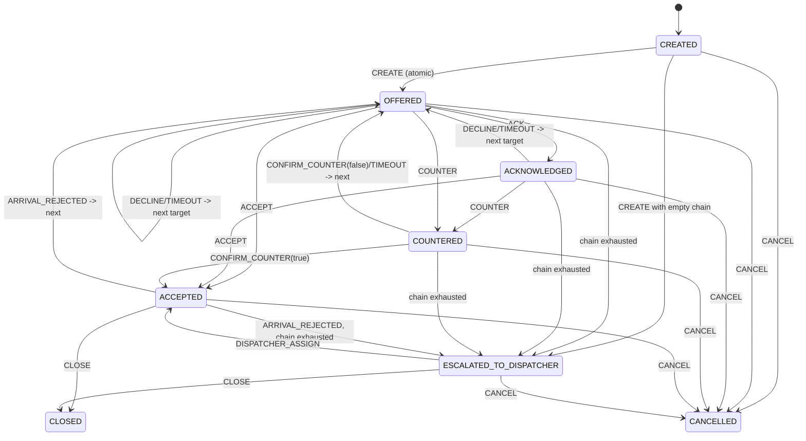
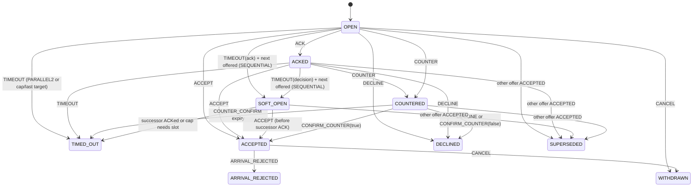
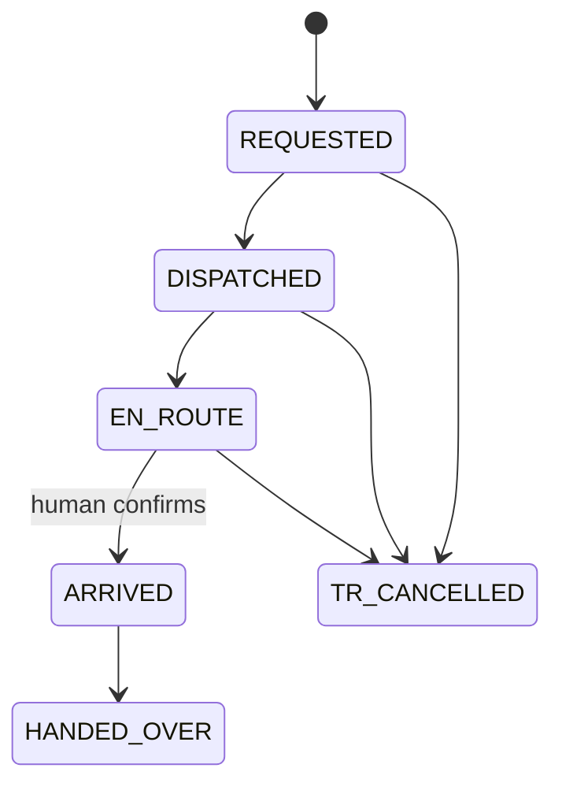

# ReferralHandshake_FINAL_LOCKED_Architecture.md

## 0. Header, Scope, Input Precedence, Tag Legend & System Diagram

**System:** Referral Handshake Protocol RHP-1 plus reference platform. **Team:** MAHA YODHAS. **Event:** Colossus 3.0, 13–14 Nov 2026, Bengaluru, 24-hour build, 2 students, 5-minute pitch with a live demo of at least 30 s [V]. **Data:** synthetic only (`REAL_DATA=0`). **Pathway:** emergency obstetric referral, Karnataka-style tiers; the data model is generic (neonatal, trauma, cardiac, stroke).

**Input precedence:** Problem Statement v7 > research tagged [V] > Solution v8 > Architecture v5 > this document's own wording. This document resolves every "or" left open in v8 and v5.
**Tags:** `[V]` verified primary · `[V*]` secondary/vendor · `[CONFLICT]` sources disagree · `[GAP]` no reliable fact, parameterised · `[verify]` pre-event test (§21).
**Status tags for weaknesses:** CLOSED (mechanism + named test) · BOUNDED (stated technical residual + monitor alarm) · OPEN (owner + closing evidence).
**Coherence rule:** every component is (a) a state/event in the contract, (b) an interface producing or consuming those events, or (c) a read-only projection of the committed event log.
**Table-count note:** the F4 brief says 22 tables but lists 24 names. All 24 are locked (§7).

```
 PRODUCERS/CONSUMERS (interfaces)                CORE (contract)                        READERS (projections of log)
 ┌──────────────────────────────┐   ┌──────────────────────────────────────┐   ┌─────────────────────────────────┐
 │ PWA desks (QR join, SSE)     │   │ FastAPI  apply_command()  10 steps   │   │ Python Monitor (own transitions)│
 │ Android EMT app (Kotlin)     │──▶│ lock order referral>offer>deadline>  │──▶│ Witness/signer (separate OS user)│
 │ Exotel IVR (outbound voice)  │   │   outbox ; idempotency ; fencing     │   │ Browser verifier (pure JS)      │
 │ DLT SMS (static alert+link)  │   │ PostgreSQL 16 primary, sync commit   │   │ Command centre, XES, FHIR export│
 │ Paper code (Crockford+mod37) │   │ Poller (2-phase) · Outbox relay      │   │ Big screen / Guarantee Arena    │
 │ Dispatcher console (proxy)   │   └──────────────────────────────────────┘   └─────────────────────────────────┘
 └──────────────────────────────┘
```

| Layer | Locked choice |
|---|---|
| DB | PostgreSQL 16, single writable primary, `synchronous_commit=on`, `READ COMMITTED` + explicit `SELECT … FOR UPDATE` |
| API | Python 3.12, FastAPI, psycopg3, Pydantic `extra='forbid'` |
| Web | React PWA; SSE with `Last-Event-ID`, 15 s heartbeats; pure-JS `@noble/curves/ed25519`, `@noble/hashes/sha256`, RFC 8785 JCS (integers, strings, booleans only; floats prohibited) |
| Mobile | Kotlin Android production design (foreground service type `location`, `FusedLocationProviderClient`, Room outbox, empty-payload FCM wake); PWA ambulance fallback for the demo |
| Voice/SMS | Exotel outbound IVR (trial: ≤10 whitelisted numbers; webhook must return HTTP 200 within 5 s [V]); DLT SMS |
| Maps | Mapbox Directions + `mapbox/driving` Matrix (25 coords, 60 req/min; `driving-traffic` 10 coords, 30 req/min [V]) |
| Proof | Quint spec (Person A), Python monitor (Person B), Toxiproxy, asyncio barrier tests |
| Banned | blockchain, Kafka, Redis, Kubernetes, WhatsApp, on-device LLM, CRDT for authoritative state |

---

## 1. Delta vs v4/v5 (F1–F20 Closure Table)

| Fix | Defect in v4/v5 | Exact mechanism in this document | § | Test |
|---|---|---|---|---|
| F1 | Poller held deadline locks across commands; v5 self-contradicted | Total lock order referral>offer>deadline>outbox; poller phase 1 is a single committed claim statement, phase 2 calls `apply_command` which locks referral first; DB trigger `rhp_require_lock` enforces I14 | 5, 7 | T-F1 `lock_order_200way` (deadlock delta = 0) |
| F2 | Notice ladder raced offer ACK | Rungs at 0, A/4, 3A/4 inside the ack window A; 4 signed profiles; demo profiles refuse boot if `REAL_DATA=1` | 6 | T-F2 `profile_guard` |
| F3 | v5 T_max double-counted slots and was unbounded in config | Slots notified concurrently; T_max = F·(A+D+ε); startup refusal if > B (I13); worked arithmetic | 6 | T-F3 `tmax_validator` |
| F4 | v5 DDL incomplete | Complete 24-table DDL, `one_lease`, FKs, CHECKs, append-only triggers | 7 | T-F4 `ddl_load_fk_scan` |
| F5 | Arrival ambiguity | Six arrival cases; geofence emits `ARRIVAL_SUGGESTED` only | 4 | T-F5 `arrival_cases` |
| F6 | Closure holes | Reachability & Exit table; 9 outcomes; two-stage CLOSURE deadline | 4 | T-F6 `reachability_bfs` |
| F7 | Lockout-DoS, voicemail ACK | Single-use ticket → device key → opaque session; Argon2id in autonomous txn; lockout per session/call_sid; AMD + press-1 gate | 8, 9 | T-F7 `pin_lockout_scope` |
| F8 | Witness/restore gaps | Separate-OS-user Ed25519 signer; Merkle inclusion proofs; cold-key `RESTORE` | 11 | T-F8 `tamper_vs_restore` |
| F9 | Free-text `event.detail` | Per-type key allowlist, Pydantic + PG CHECK, 4 h buckets, k≥5 | 7, 10 | T-F9 `detail_check_fuzz` |
| F10 | Streams outlive grants | Per-event authz; `GRANT_REVOKED` control frame | 9 | T-F10 `sse_revoke` |
| F11 | Clock hazards | `GREATEST(clock_timestamp(), head_ts)` under referral lock; slew-only; >2 s alarm | 6 | T-F11 `clock_step` |
| F12 | Stale offline ACCEPT | `expires_at` on confirmations; 409 codes; live reconfirm (I15) | 5 | T-F12 `offline_stale` |
| F13 | Open-offer count undefined | ≤2 open offers (`open_offers` CHECK); soft-open and PAR2 rules; COUNTER rule | 4 | T-F13 `open_cap` |
| F14 | Replay semantics undefined | Idempotency is step 1; scoped (actor,key)+request hash; edge table | 5 | T-F14 `idem_matrix` |
| F15 | Bare "none" residuals | Every matrix row carries a bound and reason | 18 | T-F15 `residual_lint` |
| F16 | Demo scope vague | Tiers T0–T3 behind flags; second-by-second 30 s loop | 2, 17 | T-F16 `loop_rehearsal` |
| F17 | Spec/monitor common-mode | Two authors, six mutation tests | 12 | T-F17 `mutation_suite` |
| F18 | Three cost figures | One reconciled table | 17 | T-F18 `cost_recompute` |
| F19 | v7 mapping implicit | 12-state mapping table | 4 | T-F19 `v7_map` |
| F20 | Broken build near real data | Scratch DB without `one_lease`; banner; hard abort | 12 | T-F20 `broken_isolation` |

---

## 2. Hard Constraints, Tiers T0–T3, Pre-Event vs At-Event Work & Honest Limits

**Constraints:** 2 people, 24 h, Postgres 16 + FastAPI + React PWA; every number shown live is measured live; AI is optional and off the critical path.

| Tier | Flag | Content | Cut order |
|---|---|---|---|
| T0 | always | API, Postgres, poller, relay, PWA desks with rotating QR, monitor, witness + browser verifier, `BROKEN_BUILD` scratch DB | never cut |
| T1 | `T1_TRANSPORT` | PWA ambulance (GPS), dispatcher console + proxy, replay scrubber | cut 3rd |
| T2 | `T2_REACH` | Exotel voice, DLT-style SMS stub, paper code | cut 2nd |
| T3 | `T3_EXTRAS` | Kotlin app, AI intake, FHIR/XES export | cut 1st |

**Pre-event (documents, no product code) [verify against event rules]:** this spec, `transitions.yaml`, Quint spec, DDL file, conformance vectors, signed profile file, Exotel whitelist, bundled pure-JS crypto, synthetic seed data, MP4 fallbacks plan. **At-event:** all application code, built against the frozen vectors.
**Honest limits:** the system creates no capacity; it cannot make a clinician enter accurate data; it does not remove network failure (queues + phone procedures remain primary); no mortality or time-saved claim exists [GAP].

---

## 3. Invariants I1–I16

| ID | Predicate (safety S / liveness L) | Enforcement | Independent monitor rule | Test |
|---|---|---|---|---|
| I1 | L: every non-terminal referral has ≥1 PENDING deadline and a responsible role; overdue deadline acted on within τ | deferred constraint trigger `i1_pending_deadline` at COMMIT | `now()-due_at>τ` with no `DEADLINE_TIMEOUT` | T-I1 |
| I2 | S: ≤1 active lease; `lease_epoch` strictly increases | `one_lease` partial unique index + referral row lock | count ACCEPTED offers >1 or epoch non-increasing in fold | T-I2 |
| I3 | S: `TR_UPDATE` accepted in every non-terminal hs_state | transport path never reads `hs_state` | transport rejection with reason ≠ terminal/invalid tr transition | T-I3 |
| I4 | S: each `event_id` once; per-referral `seq` gap-free | `idempotency` PK, `event.event_id UNIQUE`, `PRIMARY KEY(referral_id,seq)`, `rhp_event_guard` | gap or duplicate in fold | T-I4 |
| I5 | S: hash chain and checkpoint signatures verify; CLOSED has outcome | append-only triggers; CHECK `(terminal)=(outcome NOT NULL)` | recompute SHA-256 chain | T-I5 |
| I6 | S: every ACCEPT/COUNTER/DECLINE from rostered role, registered device/number, verified PIN, or flagged proxy | step 2–3 of pipeline | actor lacks roster row valid at `server_ts` | T-I6 |
| I7 | S: system-chosen offer targets ∈ `referral.chain`; dispatcher offers carry `source='DISPATCHER'` | trigger `offer_chain_guard` | target ∉ chain and source=CHAIN | T-I7 |
| I8 | S: stale `expected_version`/`expected_epoch` never applied, logged | step 5 → 412 + `rejected_command` | applied event whose epoch < referral epoch | T-I8 |
| I9 | S: a facility is a target at most once per referral | `UNIQUE(referral_id,facility_id)` on `offer` | duplicate facility in fold | T-I9 |
| I10 | S: clinical frames only to subscribers with an active `payload_grant` | per-event filter + `GRANT_REVOKED` | frame sent after `revoked_at` | T-I10 |
| I11 | S: `event.detail` holds only allowlisted keys with enum/int/bool/UUID values | Pydantic + `rhp_detail_ok` CHECK | scan for non-allowlisted keys | T-I11 |
| I12 | S: ≤2 open offers (OPEN, ACKED, COUNTERED, SOFT_OPEN) | `open_offers` CHECK 0..2 maintained under lock | fold count >2 | T-I12 |
| I13 | S: configured T_max ≤ B for the active profile | startup validator | recompute at boot and on `/healthz` | T-I13 |
| I14 | S: no contract-state write without the referral row lock | trigger `rhp_require_lock` (session GUC `rhp.locked_referral`) | `log_lock_waits`, deadlock counter delta | T-I14 |
| I15 | S: no lease from a resource confirmation expired at `server_ts` | step 7 check; 409 | ACCEPT with min(`expires_at`) < `server_ts` | T-I15 |
| I16 | S: `server_ts` non-decreasing per referral | `GREATEST` + `rhp_event_guard` | fold check | T-I16 |

I14 scope: referral, offer, deadline status/due, event, grant writes and outbox INSERT. Delivery bookkeeping (`outbox.status/attempts/visible_after`, `deadline.claimed_until`) is exempt because it carries no contract state.

---

## 4. State Model & Track Interactions




Transport changes destination via `TR_DESTINATION_CHANGE` (any tr state before ARRIVED); it never reads `hs_state` (I3).

**hs_state reflects the lead offer** (highest step among open offers; ACCEPTED wins). Offer status set: `OPEN, ACKED, COUNTERED, SOFT_OPEN, ACCEPTED, DECLINED, TIMED_OUT, SUPERSEDED, ARRIVAL_REJECTED, WITHDRAWN`. Open set (I12) = `OPEN, ACKED, COUNTERED, SOFT_OPEN`.

### Complete transition table (guards evaluated under the referral lock)

| Command | Actor | Pre-state | Effects | Errors |
|---|---|---|---|---|
| CREATE | rostered CLINICIAN | none | insert referral (epoch 0, tr=REQUESTED), snapshot `chain`, offer(s) to `chain[0]` (SEQ) or `chain[0..1]` (PAR2), grants to origin+offered, deadlines ACK + NOTICE_VOICE + NOTICE_PROXY; empty chain → ESCALATED_TO_DISPATCHER + DISPATCH_ACTION | 422 SCHEMA, 403 |
| ACK | receiving role (PWA/voice) | offer OPEN | offer ACKED; ACK deadline DONE; DECISION due=`ts+D`; prior SOFT_OPEN → TIMED_OUT; hs ACKNOWLEDGED | 409 INVALID_TRANSITION |
| RESOURCE_CONFIRM | PIN'd role | offer OPEN/ACKED/SOFT_OPEN | upsert confirmation, `expires_at=ts+ttl` (live only) | 409, 422 |
| ACCEPT | PIN'd role | offer OPEN/ACKED/SOFT_OPEN; no lease; every `need_class_requirement` capability confirmed and unexpired | offer ACCEPTED; `lease_epoch+1`; other open offers SUPERSEDED + grants revoked; deadlines → HANDOVER; hs ACCEPTED | 409 LEASE_HELD / LATE_ACCEPT_REJECTED / STALE_CONFIRMATION_RECONFIRM_REQUIRED, 412 |
| COUNTER | PIN'd role | offer OPEN/ACKED, `counter_round<2` | offer COUNTERED, round+1, DECISION replaced by COUNTER_CONFIRM due=`min(C, remaining D)`; hs COUNTERED | 409, 422 |
| CONFIRM_COUNTER | referrer | offer COUNTERED | true → ACCEPT path (I15 re-check); false → offer DECLINED then advance | 409 LEASE_HELD |
| DECLINE | PIN'd role | offer OPEN/ACKED/SOFT_OPEN/COUNTERED | offer DECLINED, grant revoked, `advance()` | 409 |
| TIMEOUT | system (poller) | deadline PENDING, matches offer step/status | ACK expiry: silent → SEQ: offer SOFT_OPEN + next OPEN; ACKed → `ADVISORY_PREWARM` to next (not an offer). DECISION/COUNTER_CONFIRM expiry → SEQ SOFT_OPEN + next, or TIMED_OUT + next in PAR2. HANDOVER/CLOSURE/DISPATCH_ACTION expiry → overdue event + re-page + re-arm | 200 no-op if deadline not PENDING |
| ARRIVAL_REJECTED | desk/EMT | hs ACCEPTED | offer ARRIVAL_REJECTED; `lease_epoch+1`; lease cleared; grant revoked; `advance()` | 409 |
| DISPATCHER_ASSIGN | DISPATCHER | hs ESCALATED_TO_DISPATCHER (or live with `override` reason) | offer `source='DISPATCHER'` created ACCEPTED, proxy=true, epoch+1, reason enum | 409 LEASE_HELD |
| TR_UPDATE | EMT/dispatcher/system suggestion | any non-terminal hs | advance tr_state; ARRIVED requires human actor | 409 INVALID_TR |
| CANCEL | CLINICIAN/DISPATCHER | any non-terminal | hs CANCELLED with outcome in taxonomy; offers WITHDRAWN; grants revoked; deadlines CANCELLED | 409 |
| CLOSE | receiver/dispatcher/system (after 2×CLOSURE) | hs ACCEPTED or ESCALATED_TO_DISPATCHER | hs CLOSED + outcome; grants revoked; crypto-shred scheduled | 422 OUTCOME_REQUIRED |
| REVOKE_GRANT | ADMIN/DISPATCHER/system | active grant | `revoked_at`; `GRANT_REVOKED` event | 409 |

`advance()`: next unused `chain` entry (excluding facilities already offered, I9) → new offer OPEN; if none and no other open offer → hs ESCALATED_TO_DISPATCHER + DISPATCH_ACTION deadline. RETRY is the idempotent replay path (§5); CRASH and CLOCK_STEP are faults (§18), not commands.

### v7 → RHP-1 state mapping [F19]

| v7 state | `referral.hs_state` | `offer.status` | `referral.tr_state` | `event.type` |
|---|---|---|---|---|
| CREATED | CREATED (inside CREATE txn) | — | REQUESTED | REFERRAL_CREATED |
| OFFERED | OFFERED | OPEN | any | OFFER_CREATED |
| ACKNOWLEDGED | ACKNOWLEDGED | ACKED | any | OFFER_ACKED |
| ACCEPTED | ACCEPTED | ACCEPTED | any | OFFER_ACCEPTED, LEASE_GRANTED |
| COUNTERED | COUNTERED | COUNTERED | any | OFFER_COUNTERED |
| DECLINED | OFFERED or ESCALATED_TO_DISPATCHER (post-advance) | DECLINED | any | OFFER_DECLINED |
| TIMED_OUT | as above | TIMED_OUT or SOFT_OPEN | any | DEADLINE_TIMEOUT |
| ESCALATED | OFFERED (`ladder_cursor+1`) | next OPEN | any | OFFER_CREATED (reason ESCALATION) |
| ARRIVAL_REJECTED | OFFERED or ESCALATED_TO_DISPATCHER | ARRIVAL_REJECTED | ARRIVED | ARRIVAL_REJECTED, LEASE_REVOKED |
| ESCALATED_TO_DISPATCHER | ESCALATED_TO_DISPATCHER | — | any | ESCALATED_TO_DISPATCHER |
| CANCELLED | CANCELLED | WITHDRAWN | any / TR_CANCELLED | CANCELLED |
| CLOSED | CLOSED | — | HANDED_OVER or outcome-specific | CLOSED |

### Reachability & Exit table [F6]

| State | Reachable from CREATED via | Deterministic exit to a terminal state |
|---|---|---|
| CREATED | init | CREATE txn → OFFERED, or → ESCALATED_TO_DISPATCHER if chain empty |
| OFFERED | CREATE | ACCEPT→ACCEPTED→CLOSE; or silence → … → ESCALATED_TO_DISPATCHER → CLOSE/ASSIGN; or CANCEL |
| ACKNOWLEDGED | ACK | DECISION expiry bounds it (≤D); same exits |
| COUNTERED | COUNTER | COUNTER_CONFIRM expiry ≤ remaining D; ≤2 rounds; same exits |
| ACCEPTED | ACCEPT/ASSIGN | HANDOVER deadline → overdue pages (re-armed) until CLOSE/CANCEL; ARRIVAL_REJECTED returns to OFFERED/dispatcher |
| ESCALATED_TO_DISPATCHER | chain exhausted | DISPATCH_ACTION re-pages; dispatcher ASSIGN/CLOSE/CANCEL |
| CLOSED, CANCELLED | terminal | — |

**Outcome taxonomy:** `ADMITTED_STABLE, ADMITTED_CRITICAL, DELIVERED_AT_RECEIVER, DELIVERED_EN_ROUTE, PATIENT_REFUSED, TRANSPORT_CANCELLED, DETERIORATED_OR_DIED_PRE_HANDOVER, REDIRECTED_ON_ARRIVAL, UNKNOWN_COUNTER_REFERRAL`. `ADMITTED_*` and `DELIVERED_AT_RECEIVER` require `tr_state=HANDED_OVER`. **CLOSURE behaviour when nobody closes:** at HANDED_OVER a CLOSURE deadline (24 h pilot; 20 s `DEMO_FAST`) fires `CLOSURE_OVERDUE` to dispatcher/district view and re-arms once; at the second expiry the system issues `CLOSE` with `UNKNOWN_COUNTER_REFERRAL`, `proxy=true`, `actor=system`. That is an explicit "unknown", never a fabricated clinical outcome.

### Arrival semantics [F5]

| Case | Behaviour |
|---|---|
| (a) arrival at lease holder | geofence (200 m + dwell) emits `ARRIVAL_SUGGESTED`; EMT or desk confirms `TR_UPDATE(ARRIVED)` |
| (b) arrival at facility with OPEN/ACKED/SOFT_OPEN offer | desk may `ACCEPT` immediately (resource confirmations still required); I15 applies |
| (c) unannounced arrival, no offer | `ARRIVAL_AT_NON_OWNER` urgent alert + dispatcher page; never blocks treatment; dispatcher may `DISPATCHER_ASSIGN` |
| (d) en-route destination change | crew or dispatcher issues `TR_DESTINATION_CHANGE` with reason enum; system never reroutes itself |
| (e) crew refuses redirect advisory | `TR_DESTINATION_CHANGE(accepted=false)` logged; lease unchanged; dispatcher paged |
| (f) ambulance past the highway turn-off | advisory shows detour ETA from cached Matrix; crew decides; if continuing, case (c) at the arrival facility |

### Soft-open, Parallel-2 & COUNTER arithmetic [F13]
- **Cap:** `open_offers ≤ 2` always. SEQUENTIAL steady state is 1; overlap state is k SOFT_OPEN + k+1 OPEN = 2.
- **Overlap rule:** when k+1 is offered while k−1 is still SOFT_OPEN, k−1 becomes TIMED_OUT at that instant (the late-accept window for k−1 closes early to respect the cap).
- **Late accept:** k SOFT_OPEN accepting before k+1 ACKs wins; k+1 is SUPERSEDED with notice. After k+1 ACKs, k is TIMED_OUT and its ACCEPT returns `409 LATE_ACCEPT_REJECTED`. Lock order decides; outcome is deterministic.
- **PARALLEL2** (dispatcher/demo-set): offers to `chain[0]` and `chain[1]` both OPEN. A timed-out offer becomes TIMED_OUT (no soft-open) and the next unused target opens, keeping the cap.
- **COUNTER with a second offer open:** the countered offer stays COUNTERED (counts as open); the other offer is not superseded. Whichever of {other ACCEPT, CONFIRM_COUNTER(true)} commits first wins; the loser gets `409 LEASE_HELD` and its offer is SUPERSEDED. COUNTER_CONFIRM deadline is `min(C, remaining D)`, so counters never extend the facility window.

---

## 5. Command Pipeline, Global Lock Discipline & Workers

### Global lock order proof [F1, I14]
Order: **referral → offer (ORDER BY id) → deadline (ORDER BY id) → outbox**.
| Path | Locks taken, in order | Waits while holding another lock? |
|---|---|---|
| `apply_command` | advisory try-lock (non-blocking) → referral → offers → deadlines → outbox rows | only forward in the order |
| Poller phase 1 | deadline rows via one `UPDATE … FOR UPDATE SKIP LOCKED` statement, committed immediately | no (skips locked rows) |
| Poller phase 2 | calls `apply_command(TIMEOUT)` | as `apply_command` |
| Outbox relay | outbox rows via one `SKIP LOCKED` statement | no |
| Monitor, witness | `REPEATABLE READ READ ONLY` snapshot | no row locks |
Every transaction touches one referral. A deadlock needs a cycle; multi-lock paths follow one total order and single-lock paths never wait while holding. Residual: PG internal lock behaviour is assumed correct; `log_lock_waits=on` and the deadlock counter delta (target 0) are checked by `T-F1`.

### `apply_command()` (10 steps)
```python
def apply_command(conn, cmd, sess, idem_key):           # psycopg3, READ COMMITTED
    # 1. IDEMPOTENCY (before any referral lock)
    h = sha256(jcs(cmd.body_for_hash()))
    with conn.transaction():
        if not conn.execute("SELECT pg_try_advisory_xact_lock(hashtextextended(%s,0))",
                            (f"{sess.roster_id}:{idem_key}",)).fetchone()[0]:
            return http(409, "DUPLICATE_IN_FLIGHT")
        row = conn.execute("SELECT request_hash,status,http_status,response FROM idempotency "
                           "WHERE actor_id=%s AND key=%s", (sess.roster_id, idem_key)).fetchone()
        if row:
            if row.request_hash != h: return http(422, "KEY_REUSED_DIFFERENT_PAYLOAD")
            if row.status == "DONE":  return http(row.http_status, row.response)   # replay incl. stored 409/422
        conn.execute("INSERT INTO idempotency(actor_id,key,request_hash,status,created_at,expires_at) "
                     "VALUES(%s,%s,%s,'IN_FLIGHT',clock_timestamp(),clock_timestamp()+interval '48 hours') "
                     "ON CONFLICT (actor_id,key) DO UPDATE SET status='IN_FLIGHT'", (sess.roster_id, idem_key, h))
        # 2. SESSION: opaque token → session/device/roster valid, not revoked/expired (read only)
        s = load_session(conn, sess); require(s.valid, 401, "SESSION_INVALID")
        # 3. PIN (mutating commands): Argon2id verify; failure counter written on a SEPARATE autonomous connection
        if cmd.needs_pin and not argon2_verify(s.pin_hash, cmd.pin):
            autonomous_pin_failed(s.id)                  # commits independently; pages dispatcher at 3
            return finalize(conn, 403, "PIN_INVALID")    # 429 PIN_LOCKED when pin_locked_until > now
        # 4. LOCK referral FIRST; stamp the session GUC; monotone time
        r = conn.execute("SELECT * FROM referral WHERE id=%s FOR UPDATE", (cmd.referral_id,)).fetchone()
        conn.execute("SELECT set_config('rhp.locked_referral',%s,true)", (str(r.id),))
        ts = conn.execute("SELECT GREATEST(clock_timestamp(), %s)", (r.head_ts,)).fetchone()[0]
        conn.execute("SAVEPOINT sp_cmd")
        try:
            # 5. AUTHORITY + FENCING (roster slot active, facility match, grant); expected_version/epoch
            authorize(conn, r, s, cmd);  fence(r, cmd)          # raises Reject(403|412)
            # 6. TRANSITION GUARD from transitions.yaml; lock offers then deadlines in id order
            offers = lock_offers(conn, r.id); T = TRANSITIONS.lookup(cmd.type, r, offers)
            # 7. STALENESS: I15 confirmation expiry; offer status for offline ACCEPT
            check_confirmations(conn, r, cmd, ts)               # 409 STALE_CONFIRMATION_RECONFIRM_REQUIRED / LATE_ACCEPT_REJECTED
            # 8. APPLY: offers, lease_epoch, grants; deadlines WHERE id=$1 AND status='PENDING'; new deadlines
            eff = T.apply(conn, r, offers, cmd, ts)
            # 9. EVENT + OUTBOX: seq+1, hash chain, secret ciphertext, outbox rows (outbox last), referral head/version
            ev = append_event(conn, r, cmd, eff, ts)
            outbox_rows(conn, r, ev, eff)
            # 10. FINALIZE: idempotency DONE with response; COMMIT
            return finalize(conn, 200, ev.view())
        except Reject as e:                                    # deterministic domain rejection
            conn.execute("ROLLBACK TO SAVEPOINT sp_cmd")       # referral lock retained (taken before the savepoint)
            conn.execute("INSERT INTO rejected_command(actor_id,key,referral_id,command,http_status,reason_code,session_id,created_at) "
                         "VALUES(%s,%s,%s,%s,%s,%s,%s,%s)", (sess.roster_id, idem_key, r.id, cmd.type, e.code, e.reason, s.id, ts))
            return finalize(conn, e.code, e.reason)            # stored; replays return the same
# Any non-Reject exception aborts the whole txn: idempotency row vanishes, client retries and re-executes.
```
`append_event`: `core={referral_id,seq,event_id,type,epoch,actor_roster_id,facility_id,channel,proxy,detail,secret_hash,client_ts_ms,server_ts_us}` (ints/strings/bools only); `hash=SHA256(prev_hash ‖ JCS(core))`; genesis `prev_hash=32×0x00`.

### Idempotency edge-case table [F14]
| Situation | Response |
|---|---|
| Same key, same payload, prior success | stored `200` |
| Same key, same payload, prior domain rejection | stored `409`/`412`/`422`, same body |
| Same key, different payload | `422 KEY_REUSED_DIFFERENT_PAYLOAD` |
| Concurrent in-flight duplicate | `409 DUPLICATE_IN_FLIGHT` (client retries after backoff) |
| Crash before commit | row absent → re-execution (effects absent too) |
| Key older than 48 h | treated as new; `event.event_id UNIQUE` still blocks duplicates → `409 DUPLICATE_EVENT_ID` returning the original event |
| Missing key on mutating call | `422 MISSING_IDEMPOTENCY_KEY` |
| Same `event_id`, new key | `409 DUPLICATE_EVENT_ID` |

### Offline staleness & live reconfirmation [F12, I15]
`RESOURCE_CONFIRM` is a live online command; `expires_at = server_ts + confirm_ttl` (profile). An offline ACCEPT is a request displayed "pending, not confirmed". On arrival: if the offer left OPEN/ACKED/SOFT_OPEN → `409 LATE_ACCEPT_REJECTED`; if any required confirmation has `expires_at <= server_ts` → `409 STALE_CONFIRMATION_RECONFIRM_REQUIRED`, and the PWA opens a reconfirm prompt that re-issues `RESOURCE_CONFIRM` per capability, then a fresh ACCEPT with a new `Idempotency-Key`.

### Stateless poller (two-phase)
```python
CLAIM = """UPDATE deadline SET claimed_until = clock_timestamp() + interval '5 seconds'
 WHERE id IN (SELECT id FROM deadline WHERE status='PENDING' AND due_at <= clock_timestamp()
              AND (claimed_until IS NULL OR claimed_until < clock_timestamp())
              ORDER BY due_at LIMIT 50 FOR UPDATE SKIP LOCKED)
 RETURNING id, referral_id, kind, step, epoch"""
def tick(pool):
    with pool.connection() as c:                       # phase 1: one statement, committed, no referral lock
        due = c.execute(CLAIM).fetchall()
    for d in due:                                      # phase 2: each in its own apply_command
        apply_command(pool.connection(), TimeoutCmd(d.referral_id, d.id, d.kind, d.step, d.epoch),
                      SYSTEM_SESSION, idem_key=f"timeout:{d.id}")
```
`TIMEOUT` re-reads the deadline under the referral lock (`WHERE id=$1 AND status='PENDING'`) and compares `step/epoch/offer.status`; otherwise it returns `200 no-op`.
**Double-fire:** the second firing sees status DONE and no-ops; `timeout:<id>` is also an idempotency key. **Starvation:** claims expire after 5 s and are ordered by `due_at`; n overdue rows drain in ⌈n/50⌉ ticks. **Poller crash:** claims lapse in ≤5 s and another instance re-claims.

### Outbox relay (visibility timeout)
```sql
UPDATE outbox SET visible_after = clock_timestamp() + interval '30 seconds', attempts = attempts + 1
 WHERE id IN (SELECT id FROM outbox WHERE status='PENDING' AND visible_after <= clock_timestamp()
              ORDER BY id LIMIT 20 FOR UPDATE SKIP LOCKED) RETURNING *;
```
After delivery: `UPDATE outbox SET status='SENT'`. A crashed relay's rows reappear after 30 s (at-least-once; consumers dedupe by `outbox.id`). `attempts>8` → `DEAD` + dispatcher page.

---

## 6. Timing Model, Profiles & Clock Analysis

### Unified offer-ACK window and notice ladder [F2]
```
 t=0 (offer OPEN)           A/4                         3A/4                       A (ack deadline)
  |-- push SSE+FCM to ALL ---|-- Exotel voice, slot i at |-- dispatcher proxy page --|-- TIMEOUT(ack)
  |   rostered slots         |   A/4 + i·δ  (i=0..S-1)   |   (human phone-assist)    |   SEQ: SOFT_OPEN + next OPEN
  |                                                                                   |   ACKed: ADVISORY to next
  +-- ACK at any point ends the ladder; ACK → DECISION deadline D (hard, counters inside it)
```
Notice rungs are `deadline` rows (`NOTICE_VOICE` at A/4, `NOTICE_PROXY` at 3A/4), so they cannot race the ACK deadline: both are due before or at A.

### Signed profiles (write-once; Ed25519 cold-key signature + SHA-256 pinned in `referral.profile_hash`; times in ms)
| Field | PILOT_OB_CRITICAL | PILOT_STANDARD | DEMO_FAST | DEMO_VOICE |
|---|---|---|---|---|
| A (ack window) | 60000 | 120000 | 3000 | 45000 |
| D (decision window) | 180000 | 300000 | 4000 | 20000 |
| Rungs (0, A/4, 3A/4) | 0 / 15000 / 45000 | 0 / 30000 / 90000 | 0 / 750 / 2250 | 0 / 11250 / 33750 |
| Slots S, stagger δ, call budget V | 3, 5000, 20000 | 3, 10000, 20000 | 3, 0, voice off | 1, 0, 20000 |
| F (max facilities) | 3 | 3 | 3 | 2 |
| ε per hop (poll + apply budget) | 3000 | 3000 | 1000 | 1000 |
| Counter confirm C | 90000 | 150000 | 2000 | 10000 |
| `confirm_ttl` | 120000 | 180000 | 10000 | 60000 |
| HANDOVER H / DISPATCH_ACTION / CLOSURE | 7200000 / 300000 / 86400000 | same | 30000 / 5000 / 20000 | 60000 / 10000 / 60000 |
| Bound B | 900000 | 1500000 | 25000 | 150000 |
| Allowed with `REAL_DATA=1` | yes | yes | no (refuses boot) | no (refuses boot) |
Guard bounds for pilot profiles: A ∈ [30 s, 5 min], D ∈ [1, 15 min], counter rounds ≤2 (v8 §4.5). Pilot values are starting hypotheses owned by clinical leadership; no clinical threshold is claimed.

### T_max derivation [F3, I13]
Worst case per facility: the receiver ACKs at A−ε′ and then stays silent through D, so the facility consumes A + D (counters sit inside D). Each hop adds ε (poller interval + apply budget). With F facilities and concurrent slot notification (no per-slot multiplication):
**T_max = F · (A + D + ε)**, from `CREATE` to `ESCALATED_TO_DISPATCHER`. PAR2 starts windows no later than SEQ, so the bound holds.
| Profile | Arithmetic | T_max | B | Pass |
|---|---|---|---|---|
| PILOT_OB_CRITICAL | 3·(60+180+3) s | 729 s | 900 s | yes |
| PILOT_STANDARD | 3·(120+300+3) s | 1269 s | 1500 s | yes |
| DEMO_FAST | 3·(3+4+1) s | 24 s | 25 s | yes |
| DEMO_VOICE | 2·(45+20+1) s | 132 s | 150 s | yes |
**Pre-warm:** when facility k has ACKed but is undecided at its ack deadline, facility k+1 receives `ADVISORY_PREWARM` (cannot ACCEPT, carries no deadline, does not count toward I12). When k was silent, k+1 is OFFERED at once with k SOFT_OPEN. Pre-warm shortens time-to-human at k+1; it does not alter T_max. A chain longer than F is truncated to F at CREATE; remaining human action goes to the dispatcher.
```python
def validate(p, REAL_DATA):
    assert p.F * (p.A + p.D + p.eps) <= p.B, "I13: T_max > B"
    if p.voice: assert p.A//4 + (p.S-1)*p.delta + p.V <= 3*p.A//4, "voice stagger exceeds ladder"
    assert p.rungs == (0, p.A//4, 3*p.A//4)
    assert not (p.demo and REAL_DATA), "demo profile with REAL_DATA=1"
    assert ed25519_verify(COLD_PUB, p.canonical(), p.sig)
```
Check for PILOT_OB_CRITICAL: 15000+2·5000+20000 = 45000 ≤ 45000 (tight but passes).

### Clock analysis [F11, I16]
Single authority: `ts = GREATEST(clock_timestamp(), referral.head_ts)` taken inside the referral lock; clients' clocks are recorded (`client_ts_ms`) and never used for deadlines. Pilot hosts run chrony slew-only (no `makestep` after boot) against NIC/NPL sources [V*].
- **Forward step Δ:** deadlines fire up to Δ early → premature escalation only. A lease still requires a lock and `one_lease`, so no double lease; SOFT_OPEN preserves the earlier offer's ability to accept. Fan-out is rate-limited (50 claims per tick).
- **Backward step Δ:** `GREATEST` keeps per-referral time monotone (I16); deadlines are delayed by at most Δ. Bound: T_max + Δ, with Δ ≤ 2 s before the `heartbeat.ntp_offset_ms` alarm fires (checked every 5 s).

---

## 7. Data Model (Complete PostgreSQL 16 DDL)

```sql
CREATE EXTENSION IF NOT EXISTS pgcrypto;
CREATE DOMAIN need_class_t AS text CHECK (VALUE IN ('OBSTETRIC_EMERGENCY','NEONATAL','TRAUMA','CARDIAC','STROKE'));
CREATE DOMAIN cap_t AS text CHECK (VALUE IN ('OT','BLOOD','ANAESTHETIST','PAEDIATRICIAN','NICU'));

CREATE TABLE facility(
  id uuid PRIMARY KEY, code text UNIQUE NOT NULL, name text NOT NULL,
  tier text NOT NULL CHECK (tier IN ('PHC','CHC','FRU','DH','MC','DISPATCH')),
  lat_e5 int, lon_e5 int, active boolean NOT NULL DEFAULT true);
CREATE TABLE roster(
  id uuid PRIMARY KEY, facility_id uuid NOT NULL REFERENCES facility,
  role_slot text NOT NULL CHECK (role_slot IN ('NURSE','CMO','CONSULTANT','CLINICIAN','EMT','DISPATCHER','ADMIN','JUDGE_DESK')),
  slot_no smallint NOT NULL DEFAULT 1, phone_e164 text, pin_hash text,
  valid_from timestamptz NOT NULL DEFAULT now(), valid_to timestamptz,
  UNIQUE (facility_id, role_slot, slot_no, valid_from));
CREATE TABLE facility_capability(
  facility_id uuid NOT NULL REFERENCES facility, capability cap_t NOT NULL,
  attested_at timestamptz NOT NULL, attested_by uuid REFERENCES roster, expires_at timestamptz NOT NULL,
  PRIMARY KEY (facility_id, capability));
CREATE TABLE need_class_requirement(
  need_class need_class_t NOT NULL, capability cap_t NOT NULL, PRIMARY KEY (need_class, capability));
CREATE TABLE catchment_chain(
  origin_facility_id uuid NOT NULL REFERENCES facility, need_class need_class_t NOT NULL,
  position smallint NOT NULL CHECK (position BETWEEN 1 AND 8),
  target_facility_id uuid NOT NULL REFERENCES facility,
  approved_by text NOT NULL, approved_at timestamptz NOT NULL,
  PRIMARY KEY (origin_facility_id, need_class, position),
  UNIQUE (origin_facility_id, need_class, target_facility_id),
  CHECK (origin_facility_id <> target_facility_id));
CREATE TABLE device(
  id uuid PRIMARY KEY, roster_id uuid NOT NULL REFERENCES roster,
  pubkey bytea NOT NULL CHECK (octet_length(pubkey)=32), platform text NOT NULL,
  registered_at timestamptz NOT NULL, revoked_at timestamptz);
CREATE TABLE enrollment_ticket(
  id uuid PRIMARY KEY, roster_id uuid NOT NULL REFERENCES roster, token_hash bytea UNIQUE NOT NULL,
  issued_by uuid NOT NULL REFERENCES roster, expires_at timestamptz NOT NULL,
  used_at timestamptz, device_id uuid REFERENCES device);
CREATE TABLE session(
  id uuid PRIMARY KEY, token_hash bytea UNIQUE NOT NULL, roster_id uuid NOT NULL REFERENCES roster,
  device_id uuid REFERENCES device, call_sid text UNIQUE,
  created_at timestamptz NOT NULL, expires_at timestamptz NOT NULL, revoked_at timestamptz,
  pin_failed smallint NOT NULL DEFAULT 0, pin_locked_until timestamptz,
  CHECK (device_id IS NOT NULL OR call_sid IS NOT NULL));

CREATE TABLE referral(
  id uuid PRIMARY KEY, version int NOT NULL DEFAULT 1,
  hs_state text NOT NULL CHECK (hs_state IN ('CREATED','OFFERED','ACKNOWLEDGED','ACCEPTED','COUNTERED','ESCALATED_TO_DISPATCHER','CANCELLED','CLOSED')),
  tr_state text NOT NULL DEFAULT 'REQUESTED' CHECK (tr_state IN ('REQUESTED','DISPATCHED','EN_ROUTE','ARRIVED','HANDED_OVER','TR_CANCELLED')),
  mode text NOT NULL CHECK (mode IN ('SEQUENTIAL','PARALLEL2')),
  need_class need_class_t NOT NULL, origin_facility_id uuid NOT NULL REFERENCES facility,
  chain uuid[] NOT NULL CHECK (cardinality(chain) BETWEEN 0 AND 8),
  ladder_cursor smallint NOT NULL DEFAULT 0,
  lease_offer_id uuid, lease_facility_id uuid REFERENCES facility, lease_epoch bigint NOT NULL DEFAULT 0,
  open_offers smallint NOT NULL DEFAULT 0 CHECK (open_offers BETWEEN 0 AND 2),
  tr_facility_id uuid REFERENCES facility,
  mgso4_status text NOT NULL DEFAULT 'UNKNOWN' CHECK (mgso4_status IN ('GIVEN','NONE_GIVEN','UNKNOWN')),
  profile_id text NOT NULL, profile_hash bytea NOT NULL, paper_code text UNIQUE NOT NULL,
  head_seq bigint NOT NULL DEFAULT 0, head_hash bytea NOT NULL DEFAULT decode(repeat('00',32),'hex'),
  head_ts timestamptz NOT NULL,
  outcome text CHECK (outcome IN ('ADMITTED_STABLE','ADMITTED_CRITICAL','DELIVERED_AT_RECEIVER','DELIVERED_EN_ROUTE','PATIENT_REFUSED','TRANSPORT_CANCELLED','DETERIORATED_OR_DIED_PRE_HANDOVER','REDIRECTED_ON_ARRIVAL','UNKNOWN_COUNTER_REFERRAL')),
  created_by uuid NOT NULL REFERENCES roster, created_at timestamptz NOT NULL, closed_at timestamptz,
  CHECK ((hs_state IN ('CLOSED','CANCELLED')) = (outcome IS NOT NULL AND closed_at IS NOT NULL)),
  CHECK ((lease_offer_id IS NULL) = (lease_facility_id IS NULL)));
CREATE TABLE offer(
  id uuid PRIMARY KEY, referral_id uuid NOT NULL REFERENCES referral,
  facility_id uuid NOT NULL REFERENCES facility, step smallint NOT NULL,
  source text NOT NULL CHECK (source IN ('CHAIN','DISPATCHER')),
  status text NOT NULL CHECK (status IN ('OPEN','ACKED','COUNTERED','SOFT_OPEN','ACCEPTED','DECLINED','TIMED_OUT','SUPERSEDED','ARRIVAL_REJECTED','WITHDRAWN')),
  counter_round smallint NOT NULL DEFAULT 0 CHECK (counter_round BETWEEN 0 AND 2),
  counter_mask int NOT NULL DEFAULT 0, decline_reason text CHECK (decline_reason ~ '^[A-Z_]{1,40}$'),
  created_epoch bigint NOT NULL, created_at timestamptz NOT NULL,
  acked_at timestamptz, acked_by uuid REFERENCES roster, decided_at timestamptz,
  UNIQUE (referral_id, facility_id));                                  -- I9
CREATE UNIQUE INDEX one_lease ON offer (referral_id) WHERE status = 'ACCEPTED';   -- I2
ALTER TABLE referral ADD CONSTRAINT referral_lease_fk FOREIGN KEY (lease_offer_id) REFERENCES offer(id) DEFERRABLE INITIALLY DEFERRED;
CREATE TABLE offer_resource_confirmation(
  offer_id uuid NOT NULL REFERENCES offer, capability cap_t NOT NULL,
  confirmed_by uuid NOT NULL REFERENCES roster, confirmed_at timestamptz NOT NULL, expires_at timestamptz NOT NULL,
  PRIMARY KEY (offer_id, capability), CHECK (expires_at > confirmed_at));
CREATE TABLE deadline(
  id uuid PRIMARY KEY, referral_id uuid NOT NULL REFERENCES referral, offer_id uuid REFERENCES offer,
  kind text NOT NULL CHECK (kind IN ('ACK','DECISION','COUNTER_CONFIRM','NOTICE_VOICE','NOTICE_PROXY','HANDOVER','DISPATCH_ACTION','CLOSURE')),
  step smallint, epoch bigint NOT NULL, due_at timestamptz NOT NULL,
  status text NOT NULL DEFAULT 'PENDING' CHECK (status IN ('PENDING','DONE','CANCELLED')),
  claimed_until timestamptz, created_at timestamptz NOT NULL);
CREATE INDEX deadline_due ON deadline (due_at) WHERE status = 'PENDING';
CREATE INDEX deadline_ref ON deadline (referral_id) WHERE status = 'PENDING';

CREATE FUNCTION rhp_allowed(t text) RETURNS text[] LANGUAGE sql IMMUTABLE AS $$
 SELECT CASE
  WHEN t='REFERRAL_CREATED' THEN ARRAY['mode','need_class','chain_len','profile','mgso4']
  WHEN t IN ('OFFER_CREATED','ADVISORY_PREWARM') THEN ARRAY['step','facility','source','reason']
  WHEN t='NOTICE_SENT' THEN ARRAY['channel','rung','slot']
  WHEN t='OFFER_ACKED' THEN ARRAY['channel']
  WHEN t='RESOURCE_CONFIRMED' THEN ARRAY['capability']
  WHEN t IN ('OFFER_ACCEPTED','LEASE_GRANTED','LEASE_REVOKED') THEN ARRAY['facility','epoch','reason']
  WHEN t='OFFER_COUNTERED' THEN ARRAY['round','mask']
  WHEN t='COUNTER_RESOLVED' THEN ARRAY['confirmed']
  WHEN t='OFFER_DECLINED' THEN ARRAY['reason']
  WHEN t IN ('DEADLINE_TIMEOUT','CLOSURE_OVERDUE','HANDOVER_OVERDUE') THEN ARRAY['kind','step']
  WHEN t IN ('ARRIVAL_REJECTED','ESCALATED_TO_DISPATCHER','GRANT_REVOKED','PIN_LOCKED','ARRIVAL_AT_NON_OWNER') THEN ARRAY['reason','facility']
  WHEN t='DISPATCHER_ASSIGNED' THEN ARRAY['facility','reason']
  WHEN t IN ('TR_UPDATED','ARRIVAL_SUGGESTED') THEN ARRAY['tr_state','source','dwell_s']
  WHEN t='TR_DESTINATION_CHANGE' THEN ARRAY['facility','reason','accepted']
  WHEN t IN ('CANCELLED','CLOSED') THEN ARRAY['outcome','reason']
  WHEN t='RESTORE' THEN ARRAY['checkpoint_id']
  ELSE ARRAY[]::text[] END $$;
CREATE FUNCTION rhp_detail_ok(t text, d jsonb) RETURNS boolean LANGUAGE sql IMMUTABLE AS $$
 SELECT jsonb_typeof(d)='object' AND NOT EXISTS (
   SELECT 1 FROM jsonb_each(d) e
   WHERE NOT (e.key = ANY (rhp_allowed(t)))
      OR NOT ( jsonb_typeof(e.value)='boolean'
            OR (jsonb_typeof(e.value)='number' AND e.value::text ~ '^-?[0-9]{1,12}$')
            OR (jsonb_typeof(e.value)='string' AND ((e.value #>> '{}') ~ '^[A-Z0-9_]{1,40}$'
                 OR (e.value #>> '{}') ~ '^[0-9a-f]{8}-[0-9a-f]{4}-[0-9a-f]{4}-[0-9a-f]{4}-[0-9a-f]{12}$')))) $$;

CREATE TABLE event(
  referral_id uuid NOT NULL REFERENCES referral, seq bigint NOT NULL CHECK (seq >= 1),
  event_id uuid NOT NULL UNIQUE,
  type text NOT NULL CHECK (type IN ('REFERRAL_CREATED','OFFER_CREATED','ADVISORY_PREWARM','NOTICE_SENT','OFFER_ACKED','RESOURCE_CONFIRMED','OFFER_ACCEPTED','LEASE_GRANTED','OFFER_COUNTERED','COUNTER_RESOLVED','OFFER_DECLINED','DEADLINE_TIMEOUT','OFFER_SOFT_EXPIRED','ARRIVAL_REJECTED','LEASE_REVOKED','ESCALATED_TO_DISPATCHER','DISPATCHER_ASSIGNED','TR_UPDATED','TR_DESTINATION_CHANGE','ARRIVAL_SUGGESTED','ARRIVAL_AT_NON_OWNER','CANCELLED','CLOSED','CLOSURE_OVERDUE','HANDOVER_OVERDUE','GRANT_REVOKED','PIN_LOCKED','RESTORE')),
  actor_roster_id uuid REFERENCES roster, actor_facility_id uuid REFERENCES facility,
  channel text NOT NULL CHECK (channel IN ('PWA','ANDROID','VOICE','SMS_LINK','PAPER','DISPATCHER_PROXY','SYSTEM')),
  proxy boolean NOT NULL DEFAULT false, proxy_for uuid REFERENCES roster,
  epoch bigint NOT NULL, detail jsonb NOT NULL DEFAULT '{}' CHECK (rhp_detail_ok(type, detail)),
  secret_hash bytea, client_ts_ms bigint, server_ts timestamptz NOT NULL,
  prev_hash bytea NOT NULL CHECK (octet_length(prev_hash)=32), hash bytea NOT NULL CHECK (octet_length(hash)=32),
  PRIMARY KEY (referral_id, seq));
CREATE TABLE key_version(
  id uuid PRIMARY KEY, referral_id uuid NOT NULL REFERENCES referral, kek_epoch text NOT NULL,
  wrapped_dek bytea, status text NOT NULL CHECK (status IN ('ACTIVE','SHREDDED')),
  created_at timestamptz NOT NULL, shredded_at timestamptz,
  CHECK ((status='SHREDDED') = (wrapped_dek IS NULL)));
CREATE TABLE event_secret(
  referral_id uuid NOT NULL, seq bigint NOT NULL, key_id uuid NOT NULL REFERENCES key_version,
  nonce bytea NOT NULL, ciphertext bytea NOT NULL, PRIMARY KEY (referral_id, seq),
  FOREIGN KEY (referral_id, seq) REFERENCES event);
CREATE TABLE clinical_payload(
  referral_id uuid PRIMARY KEY REFERENCES referral, key_id uuid NOT NULL REFERENCES key_version,
  nonce bytea NOT NULL, ciphertext bytea NOT NULL, schema_ver smallint NOT NULL, expires_at timestamptz NOT NULL);
CREATE TABLE payload_grant(
  id uuid PRIMARY KEY, referral_id uuid NOT NULL REFERENCES referral, facility_id uuid NOT NULL REFERENCES facility,
  key_id uuid NOT NULL REFERENCES key_version, granted_at timestamptz NOT NULL,
  revoked_at timestamptz, revoke_reason text);
CREATE UNIQUE INDEX one_active_grant ON payload_grant (referral_id, facility_id) WHERE revoked_at IS NULL;
CREATE TABLE telemetry(
  id bigserial PRIMARY KEY, referral_id uuid NOT NULL REFERENCES referral, device_id uuid NOT NULL REFERENCES device,
  event_id uuid UNIQUE NOT NULL, kind text NOT NULL CHECK (kind IN ('GPS','OBS')),
  lat_e5 int, lon_e5 int, acc_m int, obs_code text CHECK (obs_code ~ '^[A-Z_]{1,20}$'), obs_val int,
  client_ts_ms bigint NOT NULL, server_ts timestamptz NOT NULL);
CREATE TABLE idempotency(
  actor_id uuid NOT NULL REFERENCES roster, key text NOT NULL CHECK (length(key) BETWEEN 8 AND 80),
  request_hash bytea NOT NULL, status text NOT NULL CHECK (status IN ('IN_FLIGHT','DONE')),
  http_status int, response jsonb, created_at timestamptz NOT NULL, expires_at timestamptz NOT NULL,
  PRIMARY KEY (actor_id, key));
CREATE TABLE inbox(
  id bigserial PRIMARY KEY, source text NOT NULL, external_id text NOT NULL, payload_sha256 bytea NOT NULL,
  received_at timestamptz NOT NULL DEFAULT clock_timestamp(), processed_at timestamptz, UNIQUE (source, external_id));
CREATE TABLE outbox(
  id bigserial PRIMARY KEY, referral_id uuid NOT NULL, event_seq bigint NOT NULL,
  channel text NOT NULL CHECK (channel IN ('SSE','FCM','VOICE','SMS','PROXY_PAGE')),
  target_roster_id uuid REFERENCES roster, kind text NOT NULL,
  status text NOT NULL DEFAULT 'PENDING' CHECK (status IN ('PENDING','SENT','DEAD')),
  attempts smallint NOT NULL DEFAULT 0, visible_after timestamptz NOT NULL, created_at timestamptz NOT NULL,
  FOREIGN KEY (referral_id, event_seq) REFERENCES event);
CREATE INDEX outbox_ready ON outbox (visible_after) WHERE status = 'PENDING';
CREATE TABLE rejected_command(
  id bigserial PRIMARY KEY, actor_id uuid REFERENCES roster, key text, referral_id uuid REFERENCES referral,
  command text NOT NULL, http_status int NOT NULL CHECK (http_status IN (401,403,409,412,422,429)),
  reason_code text NOT NULL, session_id uuid REFERENCES session, created_at timestamptz NOT NULL);
CREATE TABLE checkpoint(
  id bigserial PRIMARY KEY, taken_at timestamptz NOT NULL,
  kind text NOT NULL CHECK (kind IN ('REGULAR','RESTORE')), tree_size int NOT NULL,
  root_hash bytea NOT NULL, signature bytea NOT NULL, signer_key_id text NOT NULL,
  restore_from bigint REFERENCES checkpoint(id), cold_signature bytea,
  CHECK ((kind='RESTORE') = (cold_signature IS NOT NULL AND restore_from IS NOT NULL)));
CREATE TABLE heartbeat(
  subject_kind text NOT NULL CHECK (subject_kind IN ('POLLER','RELAY','MONITOR','WITNESS','DEVICE')),
  subject_id text NOT NULL, last_seen timestamptz NOT NULL, ntp_offset_ms int,
  PRIMARY KEY (subject_kind, subject_id));

-- append-only, chain guard, lock guard (I14), I1 at commit, chain-target guard (I7)
CREATE FUNCTION rhp_no_mutate() RETURNS trigger LANGUAGE plpgsql AS $$ BEGIN RAISE EXCEPTION 'APPEND_ONLY %', TG_TABLE_NAME; END $$;
CREATE TRIGGER event_ao BEFORE UPDATE OR DELETE ON event FOR EACH ROW EXECUTE FUNCTION rhp_no_mutate();
CREATE TRIGGER checkpoint_ao BEFORE UPDATE OR DELETE ON checkpoint FOR EACH ROW EXECUTE FUNCTION rhp_no_mutate();
CREATE TRIGGER rejected_ao BEFORE UPDATE OR DELETE ON rejected_command FOR EACH ROW EXECUTE FUNCTION rhp_no_mutate();
CREATE FUNCTION rhp_event_guard() RETURNS trigger LANGUAGE plpgsql AS $$
DECLARE r referral%ROWTYPE;
BEGIN SELECT * INTO r FROM referral WHERE id = NEW.referral_id;
  IF NEW.seq <> r.head_seq + 1 OR NEW.prev_hash <> r.head_hash OR NEW.server_ts < r.head_ts THEN
    RAISE EXCEPTION 'CHAIN_BREAK seq=%', NEW.seq; END IF;
  RETURN NEW; END $$;
CREATE TRIGGER event_guard BEFORE INSERT ON event FOR EACH ROW EXECUTE FUNCTION rhp_event_guard();
CREATE FUNCTION rhp_require_lock() RETURNS trigger LANGUAGE plpgsql AS $$
DECLARE rid text := to_jsonb(NEW) ->> (CASE WHEN TG_TABLE_NAME='referral' THEN 'id' ELSE 'referral_id' END);
BEGIN
  IF TG_OP='UPDATE' AND TG_TABLE_NAME='deadline' AND (NEW.status, NEW.due_at) IS NOT DISTINCT FROM (OLD.status, OLD.due_at) THEN RETURN NEW; END IF;
  IF TG_OP='UPDATE' AND TG_TABLE_NAME='outbox' THEN RETURN NEW; END IF;
  IF current_setting('rhp.locked_referral', true) IS DISTINCT FROM rid THEN RAISE EXCEPTION 'I14_LOCK_NOT_HELD'; END IF;
  RETURN NEW; END $$;
CREATE TRIGGER lk_referral BEFORE INSERT OR UPDATE ON referral FOR EACH ROW EXECUTE FUNCTION rhp_require_lock();
CREATE TRIGGER lk_offer    BEFORE INSERT OR UPDATE ON offer    FOR EACH ROW EXECUTE FUNCTION rhp_require_lock();
CREATE TRIGGER lk_deadline BEFORE INSERT OR UPDATE ON deadline FOR EACH ROW EXECUTE FUNCTION rhp_require_lock();
CREATE TRIGGER lk_event    BEFORE INSERT ON event              FOR EACH ROW EXECUTE FUNCTION rhp_require_lock();
CREATE TRIGGER lk_grant    BEFORE INSERT OR UPDATE ON payload_grant FOR EACH ROW EXECUTE FUNCTION rhp_require_lock();
CREATE TRIGGER lk_outbox   BEFORE INSERT OR UPDATE ON outbox   FOR EACH ROW EXECUTE FUNCTION rhp_require_lock();
CREATE FUNCTION rhp_i1() RETURNS trigger LANGUAGE plpgsql AS $$
BEGIN IF NEW.hs_state NOT IN ('CLOSED','CANCELLED') AND
        NOT EXISTS (SELECT 1 FROM deadline WHERE referral_id=NEW.id AND status='PENDING') THEN
     RAISE EXCEPTION 'I1_NO_PENDING_DEADLINE'; END IF; RETURN NULL; END $$;
CREATE CONSTRAINT TRIGGER i1_pending_deadline AFTER INSERT OR UPDATE ON referral
  DEFERRABLE INITIALLY DEFERRED FOR EACH ROW EXECUTE FUNCTION rhp_i1();
CREATE FUNCTION rhp_chain_guard() RETURNS trigger LANGUAGE plpgsql AS $$
BEGIN IF NEW.source='CHAIN' AND NOT (NEW.facility_id = ANY ((SELECT chain FROM referral WHERE id=NEW.referral_id))) THEN
        RAISE EXCEPTION 'I7_NOT_IN_CHAIN'; END IF; RETURN NEW; END $$;
CREATE TRIGGER offer_chain_guard BEFORE INSERT ON offer FOR EACH ROW EXECUTE FUNCTION rhp_chain_guard();

-- roles
CREATE ROLE rhp_app LOGIN; CREATE ROLE rhp_monitor LOGIN; CREATE ROLE rhp_witness LOGIN;
GRANT SELECT, INSERT, UPDATE ON ALL TABLES IN SCHEMA public TO rhp_app;
GRANT USAGE ON ALL SEQUENCES IN SCHEMA public TO rhp_app, rhp_witness;
REVOKE UPDATE, DELETE ON event, checkpoint, rejected_command FROM rhp_app;
GRANT DELETE ON event_secret, clinical_payload, idempotency, telemetry TO rhp_app;     -- purge and shred
GRANT SELECT ON event, referral, offer, deadline, checkpoint, heartbeat, outbox, rejected_command TO rhp_monitor;
GRANT SELECT ON event, referral, checkpoint TO rhp_witness;
GRANT INSERT ON checkpoint TO rhp_witness; GRANT INSERT, UPDATE ON heartbeat TO rhp_witness, rhp_monitor;
```
**Concept coverage check:** ownership lease → `referral.lease_*`, `offer`, `one_lease`; escalation chain → `catchment_chain`, `referral.chain`, `deadline`; resource commitments → `need_class_requirement`, `offer_resource_confirmation`, `facility_capability`; identity → `roster`, `enrollment_ticket`, `device`, `session`; evidence → `event`, `checkpoint`; privacy → `clinical_payload`, `key_version`, `event_secret`, `payload_grant`; offline/exactly-once → `idempotency`, `inbox`, `outbox`, `rejected_command`; observations → `telemetry`; liveness → `heartbeat`. All 24 tables are used by §4–§13.
**Backup & failover:** pilot uses managed Multi-AZ with a synchronous standby. On failover (typically 60–120 s [V*]) in-flight transactions abort, clients retry with the same `Idempotency-Key`, poller/relay reconnect; locks never run on replicas (read views only). Nightly logical backup + WAL archive; restore drill before pilot.
**Cold-key signed RESTORE [F8]:** after a restore from backup, an operator with the offline cold key signs `{restore_from_checkpoint_id, restored_at, head_map_hash}`; a `checkpoint(kind='RESTORE')` row and, per affected referral, a `RESTORE` event (`prev_hash` = restored head hash, seq continues) are inserted. Any head regression without this record is TAMPER (§11).

---

## 8. Reach Layer & Unified Notice Ladder

| Party | Primary | Fallbacks |
|---|---|---|
| Referring clinician | PWA card / Android | dispatcher proxy from a phone call |
| Receiving duty role | PWA desk (SSE) | Exotel voice, SMS alert + link, paper code, dispatcher phone-assist |
| Ambulance crew | Android foreground service (PWA in demo) | EMT/dispatcher proxy entries |
| Dispatcher | console | phone |
| District officer | command centre | weekly export |

**Notice ladder (inside ACK window A):** rung 0 = SSE + empty-payload FCM to all rostered slots; rung A/4 = Exotel voice, slot i at `A/4 + i·δ`; rung 3A/4 = dispatcher proxy page; an ACK on any channel stops the ladder.
**Outbound-only Exotel IVR:** the platform calls pre-registered duty numbers; there is no inbound number.
1. Call connects → AMD status plus a mandatory keypress gate: "Press 1 to hear a referral" (8 s). Voicemail, silence or machine verdict → no ACK, call marked `UNANSWERED`.
2. Press 1 → ACK (`channel=VOICE`) is committed via `apply_command(ACK)`; then a pre-recorded (Kannada/Hindi/English) de-identified summary: facility, reason code, ETA. No patient name is ever spoken.
3. Menu: 1 accept, 2 conditions, 3 decline, 9 repeat; then PIN + `#` (sent as `%23` in the DTMF query parameter).
4. **Webhook budget 2 s** (Exotel allows 5 s [V]): handler inserts `inbox(source,external_id)` (`ON CONFLICT DO NOTHING` dedupes retries), runs `apply_command` for ≤1.5 s, and the spoken "recorded" confirmation plays only after the transaction commits; if the budget is exceeded the IVR says "please hold" and the next callback reads the committed result.
5. PIN lockout is per `call_sid` session (F7); 3 failures hang up and page the dispatcher.
**DLT SMS:** static template "RHP alert: new referral. Open {#var#}", variable ≤30 chars (short code), pre-tagged, whitelisted static domain, no clinical text [V]. Prototype uses provider sandbox/stub; the team does not circumvent telecom controls.
**Paper code:** 8 Crockford Base32 symbols (40 bits, payload N) + 1 check symbol = `N mod 37` mapped onto the 37-symbol Crockford check alphabet (`0-9A-Z*~$=U`). Because 37 is prime and 32^i is invertible mod 37, any single-symbol error changes N by Δ·32^i ≢ 0 (mod 37) and is always detected; an adjacent transposition changes N by (a−b)·32^i·31 ≢ 0 and is always detected unless the symbols are equal. Entry attempts: 10/min per session. The code carries no clinical data; the printed card is the slip (no double entry).
**Dispatcher proxy:** console actions carry `proxy=true`, `proxy_for=<roster_id>`, mandatory reason enum; flagged on the monitor.

---

## 9. Identity, Enrollment, Authority & Stream Security

**Enrollment [F7]:** ADMIN issues single-use `enrollment_ticket` (token stored as hash, 15 min) → device generates keypair, ticket redeemed with device pubkey → `device` row → opaque random session token (server stores hash; revocable by `revoked_at`). Voice sessions are keyed by `call_sid` (no device).
**PIN:** Argon2id (memory-hard params tuned to ≈100 ms on the demo laptop) verified in step 3; `pin_failed` increments on an autonomous connection so rollback cannot erase it. Backoff 0 s, 5 s, 30 s then lock for 120 s, scoped to `(session_id or call_sid)`, so a rival cannot lock out the facility's duty role. Third strike emits `PIN_LOCKED` and pages the dispatcher. Repeated lockouts on one roster slot suspend the slot pending admin review.
**Stream security [F10, I10]:** SSE authenticates by HttpOnly, Secure, SameSite=Strict cookie. For every frame the server evaluates `(facility_id, role_slot, active payload_grant)` at emit time; the 15 s heartbeat re-evaluates. On `GRANT_REVOKED` (DECLINE, CANCEL, SUPERSEDE, final TIMED_OUT, ARRIVAL_REJECTED) the relay pushes a control frame in the next relay cycle and the server strips clinical fields from that subscriber's stream; the client wipes clinical DOM state.
**Judge admission:** rotating single-use QR (payload carries `jti`, valid 20 s, rotates every 15 s) → Cloudflare Turnstile challenge before any session is minted → `JUDGE_DESK` read-only/synthetic role → admission cap 20 desks. **LAN mode** (internet down) fails closed: cap 20, synthetic only, refuses boot if `REAL_DATA=1`, PIN entry disabled over plain HTTP.

| STRIDE | Threat | Control |
|---|---|---|
| Spoofing | wrong person accepts; SIM swap | roster + registered device/number + PIN; role suspension on repeated lockouts |
| Tampering | log edit, mass-assignment of `state` | hash chain + witnesses; Pydantic `extra='forbid'`, server-owned state |
| Repudiation | "I never accepted" | device-signed ACK, `actor`, `proxy` flags, event hash |
| Info disclosure | PHI in notifications/streams | empty-payload FCM, static SMS, per-event grant filter |
| DoS | lockout, QR bots, retry storms | per-session lockout, Turnstile + cap, 429 + idempotent replay |
| Elevation | BOLA, function-level abuse | object-level facility checks on every route; role matrix tests |

---

## 10. Cryptography, Privacy Engineering & Indian Legal Posture

**Envelope encryption:** per-referral DEK (AES-256-GCM), wrapped by a KEK (AES-KW) belonging to a monthly `kek_epoch`. Payload ciphertext AAD = `referral_id ‖ key_id ‖ schema_ver`; `event_secret` AAD = `referral_id ‖ seq ‖ key_id`. `event.secret_hash` binds ciphertext into the chain, so shredding never breaks verification.
**Crypto-shredding walk-through:** (1) at expiry (`clinical_payload.expires_at`) the app deletes `clinical_payload` and `event_secret` rows; (2) sets `key_version.wrapped_dek=NULL, status='SHREDDED'`; (3) WAL and backups still contain the wrapped DEK and ciphertext, so when every referral of a `kek_epoch` has expired the KEK epoch is destroyed, making those copies unrecoverable; (4) payloads decrypt only in process memory; responses carry `Cache-Control: no-store`; no shared cache tier exists in the stack.
**PHI-free metadata [F9, I11]:** per-type key allowlist (`rhp_allowed`), values limited to enum tokens, UUIDs, booleans and ≤12-digit integers; Pydantic `Literal` enums per field are primary, the DB CHECK is defence in depth. Residual: an uppercase token can still encode a short identifier; mitigation is closed enums at the API and a CI fuzz test; status BOUNDED. **Re-identification bound:** public/aggregate exports bucket timestamps to 4 hours and suppress any cell with fewer than 5 referrals (k≥5); residual remains for low-volume facilities where adversaries hold side information.

| Law/standard | Posture ("designed to comply", synthetic data only) | Status |
|---|---|---|
| DPDP Act 2023 / Rules 2025 | commencement 13 Nov 2025 vs Gazette 14 Nov 2025 [CONFLICT]; transition ends 13/14 May 2027 [V]. s.7(f) emergency processing without consent (some drafts cite s.7(d) [CONFLICT]) used narrowly with logged basis; s.7(i) staff telemetry needs prior written notice, minimisation, HR siloing, erasure; s.8(5) safeguards (ceiling ₹250 Cr); s.8(6) breach reporting (ceiling ₹200 Cr; 72 h detailed report to DPBI); s.8(7) erasure vs NMC 3-year telemedicine retention: applicability to handover records `[GAP]`, retention is a policy parameter | OPEN (legal review) |
| BSA 2023 s.63 | export bundle: JCS event file, per-file SHA-256, bundle SHA-256, Part A (custodian) and Part B (expert) templates citing the hash; never described as certified | BOUNDED |
| CERT-In 2022 | 6 h incident reporting runbook; 180-day rolling logs kept in India; NTP to NIC/NPL [V] | BOUNDED |
| TRAI TCCCPR/DLT | variables ≤30 chars, pre-tagged, whitelisted static domain, no clinical text [V] | CLOSED by design |
| ABDM/HDMP | no longitudinal fetch; clinician-authored summary; FHIR-shaped export; "sandbox aligned" only if sandbox calls are made | BOUNDED |
| NMC 2020 | retention is a parameter; no telemedicine claim | OPEN |
| ICMR 2017/2023 | pilot needs ethics review (full committee if identifiable data of pregnant women or decision influence); human override mandatory for AI | OPEN |

---

## 11. Integrity, Merkle Proofs & Independent Witnesses

**Chain hash:** `hash = SHA256(prev_hash ‖ JCS(core))`, `core` = {referral_id, seq, event_id, type, epoch, actor_roster_id, facility_id, channel, proxy, detail, secret_hash(hex), client_ts_ms, server_ts_us}; keys ASCII, values ints/strings/booleans (RFC 8785 equals sorted-key compact JSON for this subset).
**Checkpoints (C2SP signed-note style), every 5 s:** the signer process (OS user `rhp-sign`, key file mode 0400, connects as `rhp_witness`) takes a `REPEATABLE READ READ ONLY` snapshot and builds a binary Merkle tree over referrals sorted by id. Leaf = `SHA256(0x00 ‖ referral_id(16B) ‖ head_seq(8B BE) ‖ head_hash(32B))`; node = `SHA256(0x01 ‖ left ‖ right)`; an odd node is promoted unchanged. Note text: `rhp1/<deployment>\n<tree_size>\n<root_b64>\n` + Ed25519 signature line. Witnesses: big screen, judges' phones (`/checkpoints/latest`, `no-store`), an off-box append-only file on a second laptop (S3 Object Lock in pilot [verify]). The Ed25519 public key and the cold-key public key are pinned in the judge QR payload.
**Inclusion proof (O(log N)):**
```json
{"referral_id":"…","head_seq":7,"head_hash":"b64","leaf_index":12,"tree_size":40,
 "path":[{"side":"R","hash":"b64"},{"side":"L","hash":"b64"}], "checkpoint_id":381}
```
**Pure-JS verifier (`@noble/curves/ed25519`, `@noble/hashes/sha256`):**
1. Verify the checkpoint signature with the pinned key → else `CHECKPOINT_SIG`.
2. Fetch the referral's events; recompute from genesis `prev_hash=0x00×32`; at the first seq where the stored `prev_hash` ≠ computed or `hash` ≠ recomputed print `BROKEN referral=<id> seq=<n> kind=PREV|HASH expected=<h1> got=<h2>`; a missing seq → `SEQ_GAP`.
3. Compute the leaf from `(referral_id, head_seq, head_hash)` and fold the proof path; mismatch with the signed root → `ROOT_MISMATCH`.
4. If the live chain ends below the checkpointed `head_seq` → `TRUNCATED at seq=<k>` unless a cold-key-signed RESTORE record covers it.
**Restore vs tamper [F8]:** a head regression is legitimate only when a `RESTORE` checkpoint with a valid cold-key signature references a prior checkpoint and the RESTORE events link the restored head hash; otherwise the verifier reports TAMPER. Stated limits: tamper-evident, detection depends on witnesses holding checkpoints; a signer-key thief can sign forged history until the key is rotated (OPEN, S3).

---

## 12. Proof Layer

### Quint control-plane specification (Person A; chain order = ascending facility number)
```quint
module rhp1 {
  val FACS = 1.to(3)
  val MAXE = 4
  val OPEN_ST = Set("OPEN", "ACKED", "COUNTERED", "SOFT")
  var hs: str
  var off: int -> str
  var lease: int
  var epoch: int
  var cursor: int
  var tr: str
  var par: bool

  def nOpen(m) = FACS.filter(f => OPEN_ST.contains(m.get(f))).size()
  def live = hs != "CLOSED" and hs != "CANCELLED"
  def inFlight = Set("OFFERED", "ACKNOWLEDGED", "COUNTERED").contains(hs)
  def nextTr(t) = if (t == "REQUESTED") "DISPATCHED" else if (t == "DISPATCHED") "EN_ROUTE" else if (t == "EN_ROUTE") "ARRIVED" else if (t == "ARRIVED") "HANDED_OVER" else t

  action init = {
    nondet p = Set(true, false).oneOf()
    all { hs' = "CREATED", off' = FACS.mapBy(f => "NONE"), lease' = 0, epoch' = 0, cursor' = 0, tr' = "REQUESTED", par' = p }
  }
  action offerFirst = all {
    hs == "CREATED",
    off' = FACS.mapBy(f => if (f == 1 or (par and f == 2)) "OPEN" else "NONE"),
    cursor' = if (par) 2 else 1, hs' = "OFFERED",
    lease' = lease, epoch' = epoch, tr' = tr, par' = par
  }
  action ack(f) = all {
    inFlight, off.get(f) == "OPEN",
    off' = FACS.mapBy(g => if (g == f) "ACKED" else if (g == f - 1 and off.get(g) == "SOFT") "TIMEOUT" else off.get(g)),
    hs' = "ACKNOWLEDGED", lease' = lease, epoch' = epoch, cursor' = cursor, tr' = tr, par' = par
  }
  action grant(f, from) = all {
    inFlight, lease == 0, epoch < MAXE, from.contains(off.get(f)),
    off' = FACS.mapBy(g => if (g == f) "ACCEPTED" else if (OPEN_ST.contains(off.get(g))) "SUPERSEDED" else off.get(g)),
    lease' = f, epoch' = epoch + 1, hs' = "ACCEPTED", cursor' = cursor, tr' = tr, par' = par
  }
  action accept(f) = grant(f, Set("OPEN", "ACKED", "SOFT"))
  action confirm(f) = grant(f, Set("COUNTERED"))
  action counter(f) = all {
    inFlight, Set("OPEN", "ACKED").contains(off.get(f)),
    off' = off.set(f, "COUNTERED"), hs' = "COUNTERED",
    lease' = lease, epoch' = epoch, cursor' = cursor, tr' = tr, par' = par
  }
  action decline(f) = {
    val m1 = off.set(f, "DECLINED")
    val nxt = f + 1
    all {
      inFlight, OPEN_ST.contains(off.get(f)),
      if (nOpen(m1) > 0) all { off' = m1, cursor' = cursor, hs' = hs }
      else if (nxt <= 3 and off.get(nxt) == "NONE") all { off' = m1.set(nxt, "OPEN"), cursor' = nxt, hs' = "OFFERED" }
      else all { off' = m1, cursor' = cursor, hs' = "DISPATCH" },
      lease' = lease, epoch' = epoch, tr' = tr, par' = par
    }
  }
  action timeout(f) = {
    val nxt = f + 1
    val canNext = nxt <= 3 and off.get(nxt) == "NONE"
    all {
      inFlight, Set("OPEN", "ACKED", "COUNTERED").contains(off.get(f)),
      if (canNext) all {
        off' = FACS.mapBy(g => if (g == f) (if (par) "TIMEOUT" else "SOFT") else if (g == nxt) "OPEN" else if (off.get(g) == "SOFT") "TIMEOUT" else off.get(g)),
        cursor' = nxt, hs' = "OFFERED"
      } else all {
        off' = off.set(f, "TIMEOUT"), cursor' = cursor,
        hs' = if (nOpen(off.set(f, "TIMEOUT")) > 0) hs else "DISPATCH"
      },
      lease' = lease, epoch' = epoch, tr' = tr, par' = par
    }
  }
  action arrivalRejected = all {
    hs == "ACCEPTED", lease != 0, epoch < MAXE,
    off' = if (lease < 3 and off.get(lease + 1) == "NONE") off.set(lease, "REJECTED").set(lease + 1, "OPEN") else off.set(lease, "REJECTED"),
    hs' = if (lease < 3 and off.get(lease + 1) == "NONE") "OFFERED" else "DISPATCH",
    cursor' = if (lease < 3 and off.get(lease + 1) == "NONE") lease + 1 else cursor,
    lease' = 0, epoch' = epoch + 1, tr' = tr, par' = par
  }
  action dispatchAssign(f) = all {
    hs == "DISPATCH", epoch < MAXE, Set("NONE", "TIMEOUT").contains(off.get(f)),
    off' = off.set(f, "ACCEPTED"), lease' = f, epoch' = epoch + 1, hs' = "ACCEPTED", cursor' = cursor, tr' = tr, par' = par
  }
  action trStep = all {
    live, tr != "HANDED_OVER", tr' = nextTr(tr),
    hs' = hs, off' = off, lease' = lease, epoch' = epoch, cursor' = cursor, par' = par
  }
  action cancel = all {
    live, hs' = "CANCELLED",
    off' = FACS.mapBy(f => if (OPEN_ST.contains(off.get(f)) or off.get(f) == "ACCEPTED") "WITHDRAWN" else off.get(f)),
    lease' = 0, epoch' = epoch, cursor' = cursor, tr' = tr, par' = par
  }
  action close = all {
    Set("ACCEPTED", "DISPATCH").contains(hs), hs' = "CLOSED",
    off' = off, lease' = lease, epoch' = epoch, cursor' = cursor, tr' = tr, par' = par
  }
  action step = {
    nondet f = FACS.oneOf()
    any { offerFirst, ack(f), accept(f), confirm(f), counter(f), decline(f), timeout(f), arrivalRejected, dispatchAssign(f), trStep, cancel, close }
  }

  val nAcc = FACS.filter(f => off.get(f) == "ACCEPTED").size()
  val I2 = nAcc <= 1 and ((lease != 0) == (nAcc == 1))
  val I12 = nOpen(off) <= 2
  val I1m = inFlight implies nOpen(off) >= 1
  val IDisp = (hs == "DISPATCH") implies nOpen(off) == 0
  val I13 = epoch <= MAXE
  val safety = I2 and I12 and I1m and IDisp and I13

  run transportNeverGated = init.then(trStep).then(offerFirst).then(trStep)
}
```
Run: `quint run rhp1.qnt --invariant safety --max-steps 25 --max-samples 20000`; `quint verify rhp1.qnt --invariant safety` (Apalache; bounds F=3, E=4). **Vacuity checks:** `--invariant "not (hs==\"ACCEPTED\")"` must fail (accept reachable); same for `DISPATCH`, `CLOSED`, `SOFT`. Fallback if Apalache exceeds 10 min: Python explicit-state explorer over `transitions.yaml`. Proves the modelled control plane at these bounds, not the code and not all sizes.

### Python independent runtime monitor (Person B; written from §3 prose, imports nothing from the server)
```python
import hashlib, json, time, psycopg
def jcs(o): return json.dumps(o, sort_keys=True, separators=(",", ":"), ensure_ascii=True).encode()
def h(prev, core): return hashlib.sha256(prev + jcs(core)).digest()
Q = """SELECT referral_id, seq, event_id, type, epoch, actor_roster_id::text a, actor_facility_id::text f,
              channel, proxy, detail, encode(secret_hash,'hex') sh, client_ts_ms,
              (extract(epoch from server_ts)*1000000)::bigint ts, prev_hash, hash
       FROM event ORDER BY referral_id, seq"""
def fold(rows):                       # monitor's OWN derivation of state from events
    st = dict(seq=0, head=b"\0"*32, epoch=0, lease=None, open=0, ts=0, viol=[])
    for e in rows:
        if e.seq != st["seq"] + 1: st["viol"].append(("I4", e.seq))
        if e.prev_hash != st["head"]: st["viol"].append(("I5", e.seq))
        core = dict(referral_id=str(e.referral_id), seq=e.seq, event_id=str(e.event_id), type=e.type, epoch=e.epoch,
                    actor_roster_id=e.a, facility_id=e.f, channel=e.channel, proxy=e.proxy, detail=e.detail,
                    secret_hash=e.sh, client_ts_ms=e.client_ts_ms, server_ts_us=e.ts)
        if h(e.prev_hash, core) != e.hash: st["viol"].append(("I5", e.seq))
        if e.ts < st["ts"]: st["viol"].append(("I16", e.seq))
        if e.type == "LEASE_GRANTED":
            if st["lease"] is not None or e.epoch <= st["epoch"]: st["viol"].append(("I2", e.seq))
            st["lease"] = e.detail["facility"]
        if e.type in ("LEASE_REVOKED", "ARRIVAL_REJECTED", "CANCELLED"): st["lease"] = None
        st["epoch"], st["seq"], st["head"], st["ts"] = max(st["epoch"], e.epoch), e.seq, e.hash, e.ts
    return st
def cycle(dsn):
    with psycopg.connect(dsn) as c:
        c.isolation_level = psycopg.IsolationLevel.REPEATABLE_READ; c.read_only = True
        rows, refs = {}, {r.id: r for r in c.execute("SELECT * FROM referral").fetchall()}
        with c.cursor(name="snap") as cur:                       # server-side cursor, one consistent snapshot
            cur.execute(Q)
            for e in cur: rows.setdefault(e.referral_id, []).append(e)
        out = []
        for rid, ev in rows.items():
            st, r = fold(ev), refs[rid]                          # differential check vs referral row
            if (st["seq"], st["head"]) != (r.head_seq, bytes(r.head_hash)): out.append(("DIFF_HEAD", rid))
            if st["epoch"] != r.lease_epoch: out.append(("DIFF_EPOCH", rid))
            out += [(v[0], rid, v[1]) for v in st["viol"]]
            if r.open_offers > 2: out.append(("I12", rid))
        for d in c.execute("SELECT referral_id FROM deadline WHERE status='PENDING' AND due_at < clock_timestamp() - %s * interval '1 millisecond'", (TAU_MS,)):
            out.append(("I1", d.referral_id))
        return out                                              # published to /metrics and the big screen; any item → red
```
`TAU_MS` = 2 poller intervals + 2000 ms. The monitor connects as `rhp_monitor` (read-only, no clinical tables).

### Six mutation tests [F17] (a guard is disabled; the named checker must trip)
| # | Mutation | Mutated artifact | Must trip | Expected signal |
|---|---|---|---|---|
| M1 | skip `expected_epoch` fencing | server | monitor + vector `V-STALE-EPOCH` | I8 (applied stale event) |
| M2 | remove `FOR UPDATE` on referral and drop `one_lease` | server + DB (scratch) | `T-C1 race200` + monitor | I2 (two ACCEPTED) |
| M3 | poller holds `deadline` lock then calls `apply_command` | server | `T-F1` (deadlock delta > 0) | I14 |
| M4 | delete `nOpen(m1) > 0`/cap logic: remove `nxt` guard so a third offer opens | Quint | `quint run safety` | I12 counterexample |
| M5 | write `prev_hash` as zeros | server | verifier + monitor | I5 `kind=PREV` |
| M6 | ACCEPT ignores confirmation `expires_at` | server | vector `V-STALE-CONFIRM` + monitor | I15 |
A second mutation on `transitions.yaml` (gate `TR_UPDATE` on `hs_state`) must trip monitor I3; the matching Quint mutation (add `hs != "DISPATCH"` to `trStep`) must make `transportNeverGated`'s counterpart run fail. Because Person A writes the spec/YAML and Person B writes the monitor from prose, a shared bug needs the same misreading in both.

### 200-way barrier test and Toxiproxy matrix
```python
async def race(n=200):
    bar = asyncio.Barrier(n)
    async def one(i):
        async with httpx.AsyncClient(base_url=API, cookies=SESS[i % len(SESS)]) as c:
            await bar.wait()
            return await c.post(f"/v1/offers/{OFFER[i % 2]}/accept", json={"expected_version": V, "confirm": True},
                                headers={"Idempotency-Key": f"race-{RUN}-{i}"})
    rs = await asyncio.gather(*[one(i) for i in range(n)])
    assert sum(r.status_code == 200 for r in rs) == 1
    assert all(r.status_code in (200, 409, 412, 422, 429) for r in rs)
    assert db1("SELECT count(*) FROM offer WHERE referral_id=%s AND status='ACCEPTED'", RID) == 1
    assert db1("SELECT max(seq)-count(*) FROM event WHERE referral_id=%s", RID) == 0       # gap-free
    assert deadlocks_delta() == 0
```
| # | Toxic (API↔DB and phone↔API) | Assertion |
|---|---|---|
| 1 | latency up | p95 grows; no duplicate events |
| 2 | latency down | retries replay; one effect |
| 3 | bandwidth | SSE resumes by `Last-Event-ID` |
| 4 | slow_close | no leaked IN_FLIGHT rows after 48 h purge |
| 5 | timeout | client retry gets stored or fresh result, same event |
| 6 | reset_peer | txn aborted; idempotency row absent; retry succeeds |
| 7 | slicer | JSON frames reassembled; hash unchanged |
| 8 | limit_data / proxy `enabled=false` | outbox redelivers; monitor stays green |

### Safe BROKEN_BUILD [F20]
`BROKEN_BUILD=1` routes the app only to database `rhp_scratch_broken`, created by `scripts/make_scratch.sh` from the §7 DDL minus `one_lease` and with the code-level lease guard skipped. Boot aborts (exit 78) if `REAL_DATA=1`, if the DSN database name is not `rhp_scratch_broken`, or if the scratch role can authenticate to the main database (separate role, password and `pg_hba` entry). Monitor, witness (scratch signing key) and big screen read `/mode` and show a flashing red banner `BROKEN BUILD — SCRATCH DB`; real checkpoints are never written from scratch.

---

## 13. Clients

- **Kotlin Android (T3):** foreground service `FOREGROUND_SERVICE_TYPE_LOCATION` with `FusedLocationProviderClient`; budget about 10 %/hr battery drain, expect a charging cable; Room outbox + WorkManager flush with `Idempotency-Key` and UUIDv7 `event_id`; empty-payload FCM wake then authenticated fetch (no PHI in push); heartbeat shows "last confirmed"; OEM battery-saver onboarding checklist `[GAP]`.
- **React PWA:** receiving desk (priority queue, no countdown timers [V]; red `mgso4_status=UNKNOWN` banner), printable referral-card-as-slip with paper code, dispatcher console (proxy entry, override with reason, replay scrubber), judge QR desk (read-only), ambulance fallback (foreground GPS via `watchPosition`, manual "update location" button).
- **iOS Safari:** WebCrypto lacks Ed25519 [V] and `crypto.subtle` is absent on LAN HTTP [V] → bundled pure-JS noble libs; background suspension → foreground flush only; no background guarantee is claimed.
- **Offline UI:** queued commands show "pending, not confirmed"; on reconnect the server state wins and a visible alert explains any `409/412`.

---

## 14. Live Data Feeds & Protocol Liveness

| Feed | Freshness TTL | Staleness fallback | Demo status |
|---|---|---|---|
| Ambulance GPS (phone) | 30 s | show "last confirmed Ns ago"; never auto-reroute | REAL (team phone) |
| Mapbox Matrix ETA (top candidates only) | 120 s cache | label "ETA stale", offer last value | REAL if key present, else SYNTHETIC |
| Facility attestations | 24 h (pilot), shown with age | expired capability not shown as available | SYNTHETIC |
| NTP offset (`heartbeat`) | 5 s | alarm at >2 s | REAL |
| Exotel/FCM callbacks | per call | dedupe via `inbox`; fall to next ladder rung | REAL (≤10 whitelisted numbers) |
| Handshake telemetry/KPIs | live | recomputed from log | SYNTHETIC referrals |
**Protocol liveness:** poller/relay/monitor/witness heartbeats (5 s); any stale heartbeat >15 s turns the big screen amber and pages the operator. Never shown as "live beds".

---

## 15. Read-Only Projections, Anti-Goodhart Analytics & Interoperability

- **KPIs (derived from the log only):** ACK latency, unanswered rate, escalation count per step, ARRIVAL_REJECTED rate, closure completeness. **APOT-style arrival-to-handover is reported separately from acceptance**, so "accept to hit the KPI, delay the bed" is visible. Receiving desks show an ordered queue without countdown clocks; district views aggregate capacity signals, not named individuals.
- **Network graph:** directed weighted graph origin→lease facility; betweenness centrality via `networkx` on the projection; labelled "descriptive, not causal".
- **XES (IEEE 1849):** case = `referral_id`, event = `type`, timestamp bucketed to 4 h for shared exports.
- **FHIR R4 (NRCeS-aligned, value sets `[verify]`):** `ServiceRequest` (intent=order, priority, requester=origin facility, performer=lease facility); `Task` (`status`: CREATED/OFFERED→requested, ACKNOWLEDGED→received, ACCEPTED→accepted, COUNTERED/ESCALATED_TO_DISPATCHER→on-hold, CANCELLED→cancelled, CLOSED→completed; `businessStatus` = hs_state); `Encounter` (arrival/handover, from `TR_UPDATED`); `Communication` (counter/decline with structured reason codes). Small curated code subset; no terminology server.

---

## 16. AI Intake Accelerator (Optional, Off Critical Path)

- Flag `T3_EXTRAS`; synthetic data only; the system works fully with AI off.
- **Cognitive Forcing Function:** the server withholds the draft (`423 ANCHOR_REQUIRED`) until the clinician commits `need_class` and `mgso4_status`; the draft then appears as unverified; critical fields require re-entry; a fast-approve speed bump applies only to AI drafts. No confidence scores or explanations are shown (explanations raised commission errors 10%→21% [V]; LLM confidence is poorly calibrated [V]).
- **`mgso4_status`:** `GIVEN | NONE_GIVEN | UNKNOWN` is answer-required, never knowledge-required. `UNKNOWN` never blocks CREATE or dispatch; it sets the receiving desk's red verification banner. Pre-referral dose/time fields (Dakshata; 14 g Pritchard loading) are captured when known.
- **Accuracy limits:** handwriting VLM 85–95 %, Indic ASR WER >20 % on rural dialects [V] → AI is never authoritative.
- **20-slip seeded-error gate:** 20 synthetic slips, 30 % seeded fatal errors, A/B standard vs forcing UI. Targets: critical-error rubber-stamp ≤5 %, silent omission ≤1 %. Internal usability test, not a clinical study.

---

## 17. Deployment, 30-Second Live Proof Loop, 24-Hour Build Plan & Cost Reconciliation

```yaml
services:
  pg:       {image: postgres:16, command: ["postgres","-c","synchronous_commit=on","-c","log_lock_waits=on"]}
  api:      {build: ./api,     depends_on: [pg], environment: [PROFILE=DEMO_FAST, REAL_DATA=0]}
  poller:   {build: ./api,     command: python -m rhp.poller}
  relay:    {build: ./api,     command: python -m rhp.relay}
  monitor:  {build: ./monitor, user: "1001"}            # Person B code, read-only role
  witness:  {build: ./witness, user: "1002"}            # separate OS user, key file 0400
  toxiproxy: {image: ghcr.io/shopify/toxiproxy}
  pwa:      {build: ./pwa}
  tunnel:   {image: cloudflare/cloudflared}
```
**Dual uplink:** laptop on the phone hotspot (primary) and venue Wi-Fi (secondary); Cloudflare tunnel for judges' QR; LAN-QR fallback (§9) on the hotspot.

### 30-second live proof loop [F16] (profile `DEMO_FAST`)
| t (s) | Action | Visible result | MP4 fallback |
|---|---|---|---|
| 0–4 | judges scan rotating QR; two become hospital desks D1, D2 | two desks join (cap 20) | clip A |
| 4–7 | T2 creates a PARALLEL2 referral | both desks show offer | clip A |
| 7–12 | both press Accept at once | one `200` (lease, epoch 1), one `409 LEASE_HELD`; monitor green | clip B |
| 12–18 | flip `BROKEN_BUILD=1` (red banner), new referral, both Accept | two leases; monitor red `I2` within ≤2 s | clip C |
| 18–21 | flip back, fresh referral | monitor green | clip C |
| 21–27 | `psql` edits one event row (scratch DB, superuser) | judge-phone verifier prints `BROKEN referral=… seq=… kind=HASH` | clip D |
| 27–30 | recap overlay: invariants I1–I16 counters, measured p50/p95 latency | numbers measured live, none pre-claimed | clip D |
The silence scene (ladder to dispatcher in ≤24 s) and the failure scene (Toxiproxy partition, API restart) run in the remaining pitch minutes, each with a clip.

### 24-hour build plan (T1 = backend/proof, T2 = clients/reach/demo; monitor by the other person than the server author)
| Hours | T1 | T2 | Tier |
|---|---|---|---|
| 0–2 | load DDL, seed, `transitions.yaml` loader | PWA shell, QR admission | T0 |
| 2–6 | `apply_command` steps 1–10, CREATE/ACK/ACCEPT/DECLINE | desk UI, SSE | T0 |
| 6–9 | poller, relay, TIMEOUT, ladder | big screen, monitor UI wiring | T0 |
| 9–12 | hash chain, witness/signer, checkpoint | browser verifier (noble) | T0 |
| 12–14 | 200-way test, mutation M1–M3 | `BROKEN_BUILD` scratch + banner | T0 gate |
| 14–17 | COUNTER, arrival cases, closure | dispatcher console, PWA GPS | T1 |
| 17–20 | idempotency matrix, fencing tests | Exotel IVR (press-1 gate), paper code | T2 |
| 20–22 | fixes from tests | MP4 fallbacks recorded, rehearsal ×3 | — |
| 22–24 | code freeze at H22; only config changes | final rehearsal, backup laptop | — |
T3 items run only if T0–T2 gates are green.

### Reconciled 6-month cost, AWS ap-south-1 Multi-AZ (estimates; confirm with AWS calculator `[verify]`)
| Item | USD/month |
|---|---|
| Managed Postgres Multi-AZ db.t4g.medium | 95 |
| 2 × 100 GB gp3 | 23 |
| ALB | 22 |
| **Base subtotal (6 months = 840; Report 3 stated $810, difference $30 attributed to ALB/LCU rounding)** | **140** |
| 2 × small app VM | 26 |
| Backups/S3 | 8 |
| Logs/monitoring | 10 |
| Data transfer | 6 |
| **Subtotal with app tier (6 months = 1,140; sits inside v4's $900–1,000 lean range only at the low end of the app tier)** | **190** |
| Telephony/SMS allowance | 25 |
| 10 % contingency on 215 | 21.5 |
| **Total (6 × 236.5 = 1,419)** | **236.5** |
Reconciliation: Report 3 ($810) = base only; v4 ($900–1,000) = base plus a partial app tier; v8 ($1,000–1,500) = full tier plus telephony and contingency. Locked planning figure: **≈ $1,420 for six months** (range $1,140–$1,500).

---

## 18. Comprehensive Failure-Mode & Attack Matrix

Every status is CLOSED (mechanism + test), BOUNDED (residual + alarm) or OPEN (owner). Residual column states the technical bound and reason.

| ID | Class | Scenario | Detection | Auto-response | Human fallback | Inv | Bounded residual (reason) | Test | Status |
|---|---|---|---|---|---|---|---|---|---|
| C1 | Concurrency | 200 simultaneous ACCEPT | lock wait | row lock + `one_lease`; losers 409 | — | I2 | relies on PG lock/unique correctness | T-C1 race200 | CLOSED |
| C2 | Concurrency | ACCEPT vs TIMEOUT race | lock order | first lock holder decides; both outcomes legal | — | I2 | either outcome possible, both audited | T-C2 | CLOSED |
| C3 | Concurrency | late ACCEPT after successor ACK | state check | 409 LATE_ACCEPT_REJECTED | desk re-offers via dispatcher | I2 | receiver sees rejection only on next sync | T-C3 | CLOSED |
| C4 | Concurrency | COUNTER + other ACCEPT | lock | loser 409 LEASE_HELD | referrer sees why | I2,I12 | — (decided under one lock) | T-C4 | CLOSED |
| C5 | Concurrency | poller vs command deadlock | `log_lock_waits` | single-statement claim; lock order | — | I14 | PG internals assumed | T-F1 | CLOSED |
| C6 | Concurrency | duplicate timer fire | status re-read | no-op 200 | — | I1,I4 | — (status check under lock) | T-C6 | CLOSED |
| C7 | Concurrency | stale writer (old version/epoch) | step 5 | 412 + `rejected_command` | client refetch | I8 | — | T-I8 | CLOSED |
| C8 | Concurrency | third offer attempted | CHECK | rejected, escalate to dispatcher | dispatcher | I12 | — | T-F13 | CLOSED |
| T1 | Timer | poller crash | heartbeat | claim lapses ≤5 s, other poller claims | operator restart | I1 | delay ≤ 5 s + poll 1 s | T-T1 | BOUNDED |
| T2 | Timer | clock forward step | NTP alarm | early escalation only | operator | I2,I16 | extra escalations ≤ step size | T-F11 | BOUNDED |
| T3 | Timer | clock backward step | offset >2 s | `GREATEST` keeps order | operator | I16 | deadlines late ≤ step (≤2 s before alarm) | T-F11 | BOUNDED |
| T4 | Timer | deadline storm after outage | queue depth | 50 claims/tick | dispatcher paged | I1 | extra delay ⌈n/50⌉ ticks | T-T4 | BOUNDED |
| T5 | Timer | failover mid-timer | connection reset | retry; durable rows | — | I1 | 60–120 s failover window [V*] | T-T5 | BOUNDED |
| T6 | Timer | profile tampering | signature check | refuse boot | admin | I13 | cold-key theft out of scope | T-F2 | CLOSED |
| N1 | Network | offline stale ACCEPT | step 7 | 409 reconfirm | live reconfirm | I15 | — | T-F12 | CLOSED |
| N2 | Network | lost response, retry | idempotency | stored replay | — | I4 | 48 h key window; `event_id` unique beyond | T-F14 | CLOSED |
| N3 | Network | SSE drop | heartbeat 15 s | `Last-Event-ID` resume | refresh | I4 | stale view ≤15 s | T-N3 | BOUNDED |
| N4 | Network | ambulance dead zone | heartbeat | queue; "last confirmed" | phone to dispatcher | I3 | position stale for outage length | T-N4 | BOUNDED |
| N5 | Network | Exotel webhook duplicate | `inbox` unique | dedupe | — | I4 | — | T-N5 | CLOSED |
| N6 | Network | webhook slower than budget | timer | "please hold", re-poll | next rung | I1 | caller waits ≤ one extra callback | T-N6 | BOUNDED |
| N7 | Network | venue internet down | probe | LAN mode | LAN QR | — | LAN HTTP lacks WebCrypto; pure-JS used | T-N7 | BOUNDED |
| N8 | Network | retry storm | rate limiter | 429, idempotent replay | — | I4 | burst until limiter engages (≤1 s window) | T-N8 | BOUNDED |
| I1 | Identity | wrong person accepts | roster check | 403 + log | admin | I6 | shared-credential misuse inside a valid roster | T-I6 | CLOSED |
| I2 | Identity | PIN brute force | `pin_failed` | Argon2id, backoff, lock | dispatcher | I6 | new call/session resets scope; each needs a registered number | T-F7 | BOUNDED |
| I3 | Identity | lockout-DoS by rival | per-session scope | other sessions unaffected | — | I6 | — | T-F7 | CLOSED |
| I4 | Identity | SIM swap | lockout alerts | slot suspension | admin | I6 | exposure until detected | T-I4 | BOUNDED |
| I5 | Identity | voicemail counted as ACK | AMD + press-1 | no ACK | next rung | I6 | human can press 1 without authority; PIN still gates ACCEPT | T-F7 | CLOSED |
| I6 | Identity | BOLA/mass-assignment | authz suite | 403/422 | — | I6 | routes added later need tests | T-I6b | CLOSED |
| P1 | Privacy | PHI in `event.detail` | CHECK + fuzz | reject | — | I11 | uppercase token can encode short identifiers | T-F9 | BOUNDED |
| P2 | Privacy | PHI via SMS | template lint | static text only | — | — | — | T-P2 | CLOSED |
| P3 | Privacy | PHI via FCM | payload lint | empty payload + fetch | — | I10 | — | T-P3 | CLOSED |
| P4 | Privacy | stream after revoke | frame audit | `GRANT_REVOKED` | — | I10 | data already rendered or screenshotted cannot be recalled | T-F10 | BOUNDED |
| P5 | Privacy | shred vs WAL/backup | restore test | KEK epoch destruction | — | — | backups older than the destroyed KEK epoch's cohort window | T-P5 | BOUNDED |
| A1 | AI | wrong draft field | seeded gate | CFF, re-entry | clinician | — | rubber-stamp ≤5 % target, not eliminated | T-A1 | BOUNDED |
| A2 | AI | draft leaks before anchors | API test | 423 | — | — | — | T-A2 | CLOSED |
| A3 | AI | ASR error (Kannada) | gate | AI off path | manual entry | — | WER >20 % [V] | T-A3 | BOUNDED |
| K1 | Clinical | MgSO4 unknown | field | red banner, no block | verify dosing | I3 | depends on receiver reading banner | T-K1 | BOUNDED |
| K2 | Clinical | accept-no-bed gaming | APOT gap | ARRIVAL_REJECTED, flag | district review | I2 | cannot create beds | T-K2 | BOUNDED |
| K3 | Clinical | tertiary funnelling | load guard | `AT_CAPACITY` decline, chain order | dispatcher | I7 | chain set by administrators | T-K3 | BOUNDED |
| K4 | Clinical | ambulance past turn-off | advisory | detour ETA | crew decides | I3 | crew may be unreachable | T-F5 | BOUNDED |
| S1 | Insider | admin edits event row | verifier | broken link named | incident response | I5 | detect only | T-F8 | BOUNDED |
| S2 | Insider | split-view history | witness compare | checkpoint divergence flagged | audit | I5 | needs ≥2 honest witnesses | T-S2 | BOUNDED |
| S3 | Insider | signer key theft | key rotation drill | revoke key, new key | admin | I5 | forged history until rotation; HSM absent | T-S3 | OPEN |
| S4 | Insider | dispatcher override abuse | monitor flag | reason + flag | district review | I6 | legitimate-looking misuse | T-S4 | BOUNDED |
| F1 | Infra | API kill | health | restart; retry | — | I4 | in-flight txn aborted, retried | T-F1b | BOUNDED |
| F2 | Infra | primary loss | failover | standby promote | operator | I1 | 60–120 s [V*] | T-F2b | BOUNDED |
| F3 | Infra | relay crash | visibility timeout | redelivery ≤30 s | — | I4 | duplicates tolerated by dedupe | T-F3b | BOUNDED |
| F4 | Infra | OEM kills foreground service | heartbeat | "last confirmed" | manual update | I3 | GPS gap length | T-F4b | BOUNDED |
| L1 | Legal | voice legality unsettled | review | sandbox + synthetic | legal | — | legality `[GAP]` | T-L1 | OPEN |
| L2 | Legal | retention vs erasure | policy | parameterised | legal | — | applicability `[GAP]` | T-L2 | OPEN |
| L3 | Legal | BSA over-claim | claims lint | bundle only | — | I5 | — | T-L3 | CLOSED |
| L4 | Legal | breach reporting clock | runbook drill | 6 h CERT-In, 72 h DPBI | operator | — | depends on detection time | T-L4 | BOUNDED |
| D1 | Demo | no Ed25519 on iOS Safari | load test | noble pure-JS | server verify (labelled) | I5 | JS bundle load time | T-D1 | BOUNDED |
| D2 | Demo | Exotel trial limit ≤10 | preflight | whitelist | PWA desks | — | judge numbers cannot be called | T-D2 | BOUNDED |
| D3 | Demo | BROKEN_BUILD on real DB | boot checks | abort | — | I2 | — | T-F20 | CLOSED |
| D4 | Demo | venue network fails | preflight | LAN mode | MP4 clips | — | clips are not live; disclosed on slide | T-D4 | BOUNDED |
| D5 | Demo | late code change | CODEOWNERS | freeze H22 | — | — | process control, not technical | T-D5 | BOUNDED |

---

## 19. Claims Register

| Authorized wording | Forbidden claim |
|---|---|
| Referral communication/documentation gaps are documented in specific urban Indian studies (Das 2023; Safdarjung 2018–23) | national prevalence; "lives saved"; "deaths prevented" |
| Hard single-owner guarantees were not found in public documentation of the systems audited | "first", "only", "no competitor has this" |
| Designed to comply; ABDM-sandbox aligned only if sandbox calls are made; synthetic data only | "ABDM compliant"; "production ready" |
| Every identified weakness is CLOSED, BOUNDED with a stated residual, or OPEN with an owner | "bullet-proof", "airtight", "zero loopholes", "guaranteed", "immune", "crash-proof" |
| Control-plane model checked within stated bounds (3 facilities, 4 epochs); code checked by vectors, tests and a live independent monitor | "mathematically proven system" |
| Tamper-evident log with independent witnesses; BSA s.63-ready export bundle | "immutable log"; "BSA certified" |
| Escalation and capacity signalling are hypotheses for a pilot | "eliminates ping-pong" |
(This section quotes forbidden terms by design; the self-audit scan excludes §19.)

---

## 20. Residual-Risk Register (ranked)

| Rank | Item | Status | Owner | Mitigation | Evidence to close |
|---|---|---|---|---|---|
| 1 | Voice legality unsettled (L1) | OPEN | Legal advisor | sandbox, synthetic text, own numbers | written legal opinion before any real use |
| 2 | Retention vs erasure, NMC/DPDP (L2) | OPEN | Legal advisor | parameterised retention | counsel's reading of s.8(7) for handover records |
| 3 | Signer key theft (S3) | OPEN | T1 | separate OS user, rotation drill | HSM/KMS in pilot + drill log |
| 4 | Adoption incentives | OPEN | T2 | capacity-signal framing, APOT separation | ≥3 clinician/108/district interviews |
| 5 | No capacity created | BOUNDED | admin | earlier refusal visibility | pilot bottleneck data |
| 6 | Clock step bounds (T2/T3) | BOUNDED | T1 | slew-only, 2 s alarm | NTP fault-injection report |
| 7 | AI rubber-stamping | BOUNDED | T2 | CFF, AI off by default | seeded-error gate result |
| 8 | OEM battery kills (F4) | BOUNDED | T2 | heartbeat, manual update | 2-hour device soak |
| 9 | Re-identification at low volume (P1/P6) | BOUNDED | T1 | enums, k≥5 | fuzz + export audit |
| 10 | Vibe-coded concurrency defects | BOUNDED | both | spec-first, mutation tests, monitor | M1–M6 and race200 green |

---

## 21. Pre-Event Verification Checklist

| Item | Time box | Test | Pre-decided fallback |
|---|---|---|---|
| Event rules on pre-built work / AI-assisted coding | 1 h | read rules, ask organisers | spec-only pre-work, build at event |
| Exotel concurrency, DTMF `%23`, AMD | 1.5 h | 5 concurrent calls to team phones; voicemail box | sequential calls; PWA desks |
| Exotel webhook ≤5 s under load | 30 min | 20 replayed callbacks | "please hold" path |
| LAN HTTP + QR camera on iPhone | 30 min | scan `http://192.168.x.x` | tunnel domain / pre-issued cert |
| Pure-JS Ed25519 on iPhone Safari | 30 min | verify sample checkpoint | labelled server-side verify |
| Quint/Apalache at F=3, E=4 | 1 h | `quint verify` | Python explicit-state explorer |
| Mapbox limits and key | 30 min | 1 Matrix call (25 coords) | cached synthetic ETAs |
| Android foreground soak | 2 h | screen-off GPS log | PWA manual update |
| DPDP commencement date conflict | 1 h | read Gazette/Rules text | use later date (14 Nov 2025) conservatively |
| s.7(f) vs s.7(d) citation | 30 min | read Act text | cite "emergency processing provision" |
| Das 2023 denominator | 30 min | read paper tables | quote percentages only |
| Chrony slew-only | 30 min | step host clock 3 s | alarm path demo |

---

## 22. Decision Log & F1–F20 Closure Map

1 PostgreSQL 16 single primary (row locks need primary). 2 `READ COMMITTED` + explicit `FOR UPDATE`. 3 Lock order referral>offer>deadline>outbox. 4 Poller claim is one committed statement. 5 Idempotency is step 1 with advisory try-lock. 6 Domain rejections stored via savepoint rollback. 7 Separate `version` and `lease_epoch`. 8 `one_lease` partial unique index. 9 `open_offers` CHECK ≤2. 10 Late-accept via SOFT_OPEN. 11 PARALLEL2 only by dispatcher/demo flag. 12 hs_state = lead offer. 13 Transient v7 states are events, not stored states. 14 T_max = F·(A+D+ε). 15 Slots notified concurrently. 16 Pre-warm is an advisory, not an offer. 17 Four signed profiles; demo refuses real data. 18 Notice rungs are deadline rows inside A. 19 Per-session PIN lockout. 20 Argon2id with autonomous failure counter. 21 AMD + press-1 gate. 22 Hash chain with RFC 8785 JCS. 23 Binary Merkle checkpoints, 5 s. 24 Separate-OS-user signer; cold key for RESTORE. 25 Per-referral DEK, monthly KEK epochs. 26 Event detail allowlist CHECK. 27 Quint spec by A, monitor by B. 28 Server-held human arrival confirmation (geofence = hint). 29 Closure: two-stage CLOSURE then explicit UNKNOWN outcome. 30 Scratch-DB `BROKEN_BUILD` with hard aborts.

**F-map:** F1 §5,§7 · F2 §6 · F3 §6 · F4 §7 · F5 §4 · F6 §4 · F7 §8,§9 · F8 §7,§11 · F9 §7,§10 · F10 §9 · F11 §6 · F12 §5 · F13 §4 · F14 §5 · F15 §18 · F16 §2,§17 · F17 §12 · F18 §17 · F19 §4 · F20 §12.

---

## 23. Self-Audit (author pass; each item has a CI test to run, `ST-1…ST-5`)

1. **Lock order (ST-1):** every path in §5's table acquires locks only forward; the poller claim and relay claim are single statements that never wait while holding; DB trigger `rhp_require_lock` backs I14.
2. **T_max arithmetic (ST-2):** 3·243=729 ≤ 900; 3·423=1269 ≤ 1500; 3·8=24 ≤ 25; 2·66=132 ≤ 150. Voice stagger: 15000+10000+20000=45000 ≤ 45000 (tight); DEMO_VOICE 11250+0+20000=31250 ≤ 33750.
3. **DDL FK/concept check (ST-3):** 24 tables created in dependency order (`referral→offer` cycle broken by the deferred `referral_lease_fk`); `outbox` and `event_secret` reference `event(referral_id,seq)`. The "22 tables" in the brief is a miscount of its own list; 24 are locked. DDL has not been executed in this document; ST-3 loads it into PG16 and scans `pg_constraint`.
4. **Idempotency matrix (ST-4):** §5 table covers replay, rejection replay, payload mismatch, in-flight, crash, key expiry, missing key, reused `event_id`.
5. **Forbidden-word scan (ST-5):** claim phrases appear only inside §19's forbidden column and the Quint/SQL identifiers; residual columns contain stated bounds.
6. **Known simplifications:** Quint treats chain order as facility number and does not model counters' round limit or timers (timers are covered by the T_max validator and conformance vectors); the monitor's fold models leases and chain integrity, with deadline checks done at query level.

---

## 24. Definition of Done & Tier Acceptance Gates

| Tier | Pass criteria (measured) |
|---|---|
| T0 | `race200` passes: exactly 1 of 200 returns 200, DB shows 1 ACCEPTED offer, seq gap-free, deadlock delta 0; M1–M6 each trip their checker; monitor shows 0 violations over a 10-minute randomised run (Hypothesis + chaos); `quint run safety` passes (≥20,000 samples) and vacuity checks fail as required; verifier names the edited seq on a tampered row; `BROKEN_BUILD` turns monitor red ≤2 s and green after switch-back; `DEMO_FAST` silence-to-dispatcher measured ≤25 s |
| T1 | proxy entry and direct API entry yield identical state and event sequence in 20 paired runs; dispatcher console assigns after `ESCALATED_TO_DISPATCHER`; replay reproduces final state from the log |
| T2 | 20/20 voice ACKs recorded only after commit; voicemail call yields 0 ACKs in 5 trials; webhook p95 ≤2 s; paper-code single-symbol errors rejected 100 % in 1,000 mutated codes |
| T3 | Android keeps GPS ≥2 h with screen off on the demo device; AI draft withheld until anchors (API test); seeded-error gate: rubber-stamp ≤5 %, silent omission ≤1 %; FHIR bundle passes validator |