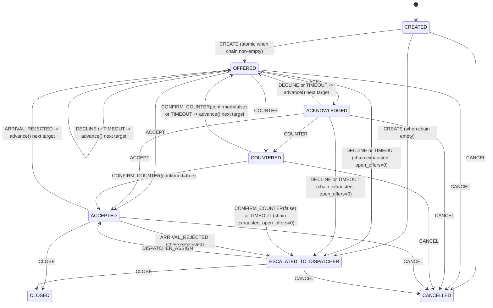
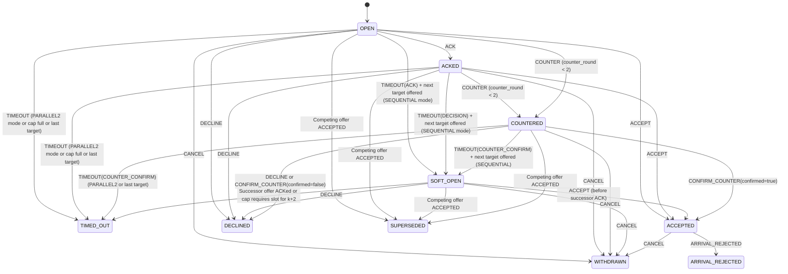
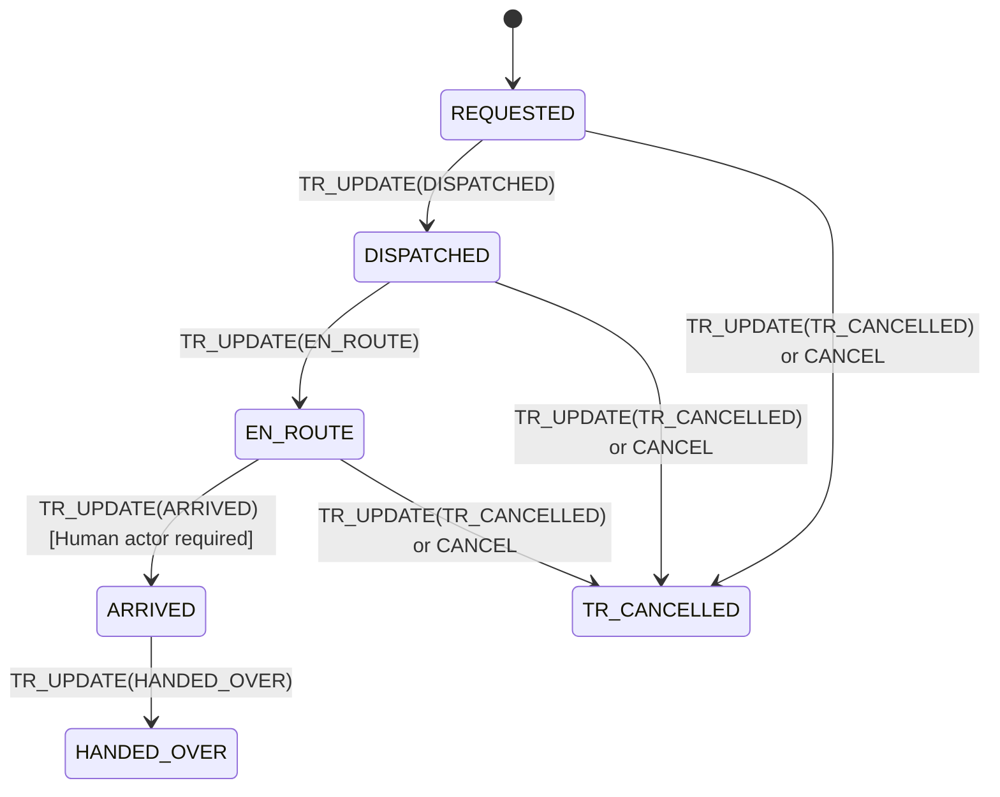

# ReferralHandshake (Protocol RHP-1) — State Transition Specification

**System:** Referral Handshake Protocol (RHP-1) & Reference Platform  
**Team:** MAHA YODHAS | **Track:** HealthTech | **Event:** Colossus 3.0  
**Document ID:** `STATE_TRANSITION_SPECIFICATION.md` | **Status:** LOCKED (`REAL_DATA=0`)  
**Authority Precedence:** `Problem_Statement_v7.md` $>$ `[V]` Research Findings $>$ `v8_LOCKED_Solution.md` $>$ `FINAL_LOCKED_Architecture.md`

> **Evidence & Status Legend:** **`[V]`** verified primary source · **`[V*]`** secondary/vendor source · **`[CONFLICT]`** sources disagree · **`[GAP]`** no reliable fact, parameterised · **`[verify]`** pre-event verification item · **`CLOSED`** mechanism + named test · **`BOUNDED`** stated technical residual + monitor alarm · **`OPEN`** owner + closing evidence.

---

## 1. Architectural Scope & The Coherence Rule

### 1.1 Coherence Rule
Every component in ReferralHandshake must be strictly one of:
1. **(a) A state or event in the contract** (`referral`, `offer`, `deadline`, `event`, `payload_grant`),
2. **(b) An interface producing or consuming those events** (React PWA desks, Kotlin Android EMT app, Exotel outbound IVR, DLT static SMS link, Crockford Base32 paper code, Dispatcher proxy console), or
3. **(c) A read-only projection of the committed event log** (Person B's independent Python Runtime Monitor, Ed25519 Witness/Signer, pure-JS Browser Verifier, Command Centre KPIs, XES/FHIR exporters).

Anything outside (a), (b), or (c) is out of scope. Authoritative state changes occur exclusively through the 10-step `apply_command()` transaction pipeline against a single writable PostgreSQL 16 primary (`synchronous_commit=on`, `READ COMMITTED` + explicit `SELECT ... FOR UPDATE`).

### 1.2 Defect & Architecture Closure Traceability
This specification enforces the state-model closures from `v8` (`D1`–`D20`) and `FINAL_LOCKED_Architecture.md` (`F1`–`F20`):
- **`D1` / `I3` (Never Block Care):** Pre-referral $\text{MgSO}_4$ status (`mgso4_status` $\in \{\text{GIVEN}, \text{NONE\_GIVEN}, \text{UNKNOWN}\}$) is *answer-required*, never *knowledge-required*. Selecting `UNKNOWN` sets a red clinical verification banner on the receiving desk and never blocks `CREATE` or ambulance dispatch.
- **`D2` / `F5` / `I3` (Parallel Transport & Human Arrival Confirmation):** The Handshake Track (`hs_state`) and Transport Track (`tr_state`) execute in parallel. Transport transitions never read `hs_state`. A $200\text{ m}$ geofence + dwell check emits `ARRIVAL_SUGGESTED` only; transition to `ARRIVED` requires a human actor (EMT or receiving desk).
- **`D3` / `F13` / `I2` / `I9` / `I12` (Negotiation, Loops & Offer Cap):** Full `ACK` / `ACCEPT` / `COUNTER` (max $2$ rounds) / `DECLINE` vocabulary; `UNIQUE(referral_id, facility_id)` prevents $A \rightarrow B \rightarrow A$ referral loops (`I9`); `open_offers` $\in \{0, 1, 2\}$ (`I12`) governs sequential `SOFT_OPEN` overlaps and `PARALLEL2` races.
- **`D7` / `I8` (Separated Optimistic Versioning & Lease Fencing):** `referral.version` (optimistic concurrency control, returning HTTP `412` on mismatch) and `referral.lease_epoch` (monotonic ownership counter, returning HTTP `409` on lost race) are distinct fields.
- **`F6` / `I1` / `I5` (Deterministic Closure & Reachability):** Every non-terminal state has $\ge 1$ `PENDING` deadline (`I1`) and a deterministic path to terminal `CLOSED` or `CANCELLED` (`F6`). Terminal states require a non-null `outcome` from the 9-value taxonomy (`I5`).
- **`F19` (Explicit v7 Mapping):** All 12 conceptual states in `Problem_Statement_v7.md` map deterministically to stored columns (`referral.hs_state`, `offer.status`, `referral.tr_state`) and append-only `event.type` records.

---

## 2. Dual-Track State Machine Model

### 2.1 Handshake Track (`referral.hs_state`)
`referral.hs_state` represents the authoritative contract ownership state of the referral. Its stored domain is:
$$\text{hs\_state} \in \{\text{CREATED}, \text{OFFERED}, \text{ACKNOWLEDGED}, \text{ACCEPTED}, \text{COUNTERED}, \text{ESCALATED\_TO\_DISPATCHER}, \text{CANCELLED}, \text{CLOSED}\}$$

**Lead-Offer Rule:** Whenever offers are active, `referral.hs_state` reflects the **lead offer**—defined as the highest `step` among open offers (`OPEN`, `ACKED`, `COUNTERED`, `SOFT_OPEN`), except that an `ACCEPTED` offer always wins and sets `hs_state = 'ACCEPTED'`.



### 2.2 Per-Facility Offer Track (`offer.status`)
Each facility targeted by a referral has at most one row in `offer` (`UNIQUE (referral_id, facility_id)`, enforcing `I9`). Its status domain is:
$$\text{offer.status} \in \{\text{OPEN}, \text{ACKED}, \text{COUNTERED}, \text{SOFT\_OPEN}, \text{ACCEPTED}, \text{DECLINED}, \text{TIMED\_OUT}, \text{SUPERSEDED}, \text{ARRIVAL\_REJECTED}, \text{WITHDRAWN}\}$$

The **Open Offer Set** (counted by `referral.open_offers` under `I12`) is strictly:
$$\text{OPEN\_SET} = \{\text{OPEN}, \text{ACKED}, \text{COUNTERED}, \text{SOFT\_OPEN}\}$$



### 2.3 Parallel Transport Track (`referral.tr_state`)
The Transport Track tracks physical patient movement independently of `hs_state` (`I3`). Its domain is:
$$\text{tr\_state} \in \{\text{REQUESTED}, \text{DISPATCHED}, \text{EN\_ROUTE}, \text{ARRIVED}, \text{HANDED\_OVER}, \text{TR\_CANCELLED}\}$$



- **Destination Redirects (`TR_DESTINATION_CHANGE`):** Valid in any `tr_state` prior to `ARRIVED` (`REQUESTED`, `DISPATCHED`, `EN_ROUTE`). Updates `referral.tr_facility_id` when `accepted=true` or logs crew refusal when `accepted=false`. The system never reroutes a moving ambulance autonomously.
- **Re-entry on Arrival Rejection:** If `ARRIVAL_REJECTED` fires while `tr_state = 'ARRIVED'`, the crew or dispatcher may issue `TR_DESTINATION_CHANGE` followed by `TR_UPDATE(EN_ROUTE)` toward the new destination.

---

## 3. v7 Conceptual State to RHP-1 Physical Mapping (`F19`)

Transient states from `Problem_Statement_v7.md` (`DECLINED`, `TIMED_OUT`, `ESCALATED`, `ARRIVAL_REJECTED`) are recorded as immutable events and offer-row statuses while `referral.hs_state` transitions atomically inside the command transaction to the next active target (`OFFERED`) or to `ESCALATED_TO_DISPATCHER`.

| v7 Conceptual State | `referral.hs_state` (Post-Txn) | `offer.status` | `referral.tr_state` | Emitted `event.type`(s) |
|---|---|---|---|---|
| `CREATED` | `CREATED` (intra-txn) $\rightarrow$ `OFFERED` or `ESCALATED_TO_DISPATCHER` | — | `REQUESTED` | `REFERRAL_CREATED` |
| `OFFERED` | `OFFERED` | `OPEN` | Any non-terminal | `OFFER_CREATED` |
| `ACKNOWLEDGED` | `ACKNOWLEDGED` | `ACKED` | Any non-terminal | `OFFER_ACKED` |
| `ACCEPTED` | `ACCEPTED` | `ACCEPTED` | Any non-terminal | `OFFER_ACCEPTED`, `LEASE_GRANTED` |
| `COUNTERED` | `COUNTERED` | `COUNTERED` | Any non-terminal | `OFFER_COUNTERED` |
| `DECLINED` | `OFFERED` (if next target opened) or `ESCALATED_TO_DISPATCHER` | `DECLINED` | Any non-terminal | `OFFER_DECLINED` (+ `OFFER_CREATED` or `ESCALATED_TO_DISPATCHER`) |
| `TIMED_OUT` | `OFFERED` (if next target opened) or `ESCALATED_TO_DISPATCHER` | `TIMED_OUT` or `SOFT_OPEN` | Any non-terminal | `DEADLINE_TIMEOUT` (+ `OFFER_CREATED` or `ESCALATED_TO_DISPATCHER`) |
| `ESCALATED` | `OFFERED` (`ladder_cursor + 1`) | Next offer `OPEN` | Any non-terminal | `OFFER_CREATED` (`detail.reason = 'ESCALATION'`) |
| `ARRIVAL_REJECTED` | `OFFERED` (if next target opened) or `ESCALATED_TO_DISPATCHER` | `ARRIVAL_REJECTED` | `ARRIVED` | `ARRIVAL_REJECTED`, `LEASE_REVOKED` (+ next step event) |
| `ESCALATED_TO_DISPATCHER` | `ESCALATED_TO_DISPATCHER` | All offers non-open | Any non-terminal | `ESCALATED_TO_DISPATCHER` |
| `CANCELLED` | `CANCELLED` | Active offers $\rightarrow$ `WITHDRAWN` | Any / `TR_CANCELLED` | `CANCELLED`, `GRANT_REVOKED` |
| `CLOSED` | `CLOSED` | Unchanged (`ACCEPTED` or prior terminal) | `HANDED_OVER` or outcome-specific | `CLOSED`, `GRANT_REVOKED` |

---

## 4. Exhaustive Command & Transition Specification

All guards are evaluated inside `apply_command()` **after** acquiring `SELECT * FROM referral WHERE id = $1 FOR UPDATE` (Step 4) and setting `rhp.locked_referral`. Every mutating command (except `CREATE` and system `TIMEOUT`) checks `expected_version == referral.version` (returning `412 STALE_VERSION` on mismatch). Commands sensitive to ownership changes also check `expected_epoch == referral.lease_epoch` (`412 STALE_EPOCH`).

### 4.1 Master Command Transition Table

| Command | Authorized Actor (`role_slot`) | PIN Req | Pre-State Guards (`hs_state` / `offer.status`) | State & Side-Effect Mutations | Emitted `event.type`(s) | Rejection Codes (`http_status`: `reason_code`) |
|---|---|---|---|---|---|---|
| `CREATE` | `CLINICIAN`, `DISPATCHER` (proxy) | Yes | Referral ID does not exist; `cardinality(chain) <= F` (truncated to $F$ if longer); active signed profile valid | Insert `referral` (`version=1`, `lease_epoch=0`, `tr_state='REQUESTED'`, `mgso4_status`); insert `key_version` + `clinical_payload`; grant origin. If `chain` non-empty: `hs_state='OFFERED'`, open `chain[0]` (`SEQUENTIAL`, `open_offers=1`) or `chain[0..1]` (`PARALLEL2`, `open_offers=2`), create `payload_grant`(s), insert `ACK` ($t+A$), `NOTICE_VOICE` ($t+A/4$), `NOTICE_PROXY` ($t+3A/4$) deadlines. If `chain` empty: `hs_state='ESCALATED_TO_DISPATCHER'`, insert `DISPATCH_ACTION` deadline | `REFERRAL_CREATED`, `OFFER_CREATED` (1 or 2) or `ESCALATED_TO_DISPATCHER` | `401 SESSION_INVALID`, `403 PIN_INVALID` / `ROLE_FORBIDDEN`, `422 SCHEMA_INVALID`, `429 PIN_LOCKED` |
| `ACK` | `NURSE`, `CMO`, `CONSULTANT`, `DISPATCHER` (proxy) at `offer.facility_id` | No (Web/Voice press-1) | `hs_state` $\in \{\text{OFFERED}, \text{ACKNOWLEDGED}, \text{COUNTERED}\}$; target `offer.status == 'OPEN'` | Set `offer.status='ACKED'`, `acked_at=ts`, `acked_by=actor`; mark offer's `ACK`, `NOTICE_VOICE`, `NOTICE_PROXY` deadlines `DONE`; insert `DECISION` deadline due at $ts + D$; if predecessor offer $k-1$ is `SOFT_OPEN`, set $k-1 \rightarrow \text{TIMED\_OUT}$, `open_offers -= 1`, revoke $k-1$ grant, emit `OFFER_SOFT_EXPIRED`; update `hs_state` to lead offer (`ACKNOWLEDGED`) | `OFFER_ACKED` (+ `OFFER_SOFT_EXPIRED`, `GRANT_REVOKED` if $k-1$ closed) | `403 FACILITY_MISMATCH`, `409 INVALID_TRANSITION` / `OFFER_NOT_OPEN`, `412 STALE_VERSION` |
| `RESOURCE_CONFIRM` | `NURSE`, `CMO`, `CONSULTANT`, `DISPATCHER` (proxy) at `offer.facility_id` | Yes | Target `offer.status` $\in \{\text{OPEN}, \text{ACKED}, \text{SOFT\_OPEN}\}$; `capability` $\in$ `need_class_requirement` | Upsert `offer_resource_confirmation(offer_id, capability, confirmed_by=actor, confirmed_at=ts, expires_at=ts + profile.confirm_ttl)` | `RESOURCE_CONFIRMED` | `403 PIN_INVALID`, `409 OFFER_CLOSED`, `422 INVALID_CAPABILITY` |
| `ACCEPT` | `NURSE`, `CMO`, `CONSULTANT`, `DISPATCHER` (proxy) at `offer.facility_id` | Yes | `hs_state` $\in \{\text{OFFERED}, \text{ACKNOWLEDGED}, \text{COUNTERED}\}$; `referral.lease_offer_id IS NULL`; target `offer.status` $\in \{\text{OPEN}, \text{ACKED}, \text{SOFT\_OPEN}\}$; every required capability in `need_class_requirement` has confirmation with `expires_at > ts` (`I15`) | Set `offer.status='ACCEPTED'`, `decided_at=ts`; set all other open offers to `SUPERSEDED`, revoke their `payload_grant`s; set `referral.lease_offer_id=offer.id`, `lease_facility_id=offer.facility_id`, `lease_epoch += 1`, `open_offers=0`, `hs_state='ACCEPTED'`; cancel all `PENDING` offer deadlines; insert `HANDOVER` deadline due at $ts + H$ | `OFFER_ACCEPTED`, `LEASE_GRANTED` (+ `GRANT_REVOKED` for superseded offers) | `409 LEASE_HELD` / `LATE_ACCEPT_REJECTED` / `STALE_CONFIRMATION_RECONFIRM_REQUIRED` / `MISSING_RESOURCE_CONFIRMATION`, `412 STALE_VERSION` |
| `COUNTER` | `NURSE`, `CMO`, `CONSULTANT`, `DISPATCHER` (proxy) at `offer.facility_id` | Yes | `hs_state` $\in \{\text{OFFERED}, \text{ACKNOWLEDGED}, \text{COUNTERED}\}$; target `offer.status` $\in \{\text{OPEN}, \text{ACKED}\}$; `offer.counter_round < 2`; `counter_mask > 0` | Set `offer.status='COUNTERED'`, `counter_round += 1`, `counter_mask=cmd.mask`; mark `ACK`/`DECISION`/`NOTICE_*` deadlines `DONE`; insert `COUNTER_CONFIRM` deadline with `due_at = LEAST(ts + C, existing_decision_due_at)`; update `hs_state` to lead offer (`COUNTERED`) | `OFFER_COUNTERED` | `409 MAX_COUNTER_ROUNDS_EXCEEDED` / `INVALID_TRANSITION`, `412 STALE_VERSION`, `422 INVALID_COUNTER_MASK` |
| `CONFIRM_COUNTER` | `CLINICIAN` (origin facility) or `DISPATCHER` (proxy) | Yes | `hs_state` $\in \{\text{OFFERED}, \text{ACKNOWLEDGED}, \text{COUNTERED}\}$; target `offer.status == 'COUNTERED'` | If `confirmed == true`: verify `lease_offer_id IS NULL` and all non-waived required confirmations have `expires_at > ts` (`I15`); set `offer.status='ACCEPTED'`, `lease_epoch += 1`, supersede other open offers + revoke grants, `open_offers=0`, `hs_state='ACCEPTED'`, cancel offer deadlines, insert `HANDOVER` deadline. If `confirmed == false`: set `offer.status='DECLINED'`, `open_offers -= 1`, revoke grant, cancel offer deadlines, invoke `advance()` | `COUNTER_RESOLVED` (+ `OFFER_ACCEPTED`, `LEASE_GRANTED` or `OFFER_DECLINED` + `advance()` events) | `409 LEASE_HELD` / `STALE_CONFIRMATION_RECONFIRM_REQUIRED` / `OFFER_NOT_COUNTERED`, `412 STALE_VERSION` |
| `DECLINE` | `NURSE`, `CMO`, `CONSULTANT`, `DISPATCHER` (proxy) at `offer.facility_id` | Yes | `hs_state` $\in \{\text{OFFERED}, \text{ACKNOWLEDGED}, \text{COUNTERED}\}$; target `offer.status` $\in \{\text{OPEN}, \text{ACKED}, \text{SOFT\_OPEN}, \text{COUNTERED}\}$ | Set `offer.status='DECLINED'`, `decline_reason=cmd.reason`, `decided_at=ts`, `open_offers -= 1`; cancel offer's `PENDING` deadlines; revoke facility's `payload_grant`; invoke `advance()` | `OFFER_DECLINED`, `GRANT_REVOKED` (+ `OFFER_CREATED` or `ESCALATED_TO_DISPATCHER`) | `409 INVALID_TRANSITION`, `412 STALE_VERSION`, `422 INVALID_DECLINE_REASON` |
| `TIMEOUT` | `SYSTEM` (poller phase 2) | No | Target `deadline.status == 'PENDING'` and `deadline.epoch == referral.lease_epoch` (else `200` no-op) | Mark `deadline.status='DONE'`. Branch by `deadline.kind`:<br>• `NOTICE_VOICE`: enqueue `VOICE` outbox rows for slots $0..S-1$ (staggered), emit `NOTICE_SENT`.<br>• `NOTICE_PROXY`: enqueue `PROXY_PAGE` outbox row, emit `NOTICE_SENT`.<br>• `ACK` (when offer `OPEN`): in `SEQUENTIAL`, if next chain target exists, set offer $\rightarrow$ `SOFT_OPEN` (if $k-1$ is `SOFT_OPEN`, set $k-1 \rightarrow \text{TIMED\_OUT}$, revoke grant, `open_offers -= 1`), open $k+1$ (`open_offers` stays $\le 2$); else set offer $\rightarrow$ `TIMED_OUT`, `open_offers -= 1`, revoke grant, invoke `advance()`. (If offer already `ACKED`, emit `ADVISORY_PREWARM` to $k+1$).<br>• `DECISION` or `COUNTER_CONFIRM`: same `SOFT_OPEN` (in `SEQUENTIAL` for `DECISION`) or `TIMED_OUT` + `advance()`.<br>• `HANDOVER` / `DISPATCH_ACTION`: emit overdue event, page dispatcher, insert new re-armed `PENDING` deadline.<br>• `CLOSURE`: 1st expiry $\rightarrow$ emit `CLOSURE_OVERDUE`, re-arm `CLOSURE` deadline once; 2nd expiry $\rightarrow$ system auto-closes with `outcome='UNKNOWN_COUNTER_REFERRAL'`, `proxy=true` | `NOTICE_SENT`, `DEADLINE_TIMEOUT`, `ADVISORY_PREWARM`, `OFFER_CREATED`, `ESCALATED_TO_DISPATCHER`, `HANDOVER_OVERDUE`, `CLOSURE_OVERDUE`, or `CLOSED` | `200 NO_OP` (if deadline already `DONE` or `CANCELLED`) |
| `ARRIVAL_REJECTED` | `NURSE`, `CMO`, `CONSULTANT`, `EMT`, `DISPATCHER` | Yes | `hs_state == 'ACCEPTED'`; `referral.lease_offer_id == offer.id` | Set `offer.status='ARRIVAL_REJECTED'`, `decided_at=ts`; set `referral.lease_offer_id=NULL`, `lease_facility_id=NULL`, `lease_epoch += 1`; cancel `HANDOVER` deadline; revoke facility's `payload_grant`; invoke `advance()` | `ARRIVAL_REJECTED`, `LEASE_REVOKED`, `GRANT_REVOKED` (+ `OFFER_CREATED` or `ESCALATED_TO_DISPATCHER`) | `409 NOT_LEASE_HOLDER` / `INVALID_TRANSITION`, `412 STALE_VERSION` |
| `DISPATCHER_ASSIGN` | `DISPATCHER` | Yes | `hs_state == 'ESCALATED_TO_DISPATCHER'` (or live non-terminal state with explicit `override=true` and `reason` enum) | If existing lease or open offers (on override), supersede/withdraw them and revoke grants; upsert `offer` for target facility with `source='DISPATCHER'`, `status='ACCEPTED'`, `created_epoch=lease_epoch`; set `referral.lease_offer_id=offer.id`, `lease_facility_id=target`, `lease_epoch += 1`, `open_offers=0`, `hs_state='ACCEPTED'`; create `payload_grant`; cancel `DISPATCH_ACTION` deadline; insert `HANDOVER` deadline | `DISPATCHER_ASSIGNED`, `LEASE_GRANTED` | `403 ROLE_FORBIDDEN`, `409 LEASE_HELD` (if `override=false`), `412 STALE_VERSION` |
| `TR_UPDATE` | `EMT`, `DISPATCHER`, `NURSE`/`CMO` (for `ARRIVED`/`HANDED_OVER`), `SYSTEM` (only `ARRIVAL_SUGGESTED`) | Yes (for `ARRIVED`, `HANDED_OVER`, `TR_CANCELLED`) | `hs_state` $\notin \{\text{CLOSED}, \text{CANCELLED}\}$ (`I3`: **never checks `hs_state` value beyond non-terminal**); valid step in `REQUESTED -> DISPATCHED -> EN_ROUTE -> ARRIVED -> HANDED_OVER` or `-> TR_CANCELLED` | For `ARRIVAL_SUGGESTED` (from $200\text{ m}$ geofence): do not change `tr_state`, emit `ARRIVAL_SUGGESTED`. For human `TR_UPDATE`: update `referral.tr_state`. If `ARRIVED` at a facility with no offer: emit `ARRIVAL_AT_NON_OWNER` + page dispatcher. If `HANDED_OVER`: cancel `HANDOVER` deadline, insert `CLOSURE` deadline due at $ts + \text{CLOSURE}$ | `TR_UPDATED`, `ARRIVAL_SUGGESTED`, or `ARRIVAL_AT_NON_OWNER` | `403 HUMAN_CONFIRMATION_REQUIRED` (if system attempts `ARRIVED`), `409 INVALID_TR_TRANSITION` / `REFERRAL_TERMINAL` |
| `TR_DESTINATION_CHANGE` | `EMT`, `DISPATCHER` | Yes | `hs_state` $\notin \{\text{CLOSED}, \text{CANCELLED}\}$; `tr_state` $\in \{\text{REQUESTED}, \text{DISPATCHED}, \text{EN\_ROUTE}, \text{ARRIVED}\}$ | If `accepted == true`: set `referral.tr_facility_id = cmd.facility_id`. If `accepted == false`: retain current `tr_facility_id`, enqueue dispatcher alert | `TR_DESTINATION_CHANGE` | `409 INVALID_TR_STATE` |
| `CANCEL` | `CLINICIAN` (origin), `DISPATCHER` | Yes | `hs_state` $\notin \{\text{CLOSED}, \text{CANCELLED}\}$; `cmd.outcome` $\in \{\text{PATIENT\_REFUSED}, \text{TRANSPORT\_CANCELLED}, \text{DELIVERED\_EN\_ROUTE}, \text{DETERIORATED\_OR\_DIED\_PRE\_HANDOVER}\}$ | Set all `OPEN_SET` and `ACCEPTED` offers to `WITHDRAWN`; clear `lease_offer_id=NULL`, `lease_facility_id=NULL`, `open_offers=0`; cancel all `PENDING` deadlines; revoke all non-origin `payload_grant`s; set `hs_state='CANCELLED'`, `tr_state='TR_CANCELLED'` (if not `HANDED_OVER`), `outcome=cmd.outcome`, `closed_at=ts` | `CANCELLED`, `GRANT_REVOKED` | `409 ALREADY_TERMINAL`, `412 STALE_VERSION`, `422 INVALID_CANCEL_OUTCOME` |
| `CLOSE` | `NURSE`, `CMO`, `CONSULTANT` (at lease facility), `DISPATCHER`, `SYSTEM` (after $2\times$ `CLOSURE` expiry) | Yes (human) | `hs_state` $\in \{\text{ACCEPTED}, \text{ESCALATED\_TO\_DISPATCHER}\}$; `cmd.outcome` in 9-outcome taxonomy; if `outcome` $\in \{\text{ADMITTED\_STABLE}, \text{ADMITTED\_CRITICAL}, \text{DELIVERED\_AT\_RECEIVER}\}$, requires `tr_state == 'HANDED_OVER'` | Cancel all `PENDING` deadlines (`HANDOVER`, `CLOSURE`, `DISPATCH_ACTION`); revoke non-origin/non-lease grants; schedule `clinical_payload.expires_at`; set `hs_state='CLOSED'`, `outcome=cmd.outcome`, `closed_at=ts` | `CLOSED`, `GRANT_REVOKED` | `409 INVALID_TRANSITION` / `HANDOVER_REQUIRED_FOR_ADMISSION_OUTCOME`, `412 STALE_VERSION`, `422 OUTCOME_REQUIRED` |
| `REVOKE_GRANT` | `ADMIN`, `DISPATCHER`, `SYSTEM` | Yes (human) | Active `payload_grant` (`revoked_at IS NULL`) | Set `payload_grant.revoked_at = ts`, `revoke_reason = cmd.reason`; enqueue `SSE` control frame `GRANT_REVOKED` | `GRANT_REVOKED` | `409 GRANT_ALREADY_REVOKED` |

---

### 4.2 Frozen `transitions.yaml` Specification

Both the FastAPI server (`apply_command()` Step 6) and Person A's Python explicit-state explorer load the exact same `spec/transitions.yaml` file (protected by `CODEOWNERS` and SHA-256 pinned in CI).

```yaml
# spec/transitions.yaml — Frozen RHP-1 Control-Plane Transition Table
schema_version: 1
protocol: RHP-1

states:
  handshake:
    non_terminal: [CREATED, OFFERED, ACKNOWLEDGED, ACCEPTED, COUNTERED, ESCALATED_TO_DISPATCHER]
    terminal: [CANCELLED, CLOSED]
    in_flight_offer: [OFFERED, ACKNOWLEDGED, COUNTERED]
  offer:
    open_set: [OPEN, ACKED, COUNTERED, SOFT_OPEN]
    closed_set: [ACCEPTED, DECLINED, TIMED_OUT, SUPERSEDED, ARRIVAL_REJECTED, WITHDRAWN]
  transport:
    ordered: [REQUESTED, DISPATCHED, EN_ROUTE, ARRIVED, HANDED_OVER]
    cancelled: [TR_CANCELLED]

invariants:
  max_open_offers: 2
  max_counter_rounds: 2
  max_chain_len: 8

outcomes:
  all:
    - ADMITTED_STABLE
    - ADMITTED_CRITICAL
    - DELIVERED_AT_RECEIVER
    - DELIVERED_EN_ROUTE
    - PATIENT_REFUSED
    - TRANSPORT_CANCELLED
    - DETERIORATED_OR_DIED_PRE_HANDOVER
    - REDIRECTED_ON_ARRIVAL
    - UNKNOWN_COUNTER_REFERRAL
  requires_handed_over:
    - ADMITTED_STABLE
    - ADMITTED_CRITICAL
    - DELIVERED_AT_RECEIVER
  valid_for_cancel:
    - PATIENT_REFUSED
    - TRANSPORT_CANCELLED
    - DELIVERED_EN_ROUTE
    - DETERIORATED_OR_DIED_PRE_HANDOVER

commands:
  CREATE:
    allowed_roles: [CLINICIAN, DISPATCHER]
    requires_pin: true
    pre_hs_state: []
    next_hs_state_if_chain: OFFERED
    next_hs_state_if_empty_chain: ESCALATED_TO_DISPATCHER
    emits: [REFERRAL_CREATED]

  ACK:
    allowed_roles: [NURSE, CMO, CONSULTANT, DISPATCHER]
    requires_pin: false
    pre_hs_state: [OFFERED, ACKNOWLEDGED, COUNTERED]
    pre_offer_status: [OPEN]
    next_offer_status: ACKED
    closes_prior_soft_open: true
    deadlines_completed: [ACK, NOTICE_VOICE, NOTICE_PROXY]
    deadlines_created: [DECISION]
    emits: [OFFER_ACKED]

  RESOURCE_CONFIRM:
    allowed_roles: [NURSE, CMO, CONSULTANT, DISPATCHER]
    requires_pin: true
    pre_hs_state: [OFFERED, ACKNOWLEDGED, COUNTERED]
    pre_offer_status: [OPEN, ACKED, SOFT_OPEN]
    next_offer_status: UNCHANGED
    emits: [RESOURCE_CONFIRMED]

  ACCEPT:
    allowed_roles: [NURSE, CMO, CONSULTANT, DISPATCHER]
    requires_pin: true
    pre_hs_state: [OFFERED, ACKNOWLEDGED, COUNTERED]
    pre_offer_status: [OPEN, ACKED, SOFT_OPEN]
    requires_no_active_lease: true
    requires_unexpired_confirmations: true
    next_offer_status: ACCEPTED
    next_hs_state: ACCEPTED
    increments_lease_epoch: true
    supersedes_other_open_offers: true
    deadlines_cancelled: [ACK, DECISION, COUNTER_CONFIRM, NOTICE_VOICE, NOTICE_PROXY]
    deadlines_created: [HANDOVER]
    emits: [OFFER_ACCEPTED, LEASE_GRANTED]

  COUNTER:
    allowed_roles: [NURSE, CMO, CONSULTANT, DISPATCHER]
    requires_pin: true
    pre_hs_state: [OFFERED, ACKNOWLEDGED, COUNTERED]
    pre_offer_status: [OPEN, ACKED]
    max_counter_round_before: 1
    next_offer_status: COUNTERED
    deadlines_completed: [ACK, DECISION, NOTICE_VOICE, NOTICE_PROXY]
    deadlines_created: [COUNTER_CONFIRM]
    emits: [OFFER_COUNTERED]

  CONFIRM_COUNTER:
    allowed_roles: [CLINICIAN, DISPATCHER]
    requires_pin: true
    pre_hs_state: [OFFERED, ACKNOWLEDGED, COUNTERED]
    pre_offer_status: [COUNTERED]
    branch_confirmed_true:
      requires_no_active_lease: true
      requires_unexpired_confirmations: true
      next_offer_status: ACCEPTED
      next_hs_state: ACCEPTED
      increments_lease_epoch: true
      supersedes_other_open_offers: true
      deadlines_cancelled: [COUNTER_CONFIRM]
      deadlines_created: [HANDOVER]
      emits: [COUNTER_RESOLVED, OFFER_ACCEPTED, LEASE_GRANTED]
    branch_confirmed_false:
      next_offer_status: DECLINED
      invokes_advance: true
      deadlines_cancelled: [COUNTER_CONFIRM]
      emits: [COUNTER_RESOLVED, OFFER_DECLINED]

  DECLINE:
    allowed_roles: [NURSE, CMO, CONSULTANT, DISPATCHER]
    requires_pin: true
    pre_hs_state: [OFFERED, ACKNOWLEDGED, COUNTERED]
    pre_offer_status: [OPEN, ACKED, SOFT_OPEN, COUNTERED]
    next_offer_status: DECLINED
    revokes_grant: true
    invokes_advance: true
    deadlines_cancelled: [ACK, DECISION, COUNTER_CONFIRM, NOTICE_VOICE, NOTICE_PROXY]
    emits: [OFFER_DECLINED, GRANT_REVOKED]

  ARRIVAL_REJECTED:
    allowed_roles: [NURSE, CMO, CONSULTANT, EMT, DISPATCHER]
    requires_pin: true
    pre_hs_state: [ACCEPTED]
    pre_offer_status: [ACCEPTED]
    next_offer_status: ARRIVAL_REJECTED
    clears_lease: true
    increments_lease_epoch: true
    revokes_grant: true
    invokes_advance: true
    deadlines_cancelled: [HANDOVER]
    emits: [ARRIVAL_REJECTED, LEASE_REVOKED, GRANT_REVOKED]

  DISPATCHER_ASSIGN:
    allowed_roles: [DISPATCHER]
    requires_pin: true
    pre_hs_state: [ESCALATED_TO_DISPATCHER, OFFERED, ACKNOWLEDGED, COUNTERED, ACCEPTED]
    requires_override_if_not_escalated: true
    next_offer_status: ACCEPTED
    next_hs_state: ACCEPTED
    increments_lease_epoch: true
    deadlines_cancelled: [DISPATCH_ACTION, ACK, DECISION, COUNTER_CONFIRM, NOTICE_VOICE, NOTICE_PROXY, HANDOVER]
    deadlines_created: [HANDOVER]
    emits: [DISPATCHER_ASSIGNED, LEASE_GRANTED]

  TR_UPDATE:
    allowed_roles: [EMT, DISPATCHER, NURSE, CMO, SYSTEM]
    requires_pin_for: [ARRIVED, HANDED_OVER, TR_CANCELLED]
    human_required_for: [ARRIVED]
    pre_hs_state: [CREATED, OFFERED, ACKNOWLEDGED, ACCEPTED, COUNTERED, ESCALATED_TO_DISPATCHER]
    valid_tr_edges:
      REQUESTED: [DISPATCHED, TR_CANCELLED]
      DISPATCHED: [EN_ROUTE, TR_CANCELLED]
      EN_ROUTE: [ARRIVED, TR_CANCELLED]
      ARRIVED: [HANDED_OVER, EN_ROUTE]
    emits: [TR_UPDATED]

  CANCEL:
    allowed_roles: [CLINICIAN, DISPATCHER]
    requires_pin: true
    pre_hs_state: [CREATED, OFFERED, ACKNOWLEDGED, ACCEPTED, COUNTERED, ESCALATED_TO_DISPATCHER]
    next_hs_state: CANCELLED
    withdraws_all_offers: true
    revokes_all_grants: true
    deadlines_cancelled: [ACK, DECISION, COUNTER_CONFIRM, NOTICE_VOICE, NOTICE_PROXY, HANDOVER, DISPATCH_ACTION, CLOSURE]
    emits: [CANCELLED, GRANT_REVOKED]

  CLOSE:
    allowed_roles: [NURSE, CMO, CONSULTANT, DISPATCHER, SYSTEM]
    requires_pin: true
    pre_hs_state: [ACCEPTED, ESCALATED_TO_DISPATCHER]
    next_hs_state: CLOSED
    deadlines_cancelled: [HANDOVER, DISPATCH_ACTION, CLOSURE]
    emits: [CLOSED, GRANT_REVOKED]
```

---

## 5. Escalation, Offer Cap, Soft-Open & Counter Arithmetic (`F13`, `I2`, `I7`, `I9`, `I12`)

### 5.1 Open-Offer Cap & `SOFT_OPEN` Overlap Rules
Invariant `I12` mandates that the number of concurrently open offers (`OPEN`, `ACKED`, `COUNTERED`, `SOFT_OPEN`) per referral never exceeds $2$:
$$0 \le \text{open\_offers} \le 2$$

1. **Sequential Steady State (`SEQUENTIAL`):**
   - At `CREATE`, facility $k=1$ (`chain[0]`) is offered with `status = 'OPEN'` ($\text{open\_offers} = 1$).
2. **Sequential Timeout Overlap (`SOFT_OPEN`):**
   - If step $k$ expires (`ACK`, `DECISION`, or `COUNTER_CONFIRM` timeout) and an unused target $k+1$ exists in `referral.chain`:
     - **Step 1 (Evict $k-1$ if still `SOFT_OPEN`):** If step $k-1$ is currently `SOFT_OPEN`, it immediately transitions to `TIMED_OUT`, its `payload_grant` is revoked, `OFFER_SOFT_EXPIRED` and `GRANT_REVOKED` are emitted, and `open_offers` is decremented ($2 \rightarrow 1$).
     - **Step 2 (Demote $k$ to `SOFT_OPEN`):** Step $k$ transitions from `OPEN`/`ACKED`/`COUNTERED` to `SOFT_OPEN`. Its `open_offers` contribution remains $1$, and its `payload_grant` stays active during the late-accept window.
     - **Step 3 (Open $k+1$):** Step $k+1$ is inserted as `OPEN` (`open_offers` increments $1 \rightarrow 2$), granted a `payload_grant`, and armed with `ACK`, `NOTICE_VOICE`, and `NOTICE_PROXY` deadlines.
3. **Late-Accept Resolution (`SOFT_OPEN` vs Successor `ACK`):**
   - **Case A ($k$ accepts before $k+1$ ACKs):** Step $k$ acquires the `referral` row lock first and calls `ACCEPT`. Because `offer.status == 'SOFT_OPEN'` and all required resource confirmations are unexpired (`I15`), $k$ transitions to `ACCEPTED`, `lease_epoch` increments, $k+1$ transitions to `SUPERSEDED` (with its deadlines cancelled and `payload_grant` revoked), and `open_offers` becomes $0$.
   - **Case B ($k+1$ ACKs before $k$ accepts):** Step $k+1$ acquires the `referral` row lock first and calls `ACK`. Step $k+1$ transitions to `ACKED`, and in the same transaction step $k$ transitions from `SOFT_OPEN` to `TIMED_OUT` (with its `payload_grant` revoked and `open_offers` decremented $2 \rightarrow 1$). When step $k$'s delayed `ACCEPT` arrives, `offer.status` is now `TIMED_OUT`, so `apply_command()` returns HTTP `409 LATE_ACCEPT_REJECTED`.
4. **Parallel-2 Mode (`PARALLEL2`):**
   - Set by dispatcher or demo configuration for critical cases. At `CREATE`, `chain[0]` and `chain[1]` are both inserted as `OPEN` ($\text{open\_offers} = 2$).
   - When either offer in `PARALLEL2` times out, it transitions **directly** to `TIMED_OUT` (never `SOFT_OPEN`, because keeping it `SOFT_OPEN` while opening a third facility would violate $\text{open\_offers} \le 2$), its `payload_grant` is revoked, and `advance()` opens the next unused facility in `referral.chain` so `open_offers` stays $\le 2$.

### 5.2 Counter-Offer Rules with Concurrent Open Offers
- A receiving duty role at an `OPEN` or `ACKED` offer may issue `COUNTER` up to $2$ times (`counter_round` $\in \{1, 2\}$).
- `COUNTER` replaces the offer's `DECISION` deadline with a `COUNTER_CONFIRM` deadline whose `due_at` is capped by the remaining decision window:
  $$\text{due\_at}_{\text{counter}} = \min(\text{ts} + C, \text{due\_at}_{\text{decision}})$$
  Thus, counter-offers can **never** extend the facility's decision window $D$ or violate $T_{max} = F \cdot (A + D + \epsilon) \le B$ (`I13`).
- If a second offer is simultaneously open (either a predecessor in `SOFT_OPEN` or a sibling in `PARALLEL2`), the countered offer remains in `COUNTERED` (which is in `OPEN_SET`) and does **not** supersede the other offer.
- Whichever of $\{\text{other offer } \text{ACCEPT}, \text{CONFIRM\_COUNTER}(\text{confirmed}=\text{true})\}$ commits first under the `referral` row lock wins the lease, increments `lease_epoch`, and marks the losing offer `SUPERSEDED`. The loser receives HTTP `409 LEASE_HELD`.

### 5.3 Authoritative `advance()` Algorithm (`I1`, `I7`, `I9`, `I12`)

```python
def advance(conn, r, offers, ts, profile, mode_is_timeout=False, timed_out_offer=None):
    """
    Deterministic escalation ladder stepper executed inside apply_command() under referral lock.
    Enforces I1 (pending deadline), I7 (chain membership), I9 (no duplicate facility), I12 (open_offers <= 2).
    """
    offered_facilities = {o.facility_id for o in offers}
    next_target = None
    next_cursor = r.ladder_cursor

    # Find next facility in referral.chain not yet offered (I7, I9)
    for idx in range(r.ladder_cursor, len(r.chain)):
        cand = r.chain[idx]
        if cand not in offered_facilities:
            next_target = cand
            next_cursor = idx + 1
            break

    open_list = [o for o in offers if o.status in ("OPEN", "ACKED", "COUNTERED", "SOFT_OPEN")]

    if mode_is_timeout and timed_out_offer is not None:
        if r.mode == "SEQUENTIAL" and next_target is not None:
            # Close any older SOFT_OPEN offer so open_offers never exceeds 2 (F13 / I12)
            for old_so in [o for o in open_list if o.status == "SOFT_OPEN" and o.id != timed_out_offer.id]:
                conn.execute("UPDATE offer SET status='TIMED_OUT', decided_at=%s WHERE id=%s", (ts, old_so.id))
                revoke_grant_internal(conn, r.id, old_so.facility_id, ts, "SOFT_OPEN_EVICTED")
                append_event_internal(conn, r, "OFFER_SOFT_EXPIRED", detail={"step": old_so.step, "facility": str(old_so.facility_id)}, ts=ts)
            # Transition current timed-out offer to SOFT_OPEN
            conn.execute("UPDATE offer SET status='SOFT_OPEN' WHERE id=%s", (timed_out_offer.id,))
        else:
            # PARALLEL2 or no next target in chain: hard timeout
            conn.execute("UPDATE offer SET status='TIMED_OUT', decided_at=%s WHERE id=%s", (ts, timed_out_offer.id))
            revoke_grant_internal(conn, r.id, timed_out_offer.facility_id, ts, "OFFER_TIMED_OUT")

    # Recompute open offers after status change
    open_count = conn.execute(
        "SELECT count(*) FROM offer WHERE referral_id=%s AND status IN ('OPEN','ACKED','COUNTERED','SOFT_OPEN')",
        (r.id,)
    ).fetchone()[0]

    if next_target is not None and open_count < 2:
        new_offer_id = uuid7()
        conn.execute(
            """INSERT INTO offer(id, referral_id, facility_id, step, source, status, created_epoch, created_at)
               VALUES (%s, %s, %s, %s, 'CHAIN', 'OPEN', %s, %s)""",
            (new_offer_id, r.id, next_target, next_cursor, r.lease_epoch, ts)
        )
        grant_payload_internal(conn, r.id, next_target, ts)
        insert_offer_deadlines(conn, r.id, new_offer_id, next_cursor, r.lease_epoch, ts, profile)
        open_count += 1
        conn.execute(
            "UPDATE referral SET hs_state='OFFERED', ladder_cursor=%s, open_offers=%s WHERE id=%s",
            (next_cursor, open_count, r.id)
        )
        append_event_internal(
            conn, r, "OFFER_CREATED",
            detail={"step": next_cursor, "facility": str(next_target), "source": "CHAIN", "reason": "ESCALATION"},
            ts=ts
        )
    else:
        # No next target could be opened; check if any offer remains open
        remaining_Active = conn.execute(
            "SELECT status FROM offer WHERE referral_id=%s AND status IN ('OPEN','ACKED','COUNTERED') ORDER BY step DESC LIMIT 1",
            (r.id,)
        ).fetchone()
        if remaining_Active:
            lead_map = {"OPEN": "OFFERED", "ACKED": "ACKNOWLEDGED", "COUNTERED": "COUNTERED"}
            conn.execute(
                "UPDATE referral SET hs_state=%s, open_offers=%s WHERE id=%s",
                (lead_map[remaining_Active.status], open_count, r.id)
            )
        else:
            # Any lingering SOFT_OPEN when chain is exhausted cannot remain without a successor; close it
            for lingering in conn.execute("SELECT id, facility_id FROM offer WHERE referral_id=%s AND status='SOFT_OPEN'", (r.id,)).fetchall():
                conn.execute("UPDATE offer SET status='TIMED_OUT', decided_at=%s WHERE id=%s", (ts, lingering.id))
                revoke_grant_internal(conn, r.id, lingering.facility_id, ts, "CHAIN_EXHAUSTED")
            conn.execute(
                "UPDATE referral SET hs_state='ESCALATED_TO_DISPATCHER', open_offers=0 WHERE id=%s",
                (r.id,)
            )
            insert_deadline(conn, r.id, None, "DISPATCH_ACTION", next_cursor, r.lease_epoch, ts + profile.dispatch_action_ms)
            append_event_internal(conn, r, "ESCALATED_TO_DISPATCHER", detail={"reason": "CHAIN_EXHAUSTED"}, ts=ts)
```

---

## 6. Arrival Semantics (`F5`) & Closure Reachability (`F6`)

### 6.1 Six Arrival Scenarios (`F5`)
Nothing in the handshake contract relies on metre-level GPS accuracy (budget-phone GPS in vehicles has $7\text{--}13\text{ m}$ typical error, up to $\sim 50\text{ m}$ median in bad conditions `[V*/V]`). A $200\text{ m}$ geofence + dwell time ($30\text{ s}$) + speed check is strictly a **hint**.

| Case | Scenario | Authoritative State & Event Behaviour |
|---|---|---|
| **(a)** | **Arrival at current lease-holding facility** | Android/PWA geofence ($200\text{ m}$ + dwell) emits `ARRIVAL_SUGGESTED` (`tr_state` stays `EN_ROUTE`). EMT or receiving desk human confirms `TR_UPDATE(ARRIVED)` $\rightarrow$ `tr_state = 'ARRIVED'`, emits `TR_UPDATED`. |
| **(b)** | **Arrival at facility with `OPEN`, `ACKED`, or `SOFT_OPEN` offer (no lease yet)** | Receiving desk may immediately issue `RESOURCE_CONFIRM` + `ACCEPT` (subject to `I2` no other lease held and `I15` unexpired confirmations) and confirm `TR_UPDATE(ARRIVED)`. |
| **(c)** | **Unannounced arrival at facility with NO offer (or closed offer)** | Human `TR_UPDATE(ARRIVED, facility_id=X)` transitions `tr_state = 'ARRIVED'` and emits `ARRIVAL_AT_NON_OWNER` (`detail: {reason: 'UNANNOUNCED_ARRIVAL', facility: X}`) + urgent dispatcher page. **Never blocks clinical triage.** Dispatcher may issue `DISPATCHER_ASSIGN` to grant the lease to facility $X$. |
| **(d)** | **En-route destination change (redirect advisory accepted)** | When ownership moves while `tr_state = 'EN_ROUTE'`, crew and dispatcher receive a redirect advisory. Crew or dispatcher issues `TR_DESTINATION_CHANGE(facility=new_owner, accepted=true, reason='LEASE_MOVED')`, updating `referral.tr_facility_id`. |
| **(e)** | **Crew refuses redirect advisory** | Crew issues `TR_DESTINATION_CHANGE(facility=new_owner, accepted=false, reason='PATIENT_UNSTABLE_FOR_DIVERSION')`. Event logged; `referral.lease_facility_id` is unchanged; dispatcher is paged immediately to coordinate. |
| **(f)** | **Ambulance already past highway turn-off when lease moves** | Advisory displays cached Mapbox Matrix detour ETA. Crew decides; if continuing to original facility, Case (e) + Case (c) (`ARRIVAL_AT_NON_OWNER`) execute at the arrival door without blocking care. |

### 6.2 State Reachability & Deterministic Exit Table (`F6`)
Every state in `referral.hs_state` is reachable from `CREATED` and possesses a deterministic, timer-bounded exit path to a terminal state (`CLOSED` or `CANCELLED`):

| `hs_state` | Entry Path from `CREATED` | Active `PENDING` Deadline (`I1`) | Deterministic Exit Path to Terminal (`CLOSED` / `CANCELLED`) |
|---|---|---|---|
| `CREATED` | Initial state inside `CREATE` txn | — (exits before `COMMIT`) | Transitions before `COMMIT` to `OFFERED` (non-empty `chain`) or `ESCALATED_TO_DISPATCHER` (empty `chain`). |
| `OFFERED` | `CREATE` with `cardinality(chain) >= 1` | `ACK` ($\le A$ per step) + `NOTICE_VOICE` ($A/4$) + `NOTICE_PROXY` ($3A/4$) | `ACCEPT` $\rightarrow$ `ACCEPTED` $\rightarrow$ `CLOSE`; or silence/decline across $\le F$ facilities ($\le T_{max}$) $\rightarrow$ `ESCALATED_TO_DISPATCHER` $\rightarrow$ `CLOSE`/`CANCEL`. |
| `ACKNOWLEDGED` | `ACK` on `OPEN` offer | `DECISION` ($\le D$ per step) | `ACCEPT` $\rightarrow$ `ACCEPTED` $\rightarrow$ `CLOSE`; or `DECISION` expiry ($\le D$) $\rightarrow$ next facility or `ESCALATED_TO_DISPATCHER` $\rightarrow$ `CLOSE`/`CANCEL`. |
| `COUNTERED` | `COUNTER` on `OPEN`/`ACKED` offer | `COUNTER_CONFIRM` ($\le \min(C, \text{remaining } D)$) | `CONFIRM_COUNTER(true)` $\rightarrow$ `ACCEPTED` $\rightarrow$ `CLOSE`; or `CONFIRM_COUNTER(false)` / expiry $\rightarrow$ next facility or `ESCALATED_TO_DISPATCHER`. |
| `ACCEPTED` | `ACCEPT`, `CONFIRM_COUNTER(true)`, or `DISPATCHER_ASSIGN` | `HANDOVER` ($H$), then `CLOSURE` after `HANDED_OVER` | Receiver/dispatcher issues `CLOSE(outcome)`; or `HANDOVER` re-pages dispatcher; after `HANDED_OVER`, $2\times$ `CLOSURE` expiry auto-closes with `UNKNOWN_COUNTER_REFERRAL`. |
| `ESCALATED_TO_DISPATCHER` | Empty `chain`, or all $F$ targets declined/timed out/rejected | `DISPATCH_ACTION` (re-arms on expiry) | Dispatcher issues `DISPATCHER_ASSIGN` $\rightarrow$ `ACCEPTED` $\rightarrow$ `CLOSE`, or dispatcher issues `CLOSE` / `CANCEL`. |
| `CANCELLED` | `CANCEL` from any non-terminal state | None (`status != 'PENDING'`) | **Terminal state.** |
| `CLOSED` | `CLOSE` from `ACCEPTED` or `ESCALATED_TO_DISPATCHER` | None (`status != 'PENDING'`) | **Terminal state.** |

---

## 7. Event Detail Schema (`F9`, `I11`) & 28-Scenario Conformance Mapping

### 7.1 Exhaustive `event.type` & `rhp_allowed(type)` Detail Key Allowlist
To prevent free-text PHI leakage into the long-term pseudonymous event log (`F9`, `I11`), `event.detail` is validated by both Pydantic `extra='forbid'` models and the PostgreSQL `rhp_detail_ok(type, detail)` `CHECK` constraint. Values may only be booleans, integers ($-999999999999$ to $999999999999$), UUID strings, or uppercase enum tokens matching `^[A-Z0-9_]{1,40}$`. Floating-point numbers are strictly forbidden in `event.detail` and RFC 8785 JCS payloads.

| # | `event.type` | Allowed `detail` Keys (`rhp_allowed`) | Example Valid `detail` JSONB |
|---|---|---|---|
| 1 | `REFERRAL_CREATED` | `mode`, `need_class`, `chain_len`, `profile`, `mgso4` | `{"mode":"SEQUENTIAL","need_class":"OBSTETRIC_EMERGENCY","chain_len":3,"profile":"PILOT_OB_CRITICAL","mgso4":"UNKNOWN"}` |
| 2 | `OFFER_CREATED` | `step`, `facility`, `source`, `reason` | `{"step":1,"facility":"018f...","source":"CHAIN","reason":"INITIAL"}` |
| 3 | `ADVISORY_PREWARM` | `step`, `facility`, `source`, `reason` | `{"step":2,"facility":"018f...","source":"CHAIN","reason":"PREWARM_ON_ACK_HOLD"}` |
| 4 | `NOTICE_SENT` | `channel`, `rung`, `slot` | `{"channel":"VOICE","rung":1,"slot":1}` |
| 5 | `OFFER_ACKED` | `channel` | `{"channel":"VOICE"}` |
| 6 | `RESOURCE_CONFIRMED` | `capability` | `{"capability":"OT"}` |
| 7 | `OFFER_ACCEPTED` | `facility`, `epoch`, `reason` | `{"facility":"018f...","epoch":1,"reason":"RESOURCES_VERIFIED"}` |
| 8 | `LEASE_GRANTED` | `facility`, `epoch`, `reason` | `{"facility":"018f...","epoch":1,"reason":"ACCEPT"}` |
| 9 | `OFFER_COUNTERED` | `round`, `mask` | `{"round":1,"mask":3}` |
| 10 | `COUNTER_RESOLVED` | `confirmed` | `{"confirmed":true}` |
| 11 | `OFFER_DECLINED` | `reason` | `{"reason":"NO_NICU"}` |
| 12 | `DEADLINE_TIMEOUT` | `kind`, `step` | `{"kind":"ACK","step":1}` |
| 13 | `OFFER_SOFT_EXPIRED` | `step`, `facility`, `source`, `reason` | `{"step":1,"facility":"018f...","source":"CHAIN","reason":"SUCCESSOR_ACKED"}` |
| 14 | `ARRIVAL_REJECTED` | `reason`, `facility` | `{"reason":"OT_OCCUPIED_UNEXPECTEDLY","facility":"018f..."}` |
| 15 | `LEASE_REVOKED` | `facility`, `epoch`, `reason` | `{"facility":"018f...","epoch":2,"reason":"ARRIVAL_REJECTED"}` |
| 16 | `ESCALATED_TO_DISPATCHER` | `reason`, `facility` | `{"reason":"CHAIN_EXHAUSTED"}` |
| 17 | `DISPATCHER_ASSIGNED` | `facility`, `reason` | `{"facility":"018f...","reason":"PHONE_CONFIRMED_BED"}` |
| 18 | `TR_UPDATED` | `tr_state`, `source`, `dwell_s` | `{"tr_state":"ARRIVED","source":"EMT_CONFIRMED","dwell_s":45}` |
| 19 | `TR_DESTINATION_CHANGE` | `facility`, `reason`, `accepted` | `{"facility":"018f...","reason":"LEASE_MOVED","accepted":true}` |
| 20 | `ARRIVAL_SUGGESTED` | `tr_state`, `source`, `dwell_s` | `{"tr_state":"EN_ROUTE","source":"GEOFENCE_200M","dwell_s":30}` |
| 21 | `ARRIVAL_AT_NON_OWNER` | `reason`, `facility` | `{"reason":"UNANNOUNCED_ARRIVAL","facility":"018f..."}` |
| 22 | `CANCELLED` | `outcome`, `reason` | `{"outcome":"PATIENT_REFUSED","reason":"FAMILY_DECLINED_TRANSFER"}` |
| 23 | `CLOSED` | `outcome`, `reason` | `{"outcome":"ADMITTED_STABLE","reason":"HANDOVER_COMPLETE"}` |
| 24 | `CLOSURE_OVERDUE` | `kind`, `step` | `{"kind":"CLOSURE","step":1}` |
| 25 | `HANDOVER_OVERDUE` | `kind`, `step` | `{"kind":"HANDOVER","step":1}` |
| 26 | `GRANT_REVOKED` | `reason`, `facility` | `{"reason":"OFFER_DECLINED","facility":"018f..."}` |
| 27 | `PIN_LOCKED` | `reason`, `facility` | `{"reason":"THREE_FAILED_ATTEMPTS","facility":"018f..."}` |
| 28 | `RESTORE` | `checkpoint_id` | `{"checkpoint_id":381}` |

### 7.2 28 Real-World Scenarios to Conformance Vector Mapping (`v8` §4.8)

| # | Scenario | Vector ID | Command Sequence & Expected State Transition |
|---|---|---|---|
| 1 | Receiver has no smartphone | `V-01-VOICE-FALLBACK` | `CREATE` $\rightarrow$ `TIMEOUT(NOTICE_VOICE)` at $A/4$ $\rightarrow$ Exotel press-1 `ACK(channel='VOICE')` $\rightarrow$ DTMF `RESOURCE_CONFIRM` + `ACCEPT` with PIN $\rightarrow$ `hs_state='ACCEPTED'`. |
| 2 | Receiver cannot take but knows who can | `V-02-DECLINE-SUGGEST` | `CREATE` $\rightarrow$ `DECLINE(reason='NO_OT')` (redirect suggestion stored in encrypted `event_secret`, never auto-followed) $\rightarrow$ `advance()` opens `chain[1]`. |
| 3 | Receiver can take partly | `V-03-COUNTER-CONFIRM` | `CREATE` $\rightarrow$ `COUNTER(mask=1)` (`WITHOUT_NICU`) $\rightarrow$ `hs_state='COUNTERED'` $\rightarrow$ `CONFIRM_COUNTER(confirmed=true)` $\rightarrow$ `hs_state='ACCEPTED'`. |
| 4 | Duty nurse is busy | `V-04-INTRA-FACILITY` | `CREATE` notifies all rostered slots (`NURSE`, `CMO`, `CONSULTANT`) via SSE/FCM at $t=0$ and staggered voice at $A/4 + i\cdot\delta$; CMO answers and `ACCEPT`s. |
| 5 | Two facilities accept at once (`PARALLEL2`) | `V-05-PAR2-RACE` | `CREATE(mode='PARALLEL2')` $\rightarrow$ concurrent `ACCEPT` on $f_1$ and $f_2$ $\rightarrow$ lock winner gets `200` (`lease_epoch=1`), loser gets `409 LEASE_HELD` (`SUPERSEDED`). |
| 6 | Late accept after escalation | `V-06-LATE-ACCEPT` | `CREATE(mode='SEQUENTIAL')` $\rightarrow$ `TIMEOUT(ACK)` on $f_1$ ($f_1 \rightarrow \text{SOFT\_OPEN}$, $f_2 \rightarrow \text{OPEN}$). Subcase 6a: $f_1$ `ACCEPT` before $f_2$ `ACK` $\rightarrow$ $f_1$ wins (`200`). Subcase 6b: $f_2$ `ACK` $\rightarrow$ $f_1 \rightarrow \text{TIMED\_OUT}$ $\rightarrow$ $f_1$ `ACCEPT` returns `409 LATE_ACCEPT_REJECTED`. |
| 7 | Accept, then cannot take on arrival | `V-07-ARRIVAL-REJECT` | `ACCEPT` at $f_1$ (`lease_epoch=1`) $\rightarrow$ `TR_UPDATE(ARRIVED)` $\rightarrow$ `ARRIVAL_REJECTED` $\rightarrow$ `lease_epoch=2`, lease cleared, `advance()` offers $f_2$. |
| 8 | All approved facilities fail | `V-08-CHAIN-EXHAUSTED` | `DECLINE` / `TIMEOUT` across $f_1, f_2, f_3$ $\rightarrow$ `hs_state='ESCALATED_TO_DISPATCHER'`, `open_offers=0`, `DISPATCH_ACTION` deadline armed. |
| 9 | Ambulance in dead zone | `V-09-OFFLINE-TELEMETRY` | Ambulance queues `GPS` and `OBS` rows in local outbox; UI shows "last confirmed $N\text{s}$ ago"; reconnect flushes via `event_id UNIQUE` set-union merge. |
| 10 | Server or internet down | `V-10-OUTBOX-RECONCILE` | Phone/paper procedures proceed; queued offline `ACCEPT` shows "pending, not confirmed"; on reconnect, `I15` and offer state are checked before applying. |
| 11 | Wrong person "accepts" | `V-11-AUTHZ-REJECT` | Unrostered actor or wrong facility calls `ACCEPT` $\rightarrow$ Step 3/5 rejects with `403`, logged in `rejected_command`, state unchanged. |
| 12 | Crew cannot use the app | `V-12-DISPATCHER-PROXY` | Dispatcher issues `TR_UPDATE` with `proxy=true`, `proxy_for=emt_roster_id` $\rightarrow$ state advances identically to direct EMT entry. |
| 13 | Slip arrives with no digital record | `V-13-PAPER-CODE` | Receiving desk enters 9-char Crockford Base32 + mod-37 paper code $\rightarrow$ resolves referral or creates linked paper-first record. |
| 14 | iPhone with restricted background | `V-14-IOS-FOREGROUND` | PWA flushes outbox on foreground `visibilitychange` and manual "update location" tap; no background tracking claimed. |
| 15 | AI draft is wrong | `V-15-AI-CFF-ANCHOR` | Draft endpoint returns `423 ANCHOR_REQUIRED` until clinician commits `need_class` and `mgso4_status`; system operates identically with `T3_EXTRAS=0`. |
| 16 | Patient delivers/stabilises pre-departure | `V-16-CANCEL-DELIVERED` | `CANCEL(outcome='DELIVERED_EN_ROUTE')` $\rightarrow$ `hs_state='CANCELLED'`, offers `WITHDRAWN`, grants revoked, deadlines cancelled. |
| 17 | Patient refuses transfer | `V-17-CANCEL-REFUSED` | `CANCEL(outcome='PATIENT_REFUSED')` $\rightarrow$ `hs_state='CANCELLED'`, logged with actor and timestamp. |
| 18 | Ambulance breaks down | `V-18-TRANSPORT-REASSIGN` | Dispatcher reassigns ambulance crew; `hs_state` and `lease_facility_id` remain completely unaffected (`I3`). |
| 19 | Receiver roster stale (phone changed) | `V-19-ROSTER-STAGGER` | Slot 1 voice call fails/unanswered $\rightarrow$ slot 2 called at $A/4 + \delta$ $\rightarrow$ `NOTICE_PROXY` at $3A/4$ $\rightarrow$ `TIMEOUT(ACK)` at $A$. |
| 20 | Counter-offer loop | `V-20-COUNTER-CAP` | Round 1 `COUNTER` $\rightarrow$ Round 2 `COUNTER` $\rightarrow$ Round 3 `COUNTER` rejected with `409 MAX_COUNTER_ROUNDS_EXCEEDED`. |
| 21 | Duplicate referral for same patient | `V-21-PAPER-LINK` | Duplicate `paper_code` rejected by `UNIQUE` constraint; UI prompts clinician to link existing referral. |
| 22 | Client clock wrong (skewed $\pm 1\text{ hr}$) | `V-22-CLOCK-SKEW` | `client_ts_ms` recorded as metadata only; all deadlines and `I15` checks use `GREATEST(clock_timestamp(), r.head_ts)` (`I16`). |
| 23 | SIM theft / PIN brute-force | `V-23-PIN-LOCKOUT` | 3 failed PIN attempts on `session_id`/`call_sid` increment `pin_failed` via autonomous txn $\rightarrow$ `429 PIN_LOCKED` for $120\text{ s}$ + `PIN_LOCKED` event + dispatcher page. |
| 24 | Admin/Dispatcher override | `V-24-DISPATCH-OVERRIDE` | `DISPATCHER_ASSIGN(override=true, reason='CRITICAL_DETERIORATION')` supersedes existing offer/lease, increments `lease_epoch`, flags monitor. |
| 25 | Receiver accepts but no bed (gaming) | `V-25-APOT-SEPARATION` | `ACCEPT` stops offer timer, but `HANDOVER` deadline tracks `ARRIVED` $\rightarrow$ `HANDED_OVER` separately; overdue triggers `HANDOVER_OVERDUE`. |
| 26 | Tertiary overload | `V-26-AT-CAPACITY` | Facility declines with `DECLINE(reason='AT_CAPACITY')`; `advance()` moves to next chain facility without penalty. |
| 27 | Retry storm from flaky network | `V-27-IDEM-STORM` | 50 retries with same `(actor_id, Idempotency-Key)` return stored response (`200` or `409`) or `409 DUPLICATE_IN_FLIGHT`; `event` count $= 1$ (`I4`). |
| 28 | Referral never closed by receiver | `V-28-AUTO-CLOSE-UNKNOWN` | After `HANDED_OVER`, `CLOSURE` deadline fires `CLOSURE_OVERDUE` and re-arms once; 2nd expiry auto-closes with `UNKNOWN_COUNTER_REFERRAL` (`proxy=true`). |