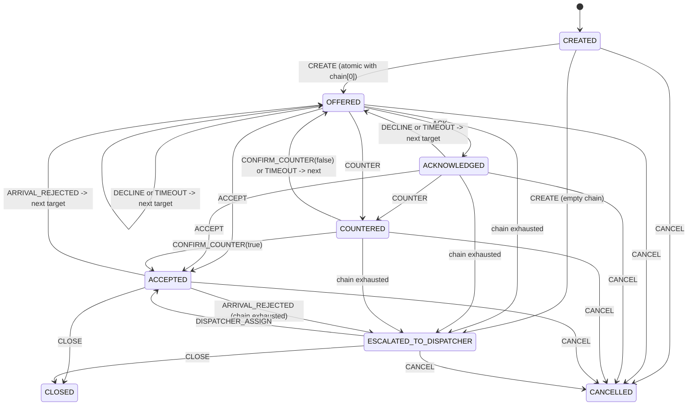
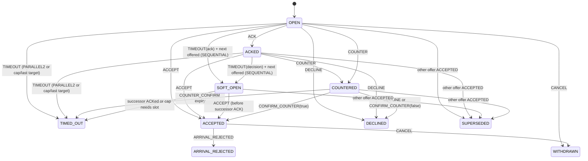

# ReferralHandshake (Protocol RHP-1) — System Design Specification

**System:** Referral Handshake Protocol (RHP-1) + Reference Platform  
**Team:** MAHA YODHAS | **Track:** HealthTech | **Event:** Colossus 3.0 (13–14 Nov 2026, Bengaluru)  
**Data Posture:** Synthetic only (`REAL_DATA=0`)  
**First Clinical Pathway:** Emergency obstetric referral across Karnataka-style tiers (`PHC -> CHC -> FRU -> DH -> MC`); data model is pathway-generic (`OBSTETRIC_EMERGENCY`, `NEONATAL`, `TRAUMA`, `CARDIAC`, `STROKE`).

---

## 0. Precedence, Tag Legend, Coherence Rule & Topology

### 0.1 Strict Input Precedence
Any design or implementation ambiguity is resolved using this non-negotiable hierarchy:
1. `ReferralHandshake_LOCKED_Problem_Statement_v7.md` (Highest authority on problem framing, evidence tags, and claims discipline)
2. Research findings tagged `[V]` inside the locked documents
3. `ReferralHandshake_v8_LOCKED_Solution.md` (Authority on `D1`–`D20` fixes, 28 scenarios, 40-item loophole ledger, and operating model)
4. `ReferralHandshake_FINAL_LOCKED_Architecture.md` (Ultimate authority on `F1`–`F20` closures, `I1`–`I16` invariants, 24-table PostgreSQL 16 DDL, 10-step `apply_command()` pipeline, timing math, Quint spec, independent Python monitor, and `T0`–`T3` tiers)
5. `ReferralHandshake_3Gem_Antigravity_Workflow.md` (Authority on multi-agent verification gates, file ownership, and `AGENTS.md` discipline)

### 0.2 Status Tag Legend
- **`[V]`**: Verified from primary research or official technical documentation.
- **`[V*]`**: Verified only from a secondary, blog, or vendor source.
- **`[CONFLICT]`**: Primary/secondary research files disagree; conservative bound applied.
- **`[GAP]`**: No reliable primary evidence found; parameterized in configuration and excluded from factual claims.
- **`[verify]`**: Requires pre-event hardware/sandbox verification per Section 13.
- **Weakness Status Tags**:
  - **`CLOSED`**: Eliminated by a deterministic architectural mechanism and verified by a named automated test.
  - **`BOUNDED`**: Technical residual explicitly quantified and monitored by a runtime alarm.
  - **`OPEN`**: Governance, legal, or physical-world dependency assigned to a named owner with required closing evidence.

### 0.3 The Coherence Rule
Every component in ReferralHandshake must be exactly one of:
1. **(a) A state or event in the contract** (stored in PostgreSQL 16 and governed by `transitions.yaml`),
2. **(b) An interface producing or consuming those events** (PWA desks, Android app, Exotel voice IVR, DLT SMS, paper code, dispatcher proxy), or
3. **(c) A read-only projection of the committed event log** (Independent Python Runtime Monitor, Merkle Witness/Signer, Browser Verifier, Command Centre KPIs, XES/FHIR exporters).

Anything outside `(a)`, `(b)`, or `(c)` is strictly out of scope.

### 0.4 System Architecture Diagram

```
 PRODUCERS / CONSUMERS (Interfaces)            CORE (The Contract)                        READERS (Log Projections)
 +------------------------------+   +----------------------------------------+   +-----------------------------------+
 | React PWA Desks (QR, SSE)    |   | FastAPI apply_command() (10 Steps)     |   | Python Monitor (Person B, RO DB)  |
 | Android EMT App (Kotlin/GPS) |-->| Lock order: referral > offer >         |-->| Witness/Signer (OS user rhp-sign) |
 | Exotel Outbound IVR (Voice)  |   |   deadline > outbox; Idempotency;      |   | Browser Verifier (Pure-JS Noble)  |
 | DLT SMS (Static Alert+Link)  |   |   Fencing (version vs lease_epoch)     |   | Command Centre (KPIs, Graph, Map) |
 | Paper Code (Crockford+mod37) |   | PostgreSQL 16 Primary (sync_commit=on) |   | FHIR R4 & IEEE 1849 XES Exporters |
 | Dispatcher Console (Proxy)   |   | 2-Phase Poller  |  Outbox Relay        |   | Guarantee Arena (Big Screen)      |
 +------------------------------+   +----------------------------------------+   +-----------------------------------+
```

### 0.5 Locked Technology Stack vs. Banned Technologies

| Layer | Locked Choice | Rationale & Hard Constraints |
|---|---|---|
| **Database** | PostgreSQL 16 (single writable primary) | `synchronous_commit=on`, `log_lock_waits=on`, `READ COMMITTED` + explicit `SELECT ... FOR UPDATE`. Row locks cannot run on hot standbys `[V]`. |
| **Backend API** | Python 3.12, FastAPI, `psycopg3` | Synchronous/async connection pooling, Pydantic v2 with `extra='forbid'` on all request models. |
| **Web Desks** | React PWA + Server-Sent Events (SSE) | `Last-Event-ID` resume, $15\text{ s}$ heartbeats, bundled pure-JS `@noble/curves/ed25519` and `@noble/hashes/sha256`, RFC 8785 JCS (integers, strings, booleans only; floating-point numbers prohibited). |
| **Mobile / GPS** | Native Android (Kotlin, Tier `T3`) + PWA GPS fallback (`T1`) | `FOREGROUND_SERVICE_TYPE_LOCATION`, `FusedLocationProviderClient`, Room offline outbox, empty-payload FCM wake ping. |
| **Voice & SMS** | Exotel Outbound IVR + DLT SMS | Outbound calls to $\le 10$ whitelisted sandbox numbers; webhook must return HTTP 200 within $5\text{ s}$ `[V]` (internal budget $2\text{ s}$). |
| **Maps & ETA** | Mapbox Directions & Matrix API | `mapbox/driving` (25 coords, 60 req/min) and `driving-traffic` (10 coords, 30 req/min) `[V]`, cached $120\text{ s}$ server-side. |
| **Formal & Runtime Proof** | Quint (`rhp1.qnt`) + Independent Python Monitor + Toxiproxy | Person A writes `rhp1.qnt` and `transitions.yaml`; Person B writes `monitor/monitor.py` from Section 3 prose alone. |
| **BANNED** | **Strictly Prohibited** | **No** blockchain, Kafka, Debezium, Redis, Kubernetes, WebSockets, WhatsApp, on-device LLMs, CRDTs for authoritative state, or floats in JCS. |

---

## 1. Build Tiers (`T0`–`T3`), Feature Flags & 24-Hour Execution Plan

| Tier | Feature Flag | Scope & Deliverables | Cut Order |
|---|---|---|---|
| **T0** | Always enabled | FastAPI `apply_command()`, PostgreSQL 16 (24 tables), 2-phase poller, outbox relay, React PWA desks with rotating QR admission, Independent Python Monitor, Merkle Witness + pure-JS Browser Verifier, `BROKEN_BUILD` scratch DB isolation | **Never cut** |
| **T1** | `T1_TRANSPORT` | PWA ambulance client (foreground GPS + manual update), Dispatcher console + proxy entry, time-scrubber replay | Cut 3rd |
| **T2** | `T2_REACH` | Exotel outbound voice IVR (AMD + press-1 gate + PIN), DLT-style static SMS stub, 9-char Crockford+mod37 paper code | Cut 2nd |
| **T3** | `T3_EXTRAS` | Native Kotlin Android app, AI intake accelerator with Cognitive Forcing Function, FHIR R4 & IEEE 1849 XES exporters | Cut 1st |

### 1.1 24-Hour Two-Lane Build Schedule
- **Lane A (Person A — Backend & Formal Proof):** Owns `db/schema.sql`, `spec/transitions.yaml`, `spec/rhp1.qnt`, `api/`, `witness/`, and concurrency/fault tests.
- **Lane B (Person B — Clients, Reach & Independent Monitor):** Owns `monitor/monitor.py` (isolated workspace, zero server imports), `pwa/`, Exotel/SMS adapters, and demo operations.

| Hours | Lane A (Backend / Proof) | Lane B (Clients / Reach / Monitor) | Gate |
|---|---|---|---|
| **H00–H02** | Load 24-table DDL, seed data, `transitions.yaml` loader | PWA shell, rotating-QR judge admission | — |
| **H02–H06** | `apply_command()` steps 1–10: `CREATE`, `ACK`, `ACCEPT`, `DECLINE` | Receiving desk UI, SSE stream with per-event `payload_grant` authz | — |
| **H06–H09** | Two-phase poller, outbox relay, `TIMEOUT`, unified notice ladder | Big screen Guarantee Arena; Independent Python Monitor (`rhp_monitor`) | — |
| **H09–H12** | Hash chain, `rhp-sign` witness process, 5 s Merkle checkpoints | Pure-JS Browser Verifier (`@noble/curves`, `@noble/hashes`) | — |
| **H12–H14** | 200-way barrier test (`race200`), mutations `M1`–`M3` | `BROKEN_BUILD=1` scratch DB + flashing red banner | **G0 (`T0` Pass)** |
| **H14–H17** | `COUNTER`, `CONFIRM_COUNTER`, 6 arrival cases, 2-stage closure | Dispatcher console, proxy entry, PWA GPS ambulance client | **G1 (`T1` Pass)** |
| **H17–H20** | Idempotency edge-case matrix, fencing tests, `M4`–`M6` | Exotel outbound IVR (press-1 gate + PIN), Crockford+mod37 paper code | **G2 (`T2` Pass)** |
| **H20–H22** | Fix defects surfaced by Gem 2 / Gem 3 audits | Record MP4 fallback clips (Clips A–D), full 30 s loop rehearsal $\times 3$ | **G3 (Rehearsal)** |
| **H22–H24** | **HARD CODE FREEZE AT H22** (config-only changes permitted) | Final rehearsal, backup laptop hot-standby, LAN hotspot verification | **FREEZE** |

---

## 2. Complete Delta & Defect Closure Ledger (`F1`–`F20` & `D1`–`D20`)

### 2.1 Architecture Closures (`F1`–`F20`)

| Fix ID | Prior Defect | Exact Architectural Mechanism in RHP-1 | Section | Verification Test |
|---|---|---|---|---|
| **F1** | Poller held deadline locks across commands; lock-order contradiction | Total lock order `referral -> offer (ORDER BY id) -> deadline (ORDER BY id) -> outbox`; Poller Phase 1 is a single committed `UPDATE ... SKIP LOCKED` statement; Phase 2 calls `apply_command(TIMEOUT)` which locks `referral` first; trigger `rhp_require_lock` enforces `I14` | §5 | `T-F1 lock_order_200way` (deadlock $\Delta = 0$) |
| **F2** | Notice ladder raced offer ACK deadline | Notice rungs placed at $0$, $A/4$, $3A/4$ inside ACK window $A$; 4 cold-key signed profiles; demo profiles refuse boot if `REAL_DATA=1` | §6 | `T-F2 profile_guard` |
| **F3** | $T_{max}$ double-counted slots and was unbounded in config | Roster slots notified concurrently; $T_{max} = F \cdot (A + D + \epsilon) \le B$; startup validator refuses boot if violated (`I13`) | §6 | `T-F3 tmax_validator` |
| **F4** | Incomplete SQL schema | Complete 24-table PostgreSQL 16 DDL, `one_lease` partial unique index, deferrable FKs, CHECKs, append-only triggers | `DATABASE_SCHEMA.md` | `T-F4 ddl_load_fk_scan` |
| **F5** | Ambiguous arrival state transitions | Six explicit arrival cases `(a)`–`(f)`; $200\text{ m}$ geofence emits `ARRIVAL_SUGGESTED` only; human actor confirms `ARRIVED` | §4.5 | `T-F5 arrival_cases` |
| **F6** | Unclosed referrals / terminal state holes | Reachability & Exit table; 9-item outcome taxonomy; two-stage `CLOSURE` deadline auto-closing with `UNKNOWN_COUNTER_REFERRAL` (`proxy=true`) | §4.4 | `T-F6 reachability_bfs` |
| **F7** | Role-wide PIN lockout DoS & voicemail false ACK | Single-use enrollment ticket $\rightarrow$ device pubkey $\rightarrow$ opaque session; Argon2id failure counter in autonomous txn scoped to `(session_id \| call_sid)`; Exotel AMD + `Press 1` gate | §5.1, §7 | `T-F7 pin_lockout_scope` |
| **F8** | Witness key co-location & DB restore false-tamper | Separate OS user `rhp-sign` (`0400` key); $O(\log N)$ Merkle inclusion proofs; cold-key signed `RESTORE` checkpoint and event | §7.2 | `T-F8 tamper_vs_restore` |
| **F9** | Free-text PHI leakage in `event.detail` | Per-event-type key allowlist (`rhp_allowed`) + value regex CHECK (`rhp_detail_ok`); $4\text{ h}$ export buckets with $k \ge 5$ suppression | §7.1 | `T-F9 detail_check_fuzz` |
| **F10** | SSE streams outliving revoked payload grants | Per-event authorization check on every SSE emission and $15\text{ s}$ heartbeat; immediate `GRANT_REVOKED` control frame + DOM wipe | `API_SPECIFICATION.md` | `T-F10 sse_revoke` |
| **F11** | Host clock steps breaking deadlines or hash chain | `ts = GREATEST(clock_timestamp(), referral.head_ts)` under referral lock (`I16`); `chrony` slew-only; $> 2\text{ s}$ NTP offset alarm | §6.3 | `T-F11 clock_step` |
| **F12** | Stale offline `ACCEPT` granted after resources vanished | `expires_at` on `offer_resource_confirmation`; `409 STALE_CONFIRMATION_RECONFIRM_REQUIRED` forces live re-confirmation (`I15`) | §5.3 | `T-F12 offline_stale` |
| **F13** | Undefined open-offer count under soft-open & counters | `open_offers` (`OPEN`, `ACKED`, `COUNTERED`, `SOFT_OPEN`) $\le 2$ always (`I12`); deterministic overlap and `COUNTER` race rules | §4.6 | `T-F13 open_cap` |
| **F14** | Undefined idempotency replay on errors/in-flight | Idempotency is Step 1 of `apply_command()`; scoped `(actor_id, key)` + SHA-256 JCS request hash; 8-case edge matrix | §5.2 | `T-F14 idem_matrix` |
| **F15** | Unsubstantiated "none" residuals in failure matrix | Every failure matrix row states an explicit technical bound and underlying reason | §9 | `T-F15 residual_lint` |
| **F16** | Vague demo script | Tiers `T0`–`T3` behind flags; second-by-second $30\text{ s}$ live proof loop with pre-recorded MP4 fallbacks | §8.5 | `T-F16 loop_rehearsal` |
| **F17** | Common-mode bug between server and monitor | Person A writes server/Quint; Person B writes Python monitor from Section 3 prose; verified by 6 mutation tests (`M1`–`M6`) | §8 | `T-F17 mutation_suite` |
| **F18** | Conflicting cloud cost estimates | Reconciled 6-month AWS `ap-south-1` Multi-AZ cost table ($\approx \$1,419$ total / $\$236.50\text{/mo}$) | §12 | `T-F18 cost_recompute` |
| **F19** | Implicit mapping between v7 states and DB columns | Explicit 12-row v7-to-RHP-1 state mapping table | §4.3 | `T-F19 v7_map` |
| **F20** | `BROKEN_BUILD` risking real data or main DB | Dedicated scratch DB `rhp_scratch_broken` lacking `one_lease`; hard abort (exit 78) if `REAL_DATA=1` or wrong DSN | §8.4 | `T-F20 broken_isolation` |

### 2.2 Solution Defect Closures (`D1`–`D20` Summary)
All 20 solution defects from `v8` are preserved and enforced:
- **`D1` (Care-blocking MgSO4 validation):** `mgso4_status` (`GIVEN | NONE_GIVEN | UNKNOWN`) is *answer-required*, never *knowledge-required*; `UNKNOWN` sets a red verification banner at the receiving desk and never blocks dispatch.
- **`D2` (Missing transport track / geofence auto-arrival):** Parallel transport track (`I3`); geofence only emits `ARRIVAL_SUGGESTED`.
- **`D3`–`D4` (Missing counter/decline, intra-facility ladder, and feature-phone reach):** Full `ACCEPT` / `COUNTER` ($\le 2$ rounds) / `DECLINE` vocabulary, concurrent slot notice ladder, Exotel IVR, SMS link, paper code, and dispatcher proxy.
- **`D5`–`D6` (Overclaims & missing formal spec):** Enforced Claims Register (§10) + frozen Quint specification (`rhp1.qnt`) + conformance vectors.
- **`D7`–`D8` (Conflated version/lease token & SQLite durability):** Separate `version` (`412`) and `lease_epoch` (`409`); PostgreSQL 16 with `synchronous_commit=on`.
- **`D9`–`D12` (Crypto-shredding, split-view tampering, QR bot minting, shared-tablet PIN spoofing):** Per-referral AES-256-GCM DEK wrapped by monthly KEK (`key_version`), Ed25519 Merkle checkpoints to external witnesses, Cloudflare Turnstile + $20$-desk cap, and Argon2id server-verified PIN.
- **`D13`–`D20` (FCM zero-payload wake, curated capability registry with attestation age, in-app log replay, 4-hour code freeze, anti-Goodhart queue without countdown clocks, independent Python monitor, and `T0`–`T3` cut lines):** Enforced across Sections 3–12.

---

## 3. System Invariants (`I1`–`I16`)

| ID | Category | Formal Invariant Predicate | Primary DB / Server Enforcement | Independent Monitor Rule (`rhp_monitor`) | Test ID |
|---|---|---|---|---|---|
| **I1** | Liveness | Every non-terminal referral (`hs_state NOT IN ('CLOSED','CANCELLED')`) has $\ge 1$ `PENDING` deadline and a responsible role; any overdue deadline is acted on within tolerance $\tau = 2 \cdot \text{poll\_interval} + 2000\text{ ms}$. | Deferred constraint trigger `i1_pending_deadline` checked at `COMMIT`. | Query `deadline WHERE status='PENDING' AND due_at < clock_timestamp() - TAU_MS`; flag `("I1", referral_id)`. | `T-I1` |
| **I2** | Safety | At most one active ownership lease per referral ($\text{count}(\text{status}=\text{'ACCEPTED'}) \le 1$); `lease_epoch` is strictly increasing on every grant/revocation. | Partial unique index `one_lease ON offer(referral_id) WHERE status='ACCEPTED'` + `SELECT ... FOR UPDATE` on `referral`. | Fold events: if `LEASE_GRANTED` when `lease != None` or `e.epoch <= st.epoch`, or DB has $>1$ `ACCEPTED` offer, flag `I2`. | `T-I2` |
| **I3** | Safety | Transport updates (`TR_UPDATE`, `TR_DESTINATION_CHANGE`) are accepted in every non-terminal `hs_state`; handshake state never gates ambulance movement. | `TR_UPDATE` handler in `apply_command()` never branches on `referral.hs_state` (checks only `hs_state NOT IN ('CLOSED','CANCELLED')`). | Inspect `rejected_command` for `TR_UPDATE` where rejection reason is anything other than terminal referral or invalid `tr_state` step. | `T-I3` |
| **I4** | Safety | Each client `event_id` is committed at most once; per-referral `seq` starts at $1$ and is strictly contiguous ($\text{seq}_k = \text{seq}_{k-1} + 1$) with zero gaps. | `idempotency` PK `(actor_id, key)`, `event.event_id UNIQUE`, `PRIMARY KEY(referral_id, seq)`, trigger `rhp_event_guard`. | Fold events ordered by `seq`: if `e.seq != st.seq + 1` or duplicate `event_id`, flag `("I4", e.seq)`. | `T-I4` |
| **I5** | Safety | Per-referral SHA-256 hash chain and Ed25519 checkpoint signatures verify from genesis; `CLOSED` referrals always record a valid `outcome`. | Triggers `event_ao`, `checkpoint_ao`, `rhp_event_guard`; `referral` CHECK `((hs_state IN ('CLOSED','CANCELLED')) = (outcome IS NOT NULL AND closed_at IS NOT NULL))`. | Recompute `SHA256(prev_hash || JCS(core))` for every event; verify `prev_hash == st.head` and `hash == expected`; verify terminal outcome. | `T-I5` |
| **I6** | Safety | Every `ACCEPT`, `COUNTER`, or `DECLINE` originates from a rostered role at the target facility on a registered device/number with a verified PIN, or is explicitly flagged `proxy=true`. | Steps 2, 3, and 5 of `apply_command()` verify session, Argon2id PIN, and active `roster` validity window. | Join `event` with `roster` and `session`; if mutating decision lacks valid roster at `server_ts` and `proxy == false`, flag `I6`. | `T-I6` |
| **I7** | Safety | Every system-generated offer target is a member of `referral.chain` (`source='CHAIN'`); only human dispatcher overrides use `source='DISPATCHER'`. | Trigger `offer_chain_guard` checks `NEW.facility_id = ANY(referral.chain)` whenever `NEW.source = 'CHAIN'`. | Verify every `OFFER_CREATED` event with `source='CHAIN'` has `facility_id` in `referral.chain`. | `T-I7` |
| **I8** | Safety | Commands carrying a stale `expected_version` or `expected_epoch` are never applied and are deterministically logged in `rejected_command`. | Step 5 fencing check raises `Reject(412, "STALE_VERSION_OR_EPOCH")`; rolls back to `SAVEPOINT sp_cmd` and inserts into `rejected_command`. | Verify no committed `event` has `e.epoch < st.epoch` at the point of application. | `T-I8` |
| **I9** | Safety | A facility is offered at most once per referral (no $A \rightarrow B \rightarrow A$ referral loops). | `UNIQUE (referral_id, facility_id)` constraint on `offer`. | Track set of offered facilities per referral in event fold; flag `I9` on repeat. | `T-I9` |
| **I10** | Safety | Clinical payload frames are transmitted only to subscribers holding an active (unrevoked) `payload_grant` for that referral. | `UNIQUE INDEX one_active_grant`; SSE emitter filters every frame and $15\text{ s}$ heartbeat against `payload_grant WHERE revoked_at IS NULL`. | Audit outbox/SSE delivery logs against `GRANT_REVOKED` timestamps; flag any clinical emission post-revocation. | `T-I10` |
| **I11** | Safety | `event.detail` contains only allowlisted keys for its `event.type` with boolean, $\le 12$-digit integer, uppercase enum token, or UUID values (zero free-text PHI). | Pydantic `Literal` schemas + PostgreSQL immutable CHECK `rhp_detail_ok(type, detail)`. | Scan `event.detail` against allowlist rules; flag any non-conforming key or value. | `T-I11` |
| **I12** | Safety | Every referral has at most $2$ concurrently open offers ($\text{status} \in \{\text{'OPEN'}, \text{'ACKED'}, \text{'COUNTERED'}, \text{'SOFT\_OPEN'}\}$). | `referral.open_offers CHECK (open_offers BETWEEN 0 AND 2)` maintained under the referral row lock. | Count offers in open statuses during fold and check `referral.open_offers <= 2`; flag `I12` if $> 2$. | `T-I12` |
| **I13** | Safety | For the active timing profile, worst-case escalation time satisfies $T_{max} = F \cdot (A + D + \epsilon) \le B$, and voice stagger fits inside $[A/4, 3A/4]$. | Startup validator `validate(profile, REAL_DATA)` runs before FastAPI binds the socket and on `/healthz`. | Recompute $F \cdot (A + D + \epsilon) \le B$ and `profile_hash` signature on every monitor cycle. | `T-I13` |
| **I14** | Safety | No write to contract state (`referral`, `offer`, `deadline` status/due, `event`, `payload_grant`, `outbox` insert) occurs without holding the `referral` row lock in total order. | Trigger `rhp_require_lock` checks `current_setting('rhp.locked_referral', true) == rid` on all contract tables. | Monitor `pg_stat_database.deadlocks` delta (must be $0$) and `log_lock_waits`. | `T-I14` |
| **I15** | Safety | No ownership lease is granted unless every capability required by `need_class_requirement` has a confirmation in `offer_resource_confirmation` with `expires_at > server_ts`. | Step 7 of `apply_command()` checks `expires_at > ts` for all required capabilities on `ACCEPT` and `CONFIRM_COUNTER(true)`. | Join `OFFER_ACCEPTED` events with `offer_resource_confirmation`; flag `I15` if any required capability is missing or expired at `server_ts`. | `T-I15` |
| **I16** | Safety | Per-referral event timestamps `server_ts` are monotonically non-decreasing ($\text{server\_ts}_k \ge \text{server\_ts}_{k-1}$). | Step 4 computes `ts = GREATEST(clock_timestamp(), referral.head_ts)` under lock; trigger `rhp_event_guard` rejects `NEW.server_ts < r.head_ts`. | Fold events: if `e.ts < st.ts`, flag `("I16", e.seq)`. | `T-I16` |

---

## 4. State Model & Two-Track Protocol Semantics

### 4.1 Handshake Track State Machine (`referral.hs_state`)



### 4.2 Per-Facility Offer State Machine (`offer.status`) & Transport Track (`referral.tr_state`)



**Transport Track (`referral.tr_state`):**
`REQUESTED -> DISPATCHED -> EN_ROUTE -> ARRIVED -> HANDED_OVER` (with `REQUESTED | DISPATCHED | EN_ROUTE -> TR_CANCELLED`). Destination updates occur via `TR_DESTINATION_CHANGE` in any state prior to `ARRIVED`. Transport never reads `hs_state` (`I3`).

### 4.3 Mapping from Problem Statement `v7` to `RHP-1` (`F19`)

| `v7` Conceptual State | `referral.hs_state` | `offer.status` | `referral.tr_state` | Committed `event.type` |
|---|---|---|---|---|
| `CREATED` | `CREATED` (transient inside `CREATE` txn) | — | `REQUESTED` | `REFERRAL_CREATED` |
| `OFFERED` | `OFFERED` | `OPEN` | any | `OFFER_CREATED` |
| `ACKNOWLEDGED` | `ACKNOWLEDGED` | `ACKED` | any | `OFFER_ACKED` |
| `ACCEPTED` | `ACCEPTED` | `ACCEPTED` | any | `OFFER_ACCEPTED`, `LEASE_GRANTED` |
| `COUNTERED` | `COUNTERED` | `COUNTERED` | any | `OFFER_COUNTERED` |
| `DECLINED` | `OFFERED` or `ESCALATED_TO_DISPATCHER` | `DECLINED` | any | `OFFER_DECLINED` |
| `TIMED_OUT` | `OFFERED` or `ESCALATED_TO_DISPATCHER` | `TIMED_OUT` or `SOFT_OPEN` | any | `DEADLINE_TIMEOUT` |
| `ESCALATED` | `OFFERED` (`ladder_cursor + 1`) | next `OPEN` | any | `OFFER_CREATED` (`reason='ESCALATION'`) |
| `ARRIVAL_REJECTED` | `OFFERED` or `ESCALATED_TO_DISPATCHER` | `ARRIVAL_REJECTED` | `ARRIVED` | `ARRIVAL_REJECTED`, `LEASE_REVOKED` |
| `ESCALATED_TO_DISPATCHER` | `ESCALATED_TO_DISPATCHER` | — | any | `ESCALATED_TO_DISPATCHER` |
| `CANCELLED` | `CANCELLED` | `WITHDRAWN` | any / `TR_CANCELLED` | `CANCELLED` |
| `CLOSED` | `CLOSED` | — | `HANDED_OVER` or outcome-specific | `CLOSED` |

### 4.4 Reachability, Deterministic Exit & Closure Semantics (`F6`)

| `hs_state` | Reachable From `CREATED` Via | Deterministic Exit to Terminal State (`CLOSED` / `CANCELLED`) |
|---|---|---|
| `CREATED` | Initial state | Atomic transition inside `CREATE` txn to `OFFERED` (non-empty chain) or `ESCALATED_TO_DISPATCHER` (empty chain). |
| `OFFERED` | `CREATE` | `ACCEPT` $\rightarrow$ `ACCEPTED` $\rightarrow$ `CLOSE`; or silence/decline across chain $\rightarrow$ `ESCALATED_TO_DISPATCHER` $\rightarrow$ `CLOSE`/`CANCEL`; or `CANCEL`. |
| `ACKNOWLEDGED` | `ACK` | Bounded by `DECISION` deadline ($\le D$); exits via `ACCEPT`, `COUNTER`, `DECLINE`, `TIMEOUT`, or `CANCEL`. |
| `COUNTERED` | `COUNTER` | Bounded by `COUNTER_CONFIRM` deadline ($\le \min(C, \text{remaining } D)$, $\le 2$ rounds); exits via `CONFIRM_COUNTER`, `TIMEOUT`, or `CANCEL`. |
| `ACCEPTED` | `ACCEPT`, `CONFIRM_COUNTER(true)`, `DISPATCHER_ASSIGN` | `HANDOVER` deadline fires `HANDOVER_OVERDUE` pages (re-armed) until `HANDED_OVER` $\rightarrow$ `CLOSURE` deadline $\rightarrow$ `CLOSE`; or `ARRIVAL_REJECTED` / `CANCEL`. |
| `ESCALATED_TO_DISPATCHER` | Chain exhaustion | `DISPATCH_ACTION` deadline re-pages dispatcher until `DISPATCHER_ASSIGN`, `CLOSE`, or `CANCEL`. |
| `CLOSED`, `CANCELLED` | Terminal states | — |

**Locked 9-Value Outcome Taxonomy (`referral.outcome`):**
1. `ADMITTED_STABLE` (requires `tr_state = 'HANDED_OVER'`)
2. `ADMITTED_CRITICAL` (requires `tr_state = 'HANDED_OVER'`)
3. `DELIVERED_AT_RECEIVER` (requires `tr_state = 'HANDED_OVER'`)
4. `DELIVERED_EN_ROUTE`
5. `PATIENT_REFUSED`
6. `TRANSPORT_CANCELLED`
7. `DETERIORATED_OR_DIED_PRE_HANDOVER`
8. `REDIRECTED_ON_ARRIVAL`
9. `UNKNOWN_COUNTER_REFERRAL`

**Two-Stage Automatic Closure (`CLOSURE` Deadline):**
When `tr_state` reaches `HANDED_OVER`, the server creates a `CLOSURE` deadline ($24\text{ h}$ in pilot profiles; $20\text{ s}$ in `DEMO_FAST`). At first expiry, the poller emits `CLOSURE_OVERDUE` to the dispatcher and district view and re-arms the `CLOSURE` deadline once for the same duration. At the second expiry, the system executes `CLOSE` with `outcome = 'UNKNOWN_COUNTER_REFERRAL'`, `proxy = true`, `channel = 'SYSTEM'`, and `actor_roster_id = NULL`. The system never fabricates a clinical outcome.

### 4.5 Six Arrival Cases (`F5`)

| Case | Scenario | Protocol Behaviour |
|---|---|---|
| **(a)** | Arrival at active lease holder | $200\text{ m}$ geofence + dwell emits `ARRIVAL_SUGGESTED`; EMT or receiving desk confirms `TR_UPDATE(tr_state='ARRIVED')`. |
| **(b)** | Arrival at facility holding `OPEN`, `ACKED`, or `SOFT_OPEN` offer | Receiving desk may execute `ACCEPT` immediately (all required resource confirmations and `I15` freshness still enforced). |
| **(c)** | Unannounced arrival at facility with no offer | Emits `ARRIVAL_AT_NON_OWNER` urgent alert + pages dispatcher; never blocks emergency care; dispatcher may execute `DISPATCHER_ASSIGN`. |
| **(d)** | En-route destination change | Crew or dispatcher issues `TR_DESTINATION_CHANGE` with structured reason enum; system never reroutes an ambulance autonomously. |
| **(e)** | Crew declines redirect advisory after lease move | Crew logs `TR_DESTINATION_CHANGE(accepted=false)`; lease remains unchanged; dispatcher is paged to coordinate. |
| **(f)** | Ambulance already past highway turn-off when lease moves | Advisory displays detour ETA from cached Mapbox Matrix; crew decides; if crew continues to original hospital, handled as Case `(c)` on arrival. |

### 4.6 Soft-Open, Parallel-2 & Counter-Offer Cap Arithmetic (`F13`, `I12`)
- **Hard Cap:** `referral.open_offers` counts offers in `{'OPEN', 'ACKED', 'COUNTERED', 'SOFT_OPEN'}` and satisfies $0 \le \text{open\_offers} \le 2$ at all times (`I12`).
- **Sequential Overlap (`SOFT_OPEN`):** In `SEQUENTIAL` mode, steady state has $1$ `OPEN` offer. When offer $k$ times out without decision and facility $k+1$ is offered, offer $k$ transitions to `SOFT_OPEN` and offer $k+1$ opens as `OPEN` ($\text{open\_offers} = 2$).
- **Early Eviction on 3rd Target:** If offer $k+1$ also times out while offer $k$ is still `SOFT_OPEN` and facility $k+2$ is offered, offer $k$ immediately transitions from `SOFT_OPEN` to `TIMED_OUT` in the same transaction so offer $k+1$ becomes `SOFT_OPEN` and offer $k+2$ becomes `OPEN` ($\text{open\_offers}$ remains $2$).
- **Late-Accept Resolution:** If facility $k$ (`SOFT_OPEN`) submits `ACCEPT` before facility $k+1$ submits `ACK`, facility $k$ wins the lease (`ACCEPTED`) and offer $k+1$ is `SUPERSEDED` with notice. The instant facility $k+1$ submits `ACK`, offer $k$ transitions from `SOFT_OPEN` to `TIMED_OUT`, and any subsequent `ACCEPT` from facility $k$ receives `409 LATE_ACCEPT_REJECTED`.
- **Parallel-2 Mode (`PARALLEL2`):** Dispatcher or demo mode opens `chain[0]` and `chain[1]` simultaneously ($\text{open\_offers} = 2$). On timeout in `PARALLEL2`, the expiring offer transitions directly to `TIMED_OUT` (no `SOFT_OPEN`) and the next unused target in `chain` opens.
- **Counter-Offers (`COUNTER`):** Allowed from `OPEN` or `ACKED` when `counter_round < 2`. Replaces the `DECISION` deadline with `COUNTER_CONFIRM` due at $\text{ts} + \min(C, \text{remaining } D)$ so counters never extend the facility's decision window. If a second offer is concurrently open, whichever of `{other ACCEPT, CONFIRM_COUNTER(true)}` acquires the referral lock and commits first wins the lease; the loser gets `409 LEASE_HELD`.

---

## 5. Command Execution Pipeline, Global Lock Order & Workers

### 5.1 Global Lock Order Proof (`F1`, `I14`)
Every multi-table transaction acquires locks strictly in the total order:
$$\text{referral} \rightarrow \text{offer (ORDER BY id)} \rightarrow \text{deadline (ORDER BY id)} \rightarrow \text{outbox}$$

| Execution Path | Locks Acquired (in exact order) | Waits While Holding a Lock? |
|---|---|---|
| `apply_command()` | `pg_try_advisory_xact_lock` (non-blocking) $\rightarrow$ `referral` $\rightarrow$ `offer (ORDER BY id)` $\rightarrow$ `deadline (ORDER BY id)` $\rightarrow$ `outbox` | Only forward in the total order |
| Poller Phase 1 (`tick`) | `deadline` rows via a single `UPDATE ... FOR UPDATE SKIP LOCKED` statement, committed immediately | Never (`SKIP LOCKED` skips contested rows) |
| Poller Phase 2 | Invokes `apply_command(TIMEOUT)` in a new transaction | Same as `apply_command()` |
| Outbox Relay | `outbox` rows via a single `UPDATE ... FOR UPDATE SKIP LOCKED` statement, committed immediately | Never (`SKIP LOCKED`) |
| Monitor & Witness | `REPEATABLE READ READ ONLY` transaction snapshot | Never (acquires zero row locks) |

Because every transaction touches at most one `referral` and acquires row locks strictly forward along a DAG with no cycles, application-level deadlocks cannot form. Database trigger `rhp_require_lock` enforces `current_setting('rhp.locked_referral', true) = referral_id` on every contract write.

### 5.2 Reference Implementation of `apply_command()` (10 Steps)

```python
import hashlib
import json
import psycopg

def jcs(obj: dict) -> bytes:
    """RFC 8785 Canonical JSON subset: ASCII keys, integers/strings/booleans only (no floats)."""
    return json.dumps(obj, sort_keys=True, separators=(",", ":"), ensure_ascii=True).encode("ascii")

class Reject(Exception):
    def __init__(self, code: int, reason: str):
        self.code = code
        self.reason = reason

def apply_command(conn: psycopg.Connection, cmd, sess, idem_key: str):
    if not idem_key or not (8 <= len(idem_key) <= 80):
        return http_response(422, {"error": "MISSING_IDEMPOTENCY_KEY"})

    # STEP 1: IDEMPOTENCY (Executed before acquiring any referral row lock)
    req_hash = hashlib.sha256(jcs(cmd.body_for_hash())).digest()
    with conn.transaction():
        locked = conn.execute(
            "SELECT pg_try_advisory_xact_lock(hashtextextended(%s, 0))",
            (f"{sess.roster_id}:{idem_key}",)
        ).fetchone()[0]
        if not locked:
            return http_response(409, {"error": "DUPLICATE_IN_FLIGHT"})

        row = conn.execute(
            "SELECT request_hash, status, http_status, response "
            "FROM idempotency WHERE actor_id = %s AND key = %s",
            (sess.roster_id, idem_key)
        ).fetchone()
        if row:
            if bytes(row.request_hash) != req_hash:
                return http_response(422, {"error": "KEY_REUSED_DIFFERENT_PAYLOAD"})
            if row.status == "DONE":
                return http_response(row.http_status, row.response)

        conn.execute(
            "INSERT INTO idempotency(actor_id, key, request_hash, status, created_at, expires_at) "
            "VALUES (%s, %s, %s, 'IN_FLIGHT', clock_timestamp(), clock_timestamp() + interval '48 hours') "
            "ON CONFLICT (actor_id, key) DO UPDATE SET status = 'IN_FLIGHT'",
            (sess.roster_id, idem_key, req_hash)
        )

        # STEP 2: SESSION & DEVICE VALIDATION (Read-only)
        s = load_and_verify_session(conn, sess)
        if not s.valid:
            return finalize_idempotency(conn, sess.roster_id, idem_key, 401, {"error": "SESSION_INVALID"})

        # STEP 3: PIN VERIFICATION (Argon2id; failure counter runs on an autonomous DB connection)
        if cmd.needs_pin:
            if s.pin_locked_until and s.pin_locked_until > s.now:
                return finalize_idempotency(conn, sess.roster_id, idem_key, 429, {"error": "PIN_LOCKED"})
            if not argon2_verify(s.pin_hash, cmd.pin):
                autonomous_pin_failed(s.id, s.roster_id, cmd.referral_id)
                return finalize_idempotency(conn, sess.roster_id, idem_key, 403, {"error": "PIN_INVALID"})

        # STEP 4: LOCK REFERRAL FIRST, STAMP SESSION GUC (I14), COMPUTE MONOTONE TIMESTAMP (I16)
        r = conn.execute(
            "SELECT * FROM referral WHERE id = %s FOR UPDATE",
            (cmd.referral_id,)
        ).fetchone()
        if not r and cmd.type != "CREATE":
            return finalize_idempotency(conn, sess.roster_id, idem_key, 404, {"error": "REFERRAL_NOT_FOUND"})
        target_rid = str(r.id) if r else str(cmd.referral_id)
        conn.execute("SELECT set_config('rhp.locked_referral', %s, true)", (target_rid,))
        ts = conn.execute(
            "SELECT GREATEST(clock_timestamp(), COALESCE(%s, clock_timestamp()))",
            (r.head_ts if r else None,)
        ).fetchone()[0]

        conn.execute("SAVEPOINT sp_cmd")
        try:
            # STEP 5: AUTHORITY & FENCING (I6, I8)
            authorize_actor(conn, r, s, cmd, ts)   # Raises Reject(403, ...) on BOLA/role mismatch
            check_fencing(r, cmd)                  # Raises Reject(412, "STALE_VERSION_OR_EPOCH")

            # STEP 6: TRANSITION GUARD (Lock offers and deadlines in ascending ID order)
            offers = conn.execute(
                "SELECT * FROM offer WHERE referral_id = %s ORDER BY id FOR UPDATE",
                (target_rid,)
            ).fetchall()
            deadlines = conn.execute(
                "SELECT * FROM deadline WHERE referral_id = %s AND status = 'PENDING' ORDER BY id FOR UPDATE",
                (target_rid,)
            ).fetchall()
            transition = TRANSITIONS.lookup(cmd.type, r, offers, deadlines, cmd)

            # STEP 7: STALENESS & RESOURCE CONFIRMATION FRESHNESS (I15, F12)
            check_confirmations_and_soft_open(conn, r, offers, cmd, ts)

            # STEP 8: APPLY STATE MUTATIONS (referral, offer, deadline, payload_grant)
            effects = transition.apply(conn, r, offers, deadlines, cmd, ts)

            # STEP 9: APPEND HASH-CHAINED EVENT(S) & OUTBOX ROWS (Outbox locked/inserted last)
            ev = append_chained_event(conn, r, cmd, effects, ts)
            insert_outbox_rows(conn, r, ev, effects, ts)

            # STEP 10: FINALIZE IDEMPOTENCY & COMMIT
            return finalize_idempotency(conn, sess.roster_id, idem_key, 200, ev.to_dict())

        except Reject as exc:
            conn.execute("ROLLBACK TO SAVEPOINT sp_cmd")
            conn.execute(
                "INSERT INTO rejected_command(actor_id, key, referral_id, command, http_status, reason_code, session_id, created_at) "
                "VALUES (%s, %s, %s, %s, %s, %s, %s, %s)",
                (sess.roster_id, idem_key, target_rid, cmd.type, exc.code, exc.reason, s.id, ts)
            )
            return finalize_idempotency(conn, sess.roster_id, idem_key, exc.code, {"error": exc.reason})
```

### 5.3 Stateless Two-Phase Poller & Outbox Relay

```python
CLAIM_DEADLINES_SQL = """
UPDATE deadline
   SET claimed_until = clock_timestamp() + interval '5 seconds'
 WHERE id IN (
       SELECT id FROM deadline
        WHERE status = 'PENDING'
          AND due_at <= clock_timestamp()
          AND (claimed_until IS NULL OR claimed_until < clock_timestamp())
        ORDER BY due_at
        LIMIT 50
        FOR UPDATE SKIP LOCKED
 )
RETURNING id, referral_id, offer_id, kind, step, epoch;
"""

def poller_tick(pool):
    # Phase 1: Single committed statement; holds zero locks after commit
    with pool.connection() as conn:
        with conn.transaction():
            due_rows = conn.execute(CLAIM_DEADLINES_SQL).fetchall()

    # Phase 2: Each claimed deadline is processed via apply_command(TIMEOUT)
    for d in due_rows:
        with pool.connection() as conn:
            cmd = TimeoutCommand(
                referral_id=d.referral_id,
                deadline_id=d.id,
                offer_id=d.offer_id,
                kind=d.kind,
                step=d.step,
                expected_epoch=d.epoch,
            )
            apply_command(conn, cmd, SYSTEM_SESSION, idem_key=f"timeout:{d.id}:{d.due_at.isoformat()}")
```

---

## 6. Timing Model, Signed Profiles & Monotone Clock Analysis

### 6.1 Unified Offer-ACK Window & Notice Ladder (`F2`)
Every `OPEN` offer has a single ACK window of duration $A$ with three deterministic notice rungs scheduled as `deadline` rows at offer creation:
- **Rung $0$ ($t = 0$):** Immediate push via SSE + empty-payload FCM wake ping to all rostered slots at the target facility concurrently.
- **Rung $A/4$ ($t = A/4 + i \cdot \delta$):** Outbound Exotel voice IVR call to rostered slot $i \in \{0, \dots, S-1\}$ with stagger $\delta$ and per-call duration budget $V$.
- **Rung $3A/4$ ($t = 3A/4$):** `NOTICE_PROXY` deadline fires a high-priority page to the human dispatcher console for phone-assisted proxy outreach.
- **ACK Expiry ($t = A$):** `ACK` deadline fires `TIMEOUT(kind='ACK')`. Any `ACK` before $t = A$ cancels pending notice rungs and sets the hard `DECISION` deadline at $t_{\text{ack}} + D$.

### 6.2 Locked Timing Profiles (All durations in milliseconds)

| Parameter | `PILOT_OB_CRITICAL` | `PILOT_STANDARD` | `DEMO_FAST` | `DEMO_VOICE` |
|---|---|---|---|---|
| **ACK Window ($A$)** | $60,000$ | $120,000$ | $3,000$ | $45,000$ |
| **Decision Window ($D$)** | $180,000$ | $300,000$ | $4,000$ | $20,000$ |
| **Notice Rungs ($0, A/4, 3A/4$)** | $0 / 15,000 / 45,000$ | $0 / 30,000 / 90,000$ | $0 / 750 / 2,250$ | $0 / 11,250 / 33,750$ |
| **Slots ($S$), Stagger ($\delta$), Call ($V$)** | $S=3, \delta=5,000, V=20,000$ | $S=3, \delta=10,000, V=20,000$ | $S=3, \delta=0$, Voice Off | $S=1, \delta=0, V=20,000$ |
| **Max Facilities ($F$)** | $3$ | $3$ | $3$ | $2$ |
| **Per-Hop Budget ($\epsilon$)** | $3,000$ | $3,000$ | $1,000$ | $1,000$ |
| **Counter Confirm ($C$)** | $90,000$ | $150,000$ | $2,000$ | $10,000$ |
| **Resource Confirm TTL (`confirm_ttl`)** | $120,000$ | $180,000$ | $10,000$ | $60,000$ |
| **`HANDOVER` / `DISPATCH_ACTION` / `CLOSURE`** | $7,200\text{ s} / 300\text{ s} / 86,400\text{ s}$ | $7,200\text{ s} / 300\text{ s} / 86,400\text{ s}$ | $30\text{ s} / 5\text{ s} / 20\text{ s}$ | $60\text{ s} / 10\text{ s} / 60\text{ s}$ |
| **Upper Bound ($B$)** | $900,000$ ($15\text{ min}$) | $1,500,000$ ($25\text{ min}$) | $25,000$ ($25\text{ s}$) | $150,000$ ($150\text{ s}$) |
| **Computed $T_{max} = F \cdot (A + D + \epsilon)$** | $3 \cdot 243\text{ s} = 729\text{ s} \le 900\text{ s}$ | $3 \cdot 423\text{ s} = 1,269\text{ s} \le 1,500\text{ s}$ | $3 \cdot 8\text{ s} = 24\text{ s} \le 25\text{ s}$ | $2 \cdot 66\text{ s} = 132\text{ s} \le 150\text{ s}$ |
| **Permitted when `REAL_DATA=1`?** | **Yes** | **Yes** | **No (aborts boot)** | **No (aborts boot)** |

**Voice Stagger Bound Check (`I13`):**
$$\frac{A}{4} + (S - 1) \cdot \delta + V \le \frac{3A}{4}$$
- `PILOT_OB_CRITICAL`: $15,000 + 2 \cdot 5,000 + 20,000 = 45,000 \le 45,000$ (Pass).
- `PILOT_STANDARD`: $30,000 + 2 \cdot 10,000 + 20,000 = 70,000 \le 90,000$ (Pass).
- `DEMO_VOICE`: $11,250 + 0 + 20,000 = 31,250 \le 33,750$ (Pass).

### 6.3 Monotone Server Clock & Step Analysis (`F11`, `I16`)
- **Single Time Authority:** `ts = GREATEST(clock_timestamp(), referral.head_ts)` under the referral lock. Client timestamps (`client_ts_ms`) are recorded as untrusted metadata and never govern deadlines.
- **Forward Clock Step ($\Delta > 0$):** Deadlines become due up to $\Delta$ early, causing premature escalation only. Because lease grants still require the referral lock and `one_lease`, safety (`I2`) cannot break.
- **Backward Clock Step ($\Delta < 0$):** `GREATEST` preserves monotone `server_ts` (`I16`); deadlines experience up to $|\Delta|$ additional delay bounded by the $2\text{ s}$ NTP offset alarm (`heartbeat.ntp_offset_ms`).

---

## 7. Security, Envelope Cryptography & Merkle Integrity

### 7.1 Envelope Encryption & Crypto-Shredding (`D9`, `F9`)
- **Per-Referral DEK:** Each referral generates a 256-bit `AES-256-GCM` Data Encryption Key (DEK) wrapped via `AES-KW` under a monthly Key Encryption Key (`kek_epoch`) stored in `key_version`.
- **Authenticated Associated Data (AAD):**
  - `clinical_payload`: $\text{AAD} = \text{referral\_id} \parallel \text{key\_id} \parallel \text{schema\_ver}$
  - `event_secret`: $\text{AAD} = \text{referral\_id} \parallel \text{seq} \parallel \text{key\_id}$
- **Chain Binding:** `event.secret_hash = SHA256(ciphertext)` is included in the JCS canonical event body before hashing, so deleting `clinical_payload` and `event_secret` at retention expiry never invalidates the SHA-256 event hash chain.
- **Shredding Execution:** On expiry, the server deletes `clinical_payload` and `event_secret`, sets `key_version.wrapped_dek = NULL, status = 'SHREDDED'`, and destroys the monthly `kek_epoch` key once all referrals in that cohort expire (rendering historical WAL/backup ciphertexts unrecoverable).

### 7.2 Hash Chain, Binary Merkle Checkpoints & Cold-Key `RESTORE` (`F8`)
- **Event Chain Formula:**
  $$\text{hash}_k = \text{SHA256}(\text{prev\_hash}_k \parallel \text{JCS}(\text{core}_k)), \quad \text{prev\_hash}_1 = \text{0x00}^{32}$$
  where `core` contains `{referral_id, seq, event_id, type, epoch, actor_roster_id, facility_id, channel, proxy, detail, secret_hash, client_ts_ms, server_ts_us}`.
- **Merkle Checkpoints (every $5\text{ s}$):** Signer process (`OS user rhp-sign`, DB role `rhp_witness`) reads a consistent snapshot of all referrals ordered by `id`:
  - $\text{Leaf}_i = \text{SHA256}(\text{0x00} \parallel \text{referral\_id}_{16\text{B}} \parallel \text{head\_seq}_{8\text{B BE}} \parallel \text{head\_hash}_{32\text{B}})$
  - $\text{Node} = \text{SHA256}(\text{0x01} \parallel \text{Left} \parallel \text{Right})$ (odd leaf promoted unchanged).
  - Signed with Ed25519 in C2SP note format: `"rhp1/<deployment>\n<tree_size>\n<root_b64>\n"` and broadcast to independent witnesses (Big Screen, Judge QR phones, off-box log).
- **Restore vs. Tamper:** Any regression in `head_seq` without a `checkpoint(kind='RESTORE')` signed by the offline Ed25519 cold key and a matching `RESTORE` event linking the restored `head_hash` is flagged as `TRUNCATED` / `TAMPER` by the verifier.

---

## 8. Proof Layer: Quint Specification, Independent Monitor & Mutation Suite

### 8.1 Complete Quint Control-Plane Specification (`spec/rhp1.qnt` — Person A)

```quint
module rhp1 {
  val FACS = 1.to(3)
  val MAXE = 4
  val OPEN_ST = Set("OPEN", "ACKED", "COUNTERED", "SOFT")
  var hs: str
  var off: int -> str
  var lease: int
  var epoch: int
  var cursor: int
  var tr: str
  var par: bool

  def nOpen(m) = FACS.filter(f => OPEN_ST.contains(m.get(f))).size()
  def live = hs != "CLOSED" and hs != "CANCELLED"
  def inFlight = Set("OFFERED", "ACKNOWLEDGED", "COUNTERED").contains(hs)
  def nextTr(t) = if (t == "REQUESTED") "DISPATCHED" else if (t == "DISPATCHED") "EN_ROUTE" else if (t == "EN_ROUTE") "ARRIVED" else if (t == "ARRIVED") "HANDED_OVER" else t

  action init = {
    nondet p = Set(true, false).oneOf()
    all { hs' = "CREATED", off' = FACS.mapBy(f => "NONE"), lease' = 0, epoch' = 0, cursor' = 0, tr' = "REQUESTED", par' = p }
  }
  action offerFirst = all {
    hs == "CREATED",
    off' = FACS.mapBy(f => if (f == 1 or (par and f == 2)) "OPEN" else "NONE"),
    cursor' = if (par) 2 else 1, hs' = "OFFERED",
    lease' = lease, epoch' = epoch, tr' = tr, par' = par
  }
  action ack(f) = all {
    inFlight, off.get(f) == "OPEN",
    off' = FACS.mapBy(g => if (g == f) "ACKED" else if (g == f - 1 and off.get(g) == "SOFT") "TIMEOUT" else off.get(g)),
    hs' = "ACKNOWLEDGED", lease' = lease, epoch' = epoch, cursor' = cursor, tr' = tr, par' = par
  }
  action grant(f, from) = all {
    inFlight, lease == 0, epoch < MAXE, from.contains(off.get(f)),
    off' = FACS.mapBy(g => if (g == f) "ACCEPTED" else if (OPEN_ST.contains(off.get(g))) "SUPERSEDED" else off.get(g)),
    lease' = f, epoch' = epoch + 1, hs' = "ACCEPTED", cursor' = cursor, tr' = tr, par' = par
  }
  action accept(f) = grant(f, Set("OPEN", "ACKED", "SOFT"))
  action confirm(f) = grant(f, Set("COUNTERED"))
  action counter(f) = all {
    inFlight, Set("OPEN", "ACKED").contains(off.get(f)),
    off' = off.set(f, "COUNTERED"), hs' = "COUNTERED",
    lease' = lease, epoch' = epoch, cursor' = cursor, tr' = tr, par' = par
  }
  action decline(f) = {
    val m1 = off.set(f, "DECLINED")
    val nxt = f + 1
    all {
      inFlight, OPEN_ST.contains(off.get(f)),
      if (nOpen(m1) > 0) all { off' = m1, cursor' = cursor, hs' = hs }
      else if (nxt <= 3 and off.get(nxt) == "NONE") all { off' = m1.set(nxt, "OPEN"), cursor' = nxt, hs' = "OFFERED" }
      else all { off' = m1, cursor' = cursor, hs' = "DISPATCH" },
      lease' = lease, epoch' = epoch, tr' = tr, par' = par
    }
  }
  action timeout(f) = {
    val nxt = f + 1
    val canNext = nxt <= 3 and off.get(nxt) == "NONE"
    all {
      inFlight, Set("OPEN", "ACKED", "COUNTERED").contains(off.get(f)),
      if (canNext) all {
        off' = FACS.mapBy(g => if (g == f) (if (par) "TIMEOUT" else "SOFT") else if (g == nxt) "OPEN" else if (off.get(g) == "SOFT") "TIMEOUT" else off.get(g)),
        cursor' = nxt, hs' = "OFFERED"
      } else all {
        off' = off.set(f, "TIMEOUT"), cursor' = cursor,
        hs' = if (nOpen(off.set(f, "TIMEOUT")) > 0) hs else "DISPATCH"
      },
      lease' = lease, epoch' = epoch, tr' = tr, par' = par
    }
  }
  action arrivalRejected = all {
    hs == "ACCEPTED", lease != 0, epoch < MAXE,
    off' = if (lease < 3 and off.get(lease + 1) == "NONE") off.set(lease, "REJECTED").set(lease + 1, "OPEN") else off.set(lease, "REJECTED"),
    hs' = if (lease < 3 and off.get(lease + 1) == "NONE") "OFFERED" else "DISPATCH",
    cursor' = if (lease < 3 and off.get(lease + 1) == "NONE") lease + 1 else cursor,
    lease' = 0, epoch' = epoch + 1, tr' = tr, par' = par
  }
  action dispatchAssign(f) = all {
    hs == "DISPATCH", epoch < MAXE, Set("NONE", "TIMEOUT").contains(off.get(f)),
    off' = off.set(f, "ACCEPTED"), lease' = f, epoch' = epoch + 1, hs' = "ACCEPTED", cursor' = cursor, tr' = tr, par' = par
  }
  action trStep = all {
    live, tr != "HANDED_OVER", tr' = nextTr(tr),
    hs' = hs, off' = off, lease' = lease, epoch' = epoch, cursor' = cursor, par' = par
  }
  action cancel = all {
    live, hs' = "CANCELLED",
    off' = FACS.mapBy(f => if (OPEN_ST.contains(off.get(f)) or off.get(f) == "ACCEPTED") "WITHDRAWN" else off.get(f)),
    lease' = 0, epoch' = epoch, cursor' = cursor, tr' = tr, par' = par
  }
  action close = all {
    Set("ACCEPTED", "DISPATCH").contains(hs), hs' = "CLOSED",
    off' = off, lease' = lease, epoch' = epoch, cursor' = cursor, tr' = tr, par' = par
  }
  action step = {
    nondet f = FACS.oneOf()
    any { offerFirst, ack(f), accept(f), confirm(f), counter(f), decline(f), timeout(f), arrivalRejected, dispatchAssign(f), trStep, cancel, close }
  }

  val nAcc = FACS.filter(f => off.get(f) == "ACCEPTED").size()
  val I2 = nAcc <= 1 and ((lease != 0) == (nAcc == 1))
  val I12 = nOpen(off) <= 2
  val I1m = inFlight implies nOpen(off) >= 1
  val IDisp = (hs == "DISPATCH") implies nOpen(off) == 0
  val I13 = epoch <= MAXE
  val safety = I2 and I12 and I1m and IDisp and I13

  run transportNeverGated = init.then(trStep).then(offerFirst).then(trStep)
}
```

### 8.2 Independent Python Runtime Monitor (`monitor/monitor.py` — Person B)
Written from Section 3 prose alone; connects as read-only role `rhp_monitor` under `REPEATABLE READ READ ONLY` isolation and imports zero application server modules:

```python
import hashlib
import json
import psycopg

TAU_MS = 4000  # 2 * poller_interval (1000ms) + 2000ms

def jcs(o: dict) -> bytes:
    return json.dumps(o, sort_keys=True, separators=(",", ":"), ensure_ascii=True).encode("ascii")

def compute_hash(prev: bytes, core: dict) -> bytes:
    return hashlib.sha256(prev + jcs(core)).digest()

EVENT_QUERY = """
SELECT referral_id, seq, event_id, type, epoch,
       actor_roster_id::text AS a, actor_facility_id::text AS f,
       channel, proxy, detail, encode(secret_hash, 'hex') AS sh,
       client_ts_ms, (extract(epoch FROM server_ts) * 1000000)::bigint AS ts,
       prev_hash, hash
  FROM event
 ORDER BY referral_id, seq
"""

def fold_events(rows):
    st = dict(seq=0, head=b"\x00" * 32, epoch=0, lease=None, ts=0, seen_ids=set(), seen_facs=set(), viol=[])
    for e in rows:
        if e.seq != st["seq"] + 1 or e.event_id in st["seen_ids"]:
            st["viol"].append(("I4", e.seq))
        st["seen_ids"].add(e.event_id)
        if bytes(e.prev_hash) != st["head"]:
            st["viol"].append(("I5", e.seq))
        core = dict(
            referral_id=str(e.referral_id), seq=e.seq, event_id=str(e.event_id),
            type=e.type, epoch=e.epoch, actor_roster_id=e.a, facility_id=e.f,
            channel=e.channel, proxy=e.proxy, detail=e.detail, secret_hash=e.sh,
            client_ts_ms=e.client_ts_ms, server_ts_us=e.ts
        )
        if compute_hash(bytes(e.prev_hash), core) != bytes(e.hash):
            st["viol"].append(("I5", e.seq))
        if e.ts < st["ts"]:
            st["viol"].append(("I16", e.seq))
        if e.epoch < st["epoch"]:
            st["viol"].append(("I8", e.seq))
        if e.type == "OFFER_CREATED":
            fac = e.detail.get("facility")
            if fac in st["seen_facs"]:
                st["viol"].append(("I9", e.seq))
            st["seen_facs"].add(fac)
        if e.type == "LEASE_GRANTED":
            if st["lease"] is not None or e.epoch <= st["epoch"]:
                st["viol"].append(("I2", e.seq))
            st["lease"] = e.detail.get("facility")
        if e.type in ("LEASE_REVOKED", "ARRIVAL_REJECTED", "CANCELLED"):
            st["lease"] = None
        st["epoch"] = max(st["epoch"], e.epoch)
        st["seq"] = e.seq
        st["head"] = bytes(e.hash)
        st["ts"] = e.ts
    return st

def monitor_cycle(dsn: str):
    with psycopg.connect(dsn) as conn:
        conn.isolation_level = psycopg.IsolationLevel.REPEATABLE_READ
        conn.read_only = True
        refs = {r.id: r for r in conn.execute("SELECT * FROM referral").fetchall()}
        events_by_ref = {}
        with conn.cursor(name="snap_cursor") as cur:
            cur.execute(EVENT_QUERY)
            for row in cur:
                events_by_ref.setdefault(row.referral_id, []).append(row)

        violations = []
        for rid, ev_list in events_by_ref.items():
            st = fold_events(ev_list)
            r = refs[rid]
            if (st["seq"], st["head"]) != (r.head_seq, bytes(r.head_hash)):
                violations.append(("DIFF_HEAD", rid))
            if st["epoch"] != r.lease_epoch:
                violations.append(("DIFF_EPOCH", rid))
            if r.open_offers > 2:
                violations.append(("I12", rid))
            if r.hs_state in ("CLOSED", "CANCELLED") and r.outcome is None:
                violations.append(("I5_OUTCOME", rid))
            violations.extend((v[0], rid, v[1]) for v in st["viol"])

        # Check DB-level duplicate ACCEPTED offers (catches BROKEN_BUILD scratch DB)
        for row in conn.execute("SELECT referral_id FROM offer WHERE status='ACCEPTED' GROUP BY referral_id HAVING count(*) > 1"):
            violations.append(("I2", row.referral_id))

        # Check I1 overdue deadlines
        for row in conn.execute(
            "SELECT referral_id FROM deadline WHERE status='PENDING' "
            "AND due_at < clock_timestamp() - (%s * interval '1 millisecond')",
            (TAU_MS,)
        ):
            violations.append(("I1", row.referral_id))

        return violations
```

### 8.3 Six Mutation Tests (`F17`)

| Mutation ID | Deliberate Fault Injected | Target Artifact | Checker That Must Trip | Expected Signal |
|---|---|---|---|---|
| **M1** | Disable `expected_epoch` fencing check in Step 5 | Server (`apply_command`) | Monitor + vector `V-STALE-EPOCH` | `I8` (applied stale event) |
| **M2** | Remove `FOR UPDATE` on `referral` and drop `one_lease` index | Server + Scratch DB | `T-C1 race200` + Monitor | `I2` (two `ACCEPTED` offers) |
| **M3** | Poller holds `deadline` row lock across `apply_command()` | Server (`poller.py`) | `T-F1 lock_order_200way` | `I14` (deadlock $\Delta > 0$) |
| **M4** | Remove `nOpen(m1) > 0` / cap guard so a 3rd offer opens | Quint (`rhp1.qnt`) | `quint run rhp1.qnt --invariant safety` | `I12` counterexample trace |
| **M5** | Write `prev_hash` as $32$ zero bytes on `seq > 1` | Server (`append_event`) | Browser Verifier + Monitor | `I5` (`BROKEN kind=PREV`) |
| **M6** | Ignore `offer_resource_confirmation.expires_at` in Step 7 | Server (`apply_command`) | Vector `V-STALE-CONFIRM` + Monitor | `I15` (expired confirmation lease) |

### 8.4 Safe `BROKEN_BUILD` Isolation (`F20`)
Setting `BROKEN_BUILD=1` routes the API exclusively to scratch database `rhp_scratch_broken` (created by `scripts/make_scratch.sh` without the `one_lease` index) and skips the Python lease guard. Startup immediately aborts with `sys.exit(78)` if:
1. `REAL_DATA == "1"`,
2. The PostgreSQL DSN database name is not `rhp_scratch_broken`, or
3. The scratch DB role can authenticate to the main contract database.
The `/v1/mode` endpoint causes the Big Screen and Judge Desks to render a flashing red banner: `BROKEN BUILD — SCRATCH DB`.

### 8.5 30-Second Live Proof Loop (`F16`, Profile `DEMO_FAST`)

| Time Window | Stage Action | Live Visible Result | Pre-Recorded Fallback |
|---|---|---|---|
| **0–4 s** | Judges scan rotating QR; two join as Hospital Desks D1 and D2 | Two judge desks active (admission cap $20$) | `clip_A.mp4` |
| **4–7 s** | Person B creates a `PARALLEL2` obstetric referral | Both D1 and D2 receive live SSE offer | `clip_A.mp4` |
| **7–12 s** | D1 and D2 press **Accept** simultaneously | One gets `200 OK` (`lease_epoch=1`), one gets `409 LEASE_HELD`; Monitor stays **GREEN** | `clip_B.mp4` |
| **12–18 s** | Flip `BROKEN_BUILD=1` (red banner), create referral, both press **Accept** | Both get `200 OK` (double lease); Monitor turns **RED (`I2`)** within $\le 2\text{ s}$ | `clip_C.mp4` |
| **18–21 s** | Flip `BROKEN_BUILD=0`, create fresh referral | Monitor returns to **GREEN** | `clip_C.mp4` |
| **21–27 s** | Superuser edits one `event` row in `psql` on scratch DB | Judge-phone Browser Verifier prints `BROKEN referral=... seq=... kind=HASH` | `clip_D.mp4` |
| **27–30 s** | Recap overlay displays `I1`–`I16` counters and live-measured p50/p95 latency | Only live-measured metrics shown; zero pre-claimed numbers | `clip_D.mp4` |

---

## 9. Comprehensive Failure-Mode & Attack Matrix (`F15`)

| ID | Class | Scenario | Detection | Auto-Response | Human Fallback | Inv | Bounded Technical Residual & Reason | Test | Status |
|---|---|---|---|---|---|---|---|---|---|
| **C1** | Concurrency | 200 simultaneous `ACCEPT` requests | Row lock wait | `FOR UPDATE` + `one_lease`; 199 losers get `409` | — | `I2` | Relies on PostgreSQL 16 row lock and unique index correctness | `T-C1 race200` | `CLOSED` |
| **C2** | Concurrency | `ACCEPT` vs `TIMEOUT` race | Lock order | First lock holder commits; both outcomes legal | — | `I2` | Either outcome is valid; both produce a contiguous audit log | `T-C2` | `CLOSED` |
| **C3** | Concurrency | Late `ACCEPT` after successor `ACK` | Offer state check | `409 LATE_ACCEPT_REJECTED` | Dispatcher re-assigns if needed | `I2` | Offline receiver sees rejection only upon next network sync | `T-C3` | `CLOSED` |
| **C4** | Concurrency | `COUNTER` + competing `ACCEPT` | Referral lock | Loser gets `409 LEASE_HELD` | Referrer sees winning facility | `I2, I12` | Decided deterministically under a single referral row lock | `T-C4` | `CLOSED` |
| **C5** | Concurrency | Poller vs command deadlock | `log_lock_waits` | 2-phase poller + forward lock order | — | `I14` | Assumes PostgreSQL internal lock manager correctness | `T-F1` | `CLOSED` |
| **C6** | Concurrency | Duplicate timer firing | `status='PENDING'` check | Returns `200` no-op under lock | — | `I1, I4` | Deterministic status re-read under referral lock | `T-C6` | `CLOSED` |
| **C7** | Concurrency | Stale writer (old `version`/`epoch`) | Step 5 fence | `412` + `rejected_command` row | Client refetches state | `I8` | Stale mutation never reaches state tables | `T-I8` | `CLOSED` |
| **C8** | Concurrency | 3rd concurrent open offer attempted | `open_offers` CHECK | Evicts oldest `SOFT_OPEN` or rejects | Dispatcher | `I12` | Enforced by DB CHECK constraint `open_offers BETWEEN 0 AND 2` | `T-F13` | `CLOSED` |
| **T1** | Timer | Poller process crash | `heartbeat` table | `claimed_until` lapses in $\le 5\text{ s}$; standby poller claims | Operator restart | `I1` | Extra escalation delay bounded by $\le 5\text{ s} + 1\text{ s}$ poll interval | `T-T1` | `BOUNDED` |
| **T2** | Timer | Host clock forward step $\Delta$ | NTP offset alarm | Early escalation only; `SOFT_OPEN` preserves prior offer | Operator | `I2, I16` | Extra escalations bounded by step size $\Delta$ and 50 claims/tick | `T-F11` | `BOUNDED` |
| **T3** | Timer | Host clock backward step $\Delta$ | Offset $> 2\text{ s}$ alarm | `GREATEST(clock_timestamp(), head_ts)` preserves order | Operator | `I16` | Deadlines delayed by at most $|\Delta|$ ($\le 2\text{ s}$ before alarm fires) | `T-F11` | `BOUNDED` |
| **T4** | Timer | Deadline storm after DB outage | Queue depth metric | Drains $50$ claims/tick in `due_at` order | Dispatcher paged | `I1` | Additional drain latency bounded by $\lceil n / 50 \rceil$ poller ticks | `T-T4` | `BOUNDED` |
| **T5** | Timer | Primary DB failover mid-timer | Connection reset | Clients/poller retry; deadlines are durable rows | — | `I1` | Multi-AZ standby promotion takes $60\text{–}120\text{ s}$ `[V*]` | `T-T5` | `BOUNDED` |
| **T6** | Timer | Timing profile file tampering | Cold-key Ed25519 sig | Startup validator refuses boot | Admin | `I13` | Offline cold-key compromise out of scope of online host | `T-F2` | `CLOSED` |
| **N1** | Network | Offline stale `ACCEPT` | Step 7 `expires_at` | `409 STALE_CONFIRMATION_RECONFIRM_REQUIRED` | Live re-confirm UI | `I15` | Requires live connectivity at the moment of re-confirmation | `T-F12` | `CLOSED` |
| **N2** | Network | Lost HTTP response + client retry | `idempotency` PK | Replays stored HTTP status & JSON body | — | `I4` | $48\text{ h}$ key retention; `event.event_id UNIQUE` guards permanently | `T-F14` | `CLOSED` |
| **N3** | Network | SSE connection drop | $15\text{ s}$ heartbeat | Browser reconnects with `Last-Event-ID` | Manual refresh | `I4` | Desk UI state can lag by at most $15\text{ s}$ before reconnect | `T-N3` | `BOUNDED` |
| **N4** | Network | Ambulance enters cellular dead zone | Device heartbeat | Room outbox queues; map shows `"last confirmed Ns ago"` | Voice call to dispatcher | `I3` | Live GPS dot is stale for the physical duration of the dead zone | `T-N4` | `BOUNDED` |
| **N5** | Network | Duplicate Exotel webhook delivery | `inbox(source, external_id)` | Deduplicated via `ON CONFLICT DO NOTHING` | — | `I4` | Exact external ID match inside `inbox` table | `T-N5` | `CLOSED` |
| **N6** | Network | Exotel webhook exceeds $1.5\text{ s}$ DB budget | Handler timer | Plays `"please hold"`, polls committed state on next callback | Next notice rung | `I1` | Caller waits at most one additional IVR callback cycle | `T-N6` | `BOUNDED` |
| **N7** | Network | Venue internet outage during demo | Uplink probe | Fail-closed switch to local hotspot LAN QR mode | Pre-recorded MP4 | — | Plain HTTP on LAN disables WebCrypto; pure-JS `@noble` used | `T-N7` | `BOUNDED` |
| **N8** | Network | Flaky-network retry storm | Rate limiter | `429` + idempotent replay on valid keys | — | `I4` | Initial burst up to rate-limiter window ($\le 1\text{ s}$) reaches worker | `T-N8` | `BOUNDED` |
| **I1** | Identity | Unauthorized person attempts `ACCEPT` | Roster & device check | `403` + logged in `rejected_command` | Admin | `I6` | Cannot prevent physical credential sharing between rostered staff | `T-I6` | `CLOSED` |
| **I2** | Identity | PIN brute-force guessing | `session.pin_failed` | Argon2id + autonomous counter + $120\text{ s}$ lock at 3 strikes | Dispatcher paged | `I6` | New call/session resets scope, but requires a registered device/phone | `T-F7` | `BOUNDED` |
| **I3** | Identity | Rival hospital locks out duty role PIN | Per-session lockout | Lockout scoped to `(session_id \| call_sid)`; other sessions unaffected | — | `I6` | Attacker only locks their own session or call leg | `T-F7` | `CLOSED` |
| **I4** | Identity | SIM swap on duty phone | Repeated lockout alert | Admin suspends roster slot | Dispatcher proxy | `I6` | Window between carrier SIM swap and PIN failure / admin suspension | `T-I4` | `BOUNDED` |
| **I5** | Identity | Voicemail greeting triggers false `ACK` | Exotel AMD + `Press 1` | No `ACK` committed without DTMF `1` | Escalates to next rung | `I6` | A human answering can press `1` to `ACK`, but PIN still gates `ACCEPT` | `T-F7` | `CLOSED` |
| **I6** | Identity | BOLA / mass-assignment of `hs_state` | Pydantic `extra='forbid'` | `403` / `422` schema rejection | — | `I6` | Covered for all v1 routes; future routes require CI authz matrix | `T-I6b` | `CLOSED` |
| **P1** | Privacy | Free-text PHI injected in `event.detail` | `rhp_detail_ok` CHECK | Transaction rejected (`422` / DB constraint error) | — | `I11` | An uppercase `[A-Z0-9_]{1,40}` token could still encode a short ID | `T-F9` | `BOUNDED` |
| **P2** | Privacy | Clinical text leaked over SMS | Static DLT template | Only short referral code sent in `{#var#}` | — | — | Zero clinical fields wired to SMS adapter | `T-P2` | `CLOSED` |
| **P3** | Privacy | Clinical text leaked over FCM push | Payload linter | Empty wake ping; app fetches via authenticated TLS | — | `I10` | Zero payload bytes sent through Google FCM | `T-P3` | `CLOSED` |
| **P4** | Privacy | SSE stream stays open after grant revoked | Per-frame grant check | Emits `GRANT_REVOKED`, strips clinical fields, wipes DOM | — | `I10` | Data already viewed or screenshotted before revocation cannot be recalled | `T-F10` | `BOUNDED` |
| **P5** | Privacy | Shredded payload persists in WAL/backups | Restore test | Monthly `kek_epoch` destruction makes WAL copies unrecoverable | — | — | Backups remain decryptable until the monthly `kek_epoch` cohort expires | `T-P5` | `BOUNDED` |
| **A1** | AI Safety | VLM/ASR hallucination in draft | Seeded-error gate | Cognitive Forcing Function + critical field re-entry | Manual clinician entry | — | Target rubber-stamp rate $\le 5\%$, not $0\%$ (human error residual) | `T-A1` | `BOUNDED` |
| **A2** | AI Safety | AI draft viewed before clinician anchors | API state check | Returns `423 ANCHOR_REQUIRED` until `need_class` + `mgso4_status` set | — | — | Server withholds draft payload bytes until anchors are committed | `T-A2` | `CLOSED` |
| **A3** | AI Safety | Rural Kannada ASR mistranscription | WER $> 20\%$ `[V]` | AI is optional (`T3_EXTRAS`); structured buttons primary | Turn AI off | — | ASR word error rate $> 20\%$ on dialects `[V]`; never authoritative | `T-A3` | `BOUNDED` |
| **K1** | Clinical | Pre-referral MgSO4 dose unknown | Mandatory enum | `mgso4_status='UNKNOWN'` allowed; renders red banner at receiver | Clinician verifies | `I3` | Depends on receiving clinician acting on the red warning banner | `T-K1` | `BOUNDED` |
| **K2** | Clinical | Hospital accepts to game KPI, delays bed | APOT metric split | Separate `ARRIVED -> HANDED_OVER` metric + `ARRIVAL_REJECTED` | District audit | `I2` | Software cannot create physical beds; surfaces bottleneck in audit | `T-K2` | `BOUNDED` |
| **K3** | Clinical | Tertiary hospital funnelling / overload | Open-offer cap | `AT_CAPACITY` decline + sequential default + catchment order | Dispatcher | `I7` | Depends on district administrators configuring realistic catchment chains | `T-K3` | `BOUNDED` |
| **K4** | Clinical | Ambulance past highway turn-off on redirect | Matrix ETA check | Displays detour ETA advisory; never auto-reroutes | Crew decides | `I3` | Crew in dead zone may not see advisory before arriving at original target | `T-F5` | `BOUNDED` |
| **S1** | Insider | Sysadmin modifies or deletes `event` row | Browser Verifier + Monitor | Names exact broken `seq` (`kind=PREV\|HASH\|TRUNCATED`) | Incident response | `I5` | Tamper-*evident* (detects within $\le 5\text{ s}$), not tamper-preventing against root | `T-F8` | `BOUNDED` |
| **S2** | Insider | Operator serves split-view history | Witness comparison | Independent witnesses compare signed Merkle roots | Audit | `I5` | Requires $\ge 2$ honest external witnesses comparing checkpoints | `T-S2` | `BOUNDED` |
| **S3** | Insider | Theft of `rhp-sign` Ed25519 private key | Key rotation drill | Revoke `signer_key_id`, rotate key, re-anchor | Admin | `I5` | Attacker can sign forged checkpoints until key rotation (no HSM in demo) | `T-S3` | `OPEN` |
| **S4** | Insider | Dispatcher abuses override assignment | Monitor audit flag | Requires reason enum; flagged `proxy=true` on big screen | District review | `I6` | Authorised dispatcher entering a plausible false reason enum | `T-S4` | `BOUNDED` |
| **F1** | Infra | FastAPI container killed mid-request | Health probe | Container restarts; client retries with `Idempotency-Key` | — | `I4` | In-flight uncommitted txn aborts cleanly; retry succeeds after restart | `T-F1b` | `BOUNDED` |
| **F2** | Infra | PostgreSQL primary instance failure | Multi-AZ monitor | Synchronous standby promoted (`synchronous_commit=on`) | Operator | `I1` | $60\text{–}120\text{ s}$ failover window `[V*]`; zero committed data loss | `T-F2b` | `BOUNDED` |
| **F3** | Infra | Outbox relay crash after sending | Visibility timeout | `visible_after` ($30\text{ s}$) re-queues; consumers dedupe by `outbox.id` | — | `I4` | Up to $30\text{ s}$ delivery delay on crash; duplicate delivery deduplicated | `T-F3b` | `BOUNDED` |
| **F4** | Infra | OEM battery saver kills Android service | Device heartbeat | UI shows `"last confirmed Ns ago"`; manual GPS button | Phone call | `I3` | Background GPS gap lasts until EMT brings app to foreground `[GAP]` | `T-F4b` | `BOUNDED` |
| **L1** | Legal | Automated voice IVR regulatory classification | Pre-pilot legal review | Sandbox + $\le 10$ whitelisted numbers + synthetic text now | Legal counsel | — | Unsettled TRAI interpretation for automated clinical alerts `[GAP]` | `T-L1` | `OPEN` |
| **L2** | Legal | DPDP s.8(7) erasure vs NMC 3-yr retention | Configurable TTL | Handover payload TTL parameterized separately from metadata log | Legal counsel | — | Applicability of 3-year telemedicine rule to handover records `[GAP]` | `T-L2` | `OPEN` |
| **L3** | Legal | BSA 2023 s.63 admissibility over-claim | Claims linter | Generates hash-bearing bundle + Part A/B draft templates only | Custodian signs | `I5` | Requires human custodian/expert signature for court admissibility `[V*]` | `T-L3` | `CLOSED` |
| **L4** | Legal | CERT-In $6\text{ h}$ / DPBI $72\text{ h}$ breach clock | Incident runbook | Automated tamper/lockout alerts trigger runbook | Security officer | — | Clock bound depends on human operator acknowledging alert | `T-L4` | `BOUNDED` |
| **D1** | Demo | iOS Safari lacks WebCrypto Ed25519 | Browser capability test | Bundled pure-JS `@noble/curves/ed25519` | Labelled server verify | `I5` | Pure-JS verification adds $\approx 5\text{–}15\text{ ms}$ per signature in browser | `T-D1` | `BOUNDED` |
| **D2** | Demo | Exotel trial account limit ($\le 10$ numbers) | Preflight script | Pre-verified team feature phone rings on stage; judges use QR PWA | Recorded clip | — | Random judge phone numbers cannot be dialled on trial account `[V]` | `T-D2` | `BOUNDED` |
| **D3** | Demo | `BROKEN_BUILD=1` accidentally hits main DB | Boot guard (`F20`) | Aborts with exit code 78 if `REAL_DATA=1` or DSN $\ne$ scratch | — | `I2` | Enforced deterministically at process startup | `T-F20` | `CLOSED` |
| **D4** | Demo | Venue Wi-Fi / internet blackouts | Preflight check | Local phone hotspot LAN QR + pre-recorded MP4 clips A–D | Disclose clip on slide | — | MP4 fallback is a recording, explicitly disclosed to judges | `T-D4` | `BOUNDED` |
| **D5** | Demo | Last-minute regression before pitch | `CODEOWNERS` + H22 freeze | Hard code freeze at Hour 22; git tag rollback | Rollback tag | — | Procedural discipline enforced by Gem 1 ledger | `T-D5` | `BOUNDED` |

---

## 10. Claims Register & Evidence Discipline

*(Note: The right-hand column lists forbidden phrases strictly to define automated linter rules; these phrases must never appear as affirmative claims in any slide, UI, or documentation.)*

| Authorized, Evidence-Backed Wording | Forbidden Claim (Never Use) |
|---|---|
| Referral communication and documentation gaps are documented in specific urban Indian studies (Das et al., 2023 `[V]`; Safdarjung audit 2018–2023 `[V]`). | National prevalence; "lives saved"; "deaths prevented". |
| Hard single-owner lease guarantees and automatic inter-facility escalation were not found in public documentation of the systems audited `[V*]`. | "First", "only", "no competitor has this". |
| Designed to comply; ABDM-sandbox aligned only if sandbox calls are executed; synthetic data only (`REAL_DATA=0`). | "ABDM compliant"; "production ready". |
| Every identified weakness is `CLOSED` with a named test, `BOUNDED` with a stated residual, or `OPEN` with an assigned owner. | "Bullet-proof", "airtight", "zero loopholes", "guaranteed", "immune", "crash-proof". |
| Control-plane model checked within stated bounds ($F=3, E=4$); implementation checked by conformance vectors, 200-way concurrency tests, and a live independent runtime monitor. | "Mathematically proven system". |
| Tamper-evident hash-chained log with independent witnesses and a BSA s.63-ready export bundle. | "Immutable log"; "BSA certified". |
| Timed escalation and district capacity signalling are operational hypotheses for an ethics-approved pilot. | "Eliminates ping-pong". |

---

## 11. Ranked Residual-Risk Register

| Rank | Risk Item | Status | Owner | Technical / Operational Mitigation | Required Closing Evidence |
|---|---|---|---|---|---|
| **1** | Automated voice IVR legality unsettled (`L1`) | `OPEN` | Legal Advisor | Exotel trial sandbox, synthetic de-identified prompts, pre-registered team numbers only | Written telecom/legal counsel opinion prior to any real-world deployment |
| **2** | DPDP s.8(7) erasure vs NMC 3-year retention (`L2`) | `OPEN` | Legal Advisor | Parameterized `clinical_payload.expires_at` + crypto-shredding decoupled from PHI-free event log | Legal counsel interpretation of DPDP s.8(7) for inter-facility handover records |
| **3** | Witness Ed25519 private key theft (`S3`) | `OPEN` | Person A (`T1`) | Isolated OS user `rhp-sign` (`0400` permissions), key rotation script | Cloud KMS/HSM signing integration and key-rotation drill log before pilot |
| **4** | Receiver adoption incentives (`F7`) | `OPEN` | Person B (`T2`) | Validated decline vocabulary, no countdown clocks on desks, aggregated district capacity framing | $\ge 3$ structured interviews with CMO, 108 dispatcher/EMT, and district officer |
| **5** | Physical bed/staff capacity not created | `BOUNDED` | District Admin | Surfaces refusal before ambulance departure; logs structured resource gaps (`OT`, `NICU`, `BLOOD`) | Pilot bottleneck telemetry report |
| **6** | Host clock step bounds (`T2`/`T3`) | `BOUNDED` | Person A (`T1`) | `GREATEST(clock_timestamp(), head_ts)`, `chrony` slew-only, $>2\text{ s}$ NTP offset alarm | Fault-injection test `T-F11` pass report |
| **7** | Clinician rubber-stamping AI drafts (`A1`) | `BOUNDED` | Person B (`T2`) | Cognitive Forcing Function (`423 ANCHOR_REQUIRED`), critical field re-entry, AI off by default | 20-slip seeded-error usability gate ($\le 5\%$ rubber-stamp, $\le 1\%$ silent omission) |
| **8** | OEM battery savers killing Android GPS (`F4`) | `BOUNDED` | Person B (`T2`) | Foreground location service, `"last confirmed Ns ago"` badge, manual location update button | 2-hour screen-off GPS soak test on target Android hardware |
| **9** | Low-volume re-identification (`P1`) | `BOUNDED` | Person A (`T1`) | Closed enum allowlist `rhp_detail_ok`, $4\text{ h}$ timestamp bucketing, $k \ge 5$ cell suppression | Fuzz test `T-F9` and export suppression audit |
| **10** | Vibe-coded concurrency defects | `BOUNDED` | Both (`T1`/`T2`) | Frozen spec, `CODEOWNERS`, independent monitor by Person B, `M1`–`M6` and `race200` | Gate `G0` full verification output |

---

## 12. Reconciled 6-Month Pilot Cloud Cost (`F18`, AWS `ap-south-1` Multi-AZ)

| Infrastructure Component | Monthly Cost (USD) | 6-Month Total (USD) | Notes |
|---|---|---|---|
| Amazon RDS for PostgreSQL 16 Multi-AZ (`db.t4g.medium`) | $\$95.00$ | $\$570.00$ | Synchronous standby in second AZ (`[verify]` AWS calculator) |
| Provisioned General Purpose SSD (`2 x 100 GB gp3`) | $\$23.00$ | $\$138.00$ | Primary + synchronous standby storage |
| Application Load Balancer (ALB) | $\$22.00$ | $\$132.00$ | **Base Subtotal = $\$140\text{/mo}$ ($\$840 / 6\text{ mo}$)** |
| Compute: $2 \times$ Small App VMs (`t4g.small` API/Poller/Monitor) | $\$26.00$ | $\$156.00$ | Stateless workers + isolated monitor/witness |
| Automated Backups & S3 Object Lock Witness Bucket | $\$8.00$ | $\$48.00$ | Off-box checkpoint witness + WAL archive |
| CloudWatch Logs & Metrics | $\$10.00$ | $\$60.00$ | `log_lock_waits` and invariant telemetry |
| Outbound Data Transfer | $\$6.00$ | $\$36.00$ | **App Tier Subtotal = $\$190\text{/mo}$ ($\$1,140 / 6\text{ mo}$)** |
| Telephony & DLT SMS Sandbox/Pilot Allowance | $\$25.00$ | $\$150.00$ | Outbound voice IVR + static SMS alerts |
| $10\%$ Operational Contingency (on $\$215.00\text{/mo}$) | $\$21.50$ | $\$129.00$ | Buffer for traffic spikes |
| **Locked Planning Total** | **$\$236.50\text{/mo}$** | **$\$1,419.00$** | Reconciles Report 3 ($\$810$), `v4` ($\$900\text{–}1,000$), and `v8` ($\$1,000\text{–}1,500$) |

---

## 13. Definition of Done & Tier Acceptance Gates

| Gate | Tier | Measurable Pass Criteria (Raw Command Output Required) |
|---|---|---|
| **G0** | **T0** | `race200` passes (1 of 200 returns `200 OK`, DB has $1$ `ACCEPTED` offer, `seq` gap-free, deadlock $\Delta = 0$); mutations `M1`–`M6` each trip their named checker; Monitor reports $0$ violations across a $10\text{-minute}$ randomised Hypothesis + Toxiproxy run; `quint run rhp1.qnt --invariant safety` passes ($\ge 20,000$ samples) and vacuity checks fail as required; Browser Verifier names exact edited `seq` on tampered row; `BROKEN_BUILD=1` turns Monitor red in $\le 2\text{ s}$ and green after switch-back; `DEMO_FAST` silence-to-dispatcher measured $\le 25\text{ s}$. |
| **G1** | **T1** | Dispatcher proxy entry and direct clinician/EMT API entry produce identical state and event sequences across $20$ paired runs; dispatcher console successfully assigns facility after `ESCALATED_TO_DISPATCHER`; time-scrubber replay reproduces exact final state from the event log. |
| **G2** | **T2** | $20/20$ Exotel voice `ACK`s recorded only after PostgreSQL commit; voicemail box yields $0$ false `ACK`s across $5$ trials; voice webhook p95 latency $\le 2\text{ s}$; Crockford+mod37 paper-code validator rejects $100\%$ of single-symbol errors and adjacent transpositions across $1,000$ mutated codes. |
| **G3** | **T3** | Android foreground service maintains GPS logging $\ge 2\text{ h}$ with screen off on demo device; AI draft endpoint returns `423 ANCHOR_REQUIRED` until `need_class` and `mgso4_status` are committed; 20-slip seeded-error test achieves $\le 5\%$ rubber-stamp and $\le 1\%$ silent omission; exported FHIR R4 bundle passes validator. |