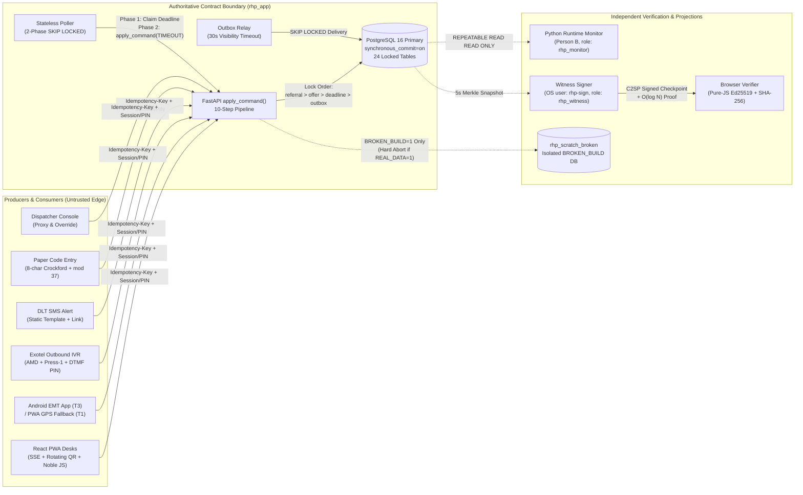

# ReferralHandshake (Protocol RHP-1) — Failure-Mode, Threat & Attack Matrix

**Team:** MAHA YODHAS | **Track:** HealthTech | **Event:** Colossus 3.0 (13–14 Nov 2026, Bengaluru)
**Target File:** `FAILURE_AND_ATTACK_MATRIX.md`
**Authority Hierarchy:** `ReferralHandshake_LOCKED_Problem_Statement_v7.md` > Research tagged `[V]` > `ReferralHandshake_v8_LOCKED_Solution.md` > `ReferralHandshake_FINAL_LOCKED_Architecture.md` > `ReferralHandshake_3Gem_Antigravity_Workflow.md`
**Operating Mode:** Synthetic data only (`REAL_DATA=0`) · 24-hour build · 2 engineers (Person A = Backend/Spec/Quint; Person B = Clients/Reach/Independent Monitor)

---

## 0. Scope, Precedence, Tag Legend & Enforcement Rules

This document is the authoritative failure, threat, loophole, chaos, and red-team verification specification for **ReferralHandshake (Protocol RHP-1)**. Every failure mode, adversarial attack vector, race condition, clock hazard, network partition, privacy leak, clinical edge case, and operational loophole across the locked specification set is cataloged here with its exact detection mechanism, automated protocol response, human fallback, invariant mapping (`I1`–`I16`), bounded technical residual, executable test ID, and closure status.

### 0.1 Status & Evidence Tag Legend

| Tag | Category | Meaning & Enforcement Rule |
|---|---|---|
| `[V]` | Evidence | Verified from a primary research source in the locked problem/architecture documents. |
| `[V*]` | Evidence | Verified only from a secondary or vendor source; must be confirmed from primary text before slide use. |
| `[CONFLICT]` | Evidence | Research files disagree (e.g., Das et al. denominator $25,253$ vs. $28,020$; DPDP commencement 13 Nov vs. 14 Nov 2025; s.7(f) vs. s.7(d)); use conservative framing and quote percentages/provisions safely. |
| `[GAP]` | Evidence | No reliable primary fact found; parameterized in architecture and excluded from factual claims. |
| `[verify]` | Operational | Pre-event verification item with a hard time-box and pre-decided fallback (§21 of Architecture). |
| `CLOSED` | Weakness Status | Closed by an explicit architectural mechanism in code/DDL and verified by a named automated test. |
| `BOUNDED` | Weakness Status | Cannot be reduced to zero in software; carries a stated quantitative/technical residual bound and an active monitor/operator alarm. |
| `OPEN` | Weakness Status | Requires external legal opinion, hardware HSM/KMS, or field pilot validation; assigned an explicit owner and closing evidence criteria. |

### 0.2 Defect Severity Taxonomy (3-Gem + Antigravity Workflow)

| Severity | Classification | Gate Impact |
|---|---|---|
| `S1` | **Blocker** — Violates an invariant (`I1`–`I16`), breaks the 30-second live proof loop, corrupts lock order, or leaks real/clinical data. | Blocks step advancement; requires a `FULL` loop (`G1 -> AG -> G2 -> G3 -> G1`). |
| `S2` | **Major** — Incorrect protocol behavior or missing error reason code where a deterministic workaround exists. | Must be closed before the current tier gate (`G0`–`G3`). |
| `S3` | **Minor** — Non-critical UI, ergonomics, or non-contract projection issue. | Scheduled in `SHOULD-FIX` queue; does not block `T0` core gate. |
| `S4` | **Note** — Documentation, comment, or future pilot hardening observation. | Logged in the STATE LEDGER (`LOG`). |

### 0.3 Non-Negotiable Matrix Discipline (F15 Closure)

Per **F15 (`T-F15 residual_lint`)**, bare `"none"` or `"zero"` residuals are forbidden across all failure and attack tables. Even when a failure mode is `CLOSED` within the protocol model, the matrix must state the underlying assumption or substrate dependency (e.g., PostgreSQL 16 row-lock/index correctness, single-lock serialization, or cryptographic primitive hardness).

---

## 1. Architectural Threat Model & Attack Surface Topology

### 1.1 Trust Boundaries & Component Topology

Every component in RHP-1 obeys the **Coherence Rule**: it is either **(a)** a state or event in the contract, **(b)** an interface producing or consuming those events, or **(c)** a read-only projection of the committed event log.



### 1.2 STRIDE Threat & Control Matrix (Architecture §9)

| STRIDE Category | Concrete Threat | RHP-1 Architectural Control | Primary Invariant / Fix | Verification Test |
|---|---|---|---|---|
| **Spoofing** | Unrostered person accepts an offer on a shared ward tablet; SIM swap on a duty phone; bot mints judge QR sessions. | Roster validity check (`valid_from <= ts < valid_to`), registered `device` pubkey or whitelisted `call_sid`, server-verified Argon2id PIN on every mutating command, slot suspension on repeated lockouts; Cloudflare Turnstile + 15s rotating single-use QR (`jti`, 20s TTL) + 20-desk cap. | `I6`, `F7`, `D11`, `D12` | `T-I6`, `T-F7`, `T-N7` |
| **Tampering** | Sysadmin `UPDATE`/`DELETE` on `event` table in `psql`; client mass-assigns `hs_state` or `lease_epoch` in JSON body; profile timing edited on disk. | `rhp_no_mutate` append-only triggers on `event`, `checkpoint`, `rejected_command`; `rhp_event_guard` trigger; SHA-256 JCS chain + 5s Ed25519 Merkle checkpoints pushed to external witnesses; Pydantic `extra='forbid'` + server-owned state; cold-key Ed25519 signature check on timing profiles at startup. | `I5`, `I13`, `F2`, `F8`, `D10` | `T-I5`, `T-F8`, `T-F2` |
| **Repudiation** | Receiving clinician or facility claims *"We never accepted that referral"* or *"Dispatcher forged our acceptance."* | Device-bound Ed25519 signature or authenticated `call_sid`, Argon2id PIN verification, explicit `actor_roster_id`, `actor_facility_id`, `channel`, `proxy` boolean, `proxy_for`, and `reason` logged inside the hash-chained `event` row. | `I5`, `I6` | `T-I5`, `T-I6` |
| **Information Disclosure** | PHI leaked in `event.detail` audit log, third-party push notifications (FCM), DLT SMS variables, or SSE streams after an offer is declined/superseded. | `rhp_detail_ok` DB `CHECK` + Pydantic `Literal` allowlist (enums, ints, bools, UUIDs only); empty-payload FCM wake ping + authenticated fetch; static DLT SMS alert; per-event `payload_grant` filter on SSE + immediate `GRANT_REVOKED` control frame + client DOM wipe; envelope encryption (`clinical_payload`, `event_secret`) with per-referral DEK and monthly `kek_epoch` destruction. | `I10`, `I11`, `F9`, `F10`, `D9` | `T-F9`, `T-F10`, `T-P2`, `T-P3`, `T-P5` |
| **Denial of Service** | Rival hospital locks out a facility's duty role by failing PINs; retry storm from flaky mobile network; poller/command deadlock; deadline flood after outage. | PIN failure counter (`pin_failed`) committed on an autonomous connection and scoped strictly to `(session_id \| call_sid)` rather than facility/role; step-1 idempotency with `pg_try_advisory_xact_lock`; strict global lock order `referral -> offer -> deadline -> outbox`; poller batch limit (`LIMIT 50 FOR UPDATE SKIP LOCKED`). | `I1`, `I4`, `I6`, `I14`, `F1`, `F7`, `F14` | `T-F1`, `T-F7`, `T-F14`, `T-T4`, `T-N8` |
| **Elevation of Privilege** | Broken Object-Level Authorization (BOLA: Facility B reads/acts on Facility A's offer); function-level abuse (`CLINICIAN` calls `DISPATCHER_ASSIGN`); unheld referral lock mutates contract tables. | Object-level facility and role checks in Step 5 (`authorize()`); DB trigger `rhp_require_lock` enforcing session GUC `rhp.locked_referral = referral_id` on every contract write; DB role separation (`rhp_app`, `rhp_monitor`, `rhp_witness`). | `I6`, `I7`, `I10`, `I14` | `T-I6b`, `T-I7`, `T-I14` |

### 1.3 Banned Technologies & Architectural Anti-Patterns

To prevent scope creep, hidden failure modes, and unverifiable concurrency behavior, the following technologies are strictly banned across all tiers (`T0`–`T3`):

| Banned Technology / Pattern | Reason for Prohibition in RHP-1 | Locked RHP-1 Replacement |
|---|---|---|
| Blockchain / Smart Contracts | Adds latency, gas/consensus overhead, and false immutability claims with a single district arbiter. | Per-referral SHA-256 JCS hash chain + 5s Ed25519 signed Merkle checkpoints + independent witnesses (§11). |
| Kafka / Debezium | Operational overhead for a 2-person team; unnecessary for single-primary transactional outbox. | Same-transaction `outbox` table + stateless polling relay (`FOR UPDATE SKIP LOCKED`, 30s visibility timeout) (§5). |
| Redis | Introduces a second stateful store that can desynchronize from PostgreSQL commit boundaries. | PostgreSQL 16 `idempotency`, `deadline`, `session`, and `outbox` tables under `synchronous_commit=on` (§7). |
| Kubernetes (EKS) | Over-engineered and costly for a single-district pilot or 24-hour hackathon build. | Docker Compose for demo; AWS `ap-south-1` Multi-AZ managed PostgreSQL + 2 small app VMs + ALB for pilot (§17). |
| WebSockets | Complex proxy/reconnect state and bidirectional framing not needed for read-only desk push. | HTTP/2 Server-Sent Events (SSE) with `Last-Event-ID` resume and 15s heartbeats (§9, §13). |
| WhatsApp | Excluded for clinical/health data due to Meta PHI terms and lack of deterministic escalation guarantees. | PWA web desks, Android foreground app, Exotel outbound IVR, DLT static SMS link, paper code (§8). |
| On-Device LLMs / Autonomous AI Triage | Unsafe given VLM handwriting error rates ($85\text{--}95\%$ accuracy) and Indic ASR WER ($>20\%$) `[V]`. | Optional cloud AI draft gated behind Cognitive Forcing Function (`423 ANCHOR_REQUIRED`); structured entry primary (§16). |
| CRDTs for Authoritative State | Authoritative ownership leases cannot be resolved eventually; double-lease is a safety violation. | Serialized per-referral `SELECT ... FOR UPDATE` on PostgreSQL primary; append-only set union for `telemetry` only (§5, §7). |
| Floating-Point Numbers in JCS | IEEE 754 float serialization edge cases risk cross-language hash-chain divergence between Python and JS. | RFC 8785 JCS restricted strictly to ASCII keys, integers (`lat_e5`, `lon_e5`, `client_ts_ms`, `server_ts_us`), strings, and booleans (§0, §11). |

---

## 2. Master Failure-Mode & Attack Matrix (51 Canonical Scenarios)

Every row below is locked from Architecture §18 and cross-referenced to its exact enforcement mechanism, HTTP/protocol response, invariant (`I1`–`I16`), bounded technical residual (satisfying `T-F15 residual_lint`), executable test ID, and closure status (`CLOSED`, `BOUNDED`, or `OPEN`).

| ID | Class | Scenario | Detection Mechanism | Automated Protocol Response | Human Fallback | Inv | Bounded Technical Residual & Reason (F15) | Test ID | Status |
|---|---|---|---|---|---|---|---|---|---|
| **C1** | Concurrency | 200 simultaneous `ACCEPT` requests on one referral (SEQUENTIAL or PARALLEL2) | PostgreSQL row lock wait on `referral` + `one_lease` partial unique index | First lock holder commits `offer.status='ACCEPTED'` and increments `lease_epoch`; 199 contenders receive `409 LEASE_HELD` (or `412` on stale version) and are logged in `rejected_command` | None required; losing desks immediately see why via SSE | `I2` | Relies on PostgreSQL 16 `FOR UPDATE` row-lock and `one_lease` unique index correctness on the single writable primary | `T-C1` (`race200`) | `CLOSED` |
| **C2** | Concurrency | `ACCEPT` vs. poller `TIMEOUT` race at deadline boundary | Lock acquisition order on `referral` row (`SELECT * FROM referral WHERE id=%s FOR UPDATE`) | First transaction to acquire the `referral` lock wins: if `ACCEPT` wins, deadline is marked `DONE` and `TIMEOUT` returns `200` no-op; if `TIMEOUT` wins in `SEQUENTIAL`, offer becomes `SOFT_OPEN` (still allowing late accept before successor ACKs) | None required; both serializations are legal protocol paths | `I2` | Either serialization order is possible within the sub-millisecond race window; both outcomes are deterministic and audited in `event` | `T-C2` | `CLOSED` |
| **C3** | Concurrency | Late `ACCEPT` from Facility $k$ after Facility $k+1$ has already ACKed | Offer status check in Step 6/7 (`offer.status` transitioned from `SOFT_OPEN` to `TIMED_OUT` upon $k+1$'s `ACK`) | Reject with HTTP `409 LATE_ACCEPT_REJECTED`; record in `rejected_command`; Facility $k+1$ retains its `ACKED` offer | Receiving desk at $k$ can contact dispatcher if $k+1$ subsequently declines | `I2` | Offline or high-latency receiver at $k$ sees the `409 LATE_ACCEPT_REJECTED` alert only upon network round-trip / reconnect sync | `T-C3` | `CLOSED` |
| **C4** | Concurrency | `COUNTER` on Offer 1 races with `ACCEPT` (or `CONFIRM_COUNTER(true)`) on Offer 2 in `PARALLEL2` | Per-referral `FOR UPDATE` lock serializes both commands | First commit to grant a lease (`ACCEPT` or `CONFIRM_COUNTER(true)`) increments `lease_epoch` and marks the other open offer `SUPERSEDED`; subsequent commit on the superseded offer returns `409 LEASE_HELD` | Referrer and losing facility see `SUPERSEDED` status and lease holder on desk | `I2`, `I12` | Decided deterministically under a single `referral` row lock; loser experiences one round-trip before seeing `409 LEASE_HELD` | `T-C4` | `CLOSED` |
| **C5** | Concurrency | Poller vs. `apply_command()` lock-order deadlock | PostgreSQL `log_lock_waits=on`, `pg_stat_database.deadlocks`, and trigger `rhp_require_lock` | Poller Phase 1 claims due deadlines in a single committed statement (`FOR UPDATE SKIP LOCKED`) holding zero locks afterward; Phase 2 invokes `apply_command(TIMEOUT)` which locks `referral -> offer -> deadline -> outbox` in strict global order | None required | `I14` | Assumes PostgreSQL 16 internal lock manager and B-tree page lock behavior are defect-free; verified to deadlock delta $= 0$ | `T-F1` (`lock_order_200way`) | `CLOSED` |
| **C6** | Concurrency | Duplicate timer fire (two pollers or retry after poller timeout) | Re-read of `deadline` under `referral` lock (`WHERE id=$1 AND status='PENDING'`) + deterministic idempotency key `timeout:<deadline_id>` | Second execution sees `deadline.status='DONE'` (or hits Step 1 idempotency replay) and returns `200` no-op with zero state mutation or duplicate events | None required | `I1`, `I4` | Decided under the `referral` row lock and `idempotency` primary key; zero duplicate events possible | `T-C6` | `CLOSED` |
| **C7** | Concurrency | Stale writer submits command with outdated `expected_version` or `expected_epoch` | Step 5 (`fence(r, cmd)`) compares command preconditions against locked `referral.version` and `referral.lease_epoch` | Rolls back to `SAVEPOINT sp_cmd`, inserts audit row into `rejected_command`, finalizes `idempotency` with HTTP `412 PRECONDITION_FAILED`, and commits | Client refetches latest referral state via GET/SSE and prompts user if action is still relevant | `I8` | Stale writer's local optimistic UI state is rolled back upon receiving `412`; requires one network round-trip | `T-I8` | `CLOSED` |
| **C8** | Concurrency | Third concurrent open offer attempted (violating open-offer cap) | `referral.open_offers CHECK (open_offers BETWEEN 0 AND 2)` + transition guard in `advance()` | Transition guard closes `SOFT_OPEN` offer `k-1` to `TIMED_OUT` before opening `k+1`, or rejects any command that would push `open_offers > 2`; if chain is exhausted, transitions to `ESCALATED_TO_DISPATCHER` | Dispatcher console assigns or manages escalation | `I12` | Enforced synchronously inside the `referral` transaction by transition logic and PostgreSQL `CHECK` constraint | `T-F13` (`open_cap`) | `CLOSED` |
| **T1** | Timer | Stateless poller process crashes mid-batch | `heartbeat` table (`subject_kind='POLLER'`) staleness $> 15\text{ s}$ + `deadline.claimed_until` lease expiry | Unfinished deadline claims automatically expire after $5\text{ s}$ (`claimed_until < clock_timestamp()`); surviving or restarted poller instance re-claims and fires `TIMEOUT` | Operator restarts container if supervisor fails; big screen turns amber at $> 15\text{ s}$ | `I1` | Maximum additional timer firing latency is bounded by $\le 5\text{ s}$ claim expiry + $1\text{ s}$ poll interval ($= 6\text{ s}$, within $\tau$) | `T-T1` | `BOUNDED` |
| **T2** | Timer | Server clock steps forward by $\Delta$ | `heartbeat.ntp_offset_ms` monitor check every $5\text{ s}$ triggers alarm if $\|\Delta\| > 2000\text{ ms}$ | Deadlines with `due_at <= clock_timestamp()` fire up to $\Delta$ early, causing premature escalation only; `one_lease` and `FOR UPDATE` still prevent double leases; `SOFT_OPEN` preserves prior facility's ability to accept before successor ACKs | Operator inspects NTP / chrony daemon and acknowledges alarm | `I2`, `I16` | Premature escalation bounded by step size $\Delta$; poller fan-out rate-limited to $50\text{ claims/tick}$; chrony configured slew-only after boot | `T-F11` (`clock_step`) | `BOUNDED` |
| **T3** | Timer | Server clock steps backward by $\Delta$ | `heartbeat.ntp_offset_ms` alarm at $> 2000\text{ ms}$ + Step 4 `GREATEST(clock_timestamp(), referral.head_ts)` | `GREATEST()` guarantees `server_ts` never decreases per referral (`I16`) and `rhp_event_guard` rejects any non-monotone timestamp; pending deadlines wait until wall clock catches up to `due_at` | Operator fixes host NTP sync | `I16` | Deadline firing delayed by at most backward step $\Delta$ ($\le 2\text{ s}$ before NTP offset alarm fires); event timestamp monotonicity strictly preserved | `T-F11` (`clock_step`) | `BOUNDED` |
| **T4** | Timer | Deadline storm after prolonged DB or poller outage ($n$ overdue deadlines) | Poller query depth metric and `I1` overdue deadline monitor counter | Poller drains overdue deadlines in `due_at` order at $50\text{ claims/tick}$ (`LIMIT 50 FOR UPDATE SKIP LOCKED`), preventing DB connection pool exhaustion | Dispatcher paged for any referral reaching `ESCALATED_TO_DISPATCHER` | `I1` | Additional drain latency is bounded by $\lceil n / 50 \rceil \times \text{tick\_interval}$ ($\lceil n / 50 \rceil \times 1\text{ s}$) | `T-T4` | `BOUNDED` |
| **T5** | Timer | Database primary failover mid-timer in pilot deployment | psycopg3 connection exception + Multi-AZ health probe | In-flight uncommitted transactions abort cleanly; poller reconnects to promoted synchronous standby and re-claims durable `deadline` rows | Operator verifies standby promotion in pilot | `I1` | Timer processing paused during AWS Multi-AZ failover window (typically $60\text{--}120\text{ s}$ `[V*]`); zero committed timers lost (`synchronous_commit=on`) | `T-T5` | `BOUNDED` |
| **T6** | Timer | Timing profile tampered on disk or demo profile loaded with `REAL_DATA=1` | Startup `validate(p, REAL_DATA)` verifies Ed25519 signature against pinned `COLD_PUB`, checks $F \cdot (A + D + \epsilon) \le B$, and checks `not (p.demo and REAL_DATA)` | FastAPI and poller refuse to boot (hard exit before opening listening socket) | Administrator restores signed profile or sets `REAL_DATA=0` | `I13` | Assumes offline cold Ed25519 private key is not compromised; profile hash is pinned per referral in `referral.profile_hash` | `T-F2`, `T-F3` | `CLOSED` |
| **N1** | Network | Offline desk queues `ACCEPT` and flushes after resource confirmation TTL or offer window expires | Step 7 `check_confirmations()` checks `offer.status` and `min(expires_at) > server_ts` under `referral` lock | Returns `409 LATE_ACCEPT_REJECTED` if offer left `OPEN/ACKED/SOFT_OPEN`, or `409 STALE_CONFIRMATION_RECONFIRM_REQUIRED` if any capability confirmation expired | PWA displays alert and opens live reconfirmation modal (`RESOURCE_CONFIRM` per capability + fresh `ACCEPT`) | `I15` | User must perform one live reconfirmation tap after reconnecting; offline `ACCEPT` is always labeled *"pending, not confirmed"* | `T-F12` (`offline_stale`) | `CLOSED` |
| **N2** | Network | HTTP response lost in transit; client retries mutating command | Step 1 lookup in `idempotency(actor_id, key)` with SHA-256 JCS `request_hash` | Returns stored `http_status` and `response` JSON (`200` or domain rejection `409/412/422`) without re-executing business logic or appending a second event | None required | `I4` | `idempotency` table retains keys for $48\text{ h}$; retries beyond $48\text{ h}$ are still caught by `event.event_id UNIQUE` (`409 DUPLICATE_EVENT_ID`) | `T-F14` (`idem_matrix`) | `CLOSED` |
| **N3** | Network | SSE stream drops due to mobile/Wi-Fi blip or proxy timeout | Missing $15\text{ s}$ SSE heartbeat frame on client | Browser `EventSource` reconnects automatically with `Last-Event-ID: <seq>`; server replays missed events for that referral (filtered by active `payload_grant`) | User can click manual refresh button in PWA header | `I4` | Desk UI view can be stale for at most the $15\text{ s}$ heartbeat detection interval plus reconnect RTT | `T-N3` | `BOUNDED` |
| **N4** | Network | Ambulance enters cellular dead zone during transport | Missing GPS `telemetry` updates and device `heartbeat` $> 30\text{ s}$ | Room/PWA outbox queues GPS and `OBS` events locally with UUIDv7 `event_id`; command center map badges ambulance *"Last confirmed $N\text{ s}$ ago"*; reconnect merges `telemetry` via append-only set union (`ON CONFLICT (event_id) DO NOTHING`) | EMT or dispatcher communicates via voice/radio and logs status via dispatcher proxy | `I3` | Live map position and vitals are stale for the duration of the cellular outage; transport and care are never blocked | `T-N4` | `BOUNDED` |
| **N5** | Network | Exotel IVR webhook delivered multiple times (provider retry) | `INSERT INTO inbox(source, external_id, payload_sha256) ON CONFLICT (source, external_id) DO NOTHING` + deterministic `Idempotency-Key` | Duplicate webhook is short-circuited in `inbox` / `idempotency` and returns cached TwiML/Exotel XML within $< 50\text{ ms}$ | None required | `I4` | Enforced by PostgreSQL `UNIQUE (source, external_id)` constraint on `inbox` | `T-N5` | `CLOSED` |
| **N6** | Network | Exotel webhook execution takes longer than the $1.5\text{ s}$ internal budget (Exotel hard limit $5\text{ s}$ `[V]`) | Internal asyncio timeout at $1.5\text{ s}$ inside webhook handler | Handler returns HTTP `200` with IVR prompt *"Please hold while we record your response"* before the $2\text{ s}$ budget; background transaction finishes and the next IVR callback reads the committed state | If call drops, notice ladder rung $3A/4$ pages dispatcher for phone-assisted proxy | `I1` | Caller hears one *"Please hold"* loop ($\le 1$ extra callback round-trip); spoken *"Recorded"* never plays before DB commit | `T-N6` | `BOUNDED` |
| **N7** | Network | Venue internet / Cloudflare tunnel fails during live demo | Preflight / continuous uplink probe failure | Switch to local hotspot **LAN mode**: serves PWA over local Wi-Fi, caps judge desks at $20$, enforces `REAL_DATA=0`, and uses bundled pure-JS `@noble/curves/ed25519` and `@noble/hashes/sha256` | Presenter switches to LAN QR code on slide (or plays pre-recorded MP4 clip if Wi-Fi is jammed) | — | Plain LAN HTTP lacks `window.crypto.subtle` on iOS Safari `[V]`; pure-JS crypto keeps verifier working, and PIN entry is disabled over plain HTTP | `T-N7` | `BOUNDED` |
| **N8** | Network | Retry storm from reconnecting clients or aggressive script | Per-session / per-IP token-bucket rate limiter + Step 1 `pg_try_advisory_xact_lock` | Excess requests receive HTTP `429 TOO_MANY_REQUESTS` with `Retry-After`; concurrent duplicates for the same key receive `409 DUPLICATE_IN_FLIGHT` without touching `referral` locks | Operator can adjust rate limit or block abusive token | `I4` | Up to 1 rate-limit window ($\le 1\text{ s}$) of burst traffic reaches FastAPI workers before `429` throttling engages | `T-N8` | `BOUNDED` |
| **I1** | Identity | Unrostered person or wrong role attempts `ACCEPT` / `COUNTER` / `DECLINE` | Step 2 & Step 5 check `session.roster_id`, `roster.role_slot`, `roster.facility_id = offer.facility_id`, and `valid_from <= ts < valid_to` | Rolls back to `SAVEPOINT sp_cmd`, logs `403 FORBIDDEN` in `rejected_command`, and returns `403` | Facility administrator updates `roster` if staff shift changed | `I6` | Cannot detect a valid rostered user who physically hands their unlocked device and PIN to a colleague on the same shift | `T-I6` | `CLOSED` |
| **I2** | Identity | Brute-force PIN guessing on a stolen session token or whitelisted phone | Step 3 Argon2id verification (`~100 ms`) + autonomous transaction incrementing `session.pin_failed` | Enforces backoff ($0\text{ s}, 5\text{ s}, 30\text{ s}$); on 3rd failure sets `pin_locked_until = now() + 120s`, emits `PIN_LOCKED` event, and pages dispatcher | Dispatcher contacts facility by phone; admin can revoke device/roster | `I6` | Attacker who can initiate fresh `call_sid` calls from a compromised whitelisted duty phone gets 3 tries per call until slot is suspended after repeated lockouts | `T-F7` (`pin_lockout_scope`) | `BOUNDED` |
| **I3** | Identity | Rival hospital or attacker intentionally fails PINs to lock out a receiving facility's duty role (Lockout-DoS) | `pin_failed` and `pin_locked_until` live on `session` (keyed by `device_id` or `call_sid`), not on `roster` or `facility` | Only the attacker's specific `session_id` or `call_sid` is locked for $120\text{ s}$; the legitimate duty nurse/CMO's enrolled tablet and other roster slots remain completely unaffected | None required; dispatcher sees `PIN_LOCKED` audit event | `I6` | Scoped strictly per session/call in `session` table; zero cross-session lockout propagation | `T-F7` (`pin_lockout_scope`) | `CLOSED` |
| **I4** | Identity | SIM swap or physical theft of a pre-registered facility duty phone | Repeated `PIN_LOCKED` events or anomalous voice ACK without PIN completion | Slot auto-suspends after repeated lockouts; voice IVR requires both registered Caller ID and 4-digit PIN before `ACCEPT/COUNTER/DECLINE` | Admin revokes `roster` phone entry and issues new `enrollment_ticket` | `I6` | Attacker with swapped SIM can press `1` to trigger `OFFER_ACKED` (delaying escalation from $A$ to $A+D$), but cannot `ACCEPT` or `DECLINE` without the PIN | `T-I4` | `BOUNDED` |
| **I5** | Identity | Voicemail box or automated answering machine answers Exotel call and is counted as human `ACK` | Exotel Answering Machine Detection (AMD) + mandatory keypress gate (*"Press 1 to hear an emergency referral"*, $8\text{ s}$ timeout) | Machine verdict or silence never calls `apply_command(ACK)`; call terminates as `UNANSWERED` and notice ladder proceeds to next slot / rung $3A/4$ | Dispatcher proxy at rung $3A/4$ | `I6` | An unauthorized human who answers the duty phone can press `1` to record `OFFER_ACKED`, but PIN still gates `ACCEPT/COUNTER/DECLINE` | `T-F7` | `CLOSED` |
| **I6** | Identity | BOLA (Facility B acts on Facility A's offer) or mass-assignment (`{"hs_state":"ACCEPTED"}` in request body) | Step 5 `authorize()` enforces `session.facility_id == offer.facility_id`; Pydantic models enforce `extra='forbid'` with no state/epoch fields in request schemas | Returns `403 FORBIDDEN` (BOLA) or `422 UNPROCESSABLE_ENTITY` (extra fields); logged in `rejected_command` | None required | `I6` | Any newly added FastAPI endpoint must be covered by the automated role-matrix and schema-fuzz test suite | `T-I6b` | `CLOSED` |
| **P1** | Privacy | Developer or client injects free-text patient name/phone into `event.detail` JSON | Pydantic `Literal` schema at API + PostgreSQL `CHECK (rhp_detail_ok(type, detail))` enforcing per-type key allowlist (`rhp_allowed`) and regex `^[A-Z0-9_]{1,40}$` | Request rejected with `422` at API or `CHECK` violation in PostgreSQL; transaction aborts before commit | Developer uses `clinical_payload` / `event_secret` for sensitive data | `I11` | A malicious insider with valid credentials could encode a short $\le 40$-char uppercase alphanumeric identifier inside an allowlisted string field if not restricted by API enum; mitigated by closed Pydantic `Literal` enums and CI fuzzing | `T-F9` (`detail_check_fuzz`) | `BOUNDED` |
| **P2** | Privacy | Clinical text or patient name sent over DLT SMS | Static template enforcement in SMS adapter (`"RHP alert: new referral. Open {#var#}"`, variable $\le 30\text{ chars}$ containing only short code) | Adapter formats only the opaque short URL/code; has no database access to `clinical_payload` | Clinician opens authenticated link or uses voice/paper code | — | Zero clinical fields passed to SMS adapter; static template enforced in code and CI lint | `T-P2` | `CLOSED` |
| **P3** | Privacy | Clinical payload pushed through third-party FCM notification | FCM adapter sends zero-payload wake ping (`{"type":"WAKE","referral_id":"..."}`) only | Android client wakes and performs authenticated TLS fetch to `/v1/referrals/{id}` using its session token and active `payload_grant` | None required | `I10` | Third-party push provider sees only that a device received a wake ping for a pseudonymous UUID | `T-P3` | `CLOSED` |
| **P4** | Privacy | Receiving desk continues receiving clinical updates on SSE stream after its offer is `DECLINED`, `SUPERSEDED`, or `TIMED_OUT` | Per-event authorization check on `payload_grant (revoked_at IS NULL)` in SSE emitter + ` side-effect in Step 8 revoking grant | Server emits `GRANT_REVOKED` control frame on the next relay cycle, strips clinical fields from all subsequent frames for that subscriber, and PWA wipes clinical DOM state | User must request a new offer/grant via dispatcher if re-engaged | `I10` | Clinical data already rendered on screen or photographed/screenshotted while the grant was legitimately active cannot be physically recalled | `T-F10` (`sse_revoke`) | `BOUNDED` |
| **P5** | Privacy | Deleted/expired clinical payload recovered from PostgreSQL WAL archives or old backups | Envelope encryption (`clinical_payload`, `event_secret`) using per-referral AES-256-GCM DEK wrapped by monthly AES-KW `kek_epoch` | At `expires_at`, ciphertext rows are deleted and `key_version.wrapped_dek` is nulled (`status='SHREDDED'`); when all referrals in a monthly `kek_epoch` expire, the master KEK for that epoch is destroyed | Admin verifies KEK epoch destruction log | — | Backups remain decryptable by a KEK-holder during the active cohort window until the monthly `kek_epoch` key is destroyed | `T-P5` | `BOUNDED` |
| **A1** | AI | VLM handwriting extraction or ASR dictation hallucinates a clinical field (e.g., wrong BP or MgSO4 dose) | Cognitive Forcing Function (CFF) + mandatory re-entry of critical fields + no confidence scores/explanations shown (`R08` `[V]`) | AI output is quarantined as an unverified draft; clinician must manually re-enter critical fields and pass a fast-approve speed bump before submitting `CREATE` | Clinician switches AI toggle off and uses structured ISBAR buttons | — | Human rubber-stamping cannot be reduced to $0\%$; bounded by the 20-slip seeded-error usability gate ($\le 5\%$ critical rubber-stamp, $\le 1\%$ silent omission) | `T-A1` | `BOUNDED` |
| **A2** | AI | Clinician or UI requests AI draft before committing anchor fields (`need_class`, `mgso4_status`) | Server guard on `/v1/ai/draft` checking committed anchor fields | Returns HTTP `423 ANCHOR_REQUIRED`; draft ciphertext is withheld until anchors are recorded | Clinician selects `need_class` and `mgso4_status` first | — | Enforced synchronously by server state check before returning draft payload | `T-A2` | `CLOSED` |
| **A3** | AI | Indic ASR fails on rural Kannada/Hindi dialect (`WER > 20%` `[V]`) | Clinician review in CFF UI or ASR timeout/error | AI accelerator is strictly optional (`T3_EXTRAS`); `CREATE` requires only structured taps (`need_class`, `mgso4_status`, one-tap chain confirmation) | Clinician ignores/disables dictation and completes card in $\sim 20\text{ s}$ via structured taps | — | Underlying ASR model WER $> 20\%$ on rural dialects `[V]`; never sits on the critical path | `T-A3` | `BOUNDED` |
| **K1** | Clinical | Referring clinician does not know whether pre-referral $\text{MgSO}_4$ was given before arrival at PHC | `referral.mgso4_status` is answer-required (`GIVEN \| NONE_GIVEN \| UNKNOWN`), never knowledge-required (Fixes `D1`) | `CREATE` succeeds immediately with `mgso4_status='UNKNOWN'`; receiving desk displays a persistent high-contrast red banner: *"PRE-REFERRAL MgSO4 DOSE UNKNOWN — VERIFY CLINICALLY BEFORE DOSING"* | Receiving clinician examines patient / escort before administering loading/maintenance dose | `I3` | Prevents dispatch block (`I3`), but clinical safety against double-dosing still depends on the receiving clinician reading and acting on the red banner | `T-K1` | `BOUNDED` |
| **K2** | Clinical | Receiving hospital clicks `ACCEPT` to look good on response KPIs, then leaves patient waiting on ambulance trolley without a bed (Goodhart gaming) | Separate tracking of `OFFER_ACCEPTED`, `TR_UPDATED(ARRIVED)`, and `TR_UPDATED(HANDED_OVER)` timestamps; APOT-style arrival-to-handover metric | Dashboard reports `ARRIVED -> HANDED_OVER` duration separately from ACK/ACCEPT speed; `HANDOVER` deadline fires `HANDOVER_OVERDUE` alert; desk can fire `ARRIVAL_REJECTED` (recording broken commitment and escalating) | Crew/referring doc triggers `ARRIVAL_REJECTED` or calls dispatcher | `I2` | Software cannot create physical beds; it makes post-acceptance handover delay and `ARRIVAL_REJECTED` visible at district level | `T-K2` | `BOUNDED` |
| **K3** | Clinical | Every PHC/CHC referral skips secondary FRUs and funnels directly to the tertiary medical college | `catchment_chain` ordered by district administration (PHC $\to$ CHC/FRU $\to$ DH $\to$ MC); `SEQUENTIAL` mode is default; facility load guard (`AT_CAPACITY`) | System offers targets in approved chain order (`I7`); when a tertiary facility hits its open-offer cap, it returns structured `AT_CAPACITY` decline; `PARALLEL2` requires explicit critical/dispatcher flag | Dispatcher overrides only with logged reason enum | `I7` | If all intermediate FRUs genuinely lack an anaesthetist or blood (`22%` FRU functionality `[V]`), referrals will still legitimately escalate to the tertiary center | `T-K3` | `BOUNDED` |
| **K4** | Clinical | Ownership lease moves to Facility B while ambulance is already on the highway past the turn-off to Facility B | Server computes detour ETA from cached Mapbox Matrix upon lease change and emits redirect advisory to ambulance + dispatcher | Ambulance app displays non-blocking redirect advisory with detour ETA; system **never** auto-reroutes a moving ambulance; crew issues `TR_DESTINATION_CHANGE(accepted=true\|false)` | If crew continues to original Facility A, arrival triggers Case (c) `ARRIVAL_AT_NON_OWNER` alert + dispatcher page | `I3` | Crew in a dead zone or high-stress situation may not acknowledge the advisory before arriving at the non-owner door | `T-F5` (`arrival_cases`) | `BOUNDED` |
| **S1** | Insider | Rogue sysadmin or DBA connects as `postgres` superuser, disables triggers, and edits/deletes a row in `event` | Independent Python monitor (`rhp_monitor`) fold check + browser pure-JS verifier recomputing SHA-256 chain and Merkle inclusion path against 5s signed checkpoints | Verifier prints `BROKEN referral=<id> seq=<n> kind=PREV\|HASH` (or `TRUNCATED at seq=<k>`); monitor raises `I5` / `DIFF_HEAD` violation on the big screen within $\le 2\text{ s}$ | Incident response restores from backup using cold-key signed `RESTORE` procedure | `I5` | Hash chains and witnesses **detect** tampering within seconds; they cannot physically prevent a root/superuser from mutating local disk blocks | `T-F8` (`tamper_vs_restore`) | `BOUNDED` |
| **S2** | Insider | Operator attempts a split-view attack (showing one history to the big screen and another to a judge's phone) | C2SP-style signed checkpoints broadcast every $5\text{ s}$ to multiple independent witnesses (big screen, judges' phones via QR, off-box append-only log on second laptop) | Witnesses cross-compare `(checkpoint_id, tree_size, root_hash, signature)` signed by `rhp-sign`; any divergence for the same tree size proves equivocation | Judges compare checkpoint root hash on their phones against the big screen | `I5` | Detection requires at least 2 independent witnesses (e.g., judge phone + off-box laptop) to observe and compare checkpoints | `T-S2` | `BOUNDED` |
| **S3** | Insider | Attacker steals the online `rhp-sign` Ed25519 private key from the host | Host file-permission audit (`0400`, user `rhp-sign` UID `1002`), witness heartbeat monitoring, and offline cold-key separation | `rhp-sign` cannot sign `RESTORE` checkpoints (which require `COLD_PUB` offline key); key rotation revokes `signer_key_id` and pins new key | Admin rotates witness signing key and audits checkpoints back to last off-box witness log | `I5` | Without a hardware HSM/KMS in the hackathon build, a root attacker who steals `rhp-sign` key AND wipes all external witness logs could forge new `REGULAR` checkpoints until key rotation | `T-S3` | `OPEN` |
| **S4** | Insider | Dispatcher abuses `DISPATCHER_ASSIGN` override to favor or punish a facility | Every dispatcher override sets `source='DISPATCHER'`, `proxy=true`, and requires a structured `reason` enum; monitor tracks override frequency per dispatcher/facility | Monitor highlights dispatcher overrides on the Guarantee Arena / district audit view | District health officer reviews weekly override audit report | `I6` | A human dispatcher with legitimate authority can enter a plausible reason code; mitigated by post-hoc district audit | `T-S4` | `BOUNDED` |
| **F1** | Infra | FastAPI container killed (`SIGKILL`) or crashes mid-transaction | Docker healthcheck / process supervisor + psycopg3 transaction rollback on disconnect | Uncommitted transaction aborts cleanly in PostgreSQL (`idempotency` row vanishes if uncommitted); client retries with same `Idempotency-Key` and executes cleanly on restarted container | Operator restarts container if supervisor fails | `I4` | Client experiences a brief connection reset and 1 retry backoff ($0.5\text{--}2\text{ s}$) during container restart | `T-F1b` | `BOUNDED` |
| **F2** | Infra | PostgreSQL primary node hardware failure (pilot deployment) | AWS RDS Multi-AZ health monitor (`synchronous_commit=on`) | Automatic promotion of synchronous standby; zero committed events lost; clients and workers reconnect via DNS endpoint | Operator verifies failover and runs verifier against latest witness checkpoint | `I1` | Write availability paused during Multi-AZ promotion ($60\text{--}120\text{ s}$ `[V*]`); in the single-laptop hackathon demo, mitigated by hot backup laptop | `T-F2b` | `BOUNDED` |
| **F3** | Infra | Outbox relay crashes after delivering notification to SSE/Exotel but before marking `outbox.status='SENT'` | `outbox.visible_after` visibility timeout ($30\text{ s}$) expires | Surviving/restarted relay re-claims the row after $30\text{ s}$ (`attempts = attempts + 1`) and redelivers; SSE clients dedupe by `event.seq` and Exotel/SMS consumers handle idempotent alerts; `attempts > 8` marks `DEAD` + pages dispatcher | Dispatcher handles any `DEAD` notification channel manually | `I4` | At-least-once delivery window of up to $30\text{ s}$ on relay crash; downstream consumers are idempotent | `T-F3b` | `BOUNDED` |
| **F4** | Infra | Android OEM battery-saver (MIUI, ColorOS, FunTouch) kills the background location service (`[GAP]`) | `heartbeat` table (`subject_kind='DEVICE'`) staleness $> 30\text{ s}$ on server | Command center map switches ambulance indicator to *"Last confirmed $N\text{ s}$ ago"*; PWA fallback provides manual *"Update Location"* button | EMT opens app to foreground (flushing Room outbox) or keeps phone on charging cable + completes OEM onboarding checklist | `I3` | GPS trace has a gap for the duration the OS kills the service; handshake contract and transport state transitions remain unblocked | `T-F4b` | `BOUNDED` |
| **L1** | Legal | Regulatory ambiguity around automated outbound voice calls reading de-identified emergency summaries to duty phones (`[GAP]`) | Pre-deployment legal checklist | Prototype uses Exotel trial sandbox with $\le 10$ pre-verified team numbers, synthetic data (`REAL_DATA=0`), and pre-recorded de-identified prompts (no patient name ever spoken); judges use QR web desks | Dispatcher manual phone call if voice channel is disabled | — | Legal status of automated clinical alert calls under TRAI TCCCPR is unsettled `[GAP]`; requires written legal opinion before any real-data pilot | `T-L1` | `OPEN` |
| **L2** | Legal | Tension between DPDP Act s.8(7) erasure upon purpose completion and NMC 3-year record-keeping / 180-day CERT-In log retention (`[GAP]`) | Policy configuration check at deployment | Architecture separates short-lived envelope-encrypted `clinical_payload` (shredded via DEK/KEK deletion at `expires_at`) from long-lived PHI-free pseudonymous `event` metadata (`rhp_detail_ok`) | Legal counsel configures `expires_at` TTL and `kek_epoch` schedule prior to pilot | — | Whether NMC 3-year telemedicine retention applies to inter-facility handover records is legally unverified `[GAP]` | `T-L2` | `OPEN` |
| **L3** | Legal | Team member or slide overclaims *"BSA s.63 certified"* or *"legally immutable log"* | Pre-pitch `ST-5` forbidden-word scan on slides, docs, and UI copy | System generates a BSA 2023 s.63-ready export bundle (JCS event file, SHA-256 hashes, Part A custodian + Part B expert certificate templates) labeled strictly *"tamper-evident export, not certified"* | Presenter uses locked Claims Register wording (§19) | `I5` | Technical export is automated; human speech on stage is governed by rehearsal and Claims Register | `T-L3` | `CLOSED` |
| **L4** | Legal | Security breach notification clock (CERT-In $6\text{ h}$ direction; DPDP $72\text{ h}$ detailed report to DPBI `[V*]`) | Monitor integrity/auth anomaly alarms + incident runbook | Runbook scripts export 180-day rolling logs, affected `referral_id` list, and checkpoint divergence proof for rapid filing | Operator executes incident reporting runbook within $6\text{ h}$ of detection | — | Reporting clock compliance depends on human operator response time after monitor alert triggers | `T-L4` | `BOUNDED` |
| **D1** | Demo | Judge scans QR on an iPhone where iOS Safari lacks native WebCrypto Ed25519 `[V]` (or runs over plain LAN HTTP where `crypto.subtle` is disabled `[V]`) | Browser capability check / bundled JS build | PWA bundles pure-JS `@noble/curves/ed25519` and `@noble/hashes/sha256` with zero dependency on `window.crypto.subtle` | Labelled server-side verify endpoint if JS bundle fails to load on an ancient browser | `I5` | Pure-JS verification adds $\sim 5\text{--}15\text{ ms}$ per checkpoint verification on mobile CPUs compared to native C++ WebCrypto | `T-D1` | `BOUNDED` |
| **D2** | Demo | Judge asks to receive the Exotel voice call on their own personal unverified phone number during the pitch | Exotel trial account restriction ($\le 10$ whitelisted numbers `[V]`) | Presenter hands the judge our pre-whitelisted physical feature phone to hold and press `1` + PIN live; all other judges join simultaneously via rotating QR web desks (up to $20$ desks) | Pre-recorded MP4 clip of the feature-phone call if cellular voice channel is congested at venue | — | Exotel trial sandbox cannot dial arbitrary unverified judge numbers without full DLT Principal Entity registration | `T-D2` | `BOUNDED` |
| **D3** | Demo | `BROKEN_BUILD=1` accidentally pointed at main database or launched with `REAL_DATA=1` | Startup guard in `api/main.py` and `scripts/make_scratch.sh` | Hard abort with exit code `78` if `REAL_DATA=1`, if DSN DB name $\neq$ `rhp_scratch_broken`, or if scratch DB role can authenticate to main DB; big screen flashes red `BROKEN BUILD — SCRATCH DB` banner | Operator switches `BROKEN_BUILD=0` | `I2` | Enforced by process startup check, PostgreSQL `pg_hba.conf` role isolation, and separate witness key | `T-F20` (`broken_isolation`) | `CLOSED` |
| **D4** | Demo | Complete venue Wi-Fi and cellular blackout during the 5-minute pitch | Preflight check at $T-15\text{ min}$ | Level 1: Phone hotspot + LAN QR (`192.168.x.x`). Level 2: Local loopback (`localhost`) with two browser windows driving the 30s proof loop. Level 3: Seamless switch to pre-recorded MP4 fallback clips (`Clip A`–`Clip D`), explicitly disclosed on screen | Presenter announces fallback mode honestly per Claims Register | — | If RF jamming blocks local Wi-Fi, judges cannot join from their own phones and watch the local loopback / MP4 fallback on the big screen | `T-D4` | `BOUNDED` |
| **D5** | Demo | Last-minute code edit at Hour 23 breaks the demo right before judging | Git tag discipline (`step-<ID>-loop<n>`), `CODEOWNERS` on `/spec`, and hard code freeze at **H22** | Only environment/config switches allowed after H22; any broken state is immediately rolled back via `git checkout` to the last green gate tag (`G0`/`G1`/`G2`) | Second teammate enforces H22 freeze and keeps backup laptop on the last green tag | — | Process control enforced by the 2-person team and Gem 1 Conductor STATE LEDGER | `T-D5` | `BOUNDED` |

---

## 3. F1–F20 Architectural Defect Closures & D1–D20 Traceability

### 3.1 F1–F20 Closure Table (Architecture §1 & §22)

| Fix ID | Vulnerability / Defect in Earlier Drafts (v4/v5) | Exact RHP-1 Closure Mechanism | Spec § | Verification Test |
|---|---|---|---|---|
| **F1** | Poller held `deadline` row locks across command execution; self-contradictory lock order created deadlock risk with `apply_command`. | Global total lock order `referral -> offer (ORDER BY id) -> deadline (ORDER BY id) -> outbox`. Poller Phase 1 is a single committed `UPDATE ... FOR UPDATE SKIP LOCKED` statement setting `claimed_until = now() + 5s`; Phase 2 calls `apply_command(TIMEOUT)` which locks `referral` first. DB trigger `rhp_require_lock` enforces session GUC `rhp.locked_referral`. | §5, §7 | `T-F1` (`lock_order_200way`) |
| **F2** | Notice ladder ran on an independent timer that raced the offer `ACK` deadline; demo timers could accidentally run on real data. | Notice rungs (`0` SSE+FCM, `A/4` Exotel voice, `3A/4` dispatcher proxy page) are `deadline` rows (`NOTICE_VOICE`, `NOTICE_PROXY`) scheduled strictly inside the unified ACK window $A$. Four cold-key signed profiles; demo profiles (`DEMO_FAST`, `DEMO_VOICE`) refuse boot if `REAL_DATA=1`. | §6 | `T-F2` (`profile_guard`) |
| **F3** | $T_{max}$ formula double-counted intra-facility roster slots sequentially and lacked a startup upper-bound check. | Roster slots are notified concurrently at rung $0$ and staggered by $\delta$ within $[A/4, 3A/4]$; worst-case escalation time is $T_{max} = F \cdot (A + D + \epsilon)$. Startup validator refuses boot if $T_{max} > B$ or if $A/4 + (S-1)\delta + V > 3A/4$ (`I13`). | §6 | `T-F3` (`tmax_validator`) |
| **F4** | Incomplete DDL with missing foreign keys, circular referral-offer dependency, and missing append-only guards. | Complete 24-table PostgreSQL 16 DDL in dependency order; `referral_lease_fk` marked `DEFERRABLE INITIALLY DEFERRED`; `one_lease` partial unique index; `rhp_no_mutate`, `rhp_event_guard`, `rhp_require_lock`, `rhp_i1`, and `rhp_chain_guard` triggers. | §7 | `T-F4` (`ddl_load_fk_scan`) |
| **F5** | Ambiguous arrival behavior when ambulance arrives at a non-owner, an open-offer facility, or after a highway turn-off. | Six explicit arrival cases `(a)`–`(f)` defined; 200 m geofence emits `ARRIVAL_SUGGESTED` hint only; `TR_UPDATE(ARRIVED)` requires a human actor (EMT or desk). | §4 | `T-F5` (`arrival_cases`) |
| **F6** | Referrals could get stuck in non-terminal states without a deterministic path to `CLOSED` or `CANCELLED`. | Complete Reachability & Exit table; 9-value outcome taxonomy; two-stage `CLOSURE` deadline after `HANDED_OVER` that pages once (`CLOSURE_OVERDUE`) and then closes with explicit `UNKNOWN_COUNTER_REFERRAL` (`proxy=true, actor=system`). | §4 | `T-F6` (`reachability_bfs`) |
| **F7** | Facility-wide PIN lockout allowed a rival to DoS a receiving desk; voicemail box answering a call could trigger a false `ACK`. | Single-use `enrollment_ticket` $\to$ device Ed25519 pubkey $\to$ opaque `session`. Argon2id PIN failure counter increments in an autonomous transaction scoped strictly to `(session_id \| call_sid)`. Exotel IVR uses AMD + mandatory *"Press 1"* gate ($8\text{ s}$) before committing `ACK`. | §8, §9 | `T-F7` (`pin_lockout_scope`) |
| **F8** | In-process checkpoint signer shared OS user with API; legitimate DB restore from backup was indistinguishable from truncation tampering. | Separate OS user `rhp-sign` (`UID 1002`, mode `0400`) connecting as `rhp_witness`; binary Merkle tree with $O(\log N)$ inclusion proofs; legitimate backup recovery requires an offline cold-key signed `checkpoint(kind='RESTORE')` and `RESTORE` event. | §7, §11 | `T-F8` (`tamper_vs_restore`) |
| **F9** | Free-text JSON in `event.detail` risked leaking patient identifiers into the long-term audit log. | Per-event-type key allowlist (`rhp_allowed`) + PostgreSQL `rhp_detail_ok` `CHECK` constraint restricting values to booleans, $\le 12$-digit integers, UUIDs, and uppercase enum tokens `^[A-Z0-9_]{1,40}$`; aggregate exports use $4\text{ h}$ buckets and $k \ge 5$ suppression. | §7, §10 | `T-F9` (`detail_check_fuzz`) |
| **F10** | Open SSE streams continued receiving clinical events after an offer was declined, timed out, or superseded. | Per-event `payload_grant` authorization check on every SSE emission and $15\text{ s}$ heartbeat; immediate `GRANT_REVOKED` control frame strips clinical fields and triggers client DOM wipe. | §9 | `T-F10` (`sse_revoke`) |
| **F11** | NTP clock steps could break event timestamp monotonicity or cause unquantified deadline drift. | Authoritative timestamp `ts = GREATEST(clock_timestamp(), referral.head_ts)` under `referral` lock (`I16`); chrony configured slew-only; `heartbeat.ntp_offset_ms` alarm at $> 2000\text{ ms}$. | §6 | `T-F11` (`clock_step`) |
| **F12** | Offline desk could tap `ACCEPT` hours after confirming resources and acquire a lease on stale capability attestations. | `offer_resource_confirmation.expires_at = server_ts + confirm_ttl`; Step 7 rejects expired confirmations with `409 STALE_CONFIRMATION_RECONFIRM_REQUIRED` and triggers live reconfirmation (`I15`). | §5 | `T-F12` (`offline_stale`) |
| **F13** | Unbounded open offers during `SOFT_OPEN` transitions and `COUNTER` negotiations. | `referral.open_offers CHECK (open_offers BETWEEN 0 AND 2)` (`I12`); opening offer $k+1$ while $k-1$ is `SOFT_OPEN` immediately transitions $k-1 \to \text{TIMED\_OUT}$; `COUNTER_CONFIRM` deadline capped at $\min(C, \text{remaining } D)$. | §4 | `T-F13` (`open_cap`) |
| **F14** | Ambiguous replay behavior on domain rejections (`409`/`412`), payload mismatches, and concurrent in-flight duplicates. | Step 1 idempotency before any referral lock using `pg_try_advisory_xact_lock`; domain rejections roll back to `SAVEPOINT sp_cmd`, log to `rejected_command`, and store the rejection in `idempotency` for deterministic replay; 8-case edge matrix locked. | §5 | `T-F14` (`idem_matrix`) |
| **F15** | Failure tables claimed bare `"none"` residuals without stating substrate assumptions. | Every row in §18 states an explicit technical bound and reason; enforced by CI lint `T-F15 residual_lint`. | §18 | `T-F15` (`residual_lint`) |
| **F16** | Unbounded demo scope risked failing the 5-minute pitch and 30-second live demo requirement. | Feature-flagged tiers `T0`–`T3` with strict cut order (`T3 -> T2 -> T1`; `T0` never cut) and a second-by-second 30s live proof loop with pre-recorded MP4 fallbacks (`Clip A`–`Clip D`). | §2, §17 | `T-F16` (`loop_rehearsal`) |
| **F17** | Single author writing both server and monitor risked a common-mode bug in state derivation. | Person A writes backend, `transitions.yaml`, and Quint spec; Person B writes the Python monitor from §3 prose alone with zero shared code; verified by 6 mutation tests (`M1`–`M6`). | §12 | `T-F17` (`mutation_suite`) |
| **F18** | Conflicting 6-month pilot cloud cost estimates across reports ($810 vs. $900–$1,000 vs. $1,000–$1,500). | Reconciled into a single itemized AWS `ap-south-1` Multi-AZ table: base DB+ALB = $\$840$, with app tier = $\$1,140$, with telephony + $10\%$ contingency = **$\$1,419$ ($\approx \$1,420$)** for 6 months. | §17 | `T-F18` (`cost_recompute`) |
| **F19** | Implicit mapping between Problem Statement v7's 12 conceptual states and RHP-1 database columns. | Explicit 12-row v7-to-RHP-1 mapping table across `referral.hs_state`, `offer.status`, `referral.tr_state`, and `event.type`. | §4 | `T-F19` (`v7_map`) |
| **F20** | Running `BROKEN_BUILD=1` against the main database risked corrupting valid referral chains or running on real data. | Isolated `rhp_scratch_broken` database without `one_lease`, separate DB credentials, exit `78` hard abort if `REAL_DATA=1` or wrong DSN, and flashing red banner on big screen. | §12 | `T-F20` (`broken_isolation`) |

### 3.2 Solution v8 Defects (D1–D20) Cross-Reference

| Solution v8 Defect | Summary of Flaw Fixed in v8 / Final Architecture | Closed By |
|---|---|---|
| **D1** | Hard-rejecting `CREATED` when $\text{MgSO}_4$/Oxytocin dose/time is unknown blocks care. | `mgso4_status` (`GIVEN \| NONE_GIVEN \| UNKNOWN`) is answer-required, never knowledge-required (`K1`, `I3`). |
| **D2** | Tying `ARRIVED` solely to a 200 m geofence with no independent transport track. | Parallel `tr_state` track (`I3`) + geofence emits `ARRIVAL_SUGGESTED` only; human confirms `ARRIVED` (`F5`). |
| **D3** | Missing `COUNTER`/`DECLINE` vocabulary, intra-facility ladder, and loop prevention. | Full transition table (§4), concurrent/staggered slot ladder (§6), `UNIQUE(referral_id, facility_id)` on `offer` (`I9`). |
| **D4** | Smartphone/web-only reach contradicted rural equity claims. | Outbound Exotel IVR with press-1 + PIN, static DLT SMS link, Crockford mod-37 paper code, dispatcher proxy (§8). |
| **D5** | Overclaims (*"mathematically impenetrable"*, *"eliminates ping-pong"*, *"MTTR 3 s"*, *"BSA s.63-ready"*). | Locked Claims Register (§19) + `ST-5` forbidden-word scan; every number shown live is measured live. |
| **D6** | Dropped formal specification and relied solely on randomized property testing. | Frozen Quint spec (`rhp1.qnt`) + `transitions.yaml` + conformance vectors + independent Python monitor (§12). |
| **D7** | Conflated optimistic row `version` (`412`) with `lease_epoch` (`409`) and left late-accept undefined. | Separate `referral.version` (`412`) and `referral.lease_epoch` (`409 LEASE_HELD` / `409 LATE_ACCEPT_REJECTED`) + `SOFT_OPEN` rule (`F13`). |
| **D8** | SQLite WAL `synchronous=NORMAL` single-file database risked losing commits and serialized unrelated referrals. | PostgreSQL 16 single primary with `synchronous_commit=on` and per-referral `SELECT ... FOR UPDATE` (§0, §5). |
| **D9** | Deleting a salt called *"crypto-shredding"*; NMC 3-year retention conflict ignored. | Envelope encryption (`AES-256-GCM` per-referral DEK + monthly `AES-KW` `kek_epoch` destruction) + parameterized retention (`P5`, `L2`). |
| **D10** | Claimed hash chains *prevent* sysadmin tampering without external witnesses. | Framed honestly as tamper-*evident* (`S1`, `S2`); 5s C2SP checkpoints broadcast to independent witnesses (§11). |
| **D11** | Unprotected QR endpoint allowed bots to mint unlimited JWTs. | Rotating single-use QR (`jti`, 20s TTL) + Cloudflare Turnstile challenge + 20-desk admission cap + LAN fallback (§9). |
| **D12** | Client-side 4-digit PIN check was brute-forceable and bypassable. | Server-side Argon2id PIN check in Step 3 with autonomous failure counter and per-session lockout (`F7`, `I2`, `I3`). |
| **D13** | Unsupported battery-saving claims for SSE on mobile; PHI in push notifications. | SSE used for web desks only; Android uses `FusedLocationProviderClient` foreground service + empty-payload FCM wake (`P3`, `F4`). |
| **D14** | Misquoted OSM tag statistics and Mapbox billing rules. | Curated facility registry with aged capability attestations; server-side cached Mapbox Matrix for top candidates (§0, §14). |
| **D15** | Assumed live CEmONC bed availability exists in public registries. | Self-reported `facility_capability` attestations displayed with age and `expires_at`; never called *"live beds"* (§7, §14). |
| **D16** | Fragile live ProM Java desktop app on stage and invalid counterfactual claims from 7 clicks. | In-app read-only projections, `networkx` descriptive graph, and IEEE 1849 XES export (§15). |
| **D17** | No demo fallback, no offline path, and no code freeze. | Hot-swappable MP4 clips (`Clip A`–`Clip D`), LAN mode, and hard code freeze at Hour 22 (`D4`, `D5`, §17). |
| **D18** | Ignored Goodhart gaming on dashboards, DPDP s.7(i) staff notice, and double-entry burden. | Priority queue without countdown clocks, separate APOT handover metric (`K2`), printed card = referral slip (§8, §15). |
| **D19** | JVM TeSSLa toolchain overhead for already-sequenced per-referral events. | Zero-dependency Python monitor written by Person B from §3 prose (`F17`, §12). |
| **D20** | No feature cut lines for a 2-person, 24-hour hackathon team. | Locked tiers `T0`–`T3` with strict cut order (`T3 -> T2 -> T1`; `T0` never cut) (§2, §17). |

---

## 4. Invariant Enforcement & Differential Monitor Fault Detection (I1–I16)

The independent Python runtime monitor (`monitor/`, written by Person B from §3 prose without importing any server code, connecting as read-only PostgreSQL role `rhp_monitor`) continuously folds the `event` log in a `REPEATABLE READ READ ONLY` snapshot and compares its derived state against the live `referral`, `offer`, and `deadline` tables.

| Inv | Type | Formal Invariant Statement | Primary Write-Path Enforcement (FastAPI + PG16) | Independent Monitor Detection Rule (`rhp_monitor`) | Emitted Violation Tuple |
|---|---|---|---|---|---|
| **I1** | Liveness ($L$) | Every non-terminal referral (`hs_state NOT IN ('CLOSED','CANCELLED')`) has $\ge 1$ `PENDING` deadline and a responsible role; overdue deadlines are acted on within tolerance $\tau = 2 \cdot \text{poll\_interval} + 2000\text{ ms}$. | Deferred constraint trigger `i1_pending_deadline` (`rhp_i1()`) checked at transaction `COMMIT`. | Queries `deadline WHERE status='PENDING' AND due_at < clock_timestamp() - TAU_MS` or non-terminal referral with $0$ pending deadlines. | `("I1", referral_id)` |
| **I2** | Safety ($S$) | At most one active ownership lease (`offer.status = 'ACCEPTED'`) per referral; `referral.lease_epoch` is strictly increasing on every lease grant/revocation. | Partial unique index `one_lease ON offer(referral_id) WHERE status = 'ACCEPTED'` + per-referral `FOR UPDATE` row lock. | Event fold tracks active `lease` and `epoch`; flags if `LEASE_GRANTED` occurs when `lease is not None` or `e.epoch <= st["epoch"]`, or if `st["epoch"] != referral.lease_epoch`. | `("I2", referral_id, seq)` / `("DIFF_EPOCH", referral_id)` |
| **I3** | Safety ($S$) | Transport updates (`TR_UPDATE`, `TR_DESTINATION_CHANGE`) are accepted in every non-terminal `hs_state` and never block care; `mgso4_status='UNKNOWN'` never blocks `CREATE`. | Transport handler path never reads `referral.hs_state` (except to check not `CLOSED/CANCELLED`); `mgso4_status` `CHECK` allows `UNKNOWN`. | Scans `rejected_command` for any `TR_UPDATE` rejected due to `hs_state` while `hs_state NOT IN ('CLOSED','CANCELLED')`. | `("I3", referral_id, rejected_id)` |
| **I4** | Safety ($S$) | Each client `event_id` appears at most once; per-referral `seq` starts at $1$ and is strictly gap-free ($1, 2, \dots, \text{head\_seq}$); retries replay stored outcomes. | `idempotency(actor_id, key)` PK, `event.event_id UNIQUE`, `PRIMARY KEY(referral_id, seq)`, and trigger `rhp_event_guard` (`NEW.seq = r.head_seq + 1`). | Event fold checks `e.seq != st["seq"] + 1` and compares final `st["seq"]` against `referral.head_seq`. | `("I4", referral_id, seq)` / `("DIFF_HEAD", referral_id)` |
| **I5** | Safety ($S$) | Per-referral SHA-256 JCS hash chain and Ed25519 checkpoint signatures verify; terminal states (`CLOSED`, `CANCELLED`) always carry a non-null `outcome` and `closed_at`. | Triggers `event_ao`, `checkpoint_ao`, `rhp_event_guard` (`NEW.prev_hash = r.head_hash`); `referral` `CHECK ((hs_state IN ('CLOSED','CANCELLED')) = (outcome IS NOT NULL AND closed_at IS NOT NULL))`. | Recomputes `SHA256(e.prev_hash \|\| JCS(core))` for every event in fold; checks `e.prev_hash == st["head"]` and `st["head"] == referral.head_hash`. | `("I5", referral_id, seq)` / `("DIFF_HEAD", referral_id)` |
| **I6** | Safety ($S$) | Every `ACCEPT`, `COUNTER`, or `DECLINE` originates from a rostered role valid at `server_ts` on a registered device or whitelisted number with a verified PIN, or is explicitly flagged `proxy=true`. | Pipeline Steps 2, 3, and 5 (`load_session`, `argon2_verify`, `authorize`). | Joins `event` (`OFFER_ACCEPTED`, `OFFER_COUNTERED`, `OFFER_DECLINED`) against `roster` where `proxy=false` and checks `server_ts BETWEEN valid_from AND COALESCE(valid_to, 'infinity')`. | `("I6", referral_id, seq)` |
| **I7** | Safety ($S$) | Every system-chosen offer target (`source='CHAIN'`) is a member of `referral.chain`; out-of-chain targets require `source='DISPATCHER'`. | Trigger `offer_chain_guard` (`rhp_chain_guard()`) before `INSERT` on `offer`. | Checks all `offer` rows where `source='CHAIN'` and `NOT (facility_id = ANY(referral.chain))`. | `("I7", referral_id, offer_id)` |
| **I8** | Safety ($S$) | Commands carrying a stale `expected_version` or `expected_epoch` are never applied to contract state and are recorded in `rejected_command`. | Step 5 `fence(r, cmd)` raises `Reject(412)`, rolls back to `SAVEPOINT sp_cmd`, and inserts into `rejected_command`. | Fold checks that no applied event carries `e.epoch < st["epoch"]`. | `("I8", referral_id, seq)` |
| **I9** | Safety ($S$) | A facility appears at most once as an offer target per referral (no $A \to B \to A$ referral loops). | Table constraint `UNIQUE (referral_id, facility_id)` on `offer` + `advance()` filter excluding prior targets. | Fold tracks set of offered `facility_id`s per referral and flags any duplicate `OFFER_CREATED`. | `("I9", referral_id, seq)` |
| **I10** | Safety ($S$) | Clinical payloads and secret frames are delivered only to subscribers holding an active, unrevoked `payload_grant` (`revoked_at IS NULL`). | Per-event SSE filter + `one_active_grant` partial unique index + `GRANT_REVOKED` emission on decline/supersede/timeout/cancel. | Audits `GRANT_REVOKED` events against `payload_grant.revoked_at` and SSE emission logs. | `("I10", referral_id, seq)` |
| **I11** | Safety ($S$) | `event.detail` contains only allowlisted keys for its `event.type` (`rhp_allowed`) and values restricted to booleans, $\le 12$-digit integers, UUIDs, or uppercase enum tokens (`^[A-Z0-9_]{1,40}$`). | Pydantic `extra='forbid'` + PostgreSQL `CHECK (rhp_detail_ok(type, detail))`. | Scans `event.detail` keys and regex patterns in Python fold. | `("I11", referral_id, seq)` |
| **I12** | Safety ($S$) | At most $2$ offers per referral may be in the open set (`OPEN`, `ACKED`, `COUNTERED`, `SOFT_OPEN`) at any instant. | `referral.open_offers CHECK (open_offers BETWEEN 0 AND 2)` updated under the `referral` row lock. | Counts `offer` rows in `('OPEN','ACKED','COUNTERED','SOFT_OPEN')` per referral and checks `referral.open_offers <= 2`. | `("I12", referral_id)` |
| **I13** | Safety ($S$) | Configured worst-case escalation time satisfies $T_{max} = F \cdot (A + D + \epsilon) \le B$ and voice stagger $A/4 + (S-1)\delta + V \le 3A/4$ for the active signed profile. | Startup `validate(p, REAL_DATA)` check before FastAPI/poller boot. | Recomputes $T_{max} \le B$ on `/healthz` and verifies `referral.profile_hash` against signed profile registry. | `("I13", profile_id)` |
| **I14** | Safety ($S$) | No contract-state write (`referral`, `offer`, `deadline` status/due, `event`, `payload_grant`, `outbox` insert) occurs without holding the `referral` row lock in the current transaction. | Trigger `rhp_require_lock()` checking `current_setting('rhp.locked_referral', true) = referral_id::text` on all 6 tables. | Checks `pg_stat_database.deadlocks` delta $= 0$ and scans PostgreSQL logs for `I14_LOCK_NOT_HELD`. | `("I14", db_deadlock_delta)` |
| **I15** | Safety ($S$) | No ownership lease is granted from an `offer_resource_confirmation` whose `expires_at <= server_ts` at the moment of `ACCEPT` or `CONFIRM_COUNTER(true)`. | Step 7 `check_confirmations()` verifies every required capability confirmation has `expires_at > ts`. | On every `LEASE_GRANTED` (`source='CHAIN'`), verifies matching `offer_resource_confirmation.expires_at > event.server_ts`. | `("I15", referral_id, seq)` |
| **I16** | Safety ($S$) | Per-referral `server_ts` is monotonically non-decreasing (`event[k].server_ts >= event[k-1].server_ts`). | Step 4 computes `ts = GREATEST(clock_timestamp(), referral.head_ts)` under `referral` lock + trigger `rhp_event_guard` (`NEW.server_ts >= r.head_ts`). | Fold checks `e.ts < st["ts"]` for every sequential event of a referral. | `("I16", referral_id, seq)` |

---

## 5. Deep-Dive Attack Vectors & Deterministic Protocol Defenses

### 5.1 Concurrency, Deadlock Prevention & Global Lock-Order Proof (F1, I14)

A classic failure in vibe-coded timer systems occurs when a background poller locks a `deadline` row (`SELECT ... FOR UPDATE`) and, inside the same transaction, invokes command logic that attempts to lock the parent `referral` row—while a live HTTP `ACCEPT` request locks `referral` first and then updates `deadline`. That cycle (`deadline -> referral` vs. `referral -> deadline`) causes a PostgreSQL deadlock under load.

**RHP-1 Proof of Deadlock Freedom:**
1. **Total Lock Order:** Every multi-row transaction in RHP-1 acquires row locks strictly in the order:
   $$\text{referral} \longrightarrow \text{offer } (\text{ORDER BY id}) \longrightarrow \text{deadline } (\text{ORDER BY id}) \longrightarrow \text{outbox}$$
2. **Single-Referral Scope:** Every `apply_command()` transaction operates on at most one `referral_id`.
3. **Two-Phase Stateless Poller:**
   - **Phase 1 (Claim):** Runs a single auto-committed `UPDATE deadline SET claimed_until = clock_timestamp() + interval '5 seconds' WHERE id IN (... FOR UPDATE SKIP LOCKED) RETURNING ...` statement. Because it uses `SKIP LOCKED`, it never waits on a locked row, and because it commits immediately, it holds **zero** row locks when Phase 1 finishes. Additionally, `rhp_require_lock()` explicitly exempts `deadline` updates where `(NEW.status, NEW.due_at) IS NOT DISTINCT FROM (OLD.status, OLD.due_at)`.
   - **Phase 2 (Execute):** For each claimed deadline, the poller opens a fresh transaction and calls `apply_command(TIMEOUT)`, which locks `referral` **first** (Step 4), sets `set_config('rhp.locked_referral', r.id, true)`, locks `offer` rows in `id` order, and updates `deadline` (`WHERE id=$1 AND status='PENDING'`) in `id` order.
4. **Database Trigger Enforcement (`I14`):** If any developer or AI coding agent writes a query that inserts or updates `referral`, `offer`, `deadline` (`status`/`due_at`), `event`, `payload_grant`, or `outbox` (insert) without first locking `referral` and setting `rhp.locked_referral`, PostgreSQL immediately aborts the statement with `RAISE EXCEPTION 'I14_LOCK_NOT_HELD'`.

### 5.2 Idempotency & Replay Edge-Case Matrix (F14, I4)

Step 1 of `apply_command()` executes **before** taking any `referral` lock so that retry storms and duplicate network deliveries are absorbed at the edge without contending on hot referral rows.

| Case # | Client / Network Condition | `idempotency` / `event` State at Arrival | Exact Protocol Action & HTTP Response |
|---|---|---|---|
| **1** | Same `(actor_id, Idempotency-Key)`, identical JCS payload hash, prior request succeeded (`status='DONE'`, `http_status=200`). | Row exists in `idempotency` with matching `request_hash` and `status='DONE'`. | Returns stored `200 OK` and cached `response` JSON immediately in Step 1. Zero referral locks taken; zero events appended. |
| **2** | Same `(actor_id, Idempotency-Key)`, identical JCS payload hash, prior request suffered a deterministic domain rejection (`403`, `409`, `412`, `422`, `429`). | Row exists in `idempotency` with matching `request_hash` and `status='DONE'` (saved after `ROLLBACK TO SAVEPOINT sp_cmd`). | Returns stored `403`/`409`/`412`/`422`/`429` status and identical error reason code. Prior `rejected_command` audit row remains intact. |
| **3** | Same `(actor_id, Idempotency-Key)`, **different** JCS payload hash (client bug or parameter tampering on retry). | Row exists in `idempotency` with `row.request_hash != h`. | Rejects immediately in Step 1 with HTTP `422 KEY_REUSED_DIFFERENT_PAYLOAD`. |
| **4** | Two identical requests with the same `(actor_id, Idempotency-Key)` arrive simultaneously in parallel TCP connections. | First request acquires `pg_try_advisory_xact_lock(hashtextextended(actor_id \|\| ':' \|\| key, 0))`; second sees `false`. | Second request immediately returns HTTP `409 DUPLICATE_IN_FLIGHT` without waiting on a lock; client backs off and retries to receive the stored `DONE` response. |
| **5** | Server crashes (`SIGKILL`), DB connection drops (`reset_peer`), or unhandled runtime exception occurs mid-transaction before `COMMIT`. | Whole PostgreSQL transaction aborts automatically; `idempotency` `IN_FLIGHT` row and all partial writes vanish. | Client retries with the same `Idempotency-Key`; request executes cleanly as a fresh command. |
| **6** | Client retries with an `Idempotency-Key` older than $48\text{ hours}$ after the `idempotency` purge job has deleted the expired key row, but carries the same `event_id`. | `idempotency` row absent; `event.event_id UNIQUE` constraint catches the duplicate UUIDv7 at Step 9. | Catches unique violation on `event.event_id`, rolls back to `SAVEPOINT sp_cmd`, and returns HTTP `409 DUPLICATE_EVENT_ID` with the original committed event view. |
| **7** | Mutating POST/PUT request arrives without an `Idempotency-Key` header (or key length $< 8$ or $> 80$). | Caught by FastAPI header dependency / `CHECK (length(key) BETWEEN 8 AND 80)`. | Rejects before DB transaction with HTTP `422 MISSING_IDEMPOTENCY_KEY`. |
| **8** | Client generates a **new** `Idempotency-Key` but reuses an `event_id` that was already committed in an earlier event. | Step 1 inserts new `idempotency` key; Step 9 hits `event_event_id_key` unique constraint. | Rolls back to `SAVEPOINT sp_cmd`, logs to `rejected_command`, stores `409 DUPLICATE_EVENT_ID` in `idempotency`, and returns `409`. |

### 5.3 Timing Math, Unified Notice Ladder & Clock-Skew Bounds (F2, F3, F11, I13, I16)

#### Unified Offer-ACK Window & Concurrent Slot Stagger
Inside each facility's ACK window $A$, all rostered duty slots ($S$ slots: e.g., Duty Nurse, Casualty Medical Officer, On-Call Consultant) are notified concurrently at rung $0$ via SSE and empty-payload FCM, and dialed via Exotel IVR starting at rung $A/4$ with inter-slot stagger $\delta$ ($i = 0, \dots, S-1$ at $A/4 + i\cdot\delta$, each call bounded by budget $V$). Rung $3A/4$ pages the dispatcher for phone-assisted proxy entry.
- **No Slot Multiplication Bug (F3):** Because slots are notified within the facility's single window $A$, the intra-facility ladder never multiplies $A$ by $S$.
- **Voice Stagger Guard:** Every voice-enabled profile must satisfy:
  $$\frac{A}{4} + (S - 1)\cdot\delta + V \le \frac{3A}{4}$$
- **Worst-Case Escalation Bound ($T_{max}$):** A facility consumes at most $A + D$ (if it ACKs at $A - \epsilon'$ and then remains silent through the hard decision window $D$; `COUNTER_CONFIRM` deadlines sit strictly inside $D$ via $\min(C, \text{remaining } D)$). With $F$ maximum facilities in the chain and per-hop poller+apply budget $\epsilon$:
  $$T_{max} = F \cdot (A + D + \epsilon) \le B$$

#### Locked Profile Verification Table (Architecture §6 & §23 `ST-2`)

| Profile ID | $F$ | $A\text{ (ms)}$ | $D\text{ (ms)}$ | $\epsilon\text{ (ms)}$ | $S, \delta\text{ (ms)}, V\text{ (ms)}$ | Voice Stagger Check: $A/4 + (S-1)\delta + V \le 3A/4$ | $T_{max} = F(A+D+\epsilon)$ | Bound $B$ | `REAL_DATA=1` |
|---|---|---|---|---|---|---|---|---|---|
| `PILOT_OB_CRITICAL` | $3$ | $60,000$ | $180,000$ | $3,000$ | $3,\; 5,000,\; 20,000$ | $15,000 + 2(5,000) + 20,000 = 45,000 \le 45,000$ (Pass) | $3 \times 243\text{ s} = 729\text{ s}$ | $900\text{ s}$ | Allowed |
| `PILOT_STANDARD` | $3$ | $120,000$ | $300,000$ | $3,000$ | $3,\; 10,000,\; 20,000$ | $30,000 + 2(10,000) + 20,000 = 70,000 \le 90,000$ (Pass) | $3 \times 423\text{ s} = 1,269\text{ s}$ | $1,500\text{ s}$ | Allowed |
| `DEMO_FAST` | $3$ | $3,000$ | $4,000$ | $1,000$ | $3,\; 0,\; \text{voice off}$ | Voice disabled (`0 / 750 / 2250` rungs) (Pass) | $3 \times 8\text{ s} = 24\text{ s}$ | $25\text{ s}$ | **Refuses Boot** |
| `DEMO_VOICE` | $2$ | $45,000$ | $20,000$ | $1,000$ | $1,\; 0,\; 20,000$ | $11,250 + 0 + 20,000 = 31,250 \le 33,750$ (Pass) | $2 \times 66\text{ s} = 132\text{ s}$ | $150\text{ s}$ | **Refuses Boot** |

---

## 6. 28 Real-World Operational Scenarios & Arrival/Closure Edge Cases

### 6.1 28-Scenario Operational Stress Matrix (Solution v8 §4.8 $\to$ Final Architecture)

Every scenario below is mapped to a deterministic conformance vector (`V-SC01`–`V-SC28`) executed against `apply_command()`.

| # | Vector ID | Operational Scenario | Deterministic RHP-1 Protocol Behavior | Primary Invariants |
|---|---|---|---|---|
| 1 | `V-SC01` | Receiver has no smartphone or internet | Notice ladder rung $A/4$ dials duty feature phone via Exotel IVR; AMD + press `1` records `OFFER_ACKED`; press `1/2/3` + PIN records decision; rung $3A/4$ pages dispatcher for phone-assisted proxy if unanswered. | `I1`, `I6` |
| 2 | `V-SC02` | Receiver cannot take patient but knows who can | Receiver submits `DECLINE` with structured `decline_reason` (e.g., `NO_ANAESTHETIST`, `NO_NICU`) and optional redirect facility code in `detail`; system advances chain and surfaces suggestion as an advisory to dispatcher/referrer (never auto-followed, `I7`). | `I6`, `I7` |
| 3 | `V-SC03` | Receiver can take patient only conditionally | Receiver submits `COUNTER` with `counter_mask` bitmask (e.g., `ANAESTHETIST_IN_20M`, `WITHOUT_NICU`) and `counter_round <= 2`; deadline replaced by `COUNTER_CONFIRM` ($\le \min(C, \text{remaining } D)$); referrer calls `CONFIRM_COUNTER(true\|false)`. | `I1`, `I2`, `I15` |
| 4 | `V-SC04` | Duty nurse is busy with a delivery | Rung $0$ notifies all rostered slots concurrently; rung $A/4 + i\cdot\delta$ dials Nurse ($i=0$), then CMO ($i=1$), then Consultant ($i=2$) within window $A$ before escalating to next facility. | `I1`, `I13` |
| 5 | `V-SC05` | Two facilities press `ACCEPT` at the exact same instant (`PARALLEL2`) | Per-referral `FOR UPDATE` row lock + `one_lease` index grants `ACCEPTED` and `lease_epoch+1` to the first lock holder; the second receives `409 LEASE_HELD` and its offer becomes `SUPERSEDED` with grant revoked. | `I2`, `I10`, `I12` |
| 6 | `V-SC06` | Late `ACCEPT` from Facility $k$ after `TIMEOUT` escalated to $k+1$ | In `SEQUENTIAL` mode, Offer $k$ becomes `SOFT_OPEN` when $k+1$ opens. If $k$ accepts before $k+1$ ACKs, $k$ wins the lease and $k+1$ becomes `SUPERSEDED`; once $k+1$ ACKs (or $k+2$ opens), $k$ becomes `TIMED_OUT` and gets `409 LATE_ACCEPT_REJECTED`. | `I2`, `I12` |
| 7 | `V-SC07` | Receiver accepts, then rejects patient upon physical arrival | Desk or EMT submits `ARRIVAL_REJECTED` with structured reason; `offer.status='ARRIVAL_REJECTED'`, `lease_epoch+1`, lease cleared, `payload_grant` revoked, broken commitment logged, and `advance()` offers next chain target or escalates to dispatcher. | `I1`, `I2`, `I10` |
| 8 | `V-SC08` | All pre-approved facilities in catchment chain decline or time out | `advance()` finds no unused target in `referral.chain` and zero open offers; transitions `hs_state` to `ESCALATED_TO_DISPATCHER` and arms `DISPATCH_ACTION` deadline; system never invents an unapproved destination. | `I1`, `I7` |
| 9 | `V-SC09` | Ambulance enters a cellular dead zone mid-journey | Android Room / PWA outbox queues `telemetry` (`GPS`, `OBS`) with UUIDv7 `event_id`; UI shows *"Last confirmed"*; upon reconnect, `telemetry` merges via set union (`ON CONFLICT (event_id) DO NOTHING`). | `I3`, `I4` |
| 10 | `V-SC10` | Server or internet unreachable from referring PHC | Clinician follows standard phone procedure and hands printed referral slip bearing the 9-char Crockford+mod37 `paper_code` to crew; local outbox reconciles when connectivity returns. | `I3`, `I4` |
| 11 | `V-SC11` | Unauthorized person attempts to `ACCEPT` on ward tablet | Step 2/3/5 checks `session`, `roster` role/facility match, and Argon2id PIN; rejects with `403 FORBIDDEN` and logs in `rejected_command`. | `I6` |
| 12 | `V-SC12` | Ambulance crew cannot operate app during acute resuscitation | Dispatcher or receiving desk enters transport status with `proxy=true, proxy_for=<emt_roster_id>`, flagged in event log. | `I3`, `I6` |
| 13 | `V-SC13` | Paper slip arrives at receiving desk before digital sync | Receiving desk enters the 9-char `paper_code` (single-char and adjacent-transposition errors caught $100\%$ by $\bmod 37$ check digit) to link or initialize the record. | `I4`, `I5` |
| 14 | `V-SC14` | Clinician or judge uses an iPhone (iOS Safari) | PWA flushes outbox in foreground; uses bundled pure-JS `@noble/curves/ed25519` and `@noble/hashes/sha256`; no background GPS guarantee claimed for iOS. | `I5` |
| 15 | `V-SC15` | AI intake draft misreads handwritten vitals or drug dose | Draft withheld (`423 ANCHOR_REQUIRED`) until `need_class` and `mgso4_status` are committed; critical fields require manual re-entry; no confidence scores shown; works with AI off. | `I3` |
| 16 | `V-SC16` | Patient delivers at PHC or stabilizes before departure | Clinician or dispatcher calls `CANCEL` with outcome `DELIVERED_EN_ROUTE` or `TRANSPORT_CANCELLED`; all open/accepted offers become `WITHDRAWN`, deadlines `CANCELLED`, grants revoked. | `I1`, `I5`, `I10` |
| 17 | `V-SC17` | Patient or family refuses inter-facility transfer | Clinician calls `CANCEL` with outcome `PATIENT_REFUSED`; logged with timestamp and actor in hash chain. | `I5` |
| 18 | `V-SC18` | Ambulance breaks down en route | Dispatcher updates transport assignment via `TR_UPDATE` / proxy; handshake lease (`hs_state`, `lease_facility_id`) remains completely unaffected. | `I2`, `I3` |
| 19 | `V-SC19` | Receiving duty officer's phone number on roster is stale/unreachable | Exotel call fails/times out at slot $0$; notice ladder dials slot $1, 2$ at $A/4 + i\cdot\delta$, then pages dispatcher at $3A/4$, then escalates at $A$. | `I1`, `I13` |
| 20 | `V-SC20` | Endless negotiation loop via counter-offers | `offer.counter_round CHECK (counter_round BETWEEN 0 AND 2)` limits counters to at most $2$ rounds per offer, and `COUNTER_CONFIRM` sits inside remaining $D$. | `I1`, `I13` |
| 21 | `V-SC21` | Two clinicians accidentally create duplicate referrals for one patient | Entering or scanning the printed `paper_code` (`UNIQUE`) prompts the desk to link to the existing referral; system never silently auto-merges clinical records. | `I4` |
| 22 | `V-SC22` | Client device clock is skewed by hours or days | Server records `client_ts_ms` as informational metadata only; all deadline calculations and `I15` checks use `ts = GREATEST(clock_timestamp(), referral.head_ts)`. | `I15`, `I16` |
| 23 | `V-SC23` | SIM swap or repeated PIN guessing on duty phone | Per-session/per-call Argon2id backoff and 3-strike lockout (`PIN_LOCKED` event + dispatcher page); repeated lockouts suspend the roster slot. | `I6` |
| 24 | `V-SC24` | Dispatcher forces assignment to a specific hospital (`DISPATCHER_ASSIGN`) | Allowed from `ESCALATED_TO_DISPATCHER` (or live override with reason enum); creates offer with `source='DISPATCHER', proxy=true`, increments `lease_epoch`, and flags override on monitor. | `I2`, `I6`, `I7` |
| 25 | `V-SC25` | Hospital accepts quickly to game KPIs, then delays trolley handover | Receiving queue hides countdown timers; analytics separate `ACK/ACCEPT` latency from `ARRIVED -> HANDED_OVER` (APOT) and fire `HANDOVER_OVERDUE` alerts. | `I1`, `I2` |
| 26 | `V-SC26` | Tertiary medical college is overwhelmed with open referrals | Load guard allows configured cap on concurrent open offers; excess offers receive structured `AT_CAPACITY` decline and advance to next chain target. | `I1`, `I7` |
| 27 | `V-SC27` | Flaky 2G/3G connection causes client retry storm | Step 1 advisory lock (`409 DUPLICATE_IN_FLIGHT`) and idempotent replay (`200`/cached rejection) absorb retries with zero duplicate state changes. | `I4` |
| 28 | `V-SC28` | Receiving desk forgets to close referral after handover | Two-stage `CLOSURE` deadline after `HANDED_OVER` emits `CLOSURE_OVERDUE` at stage 1, and at stage 2 closes with `outcome='UNKNOWN_COUNTER_REFERRAL', proxy=true, actor=system`. | `I1`, `I5` |

### 6.2 Six Arrival Semantics Cases (F5 Closure)

| Case | Arrival Condition | Deterministic Protocol Behavior |
|---|---|---|
| **(a)** | Ambulance arrives at the active lease-holding facility (`tr_facility_id == lease_facility_id`). | 200 m geofence + dwell emits `ARRIVAL_SUGGESTED` (`detail: {tr_state, source, dwell_s}`); EMT or receiving desk confirms `TR_UPDATE(ARRIVED)` (human actor required). |
| **(b)** | Ambulance arrives at a facility whose offer is currently `OPEN`, `ACKED`, or `SOFT_OPEN`. | Receiving desk may immediately submit `RESOURCE_CONFIRM` + `ACCEPT` (subject to `I2` and `I15`) and confirm `TR_UPDATE(ARRIVED)`. |
| **(c)** | Unannounced arrival at a facility with **no** open or accepted offer (e.g., crew bypassed redirect or paper-only arrival). | Emits `ARRIVAL_AT_NON_OWNER` urgent event and pages dispatcher; **never blocks emergency clinical care**; dispatcher may issue `DISPATCHER_ASSIGN` (`source='DISPATCHER'`) to align the lease with physical reality. |
| **(d)** | En-route destination change before `ARRIVED`. | Crew or dispatcher submits `TR_DESTINATION_CHANGE` with structured `reason` enum and target `facility_id`; system never reroutes a moving ambulance autonomously. |
| **(e)** | Crew declines a redirect advisory after lease ownership moves to a new facility. | Crew logs `TR_DESTINATION_CHANGE(accepted=false, reason=...)`; existing handshake lease remains unchanged while dispatcher is paged to coordinate. |
| **(f)** | Ambulance is already on the highway past the turn-off when a new facility accepts. | Server computes detour ETA from cached Mapbox Matrix and displays it on the redirect advisory; crew decides whether to turn around (Case a) or continue to the nearer facility (triggering Case c upon arrival). |

---

## 7. Complete 40-Item Loophole Ledger (Solution v8 §16 Reconciled with Final Architecture)

| # | Loophole Identified in Red-Team Pre-Mortem | Architectural Closure / Bounded Residual in RHP-1 | Matrix / Fix Ref | Status |
|---|---|---|---|---|
| 1 | Mandatory clinical fields block referral creation when pre-referral drug history is unknown | `mgso4_status` (`GIVEN \| NONE_GIVEN \| UNKNOWN`) is answer-required, never knowledge-required; `UNKNOWN` triggers red receiver banner and never blocks `CREATE` or dispatch | `D1`, `K1`, `I3` | `BOUNDED` |
| 2 | Ambulance held at origin waiting for digital handshake completion | Independent `hs_state` and `tr_state` tracks; `TR_UPDATE` accepted in every non-terminal handshake state | `D2`, `I3` | `CLOSED` |
| 3 | Double lease granted under simultaneous acceptance race | Per-referral `SELECT ... FOR UPDATE` + `one_lease` partial unique index + `lease_epoch` fencing + `SOFT_OPEN` rule | `C1`, `F13`, `I2` | `CLOSED` |
| 4 | Zombie write from a delayed or partitioned client overwrites newer state | Step 5 `fence()` checks `expected_version` and `expected_epoch`; stale writes roll back to `sp_cmd`, log to `rejected_command`, and return `412` | `C7`, `I8` | `CLOSED` |
| 5 | Lost HTTP response causes duplicate event on client retry | Step 1 `idempotency(actor_id, key)` check + `event.event_id UNIQUE` replays stored status/body | `N2`, `F14`, `I4` | `CLOSED` |
| 6 | In-memory timer lost when server container restarts | All timers are durable rows in `deadline`; stateless poller re-claims overdue rows within $\le 5\text{ s}$ | `T1`, `I1` | `BOUNDED` |
| 7 | Skewed client clock alters escalation deadlines or confirmation expiry | Deadlines and `I15` checks use `GREATEST(clock_timestamp(), referral.head_ts)` on the server; `client_ts_ms` is audit-only | `T2`, `T3`, `F11`, `I16` | `BOUNDED` |
| 8 | Silent receiver leaves referral hanging indefinitely | Unified ACK window $A$ (rungs $0, A/4, 3A/4$) + decision window $D$ + `i1_pending_deadline` constraint trigger | `F2`, `F3`, `I1` | `CLOSED` |
| 9 | Exhausted facility chain leaves patient without an owner or invents an unapproved hospital | `advance()` transitions exhausted chains to `ESCALATED_TO_DISPATCHER` + `DISPATCH_ACTION` deadline; trigger `offer_chain_guard` enforces `I7` | `F6`, `I7` | `CLOSED` |
| 10 | Automated escalation funnels every referral straight to overloaded tertiary medical college | `SEQUENTIAL` mode by default following admin-approved `catchment_chain`; facility load guard returns `AT_CAPACITY` | `K3`, `I7` | `BOUNDED` |
| 11 | Referral ping-pongs in a loop ($A \to B \to A$) | `UNIQUE (referral_id, facility_id)` constraint on `offer` (`I9`) prevents offering the same facility twice for one referral | `I9` | `CLOSED` |
| 12 | Hospital clicks `ACCEPT` to game response-time KPIs when no bed is ready | Separate `ARRIVED -> HANDED_OVER` (APOT) metric, `HANDOVER` deadline alerts, and `ARRIVAL_REJECTED` broken-commitment logging | `K2`, `I2` | `BOUNDED` |
| 13 | Unauthorized person taps `ACCEPT` on a shared casualty ward tablet | Enrollment ticket $\to$ device key $\to$ opaque session + server-side Argon2id PIN verification on every mutating call | `I1`, `F7`, `I6` | `CLOSED` |
| 14 | BOLA, mass-assignment of `hs_state`, or function-level privilege escalation | Step 5 facility/role authorization, Pydantic `extra='forbid'`, server-owned state columns, and DB trigger `rhp_require_lock` | `I6`, `I14` | `CLOSED` |
| 15 | Rogue sysadmin mutates or truncates the `event` table in PostgreSQL | `rhp_no_mutate` triggers + SHA-256 JCS chain + 5s Ed25519 Merkle checkpoints pushed to external witnesses (detects tampering within seconds) | `S1`, `F8`, `I5` | `BOUNDED` |
| 16 | Operator presents split-view history to different observers | Signed C2SP checkpoints broadcast every $5\text{ s}$ to big screen, judge phones, and off-box witness log for cross-comparison | `S2`, `F8`, `I5` | `BOUNDED` |
| 17 | Bot script scans judge QR and floods session minting endpoint | Rotating single-use QR (`jti`, 20s TTL, 15s rotation) + Cloudflare Turnstile challenge + 20-desk admission cap | `D11`, `N8` | `BOUNDED` |
| 18 | PHI leaked through third-party push notifications (FCM) | FCM carries zero-payload wake ping only; Android app performs authenticated TLS fetch with active `payload_grant` | `P3`, `I10` | `CLOSED` |
| 19 | PHI leaked in DLT SMS messages or silently dropped by telecom filters | SMS carries static template + short code link ($\le 30\text{ chars}$) on whitelisted domain; zero clinical text in SMS | `P2` | `CLOSED` |
| 20 | Broken "crypto-shredding" leaves clinical data recoverable after expiry | Envelope encryption (`AES-256-GCM` per-referral DEK wrapped by monthly `AES-KW` `kek_epoch`); deleting DEK + destroying expired `kek_epoch` shreds WAL/backups | `D9`, `P5` | `BOUNDED` |
| 21 | DPDP Act s.8(7) erasure conflicts with 3-year clinical record retention duties | Separation of short-lived encrypted `clinical_payload` from PHI-free `event` metadata (`rhp_detail_ok`); retention TTL parameterized pending legal review `[GAP]` | `L2`, `F9`, `I11` | `OPEN` |
| 22 | Hallucinated VLM/ASR draft reaches the clinical record unchecked | Cognitive Forcing Function (`423 ANCHOR_REQUIRED`), mandatory re-entry of critical fields, fast-approve speed bump, AI off by default | `A1`, `A2`, `A3` | `BOUNDED` |
| 23 | AI confidence scores or explanations induce clinician automation bias | UI and API strictly omit confidence scores and persuasive explanations (`R08` `[V]`) | `A1` | `CLOSED` |
| 24 | Countdown clocks on receiving desks distort clinical triage (Goodhart's Law) | Receiving desk shows priority-ordered queue without countdown timers; district analytics frame data as aggregate capacity signals | `D18`, `K2` | `BOUNDED` |
| 25 | Staff telemetry violates DPDP Act s.7(i) employment processing rules | Prior written notice required for pilot, minimal role-level logging, strict siloing from HR records, and scheduled erasure | `D18`, `L2` | `OPEN` |
| 26 | Clinicians refuse adoption due to double-entry burden (paper slip + app) | The ReferralHandshake card prints directly with the 9-char `paper_code` and QR as the official physical slip | `D18` | `CLOSED` |
| 27 | Pitch or slides make unverified mortality or competitor claims | Locked Claims Register (§19) + automated `ST-5` forbidden-word scan | `D5`, `L3` | `CLOSED` |
| 28 | AI coding agent edits the spec or tests to make a broken build pass (reward hacking) | `/spec`, `transitions.yaml`, `db/schema.sql`, and `monitor/` protected by `CODEOWNERS` and read-only rules in `AGENTS.md` | `F17` | `CLOSED` |
| 29 | Formal model hides real database concurrency races (false atomicity) | Quint checks control plane; `race200` barrier test, Toxiproxy suite, and continuous differential monitor check the real PostgreSQL system | `C1`, `F17` | `CLOSED` |
| 30 | Runtime monitor and server share the same state-machine bug | Person A writes server/Quint; Person B writes monitor from §3 prose alone; verified by 6 mutation tests (`M1`–`M6`) | `F17` | `CLOSED` |
| 31 | Venue Wi-Fi or internet fails during the live hackathon pitch | Dual uplink (hotspot + venue Wi-Fi), LAN-QR fallback mode, and pre-recorded MP4 clips (`Clip A`–`Clip D`) | `N7`, `D4` | `BOUNDED` |
| 32 | Urban multipath GPS error ($7\text{--}50\text{ m}$ `[V]`) prematurely triggers `ARRIVED` | 200 m geofence + dwell emits `ARRIVAL_SUGGESTED` only; `TR_UPDATE(ARRIVED)` requires human confirmation | `D2`, `F5` | `CLOSED` |
| 33 | Missing OSM hospital tags ($0.08\%$ bed tags `[V]`) or OSM tile-scraping policy violation | Curated district facility registry + commercial Mapbox SDK / self-hosted PMTiles | `D14` | `CLOSED` |
| 34 | Stale self-reported facility capability data treated as real-time bed availability | `facility_capability` rows carry `attested_at` and `expires_at`; UI displays attestation age and hides expired tags; never called *"live beds"* | `D15` | `BOUNDED` |
| 35 | Outdated duty roster phone number blocks facility notification | Concurrent multi-slot notification + staggered voice ladder ($A/4 + i\cdot\delta$) + dispatcher proxy at $3A/4$ | `V-SC19`, `F2` | `BOUNDED` |
| 36 | Rival locks out receiving facility by spamming wrong PINs (Lockout-DoS) | Argon2id failure counter and $120\text{ s}$ lockout scoped strictly to `(session_id \| call_sid)` | `F7`, `I3` | `CLOSED` |
| 37 | Unsafe hardcoded demo timers accidentally deployed in clinical pilot | Four cold-key signed profiles; `DEMO_FAST` and `DEMO_VOICE` refuse boot when `REAL_DATA=1` | `F2`, `T6`, `I13` | `CLOSED` |
| 38 | Single database host failure in pilot loses active referrals | Pilot uses AWS Multi-AZ managed PostgreSQL with synchronous standby (`synchronous_commit=on`) and cold-key signed `RESTORE` drill | `T5`, `F2`, `F8` | `BOUNDED` |
| 39 | Vibe-coded concurrency or lock-order bug introduced during 24h build | Enforced 3-Gem + Antigravity loop, `rhp_require_lock` DB trigger (`I14`), `race200`, and `M1`–`M6` gate checks | `C5`, `F1`, `I14` | `CLOSED` |
| 40 | Unsettled legality of automated voice calls reading clinical summaries | Sandbox + $\le 10$ whitelisted team numbers + de-identified pre-recorded audio in prototype; legal sign-off required before real use `[GAP]` | `L1` | `OPEN` |

---

## 8. Executable Chaos, Concurrency & Mutation Test Specifications (Gem 3 Red-Team Suite)

Per the **3-Gem + Antigravity Workflow**, every red-team attack from Gem 3 (ADVERSARY) must compile into a runnable test with explicit inputs, execution steps, and measurable pass conditions.

### 8.1 Six Mutation Tests (`M1`–`M6` + Track-Gating Mutation) [F17]

To prove that the specification, conformance suite, verifier, and Person B's independent runtime monitor are not vacuously green or suffering from common-mode failure, each mutation below deliberately disables one guard and asserts that the corresponding checker trips within its required bound.

| Mutation ID | Mutated Artifact | Exact Fault Injected | Checker That Must Trip | Required Signal & Pass Condition |
|---|---|---|---|---|
| **M1** | FastAPI Server (`Step 5 fence()`) | Comment out `if cmd.expected_epoch != r.lease_epoch: raise Reject(412, "STALE_EPOCH")` and apply an event with a stale epoch. | Conformance vector `V-STALE-EPOCH` + Independent Monitor (`rhp_monitor`) | Monitor emits `("I8", referral_id, seq)` (or `("I2", ...)` on non-increasing epoch) within $1$ monitor cycle ($\le 2\text{ s}$). |
| **M2** | FastAPI Server + Scratch DB (`rhp_scratch_broken`) | Run `BROKEN_BUILD=1`: omit `SELECT ... FOR UPDATE` on `referral`, skip the code-level lease check, and use `rhp_scratch_broken` (which lacks the `one_lease` unique index). | `T-C1` (`race200`) + Independent Monitor (`rhp_monitor`) | Under 2 concurrent `ACCEPT` calls, both return `200`, 2 offers become `ACCEPTED`, and monitor turns red with `("I2", referral_id, seq)` in $\le 2\text{ s}$. |
| **M3** | Poller Worker (`rhp/poller.py`) | Hold `SELECT ... FOR UPDATE` on a `deadline` row inside an uncommitted transaction and call `apply_command(TIMEOUT)` while a concurrent thread runs `apply_command(ACCEPT)` on the same referral. | `T-F1` (`lock_order_200way`) + DB trigger `rhp_require_lock` | Either `rhp_require_lock` aborts the unheld write with `I14_LOCK_NOT_HELD`, or PostgreSQL `pg_stat_database.deadlocks` delta increments ($> 0$), failing `T-F1`. |
| **M4** | Quint Spec (`spec/rhp1.qnt`) | In `action decline(f)` or `timeout(f)`, remove the `nOpen(m1) > 0` / cap guard so a third facility is set to `"OPEN"` while two offers are already in `OPEN_ST`. | Quint simulator / verifier (`quint run rhp1.qnt --invariant safety`) | Quint finds a counterexample trace violating `I12` (`nOpen(off) <= 2`) within $\le 20,000$ samples. |
| **M5** | FastAPI Server (`append_event()`) | Force `prev_hash = b"\x00" * 32` on an event where `seq > 1` (bypassing `event_guard` on scratch DB or corrupting a row as superuser). | Pure-JS Browser Verifier + Independent Monitor (`rhp_monitor`) | Browser verifier prints `BROKEN referral=<id> seq=<n> kind=PREV` and monitor emits `("I5", referral_id, seq)`. |
| **M6** | FastAPI Server (`Step 7 check_confirmations()`) | Skip the `expires_at > ts` check on `offer_resource_confirmation` and allow an `ACCEPT` whose confirmation expired $5\text{ s}$ prior. | Conformance vector `V-STALE-CONFIRM` + Independent Monitor (`rhp_monitor`) | Vector fails expected `409 STALE_CONFIRMATION_RECONFIRM_REQUIRED` and monitor emits `("I15", referral_id, seq)`. |
| **M7 (Track Gate)** | `transitions.yaml` & `spec/rhp1.qnt` | Add guard `hs_state == "ACCEPTED"` to `TR_UPDATE` in `transitions.yaml` and `hs != "DISPATCH"` to `trStep` in `rhp1.qnt`. | Monitor `I3` check + Quint `run transportNeverGated` | Monitor flags `("I3", ...)` on rejected transport update and Quint `transportNeverGated` trace fails. |

### 8.2 Toxiproxy 8-Fault Chaos Matrix (Architecture §12)

Toxiproxy sits on two links in `docker-compose.yml`: **`proxy_db`** (`api <-> pg:5432`) and **`proxy_edge`** (`phone/pwa <-> api:8000`). Across all 8 faults, the monitor must record **0 invariant violations** (`I1`–`I16`).

| # | Toxic Name | Target Link | Injected Parameters | Workload Executed During Fault | Measurable Pass Assertion |
|---|---|---|---|---|---|
| **1** | `latency_up` | `api <-> pg` & `phone <-> api` | `latency=400ms, jitter=150ms` (upstream) | 20 concurrent commands (`CREATE`, `ACK`, `RESOURCE_CONFIRM`, `ACCEPT`) with retries | p95 latency increases as measured live; `event` log has 0 duplicate `event_id`s and gap-free `seq` (`I4`). |
| **2** | `latency_down` | `phone <-> api` | `latency=800ms, jitter=200ms` (downstream response delay) | Client times out waiting for HTTP response and retries 5 times with same `Idempotency-Key` | Step 1 replays stored `200 OK`; exactly 1 event written in `event`; 0 duplicate side effects (`I4`). |
| **3** | `bandwidth` | `phone <-> api` | `rate=8` ($8\text{ KB/s}$) | Active SSE stream receiving 15 referral/transport events + $15\text{ s}$ heartbeats | SSE stream stays alive or reconnects cleanly via `Last-Event-ID`; client state matches server head (`I4`, `I10`). |
| **4** | `slow_close` | `phone <-> api` | `delay=2000ms` | 50 rapid short-lived HTTP connections submitting idempotent commands | Connection pool does not deadlock; no leaked `IN_FLIGHT` rows remain after transaction completion/purge (`I4`). |
| **5** | `timeout` | `api <-> pg` | `timeout=1500ms` (drops connection after $1.5\text{ s}$) | Mid-flight `ACCEPT` and poller `TIMEOUT` batch | Aborted transactions roll back cleanly; client retry with same `Idempotency-Key` either replays committed result or executes cleanly once (`I1`, `I4`). |
| **6** | `reset_peer` | `api <-> pg` | `timeout=500ms` (TCP `RST` mid-query) | `apply_command(ACCEPT)` killed between Step 4 and Step 9 | PostgreSQL rolls back uncommitted transaction; `idempotency` row is absent; immediate client retry succeeds with `seq` gap-free (`I4`, `I14`). |
| **7** | `slicer` | `phone <-> api` | `average_size=32, size_variation=16, delay=10ms` | Large `CREATE` and `ACCEPT` JSON payloads + checkpoint verification fetches | HTTP/JSON frames reassemble cleanly; JCS canonical SHA-256 hashes and Ed25519 signatures verify $100\%$ (`I5`). |
| **8** | `limit_data` / `enabled=false` | `api <-> pg` & `relay <-> edge` | Cut after $1\text{ KB}$ or full blackout for $10\text{ s}$, then restore | Outbox relay delivering SSE/voice notifications + poller claiming deadlines | Outbox rows reappear after $30\text{ s}$ `visible_after` timeout (`F3`); poller claims lapse in $\le 5\text{ s}$ (`T1`); monitor stays green (`0` violations). |

### 8.3 Reference Verification Scripts (`T-C1`, `T-F1`, `T-F15`, `ST-5`)

#### `T-C1` & `T-F1`: 200-Way Barrier Race + Lock-Order Deadlock Check
```python
import asyncio, httpx, psycopg

async def test_race200_and_lock_order(api_url: str, dsn: str, referral_id: str, offers: list[str], sessions: list[dict], version: int):
    with psycopg.connect(dsn) as conn:
        dl_before = conn.execute("SELECT sum(deadlocks) FROM pg_stat_database").fetchone()[0]

    barrier = asyncio.Barrier(200)

    async def worker(i: int):
        oid = offers[i % len(offers)]
        cookies = sessions[i % len(sessions)]
        async with httpx.AsyncClient(base_url=api_url, cookies=cookies, timeout=10.0) as client:
            await barrier.wait()
            return await client.post(
                f"/v1/offers/{oid}/accept",
                json={"expected_version": version, "pin": "1234"},
                headers={"Idempotency-Key": f"race200-{referral_id}-{i}"}
            )

    responses = await asyncio.gather(*[worker(i) for i in range(200)])
    codes = [r.status_code for r in responses]

    assert codes.count(200) == 1, f"I2 violation: expected 1 winner, got {codes.count(200)}"
    assert all(c in (200, 409, 412, 422, 429) for c in codes), f"Unexpected status codes: {set(codes)}"

    with psycopg.connect(dsn) as conn:
        accepted = conn.execute("SELECT count(*) FROM offer WHERE referral_id=%s AND status='ACCEPTED'", (referral_id,)).fetchone()[0]
        seq_gap = conn.execute("SELECT COALESCE(max(seq),0) - count(*) FROM event WHERE referral_id=%s", (referral_id,)).fetchone()[0]
        dl_after = conn.execute("SELECT sum(deadlocks) FROM pg_stat_database").fetchone()[0]

    assert accepted == 1, f"I2 DB violation: {accepted} ACCEPTED offers"
    assert seq_gap == 0, f"I4 violation: seq gap detected ({seq_gap})"
    assert (dl_after - dl_before) == 0, f"I14 violation: {dl_after - dl_before} deadlocks recorded"
```

#### `T-F15` & `ST-5`: Residual Lint & Forbidden-Claims Scanner
```python
import pathlib, re, sys

FORBIDDEN_CLAIMS = [
    r"mathematically proven system",
    r"mathematically impenetrable",
    r"bullet-?proof",
    r"airtight",
    r"zero loopholes",
    r"immutable log",
    r"abdm compliant",
    r"bsa certified",
    r"lives saved",
    r"deaths prevented",
    r"eliminates ping-pong",
    r"zero silent drops",
]

def check_forbidden_claims(path: pathlib.Path) -> list[str]:
    text = path.read_text(encoding="utf-8")
    errors = []
    for line_no, line in enumerate(text.splitlines(), start=1):
        # Allow quoting forbidden terms only inside explicit Claims Register / scanner rules
        if "Forbidden" in line or "NEVER use" in line or "FORBIDDEN_CLAIMS" in line or "Overclaims:" in line:
            continue
        for pat in FORBIDDEN_CLAIMS:
            if re.search(pat, line, flags=re.IGNORECASE):
                errors.append(f"{path}:{line_no}: forbidden claim matched '{pat}'")
    return errors

if __name__ == "__main__":
    errs = []
    for p in pathlib.Path(".").rglob("*.md"):
        errs.extend(check_forbidden_claims(p))
    if errs:
        print("\n".join(errs), file=sys.stderr)
        sys.exit(1)
    print("ST-5 and T-F15 checks passed.")
```

---

## 9. Ranked Residual-Risk Register (§20) & Claims Discipline (§19)

### 9.1 Ranked Residual-Risk Register (Architecture §20)

Software cannot create hospital beds or resolve unsettled telecom/data-retention statutes on its own. The 10 highest-priority residual risks are ranked and bounded below:

| Rank | Residual Risk Item | Status | Owner | Architectural / Operational Mitigation | Required Evidence to Close |
|---|---|---|---|---|---|
| **1** | Automated outbound voice call legality unsettled under TRAI TCCCPR (`L1`) `[GAP]` | `OPEN` | Legal Advisor | Prototype uses Exotel sandbox, $\le 10$ pre-verified team phones, `REAL_DATA=0`, and pre-recorded de-identified audio (no patient name spoken); QR web desks for judges. | Written legal opinion and Principal Entity DLT registration prior to any real-data pilot. |
| **2** | DPDP Act s.8(7) erasure vs. NMC 3-year clinical retention tension (`L2`) `[GAP]` | `OPEN` | Legal Advisor | Short-lived envelope-encrypted `clinical_payload` separated from PHI-free `event` metadata (`rhp_detail_ok`); retention TTL parameterized. | Legal counsel's written determination on s.8(7) and NMC retention applicability to handover records. |
| **3** | Host witness signer private key (`rhp-sign`) theft without hardware HSM (`S3`) | `OPEN` | Person A (`T1`) | Separate OS user `rhp-sign` (`UID 1002`, mode `0400`), offline cold key required for `RESTORE` checkpoints, external witness logs on judge phones + second laptop. | AWS KMS / CloudHSM integration in pilot + executed key-rotation drill log. |
| **4** | Real-world receiver adoption incentives & shift workflow fit | `OPEN` | Person B (`T2`) | Duty-role addressing, valid `DECLINE`/`COUNTER` vocabulary (no penalty for missing resource), no countdown clocks on receiving desk, separate APOT handover metric (`K2`), card-is-slip (zero double entry). | $\ge 3$ structured validation interviews across a PHC/CHC clinician, 108 crew/dispatcher, and district officer. |
| **5** | Protocol creates zero physical hospital capacity (`K2`, `K3`) | `BOUNDED` | District Admin | Surfaces refusals and missing capabilities (`OT`, `NICU`, `ANAESTHETIST`, `BLOOD`) before the ambulance reaches the door; aggregates district bottleneck telemetry. | Shadow-mode district pilot bottleneck report. |
| **6** | Host NTP clock-step bounds (`T2`, `T3`, `F11`) | `BOUNDED` | Person A (`T1`) | `GREATEST(clock_timestamp(), referral.head_ts)` preserves monotonicity (`I16`); chrony slew-only config; `heartbeat.ntp_offset_ms` alarm at $> 2000\text{ ms}$. | `T-F11` (`clock_step`) fault-injection report showing 0 safety violations under $\pm 5\text{ s}$ clock steps. |
| **7** | Clinician rubber-stamping of AI intake drafts (`A1`) | `BOUNDED` | Person B (`T2`) | AI off by default (`T3_EXTRAS`); Cognitive Forcing Function (`423 ANCHOR_REQUIRED`), mandatory re-entry of critical fields, zero confidence scores/explanations. | 20-slip seeded-error usability test achieving $\le 5\%$ critical rubber-stamp and $\le 1\%$ silent omission. |
| **8** | Android OEM battery-savers killing background location service (`F4`) `[GAP]` | `BOUNDED` | Person B (`T2`) | Foreground service `FOREGROUND_SERVICE_TYPE_LOCATION`, charging cable expectation, $30\text{ s}$ device heartbeat, *"Last confirmed $N\text{ s}$ ago"* badge, manual PWA location update button. | 2-hour screen-off GPS soak test on the physical demo Android phone. |
| **9** | Quasi-identifier re-identification at low-volume facilities (`P1`) | `BOUNDED` | Person A (`T1`) | Closed Pydantic `Literal` enums, `rhp_detail_ok` DB `CHECK`, $4\text{ h}$ timestamp bucketing, and $k \ge 5$ cell suppression on shared exports. | `T-F9` (`detail_check_fuzz`) + export k-anonymity audit script. |
| **10** | Vibe-coded concurrency or lock-order bugs during 24-hour hackathon build | `BOUNDED` | Both (`T1` & `T2`) | 3-Gem + Antigravity workflow, `CODEOWNERS` on `/spec`, DB trigger `rhp_require_lock` (`I14`), `race200`, and `M1`–`M6` mutation suite. | All `T0` gate checks green (`race200` $= 1$ winner, deadlock delta $= 0$, `M1`–`M6` trip, 10-min chaos run $= 0$ violations). |

### 9.2 Claims Discipline Register (Architecture §19)

Every slide, UI banner, README, and spoken answer during the Colossus 3.0 judging session must adhere strictly to this table:

| Authorized, Evidence-Backed Wording (MAY CLAIM) | Forbidden Overclaim (MUST NEVER CLAIM) |
|---|---|
| *"Referral communication and documentation gaps are documented in specific urban Indian studies: $53\%$ no phone contact and $37\%$ complete slips in urban Maharashtra (Das et al., 2023), and $90.6\%$ unannounced arrivals with $47.3\%$ visiting $\ge 2$ hospitals first at one Delhi tertiary obstetric ICU (Safdarjung, 2018–2023) `[V]`."* | National prevalence claims, *"lives saved"*, or *"deaths prevented"*. |
| *"Automatic inter-facility escalation and a hard single-owner lease guarantee were not found in public documentation of the systems audited `[V*]`."* | *"First in the world"*, *"only system"*, or *"no competitor has this"*. |
| *"Every identified failure mode is `CLOSED` with a named test, `BOUNDED` with a stated technical residual and monitor alarm, or `OPEN` with an explicit owner."* | *"Bullet-proof"*, *"airtight"*, *"zero loopholes"*, *"crash-proof"*, *"immune"*, or *"zero silent drops"*. |
| *"Control-plane specification model-checked within stated bounds ($F=3$ facilities, $E=4$ epochs) in Quint; implementation checked by conformance vectors, 200-way barrier tests, Toxiproxy faults, and an independent runtime monitor written by the second teammate."* | *"Mathematically proven system"* or *"mathematically impenetrable"*. |
| *"Tamper-evident hash-chained log with 5-second Ed25519 Merkle checkpoints pushed to independent witnesses, plus a BSA 2023 s.63-ready export bundle."* | *"Immutable log"* or *"BSA s.63 certified"*. |
| *"Designed to align with ABDM/NRCeS FHIR R4 profiles (`ServiceRequest`, `Task`, `Encounter`, `Communication`) using synthetic data (`REAL_DATA=0`)."* | *"ABDM compliant"*, *"production ready"*, or live integration with 108/hospitals. |
| *"Process improvements (reduced unanswered referrals and earlier refusal discovery) are hypotheses to be tested in an ethics-approved shadow-mode district pilot."* | *"Eliminates ping-pong"* or unmeasured ambulance-minutes saved as established fact. |