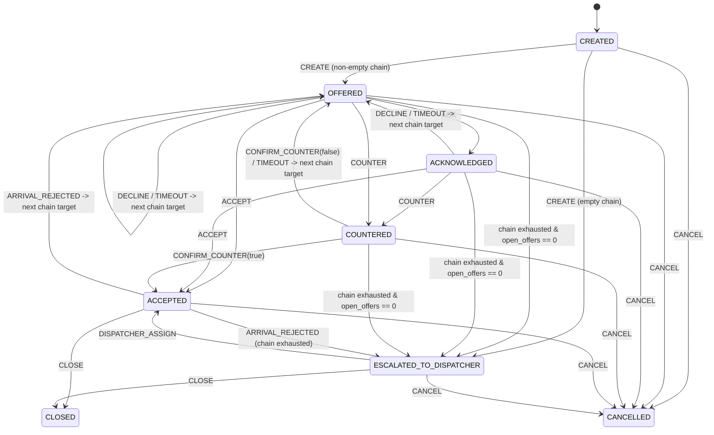
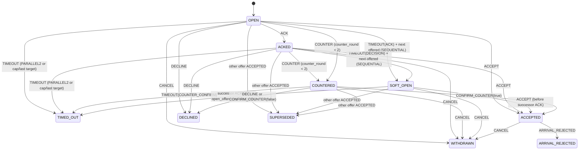
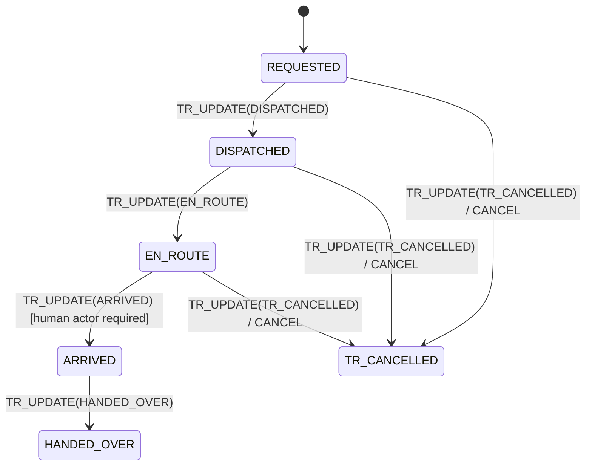

# Feature Specification — ReferralHandshake (Protocol RHP-1)

**Document Authority:** Derived strictly from `ReferralHandshake_FINAL_LOCKED_Architecture.md`, `ReferralHandshake_v8_LOCKED_Solution.md`, and `ReferralHandshake_LOCKED_Problem_Statement_v7.md`.  
**Implementation Mandate:** Every SQL table, trigger, state transition, lock order, timing equation, cryptographic primitive, and API error code in this specification is locked. Coding agents must implement these exact definitions without improvisation.

---

## 0. Architecture Overview, Coherence Mapping & Invariants I1–I16

### 0.1 System Architecture & Coherence Rule Mapping
Every module in ReferralHandshake belongs to exactly one of the three Coherence Rule categories:

```
 PRODUCERS / CONSUMERS (Interfaces)              CONTRACT CORE (State & Events)           READ-ONLY PROJECTIONS (Log Readers)
 ┌──────────────────────────────────┐     ┌──────────────────────────────────────────┐     ┌────────────────────────────────────┐
 │ • React PWA Desks (QR, SSE)      │     │ • FastAPI apply_command() (10 steps)     │     │ • Python Monitor (Person B, I1-I16)│
 │ • Kotlin Android App / PWA GPS   │────▶│ • Lock order: referral > offer >         │────▶│ • Witness Signer (OS user rhp-sign)│
 │ • Exotel Outbound IVR (Press 1)  │     │   deadline > outbox (I14 trigger)        │     │ • Pure-JS Browser Verifier (@noble)│
 │ • DLT Static SMS Alert + Link    │     │ • PostgreSQL 16 Primary (sync_commit=on) │     │ • Guarantee Arena Big Screen       │
 │ • Paper Code (Base32 + mod 37)   │     │ • Stateless Poller (2-phase SKIP LOCKED) │     │ • Command Centre Map, KPIs, Graph  │
 │ • Dispatcher Console (Proxy)     │     │ • Outbox Relay (visibility timeout)      │     │ • FHIR R4 & IEEE 1849 XES Exporters│
 └──────────────────────────────────┘     └──────────────────────────────────────────┘     └────────────────────────────────────┘
```

### 0.2 Formal Invariants I1–I16 (Architecture §3)

| ID | Safety (S) / Liveness (L) Predicate | Primary DB / API Enforcement Mechanism | Independent Python Monitor Rule (Person B) | Verification Test |
|---|---|---|---|---|
| **I1** | **L:** Every non-terminal referral has $\ge 1$ `PENDING` deadline and a responsible role; overdue deadlines are acted on within tolerance $\tau$ ($2 \cdot \text{poll} + 2000\text{ ms}$) | `DEFERRABLE INITIALLY DEFERRED` constraint trigger `i1_pending_deadline` on `referral` at `COMMIT` | Query `deadline WHERE status='PENDING' AND due_at < clock_timestamp() - TAU_MS` | `T-I1` |
| **I2** | **S:** At most $1$ active ownership lease per referral (`status='ACCEPTED'`); `lease_epoch` strictly increases on every grant/revoke | Partial unique index `one_lease ON offer(referral_id) WHERE status='ACCEPTED'` + `referral` row lock | Fold `event` stream: flag if $>1$ active lease or `e.epoch <= st["epoch"]` on `LEASE_GRANTED` | `T-I2`, `T-C1 race200` |
| **I3** | **S:** Transport updates (`TR_UPDATE`, `TR_DESTINATION_CHANGE`) are accepted in every non-terminal `hs_state` | `TR_UPDATE` handler never reads `referral.hs_state` (checks only `hs_state NOT IN ('CLOSED','CANCELLED')`) | Flag any `rejected_command` for `TR_UPDATE` where `hs_state` was non-terminal and `tr_state` transition was valid | `T-I3` |
| **I4** | **S:** Each client `event_id` appears at most once; per-referral `seq` is strictly $1, 2, \dots, n$ with zero gaps | `idempotency(actor_id, key)` PK, `event.event_id UNIQUE`, `PRIMARY KEY(referral_id, seq)`, trigger `rhp_event_guard` | Fold check: `e.seq != st["seq"] + 1` or duplicate `event_id` | `T-I4`, `T-F14` |
| **I5** | **S:** Per-referral SHA-256 JCS hash chain and Ed25519 checkpoint signatures verify; `CLOSED`/`CANCELLED` iff `outcome IS NOT NULL` | Append-only triggers `event_ao`, `checkpoint_ao`; `referral` CHECK constraint; `rhp_event_guard` | Recompute `SHA256(prev_hash || JCS(core))` for every event and compare with `referral.head_hash` | `T-I5`, `T-F8` |
| **I6** | **S:** Every `ACCEPT`/`COUNTER`/`DECLINE` comes from an active rostered role on a registered device/call session with verified PIN, or is flagged `proxy=true` | Pipeline Steps 2, 3, and 5 (`load_session`, `argon2_verify`, `authorize`) | Verify `actor_roster_id` has an active `roster` row covering `server_ts` | `T-I6`, `T-F7` |
| **I7** | **S:** Every system-chosen offer target $\in \text{referral.chain}$; dispatcher overrides carry `source='DISPATCHER'` | `BEFORE INSERT ON offer` trigger `offer_chain_guard` (`rhp_chain_guard()`) | Flag any `offer` where `source='CHAIN'` and `facility_id NOT IN referral.chain` | `T-I7` |
| **I8** | **S:** Commands with stale `expected_version` or `expected_epoch` are never applied and are logged in `rejected_command` | Pipeline Step 5 `fence(r, cmd)` raises `Reject(412)` $\rightarrow$ `ROLLBACK TO SAVEPOINT sp_cmd` $\rightarrow$ insert `rejected_command` | Flag any applied `event` where `e.epoch < st["epoch"]` | `T-I8`, `M1` |
| **I9** | **S:** A facility is targeted at most once per referral (no $A \rightarrow B \rightarrow A$ referral loops) | `UNIQUE (referral_id, facility_id)` constraint on `offer` | Fold check for duplicate `facility_id` across `OFFER_CREATED` events of a referral | `T-I9` |
| **I10** | **S:** Clinical payloads and clinical SSE frames are delivered only to subscribers holding an active (unrevoked) `payload_grant` | Per-frame authorization filter on SSE emitter + `15 s` heartbeat re-check + `GRANT_REVOKED` control frame | Audit SSE frame log against `payload_grant.revoked_at` timestamps | `T-I10`, `T-F10` |
| **I11** | **S:** `event.detail` contains only allowlisted keys per `event.type` with boolean, $\le 12\text{-digit}$ integer, uppercase enum token, or UUID values (zero free-text PHI) | Pydantic `Literal` schemas (`extra='forbid'`) + PostgreSQL `CHECK (rhp_detail_ok(type, detail))` | Scan `event.detail` for any key/value violating `rhp_allowed(type)` | `T-I11`, `T-F9` |
| **I12** | **S:** Concurrent open offers (`OPEN`, `ACKED`, `COUNTERED`, `SOFT_OPEN`) $\le 2$ per referral at all times | `referral.open_offers CHECK (open_offers BETWEEN 0 AND 2)` maintained under referral row lock | Fold offer states and compare active open count $> 2$ or $\ne \text{referral.open\_offers}$ | `T-I12`, `T-F13`, `M4` |
| **I13** | **S:** Configured worst-case escalation time $T_{max} = F \cdot (A + D + \epsilon) \le B$ for the active signed profile | Boot-time validator `validate(profile, REAL_DATA)` refuses startup on violation | Recompute $T_{max} \le B$ at monitor startup and on `/healthz` | `T-I13`, `T-F3` |
| **I14** | **S:** No contract-state write (`referral`, `offer`, `deadline` status/due, `event`, `payload_grant`, `outbox` insert) occurs without holding the `referral` row lock | Session GUC `set_config('rhp.locked_referral', r.id, true)` verified by `BEFORE` triggers `lk_*` (`rhp_require_lock()`) | Check `pg_stat_database.deadlocks` delta $= 0$ and `log_lock_waits` | `T-I14`, `T-F1`, `M3` |
| **I15** | **S:** No ownership lease is granted from a resource capability confirmation that has expired at `server_ts` | Pipeline Step 7 `check_confirmations()` verifies `min(expires_at) > ts`; else `409 STALE_CONFIRMATION_RECONFIRM_REQUIRED` | Join `OFFER_ACCEPTED` events with `offer_resource_confirmation` and check `expires_at <= server_ts` | `T-I15`, `T-F12`, `M6` |
| **I16** | **S:** Per-referral `server_ts` is monotonically non-decreasing across `seq` | `ts = GREATEST(clock_timestamp(), referral.head_ts)` under referral lock + `rhp_event_guard` trigger | Fold check: `e.ts < st["ts"]` | `T-I16`, `T-F11` |

---

## 1. State Machines, Transition Table & 28 Conformance Scenarios

### 1.1 Three Parallel State Machines (`hs_state`, `offer.status`, `tr_state`)

#### Handshake Track (`referral.hs_state`)


#### Per-Facility Offer Lifecycle (`offer.status`)


#### Parallel Transport Track (`referral.tr_state` — Never Gated by `hs_state`)


### 1.2 Complete 14-Command Transition Table (Evaluated Under `referral` Row Lock)

| Command | Authorized Actor(s) | Pre-State Guards | Atomic State, Deadline, Grant & Event Effects | Error Codes |
|---|---|---|---|---|
| **`CREATE`** | Rostered `CLINICIAN` (or `DISPATCHER` proxy) | Referral ID does not exist; active signed profile valid | Insert `referral` (`version=1, lease_epoch=0, tr_state='REQUESTED'`), snapshot `chain` (truncated to $F$), encrypt `clinical_payload` with new DEK (`key_version`), grant origin facility. If `chain` non-empty: create `OPEN` offer(s) for `chain[0]` (`SEQUENTIAL`) or `chain[0..1]` (`PARALLEL2`), grant offered facility(ies), insert deadlines `ACK` ($t+A$), `NOTICE_VOICE` ($t+A/4$), `NOTICE_PROXY` ($t+3A/4$), set `hs_state='OFFERED'`. If `chain` empty: set `hs_state='ESCALATED_TO_DISPATCHER'` + `DISPATCH_ACTION` deadline. Emit `REFERRAL_CREATED`, `OFFER_CREATED`. | `422 SCHEMA`, `403 FORBIDDEN` |
| **`ACK`** | Receiving role (`NURSE`, `CMO`, `CONSULTANT`) via PWA or Voice (`Press 1`) | Target `offer.status == 'OPEN'`; `referral.hs_state` non-terminal | Set `offer.status='ACKED'`, `acked_at=ts`, `acked_by=actor`; mark `ACK`, `NOTICE_VOICE`, `NOTICE_PROXY` deadlines `DONE`; insert `DECISION` deadline due at $ts + D$; if prior step offer is `SOFT_OPEN`, transition it to `TIMED_OUT` (`open_offers` decremented) and revoke its `payload_grant`; update `hs_state` to lead offer (`ACKNOWLEDGED`). Emit `OFFER_ACKED` (+ `OFFER_SOFT_EXPIRED` if prior soft-open closed). | `409 INVALID_TRANSITION`, `412 STALE_VERSION` |
| **`RESOURCE_CONFIRM`** | PIN-verified receiving role (live online only) | `offer.status IN ('OPEN','ACKED','SOFT_OPEN')`; capability $\in \text{cap\_t}$ | Upsert `offer_resource_confirmation(offer_id, capability, confirmed_by, confirmed_at=ts, expires_at=ts+confirm_ttl)`. Emit `RESOURCE_CONFIRMED`. | `409 INVALID_STATE`, `422 INVALID_CAPABILITY` |
| **`ACCEPT`** | PIN-verified receiving role (or `DISPATCHER` proxy) | `offer.status IN ('OPEN','ACKED','SOFT_OPEN')`; `referral.lease_offer_id IS NULL`; every capability in `need_class_requirement` for `referral.need_class` has a row in `offer_resource_confirmation` with `expires_at > ts` (`I15`) | Set `offer.status='ACCEPTED'`, `decided_at=ts`; set `referral.lease_offer_id=offer.id`, `lease_facility_id=offer.facility_id`, `lease_epoch = lease_epoch + 1`, `hs_state='ACCEPTED'`; transition all other open offers (`OPEN`, `ACKED`, `COUNTERED`, `SOFT_OPEN`) to `SUPERSEDED`, set `open_offers=0`, and revoke their `payload_grant`s; cancel pending offer deadlines and insert `HANDOVER` deadline ($ts + H$). Emit `OFFER_ACCEPTED`, `LEASE_GRANTED`, `GRANT_REVOKED`. | `409 LEASE_HELD`, `409 LATE_ACCEPT_REJECTED`, `409 STALE_CONFIRMATION_RECONFIRM_REQUIRED`, `412 STALE_VERSION` |
| **`COUNTER`** | PIN-verified receiving role | `offer.status IN ('OPEN','ACKED')`; `offer.counter_round < 2` | Set `offer.status='COUNTERED'`, `counter_round = counter_round + 1`, `counter_mask = cmd.mask`; cancel `ACK`/`DECISION` deadline and insert `COUNTER_CONFIRM` deadline due at $\min(ts + C, \text{remaining } D)$; update `hs_state='COUNTERED'` (if lead). Emit `OFFER_COUNTERED`. | `409 MAX_COUNTERS_EXCEEDED`, `409 INVALID_STATE`, `422` |
| **`CONFIRM_COUNTER`** | Referring `CLINICIAN` (or `DISPATCHER` proxy) | `offer.status == 'COUNTERED'`; `referral.lease_offer_id IS NULL` | If `cmd.confirmed == true`: re-verify `I15` confirmations (`expires_at > ts`) and execute the `ACCEPT` grant path (`COUNTER_RESOLVED(confirmed=true)`, `OFFER_ACCEPTED`, `LEASE_GRANTED`). If `cmd.confirmed == false`: set `offer.status='DECLINED'`, revoke facility `payload_grant`, decrement `open_offers`, emit `COUNTER_RESOLVED(confirmed=false)`, and call `advance()`. | `409 LEASE_HELD`, `409 STALE_CONFIRMATION_RECONFIRM_REQUIRED`, `412` |
| **`DECLINE`** | PIN-verified receiving role | `offer.status IN ('OPEN','ACKED','SOFT_OPEN','COUNTERED')`; valid `decline_reason` enum | Set `offer.status='DECLINED'`, `decline_reason=cmd.reason`, `decided_at=ts`; cancel offer deadlines; revoke facility `payload_grant`; decrement `open_offers`; emit `OFFER_DECLINED`, `GRANT_REVOKED`; call `advance()`. | `409 INVALID_STATE`, `422 INVALID_REASON` |
| **`TIMEOUT`** | `SYSTEM` (Poller Phase 2) | `deadline.status == 'PENDING'` and matches `step`, `epoch`, and current offer state | Mark `deadline.status='DONE'`.<br>• **`NOTICE_VOICE` / `NOTICE_PROXY`:** if offer still `OPEN`, enqueue outbox rows for voice slot stagger / dispatcher proxy page; emit `NOTICE_SENT`.<br>• **`ACK` expiry:** if offer still `OPEN` (silent) in `SEQUENTIAL` mode and next chain target exists: set offer to `SOFT_OPEN` (if an older step $k-1$ is still `SOFT_OPEN`, set $k-1$ to `TIMED_OUT` and revoke its grant so `open_offers <= 2`) and open next target (`advance_soft()`). If `PARALLEL2` or no next target: set offer `TIMED_OUT`, revoke grant, call `advance()`. If offer already `ACKED`: send `ADVISORY_PREWARM` to next chain target (not an offer).<br>• **`DECISION` / `COUNTER_CONFIRM` expiry:** in `SEQUENTIAL` with next target, set `SOFT_OPEN` + open next; else set `TIMED_OUT`, revoke grant, call `advance()`.<br>• **`HANDOVER` / `DISPATCH_ACTION` expiry:** emit `HANDOVER_OVERDUE` / `DEADLINE_TIMEOUT`, page dispatcher, and insert a new re-armed `PENDING` deadline (`I1`).<br>• **`CLOSURE` expiry:** 1st expiry emits `CLOSURE_OVERDUE` and re-arms once; 2nd expiry executes automatic `CLOSE(outcome='UNKNOWN_COUNTER_REFERRAL', proxy=true)`. | `200 NO_OP` (if deadline already `DONE`/`CANCELLED` or epoch advanced) |
| **`ARRIVAL_REJECTED`** | Receiving desk role or `EMT` / `DISPATCHER` | `referral.hs_state == 'ACCEPTED'`; `offer.status == 'ACCEPTED'` | Set `offer.status='ARRIVAL_REJECTED'`; clear `lease_offer_id=NULL`, `lease_facility_id=NULL`; increment `lease_epoch = lease_epoch + 1`; revoke facility `payload_grant`; cancel `HANDOVER` deadline; emit `ARRIVAL_REJECTED`, `LEASE_REVOKED`, `GRANT_REVOKED`; call `advance()`. | `409 INVALID_STATE`, `412` |
| **`DISPATCHER_ASSIGN`** | `DISPATCHER` | `hs_state == 'ESCALATED_TO_DISPATCHER'` (or live referral with explicit override `reason` enum); `lease_offer_id IS NULL` | Upsert/create `offer` with `source='DISPATCHER'`, `status='ACCEPTED'`; set `lease_offer_id`, `lease_facility_id`, `lease_epoch = lease_epoch + 1`, `hs_state='ACCEPTED'`; supersede any open offers; grant `payload_grant` to assigned facility; insert `HANDOVER` deadline; emit `DISPATCHER_ASSIGNED`, `LEASE_GRANTED` (`proxy=true`). | `409 LEASE_HELD`, `422 REASON_REQUIRED` |
| **`TR_UPDATE`** | `EMT`, `DISPATCHER`, receiving desk, or system geofence hint | `referral.hs_state NOT IN ('CLOSED','CANCELLED')` (`I3`); valid `tr_state` progression | • If `cmd.kind == 'ARRIVAL_SUGGESTED'` ($200\text{ m}$ geofence + dwell): emit `ARRIVAL_SUGGESTED` without changing `tr_state`.<br>• If human actor confirms `ARRIVED`: set `tr_state='ARRIVED'` (if at non-owner facility with no open offer, emit `ARRIVAL_AT_NON_OWNER` alert + dispatcher page).<br>• If `HANDED_OVER`: set `tr_state='HANDED_OVER'`, cancel `HANDOVER` deadline, insert `CLOSURE` deadline ($ts + \text{CLOSURE}$).<br>• If `TR_DESTINATION_CHANGE`: update `tr_facility_id` and emit `TR_DESTINATION_CHANGE(facility, reason, accepted)`. | `409 INVALID_TR_TRANSITION`, `403 HUMAN_REQUIRED_FOR_ARRIVED` |
| **`CANCEL`** | Referring `CLINICIAN` or `DISPATCHER` | `referral.hs_state NOT IN ('CLOSED','CANCELLED')`; valid cancellation outcome in taxonomy | Set `hs_state='CANCELLED'`, `tr_state='TR_CANCELLED'`, `outcome=cmd.outcome`, `closed_at=ts`, `lease_offer_id=NULL`, `lease_facility_id=NULL`, `open_offers=0`; set all active/accepted offers to `WITHDRAWN`; cancel all `PENDING` deadlines; revoke all non-origin `payload_grant`s; emit `CANCELLED`. | `409 ALREADY_TERMINAL`, `422 OUTCOME_REQUIRED` |
| **`CLOSE`** | Receiving role, `DISPATCHER`, or `SYSTEM` (after $2 \times \text{CLOSURE}$ timeout) | `hs_state IN ('ACCEPTED','ESCALATED_TO_DISPATCHER')`; outcome $\in$ 9-outcome taxonomy (`ADMITTED_*` and `DELIVERED_AT_RECEIVER` require `tr_state == 'HANDED_OVER'`) | Set `hs_state='CLOSED'`, `outcome=cmd.outcome`, `closed_at=ts`, `open_offers=0`; cancel all `PENDING` deadlines; revoke remaining `payload_grant`s; schedule `clinical_payload` expiry; emit `CLOSED`. | `409 INVALID_STATE`, `422 OUTCOME_REQUIRES_HANDOVER` |
| **`REVOKE_GRANT`** | `ADMIN`, `DISPATCHER`, or `SYSTEM` | Active `payload_grant` (`revoked_at IS NULL`) | Set `payload_grant.revoked_at=ts`, `revoke_reason=cmd.reason`; enqueue `GRANT_REVOKED` SSE control frame; emit `GRANT_REVOKED`. | `409 ALREADY_REVOKED` |

### 1.3 v7 State Mapping (F19), Reachability (F6) & 28 Conformance Scenarios (v8 §4.8)

#### v7 $\rightarrow$ RHP-1 State Mapping Table
| v7 Concept | `referral.hs_state` | `offer.status` | `referral.tr_state` | Emitted `event.type` |
|---|---|---|---|---|
| `CREATED` | `CREATED` (transient inside `CREATE` txn) | — | `REQUESTED` | `REFERRAL_CREATED` |
| `OFFERED` | `OFFERED` | `OPEN` | any | `OFFER_CREATED` |
| `ACKNOWLEDGED` | `ACKNOWLEDGED` | `ACKED` | any | `OFFER_ACKED` |
| `ACCEPTED` | `ACCEPTED` | `ACCEPTED` | any | `OFFER_ACCEPTED`, `LEASE_GRANTED` |
| `COUNTERED` | `COUNTERED` | `COUNTERED` | any | `OFFER_COUNTERED` |
| `DECLINED` | `OFFERED` or `ESCALATED_TO_DISPATCHER` | `DECLINED` | any | `OFFER_DECLINED` |
| `TIMED_OUT` | `OFFERED` or `ESCALATED_TO_DISPATCHER` | `TIMED_OUT` or `SOFT_OPEN` | any | `DEADLINE_TIMEOUT` |
| `ESCALATED` | `OFFERED` (`ladder_cursor + 1`) | next offer `OPEN` | any | `OFFER_CREATED` (`reason='ESCALATION'`) |
| `ARRIVAL_REJECTED` | `OFFERED` or `ESCALATED_TO_DISPATCHER` | `ARRIVAL_REJECTED` | `ARRIVED` | `ARRIVAL_REJECTED`, `LEASE_REVOKED` |
| `ESCALATED_TO_DISPATCHER` | `ESCALATED_TO_DISPATCHER` | — | any | `ESCALATED_TO_DISPATCHER` |
| `CANCELLED` | `CANCELLED` | `WITHDRAWN` | `TR_CANCELLED` | `CANCELLED` |
| `CLOSED` | `CLOSED` | — | `HANDED_OVER` / outcome-specific | `CLOSED` |

#### Complete 28 Real-World Scenarios & Conformance Vectors
| # | Conformance Vector ID | Real-World Scenario | Exact RHP-1 Protocol Behaviour |
|---|---|---|---|
| 1 | `V-01-VOICE-ACK-ACCEPT` | Receiver has no smartphone (feature phone only) | Outbound Exotel call at $A/4$; `Press 1` commits `ACK(channel='VOICE')`; DTMF `1` + PIN commits `ACCEPT`; fallback to dispatcher proxy at $3A/4$ |
| 2 | `V-02-DECLINE-REDIRECT` | Receiver cannot take patient but suggests another hospital | `DECLINE(reason='NO_NICU')` revokes grant and advances chain; redirect suggestion displayed as advisory only (never auto-followed, `I7`) |
| 3 | `V-03-COUNTER-CONFIRM` | Receiver can take patient only under conditions | `COUNTER(mask)` sets `COUNTERED` and `COUNTER_CONFIRM` deadline $\le \text{remaining } D$; referrer calls `CONFIRM_COUNTER(true)` $\rightarrow$ `ACCEPTED` |
| 4 | `V-04-INTRA-FACILITY` | Duty nurse is busy with a delivery | Concurrent SSE/FCM to all rostered slots at $t=0$; staggered voice calls to slots $0 \dots S-1$ at $A/4 + i \cdot \delta$; proxy page at $3A/4$ |
| 5 | `V-05-PARALLEL-RACE` | Two facilities press Accept simultaneously (`PARALLEL2`) | `SELECT ... FOR UPDATE` + `one_lease` grants `200` to first lock holder (`lease_epoch=1`) and `409 LEASE_HELD` (`SUPERSEDED`) to loser |
| 6 | `V-06-LATE-ACCEPT-SOFT` | Facility $k$ accepts shortly after $k$ timed out and $k+1$ opened | While $k$ is `SOFT_OPEN` (before $k+1$ `ACK`s), $k$'s `ACCEPT` succeeds and supersedes $k+1$; after $k+1$ `ACK`s, $k$ gets `409 LATE_ACCEPT_REJECTED` |
| 7 | `V-07-ARRIVAL-REJECTED` | Receiver accepted, but OT is occupied when ambulance arrives | `ARRIVAL_REJECTED` increments `lease_epoch`, clears lease, revokes grant, records broken commitment, and escalates to next chain target |
| 8 | `V-08-CHAIN-EXHAUSTED` | Every facility in `referral.chain` declines or times out | `advance()` transitions `hs_state` to `ESCALATED_TO_DISPATCHER` and arms `DISPATCH_ACTION` deadline (`I1`, `I7`) |
| 9 | `V-09-DEAD-ZONE-MERGE` | Ambulance enters a cellular dead zone mid-transit | GPS/vitals queue in local outbox; UI shows `"Last confirmed Ns ago"`; reconnect merges `telemetry` via `event_id UNIQUE` set-union |
| 10 | `V-10-SERVER-OUTAGE` | API or internet goes down during transfer | Clinical/phone procedures continue; printed slip carries 9-char Base32 code; client outbox replays idempotently after recovery |
| 11 | `V-11-UNAUTHORIZED-ACTOR` | Unrostered user or wrong PIN attempts to accept | Pipeline Steps 2/3/5 reject with `403 FORBIDDEN` / `PIN_INVALID` and log a row in `rejected_command` (`I6`) |
| 12 | `V-12-DISPATCHER-PROXY` | Ambulance crew cannot operate app while treating patient | Dispatcher enters status with `proxy=true, proxy_for=<emt_roster_id>`, logged and badged on monitor |
| 13 | `V-13-PAPER-CODE-LINK` | Patient arrives with physical slip before digital desk sync | Receiving desk enters 9-char Crockford Base32 (`mod 37`) `paper_code` to look up referral and record arrival/handover |
| 14 | `V-14-IOS-FOREGROUND` | Clinician uses iPhone Safari with restricted backgrounding | Pure-JS `@noble` crypto runs in foreground; outbox flushes on `visibilitychange` foreground resume; no background claim made |
| 15 | `V-15-AI-CFF-GATE` | AI OCR draft misreads handwritten dosage | Server returns `423 ANCHOR_REQUIRED` until clinician commits `need_class` and `mgso4_status`; critical fields require manual re-entry |
| 16 | `V-16-CANCEL-STABILISED` | Patient delivers or stabilises at originating PHC before departure | `CANCEL(outcome='DELIVERED_EN_ROUTE' \| 'TRANSPORT_CANCELLED')` withdraws open offers, revokes grants, cancels deadlines |
| 17 | `V-17-PATIENT-REFUSED` | Patient or family refuses inter-facility transfer | `CANCEL(outcome='PATIENT_REFUSED')` closes referral cleanly with full audit trail (`I5`) |
| 18 | `V-18-AMBULANCE-BREAKDOWN` | Ambulance breaks down en route | Replacement vehicle continues `tr_state`; `hs_state` and `lease_epoch` remain intact (`I3`) |
| 19 | `V-19-STALE-ROSTER-PHONE` | Duty nurse's phone number is unreachable | Voice call fails/unanswered $\rightarrow$ next slot $i+1$ called at $+ \delta$ $\rightarrow$ dispatcher proxy page at $3A/4$ $\rightarrow$ next facility at $A$ |
| 20 | `V-20-COUNTER-MAX-2` | Receiver attempts a 3rd counter-offer round | Guard `counter_round < 2` rejects 3rd `COUNTER` with `409 MAX_COUNTERS_EXCEEDED`; timer expires to next facility |
| 21 | `V-21-DUPLICATE-PATIENT` | Second clinician starts a card for the same patient | Paper-code / origin-time proximity prompts UI warning to link existing referral; never auto-merges authoritative state |
| 22 | `V-22-CLIENT-CLOCK-SKEW` | Clinician tablet clock is $45\text{ min}$ behind | Deadlines use `GREATEST(clock_timestamp(), referral.head_ts)` (`I16`); skewed `client_ts_ms` is recorded for audit only |
| 23 | `V-23-PIN-LOCKOUT-SCOPE` | Attacker or confused user enters 3 wrong PINs on one session | Autonomous txn increments `session.pin_failed`; at 3 strikes sets `pin_locked_until = now() + 120s` for *that session/call_sid only* (`F7`) |
| 24 | `V-24-DISPATCHER-OVERRIDE` | Dispatcher manually assigns a hospital outside normal ladder | `DISPATCHER_ASSIGN` requires structured `reason` enum, sets `source='DISPATCHER'`, `proxy=true`, increments `lease_epoch`, flags monitor |
| 25 | `V-25-APOT-GAMING-FLAG` | Hospital accepts quickly to look good, then holds ambulance at door | `HANDOVER` deadline fires `HANDOVER_OVERDUE`; APOT metric (`ARRIVED -> HANDED_OVER`) highlights the delay separately from `ACCEPT` |
| 26 | `V-26-AT-CAPACITY-DECLINE` | Tertiary medical college OT is saturated | Desk issues `DECLINE(reason='AT_CAPACITY')`; chain immediately advances without waiting for timeout |
| 27 | `V-27-RETRY-STORM` | Flaky 2G connection replays `ACCEPT` 15 times | Step 1 idempotency returns stored response (`200` or `409`) or `409 DUPLICATE_IN_FLIGHT` with zero duplicate `event` rows (`I4`) |
| 28 | `V-28-UNCLOSED-REFERRAL` | Receiving team forgets to click Close after `HANDED_OVER` | First `CLOSURE` deadline fires `CLOSURE_OVERDUE`; second expiry auto-commits `CLOSE(outcome='UNKNOWN_COUNTER_REFERRAL', proxy=true)` (`F6`) |

---

## 2. Command Execution Pipeline, Global Lock Order & Background Workers

### 2.1 Global Lock Order Proof (F1, I14)
To guarantee freedom from database deadlocks under 200-way concurrency, every multi-row transaction strictly obeys the total lock hierarchy:
$$\text{referral} \longrightarrow \text{offer } (\text{ORDER BY id}) \longrightarrow \text{deadline } (\text{ORDER BY id}) \longrightarrow \text{outbox}$$

- **Poller Phase 1 (`CLAIM`):** Executes a single `UPDATE deadline ... WHERE id IN (SELECT ... FOR UPDATE SKIP LOCKED) RETURNING ...` statement and commits immediately without touching `referral`.
- **Poller Phase 2 (`TIMEOUT`):** Invokes `apply_command(TIMEOUT)`, which locks `referral` first, then `offer`, then re-verifies `deadline WHERE id=$1 AND status='PENDING'`.
- **Database Trigger Enforcement (`I14`):** Step 4 of `apply_command()` executes `SELECT set_config('rhp.locked_referral', r.id::text, true)`. Triggers `lk_referral`, `lk_offer`, `lk_deadline`, `lk_event`, `lk_grant`, and `lk_outbox` raise `I14_LOCK_NOT_HELD` if any contract-state write is attempted when `current_setting('rhp.locked_referral', true)` does not match the target `referral_id`.

### 2.2 The 10-Step `apply_command()` Pipeline (Architecture §5)

```python
import hashlib
import json
import psycopg

def jcs(obj: dict) -> bytes:
    """RFC 8785 Canonical JSON subset: ASCII keys, ints/strings/bools only (floats forbidden)."""
    return json.dumps(obj, sort_keys=True, separators=(",", ":"), ensure_ascii=True).encode("ascii")

def sha256(data: bytes) -> bytes:
    return hashlib.sha256(data).digest()

def apply_command(conn: psycopg.Connection, cmd, sess, idem_key: str):
    """Executes inside PostgreSQL 16 READ COMMITTED with synchronous_commit=on."""
    if not idem_key or not (8 <= len(idem_key) <= 80):
        return http(422, "MISSING_IDEMPOTENCY_KEY")

    # STEP 1: IDEMPOTENCY (before acquiring any referral lock)
    h = sha256(jcs(cmd.body_for_hash()))
    with conn.transaction():
        lock_key = f"{sess.roster_id}:{idem_key}"
        got_lock = conn.execute(
            "SELECT pg_try_advisory_xact_lock(hashtextextended(%s, 0))", (lock_key,)
        ).fetchone()[0]
        if not got_lock:
            return http(409, "DUPLICATE_IN_FLIGHT")

        row = conn.execute(
            "SELECT request_hash, status, http_status, response FROM idempotency "
            "WHERE actor_id = %s AND key = %s AND expires_at > clock_timestamp()",
            (sess.roster_id, idem_key),
        ).fetchone()
        if row:
            if bytes(row.request_hash) != h:
                return http(422, "KEY_REUSED_DIFFERENT_PAYLOAD")
            if row.status == "DONE":
                return http(row.http_status, row.response)  # Replays 200 AND stored 409/412/422

        conn.execute(
            "INSERT INTO idempotency(actor_id, key, request_hash, status, created_at, expires_at) "
            "VALUES (%s, %s, %s, 'IN_FLIGHT', clock_timestamp(), clock_timestamp() + interval '48 hours') "
            "ON CONFLICT (actor_id, key) DO UPDATE SET "
            "request_hash = EXCLUDED.request_hash, status = 'IN_FLIGHT', "
            "created_at = EXCLUDED.created_at, expires_at = EXCLUDED.expires_at",
            (sess.roster_id, idem_key, h),
        )

        # STEP 2: SESSION & DEVICE VALIDATION (read-only)
        s = load_session(conn, sess)
        if not s or not s.valid:
            return http(401, "SESSION_INVALID")
        if s.pin_locked_until and s.pin_locked_until > s.now:
            return finalize(conn, s.roster_id, idem_key, 429, {"error": "PIN_LOCKED"})

        # STEP 3: PIN VERIFICATION (Argon2id; failure counter on autonomous connection)
        if cmd.needs_pin and not argon2_verify(s.pin_hash, cmd.pin):
            locked = autonomous_pin_failed(s.id, s.roster_id, cmd.referral_id)
            code = 429 if locked else 403
            reason = "PIN_LOCKED" if locked else "PIN_INVALID"
            return finalize(conn, s.roster_id, idem_key, code, {"error": reason})

        # STEP 4: LOCK REFERRAL FIRST, STAMP I14 GUC, COMPUTE MONOTONE SERVER TIMESTAMP (I16)
        r = lock_or_init_referral(conn, cmd, s)
        conn.execute("SELECT set_config('rhp.locked_referral', %s, true)", (str(r.id),))
        ts = conn.execute("SELECT GREATEST(clock_timestamp(), %s)", (r.head_ts,)).fetchone()[0]

        conn.execute("SAVEPOINT sp_cmd")
        try:
            # STEP 5: OBJECT-LEVEL AUTHORITY (I6) & OPTIMISTIC/EPOCH FENCING (I8)
            authorize(conn, r, s, cmd, ts)  # Raises Reject(403, ...) on roster/facility mismatch
            fence(r, cmd)                   # Raises Reject(412, "STALE_VERSION_OR_EPOCH")

            # STEP 6: TRANSITION LOOKUP & ORDERED CHILD LOCKS (offer ORDER BY id, deadline ORDER BY id)
            offers = conn.execute(
                "SELECT * FROM offer WHERE referral_id = %s ORDER BY id FOR UPDATE", (r.id,)
            ).fetchall()
            deadlines = conn.execute(
                "SELECT * FROM deadline WHERE referral_id = %s AND status = 'PENDING' ORDER BY id FOR UPDATE",
                (r.id,),
            ).fetchall()
            transition = TRANSITIONS.lookup(cmd.type, r, offers, deadlines, cmd)

            # STEP 7: LIVE STALENESS & RESOURCE CONFIRMATION CHECK (I15, F12)
            check_confirmations(conn, r, offers, cmd, ts)

            # STEP 8: APPLY STATE MUTATIONS (offers, lease_epoch, grants, deadlines)
            eff = transition.apply(conn, r, offers, deadlines, cmd, s, ts)

            # STEP 9: APPEND HASH-CHAINED EVENT(S) & INSERT OUTBOX ROWS LAST
            ev = append_event(conn, r, cmd, s, eff, ts)
            insert_outbox_rows(conn, r, ev, eff, ts)

            # STEP 10: FINALIZE IDEMPOTENCY ROW AS 'DONE' & COMMIT
            return finalize(conn, s.roster_id, idem_key, 200, ev.to_dict())

        except Reject as e:
            # Deterministic domain rejection: rollback to savepoint (retaining referral lock & GUC)
            conn.execute("ROLLBACK TO SAVEPOINT sp_cmd")
            conn.execute(
                "INSERT INTO rejected_command(actor_id, key, referral_id, command, http_status, reason_code, session_id, created_at) "
                "VALUES (%s, %s, %s, %s, %s, %s, %s, %s)",
                (s.roster_id, idem_key, r.id, cmd.type, e.code, e.reason, s.id, ts),
            )
            return finalize(conn, s.roster_id, idem_key, e.code, {"error": e.reason})
```

### 2.3 Two-Phase Stateless Poller & Outbox Relay (Architecture §5.3–§5.4)

```python
CLAIM_DEADLINES_SQL = """
UPDATE deadline
   SET claimed_until = clock_timestamp() + interval '5 seconds'
 WHERE id IN (
       SELECT id FROM deadline
        WHERE status = 'PENDING'
          AND due_at <= clock_timestamp()
          AND (claimed_until IS NULL OR claimed_until < clock_timestamp())
        ORDER BY due_at
        LIMIT 50
        FOR UPDATE SKIP LOCKED
 )
 RETURNING id, referral_id, offer_id, kind, step, epoch;
"""

def poller_tick(pool):
    # Phase 1: Single committed statement, zero referral locks held
    with pool.connection() as conn:
        with conn.transaction():
            due_rows = conn.execute(CLAIM_DEADLINES_SQL).fetchall()
            conn.execute(
                "INSERT INTO heartbeat(subject_kind, subject_id, last_seen, ntp_offset_ms) "
                "VALUES ('POLLER', 'poller-1', clock_timestamp(), 0) "
                "ON CONFLICT (subject_kind, subject_id) DO UPDATE SET last_seen = clock_timestamp()"
            )
    # Phase 2: Each claimed deadline invokes apply_command(TIMEOUT), which locks referral FIRST
    for d in due_rows:
        with pool.connection() as conn:
            cmd = TimeoutCommand(
                referral_id=d.referral_id,
                deadline_id=d.id,
                offer_id=d.offer_id,
                kind=d.kind,
                step=d.step,
                expected_epoch=d.epoch,
            )
            apply_command(conn, cmd, SYSTEM_SESSION, idem_key=f"timeout:{d.id}:{d.epoch}")
```

---

## 3. Timing Model, Signed Profiles & Monotone Clock Semantics

### 3.1 Unified Offer-ACK Window ($A$) & Notice Ladder (F2)
```
 t = 0 (Offer OPEN)           t = A/4                            t = 3A/4                         t = A (ACK Deadline)
  ├── Push SSE + empty FCM ───┼── Outbound Exotel Voice IVR ─────┼── Dispatcher Proxy Page ───────┼── TIMEOUT(ACK)
  │   to ALL rostered slots   │   Slot i at A/4 + i·δ (i=0..S-1) │   (human phone-assist alert)   │   • Silent (SEQ): SOFT_OPEN + next OPEN
  │   concurrently            │   AMD + Press 1 gate             │                                │   • ACKed: ADVISORY_PREWARM to next
  └───────────────────────────┴──────────────────────────────────┴────────────────────────────────┴── Any ACK cancels NOTICE rungs & arms D
```

### 3.2 Signed Timing Profiles & $T_{max} = F \cdot (A + D + \epsilon) \le B$ Proof (F3, I13)

| Profile Parameter | `PILOT_OB_CRITICAL` | `PILOT_STANDARD` | `DEMO_FAST` | `DEMO_VOICE` |
|---|---|---|---|---|
| **$A$ (ACK window, ms)** | $60,000\text{ ms}$ ($60\text{ s}$) | $120,000\text{ ms}$ ($120\text{ s}$) | $3,000\text{ ms}$ ($3\text{ s}$) | $45,000\text{ ms}$ ($45\text{ s}$) |
| **$D$ (Decision window, ms)** | $180,000\text{ ms}$ ($180\text{ s}$) | $300,000\text{ ms}$ ($300\text{ s}$) | $4,000\text{ ms}$ ($4\text{ s}$) | $20,000\text{ ms}$ ($20\text{ s}$) |
| **Notice Rungs ($0, A/4, 3A/4$, ms)** | $0 / 15,000 / 45,000$ | $0 / 30,000 / 90,000$ | $0 / 750 / 2,250$ | $0 / 11,250 / 33,750$ |
| **Slots $S$, Stagger $\delta$, Call Budget $V$ (ms)** | $S=3, \delta=5,000, V=20,000$ | $S=3, \delta=10,000, V=20,000$ | $S=3, \delta=0$, Voice OFF | $S=1, \delta=0, V=20,000$ |
| **Max Facilities $F$** | $3$ | $3$ | $3$ | $2$ |
| **Hop Budget $\epsilon$ (poll + apply, ms)** | $3,000\text{ ms}$ ($3\text{ s}$) | $3,000\text{ ms}$ ($3\text{ s}$) | $1,000\text{ ms}$ ($1\text{ s}$) | $1,000\text{ ms}$ ($1\text{ s}$) |
| **Counter Confirm $C$ (ms)** | $90,000\text{ ms}$ | $150,000\text{ ms}$ | $2,000\text{ ms}$ | $10,000\text{ ms}$ |
| **Resource `confirm_ttl` (ms)** | $120,000\text{ ms}$ | $180,000\text{ ms}$ | $10,000\text{ ms}$ | $60,000\text{ ms}$ |
| **`HANDOVER` $H$ / `DISPATCH_ACTION` / `CLOSURE` (ms)** | $7.2\times 10^6 / 3\times 10^5 / 8.64\times 10^7$ | $7.2\times 10^6 / 3\times 10^5 / 8.64\times 10^7$ | $30,000 / 5,000 / 20,000$ | $60,000 / 10,000 / 60,000$ |
| **Computed $T_{max} = F \cdot (A + D + \epsilon)$** | $3 \cdot (60 + 180 + 3) = \mathbf{729\text{ s}}$ | $3 \cdot (120 + 300 + 3) = \mathbf{1,269\text{ s}}$ | $3 \cdot (3 + 4 + 1) = \mathbf{24\text{ s}}$ | $2 \cdot (45 + 20 + 1) = \mathbf{132\text{ s}}$ |
| **Hard Upper Bound $B$** | $\mathbf{900\text{ s}}$ ($900,000\text{ ms}$) | $\mathbf{1,500\text{ s}}$ ($1,500,000\text{ ms}$) | $\mathbf{25\text{ s}}$ ($25,000\text{ ms}$) | $\mathbf{150\text{ s}}$ ($150,000\text{ ms}$) |
| **Voice Stagger Check: $A/4 + (S-1)\delta + V \le 3A/4$** | $15 + 10 + 20 = 45 \le 45\text{ s}$ (PASS) | $30 + 20 + 20 = 70 \le 90\text{ s}$ (PASS) | Voice OFF (PASS) | $11.25 + 0 + 20 = 31.25 \le 33.75\text{ s}$ (PASS) |
| **Permitted When `REAL_DATA=1`?** | **YES** | **YES** | **NO (Refuses Boot)** | **NO (Refuses Boot)** |

---

## 4. Complete 24-Table PostgreSQL 16 Data Model (DDL)

The following SQL schema (`db/schema.sql`) is locked and must be loaded verbatim into PostgreSQL 16:

```sql
CREATE EXTENSION IF NOT EXISTS pgcrypto;
CREATE DOMAIN need_class_t AS text CHECK (VALUE IN ('OBSTETRIC_EMERGENCY','NEONATAL','TRAUMA','CARDIAC','STROKE'));
CREATE DOMAIN cap_t AS text CHECK (VALUE IN ('OT','BLOOD','ANAESTHETIST','PAEDIATRICIAN','NICU'));

-- 1. facility
CREATE TABLE facility(
  id uuid PRIMARY KEY, code text UNIQUE NOT NULL, name text NOT NULL,
  tier text NOT NULL CHECK (tier IN ('PHC','CHC','FRU','DH','MC','DISPATCH')),
  lat_e5 int, lon_e5 int, active boolean NOT NULL DEFAULT true);

-- 2. roster
CREATE TABLE roster(
  id uuid PRIMARY KEY, facility_id uuid NOT NULL REFERENCES facility,
  role_slot text NOT NULL CHECK (role_slot IN ('NURSE','CMO','CONSULTANT','CLINICIAN','EMT','DISPATCHER','ADMIN','JUDGE_DESK')),
  slot_no smallint NOT NULL DEFAULT 1, phone_e164 text, pin_hash text,
  valid_from timestamptz NOT NULL DEFAULT now(), valid_to timestamptz,
  UNIQUE (facility_id, role_slot, slot_no, valid_from));

-- 3. facility_capability
CREATE TABLE facility_capability(
  facility_id uuid NOT NULL REFERENCES facility, capability cap_t NOT NULL,
  attested_at timestamptz NOT NULL, attested_by uuid REFERENCES roster, expires_at timestamptz NOT NULL,
  PRIMARY KEY (facility_id, capability));

-- 4. need_class_requirement
CREATE TABLE need_class_requirement(
  need_class need_class_t NOT NULL, capability cap_t NOT NULL, PRIMARY KEY (need_class, capability));

-- 5. catchment_chain
CREATE TABLE catchment_chain(
  origin_facility_id uuid NOT NULL REFERENCES facility, need_class need_class_t NOT NULL,
  position smallint NOT NULL CHECK (position BETWEEN 1 AND 8),
  target_facility_id uuid NOT NULL REFERENCES facility,
  approved_by text NOT NULL, approved_at timestamptz NOT NULL,
  PRIMARY KEY (origin_facility_id, need_class, position),
  UNIQUE (origin_facility_id, need_class, target_facility_id),
  CHECK (origin_facility_id <> target_facility_id));

-- 6. device
CREATE TABLE device(
  id uuid PRIMARY KEY, roster_id uuid NOT NULL REFERENCES roster,
  pubkey bytea NOT NULL CHECK (octet_length(pubkey)=32), platform text NOT NULL,
  registered_at timestamptz NOT NULL, revoked_at timestamptz);

-- 7. enrollment_ticket
CREATE TABLE enrollment_ticket(
  id uuid PRIMARY KEY, roster_id uuid NOT NULL REFERENCES roster, token_hash bytea UNIQUE NOT NULL,
  issued_by uuid NOT NULL REFERENCES roster, expires_at timestamptz NOT NULL,
  used_at timestamptz, device_id uuid REFERENCES device);

-- 8. session
CREATE TABLE session(
  id uuid PRIMARY KEY, token_hash bytea UNIQUE NOT NULL, roster_id uuid NOT NULL REFERENCES roster,
  device_id uuid REFERENCES device, call_sid text UNIQUE,
  created_at timestamptz NOT NULL, expires_at timestamptz NOT NULL, revoked_at timestamptz,
  pin_failed smallint NOT NULL DEFAULT 0, pin_locked_until timestamptz,
  CHECK (device_id IS NOT NULL OR call_sid IS NOT NULL));

-- 9. referral
CREATE TABLE referral(
  id uuid PRIMARY KEY, version int NOT NULL DEFAULT 1,
  hs_state text NOT NULL CHECK (hs_state IN ('CREATED','OFFERED','ACKNOWLEDGED','ACCEPTED','COUNTERED','ESCALATED_TO_DISPATCHER','CANCELLED','CLOSED')),
  tr_state text NOT NULL DEFAULT 'REQUESTED' CHECK (tr_state IN ('REQUESTED','DISPATCHED','EN_ROUTE','ARRIVED','HANDED_OVER','TR_CANCELLED')),
  mode text NOT NULL CHECK (mode IN ('SEQUENTIAL','PARALLEL2')),
  need_class need_class_t NOT NULL, origin_facility_id uuid NOT NULL REFERENCES facility,
  chain uuid[] NOT NULL CHECK (cardinality(chain) BETWEEN 0 AND 8),
  ladder_cursor smallint NOT NULL DEFAULT 0,
  lease_offer_id uuid, lease_facility_id uuid REFERENCES facility, lease_epoch bigint NOT NULL DEFAULT 0,
  open_offers smallint NOT NULL DEFAULT 0 CHECK (open_offers BETWEEN 0 AND 2),
  tr_facility_id uuid REFERENCES facility,
  mgso4_status text NOT NULL DEFAULT 'UNKNOWN' CHECK (mgso4_status IN ('GIVEN','NONE_GIVEN','UNKNOWN')),
  profile_id text NOT NULL, profile_hash bytea NOT NULL, paper_code text UNIQUE NOT NULL,
  head_seq bigint NOT NULL DEFAULT 0, head_hash bytea NOT NULL DEFAULT decode(repeat('00',32),'hex'),
  head_ts timestamptz NOT NULL,
  outcome text CHECK (outcome IN ('ADMITTED_STABLE','ADMITTED_CRITICAL','DELIVERED_AT_RECEIVER','DELIVERED_EN_ROUTE','PATIENT_REFUSED','TRANSPORT_CANCELLED','DETERIORATED_OR_DIED_PRE_HANDOVER','REDIRECTED_ON_ARRIVAL','UNKNOWN_COUNTER_REFERRAL')),
  created_by uuid NOT NULL REFERENCES roster, created_at timestamptz NOT NULL, closed_at timestamptz,
  CHECK ((hs_state IN ('CLOSED','CANCELLED')) = (outcome IS NOT NULL AND closed_at IS NOT NULL)),
  CHECK ((lease_offer_id IS NULL) = (lease_facility_id IS NULL)));

-- 10. offer
CREATE TABLE offer(
  id uuid PRIMARY KEY, referral_id uuid NOT NULL REFERENCES referral,
  facility_id uuid NOT NULL REFERENCES facility, step smallint NOT NULL,
  source text NOT NULL CHECK (source IN ('CHAIN','DISPATCHER')),
  status text NOT NULL CHECK (status IN ('OPEN','ACKED','COUNTERED','SOFT_OPEN','ACCEPTED','DECLINED','TIMED_OUT','SUPERSEDED','ARRIVAL_REJECTED','WITHDRAWN')),
  counter_round smallint NOT NULL DEFAULT 0 CHECK (counter_round BETWEEN 0 AND 2),
  counter_mask int NOT NULL DEFAULT 0, decline_reason text CHECK (decline_reason ~ '^[A-Z_]{1,40}$'),
  created_epoch bigint NOT NULL, created_at timestamptz NOT NULL,
  acked_at timestamptz, acked_by uuid REFERENCES roster, decided_at timestamptz,
  UNIQUE (referral_id, facility_id));                                  -- I9
CREATE UNIQUE INDEX one_lease ON offer (referral_id) WHERE status = 'ACCEPTED';   -- I2
ALTER TABLE referral ADD CONSTRAINT referral_lease_fk FOREIGN KEY (lease_offer_id) REFERENCES offer(id) DEFERRABLE INITIALLY DEFERRED;

-- 11. offer_resource_confirmation
CREATE TABLE offer_resource_confirmation(
  offer_id uuid NOT NULL REFERENCES offer, capability cap_t NOT NULL,
  confirmed_by uuid NOT NULL REFERENCES roster, confirmed_at timestamptz NOT NULL, expires_at timestamptz NOT NULL,
  PRIMARY KEY (offer_id, capability), CHECK (expires_at > confirmed_at));

-- 12. deadline
CREATE TABLE deadline(
  id uuid PRIMARY KEY, referral_id uuid NOT NULL REFERENCES referral, offer_id uuid REFERENCES offer,
  kind text NOT NULL CHECK (kind IN ('ACK','DECISION','COUNTER_CONFIRM','NOTICE_VOICE','NOTICE_PROXY','HANDOVER','DISPATCH_ACTION','CLOSURE')),
  step smallint, epoch bigint NOT NULL, due_at timestamptz NOT NULL,
  status text NOT NULL DEFAULT 'PENDING' CHECK (status IN ('PENDING','DONE','CANCELLED')),
  claimed_until timestamptz, created_at timestamptz NOT NULL);
CREATE INDEX deadline_due ON deadline (due_at) WHERE status = 'PENDING';
CREATE INDEX deadline_ref ON deadline (referral_id) WHERE status = 'PENDING';

-- Event Detail Allowlist Functions (F9, I11)
CREATE FUNCTION rhp_allowed(t text) RETURNS text[] LANGUAGE sql IMMUTABLE AS $$
 SELECT CASE
  WHEN t='REFERRAL_CREATED' THEN ARRAY['mode','need_class','chain_len','profile','mgso4']
  WHEN t IN ('OFFER_CREATED','ADVISORY_PREWARM') THEN ARRAY['step','facility','source','reason']
  WHEN t='NOTICE_SENT' THEN ARRAY['channel','rung','slot']
  WHEN t='OFFER_ACKED' THEN ARRAY['channel']
  WHEN t='RESOURCE_CONFIRMED' THEN ARRAY['capability']
  WHEN t IN ('OFFER_ACCEPTED','LEASE_GRANTED','LEASE_REVOKED') THEN ARRAY['facility','epoch','reason']
  WHEN t='OFFER_COUNTERED' THEN ARRAY['round','mask']
  WHEN t='COUNTER_RESOLVED' THEN ARRAY['confirmed']
  WHEN t='OFFER_DECLINED' THEN ARRAY['reason']
  WHEN t IN ('DEADLINE_TIMEOUT','CLOSURE_OVERDUE','HANDOVER_OVERDUE') THEN ARRAY['kind','step']
  WHEN t IN ('ARRIVAL_REJECTED','ESCALATED_TO_DISPATCHER','GRANT_REVOKED','PIN_LOCKED','ARRIVAL_AT_NON_OWNER') THEN ARRAY['reason','facility']
  WHEN t='DISPATCHER_ASSIGNED' THEN ARRAY['facility','reason']
  WHEN t IN ('TR_UPDATED','ARRIVAL_SUGGESTED') THEN ARRAY['tr_state','source','dwell_s']
  WHEN t='TR_DESTINATION_CHANGE' THEN ARRAY['facility','reason','accepted']
  WHEN t IN ('CANCELLED','CLOSED') THEN ARRAY['outcome','reason']
  WHEN t='RESTORE' THEN ARRAY['checkpoint_id']
  ELSE ARRAY[]::text[] END $$;

CREATE FUNCTION rhp_detail_ok(t text, d jsonb) RETURNS boolean LANGUAGE sql IMMUTABLE AS $$
 SELECT jsonb_typeof(d)='object' AND NOT EXISTS (
   SELECT 1 FROM jsonb_each(d) e
   WHERE NOT (e.key = ANY (rhp_allowed(t)))
      OR NOT ( jsonb_typeof(e.value)='boolean'
            OR (jsonb_typeof(e.value)='number' AND e.value::text ~ '^-?[0-9]{1,12}$')
            OR (jsonb_typeof(e.value)='string' AND ((e.value #>> '{}') ~ '^[A-Z0-9_]{1,40}$'
                 OR (e.value #>> '{}') ~ '^[0-9a-f]{8}-[0-9a-f]{4}-[0-9a-f]{4}-[0-9a-f]{4}-[0-9a-f]{12}$')))) $$;

-- 13. event
CREATE TABLE event(
  referral_id uuid NOT NULL REFERENCES referral, seq bigint NOT NULL CHECK (seq >= 1),
  event_id uuid NOT NULL UNIQUE,
  type text NOT NULL CHECK (type IN ('REFERRAL_CREATED','OFFER_CREATED','ADVISORY_PREWARM','NOTICE_SENT','OFFER_ACKED','RESOURCE_CONFIRMED','OFFER_ACCEPTED','LEASE_GRANTED','OFFER_COUNTERED','COUNTER_RESOLVED','OFFER_DECLINED','DEADLINE_TIMEOUT','OFFER_SOFT_EXPIRED','ARRIVAL_REJECTED','LEASE_REVOKED','ESCALATED_TO_DISPATCHER','DISPATCHER_ASSIGNED','TR_UPDATED','TR_DESTINATION_CHANGE','ARRIVAL_SUGGESTED','ARRIVAL_AT_NON_OWNER','CANCELLED','CLOSED','CLOSURE_OVERDUE','HANDOVER_OVERDUE','GRANT_REVOKED','PIN_LOCKED','RESTORE')),
  actor_roster_id uuid REFERENCES roster, actor_facility_id uuid REFERENCES facility,
  channel text NOT NULL CHECK (channel IN ('PWA','ANDROID','VOICE','SMS_LINK','PAPER','DISPATCHER_PROXY','SYSTEM')),
  proxy boolean NOT NULL DEFAULT false, proxy_for uuid REFERENCES roster,
  epoch bigint NOT NULL, detail jsonb NOT NULL DEFAULT '{}' CHECK (rhp_detail_ok(type, detail)),
  secret_hash bytea, client_ts_ms bigint, server_ts timestamptz NOT NULL,
  prev_hash bytea NOT NULL CHECK (octet_length(prev_hash)=32), hash bytea NOT NULL CHECK (octet_length(hash)=32),
  PRIMARY KEY (referral_id, seq));

-- 14. key_version
CREATE TABLE key_version(
  id uuid PRIMARY KEY, referral_id uuid NOT NULL REFERENCES referral, kek_epoch text NOT NULL,
  wrapped_dek bytea, status text NOT NULL CHECK (status IN ('ACTIVE','SHREDDED')),
  created_at timestamptz NOT NULL, shredded_at timestamptz,
  CHECK ((status='SHREDDED') = (wrapped_dek IS NULL)));

-- 15. event_secret
CREATE TABLE event_secret(
  referral_id uuid NOT NULL, seq bigint NOT NULL, key_id uuid NOT NULL REFERENCES key_version,
  nonce bytea NOT NULL, ciphertext bytea NOT NULL, PRIMARY KEY (referral_id, seq),
  FOREIGN KEY (referral_id, seq) REFERENCES event);

-- 16. clinical_payload
CREATE TABLE clinical_payload(
  referral_id uuid PRIMARY KEY REFERENCES referral, key_id uuid NOT NULL REFERENCES key_version,
  nonce bytea NOT NULL, ciphertext bytea NOT NULL, schema_ver smallint NOT NULL, expires_at timestamptz NOT NULL);

-- 17. payload_grant
CREATE TABLE payload_grant(
  id uuid PRIMARY KEY, referral_id uuid NOT NULL REFERENCES referral, facility_id uuid NOT NULL REFERENCES facility,
  key_id uuid NOT NULL REFERENCES key_version, granted_at timestamptz NOT NULL,
  revoked_at timestamptz, revoke_reason text);
CREATE UNIQUE INDEX one_active_grant ON payload_grant (referral_id, facility_id) WHERE revoked_at IS NULL;

-- 18. telemetry
CREATE TABLE telemetry(
  id bigserial PRIMARY KEY, referral_id uuid NOT NULL REFERENCES referral, device_id uuid NOT NULL REFERENCES device,
  event_id uuid UNIQUE NOT NULL, kind text NOT NULL CHECK (kind IN ('GPS','OBS')),
  lat_e5 int, lon_e5 int, acc_m int, obs_code text CHECK (obs_code ~ '^[A-Z_]{1,20}$'), obs_val int,
  client_ts_ms bigint NOT NULL, server_ts timestamptz NOT NULL);

-- 19. idempotency
CREATE TABLE idempotency(
  actor_id uuid NOT NULL REFERENCES roster, key text NOT NULL CHECK (length(key) BETWEEN 8 AND 80),
  request_hash bytea NOT NULL, status text NOT NULL CHECK (status IN ('IN_FLIGHT','DONE')),
  http_status int, response jsonb, created_at timestamptz NOT NULL, expires_at timestamptz NOT NULL,
  PRIMARY KEY (actor_id, key));

-- 20. inbox
CREATE TABLE inbox(
  id bigserial PRIMARY KEY, source text NOT NULL, external_id text NOT NULL, payload_sha256 bytea NOT NULL,
  received_at timestamptz NOT NULL DEFAULT clock_timestamp(), processed_at timestamptz, UNIQUE (source, external_id));

-- 21. outbox
CREATE TABLE outbox(
  id bigserial PRIMARY KEY, referral_id uuid NOT NULL, event_seq bigint NOT NULL,
  channel text NOT NULL CHECK (channel IN ('SSE','FCM','VOICE','SMS','PROXY_PAGE')),
  target_roster_id uuid REFERENCES roster, kind text NOT NULL,
  status text NOT NULL DEFAULT 'PENDING' CHECK (status IN ('PENDING','SENT','DEAD')),
  attempts smallint NOT NULL DEFAULT 0, visible_after timestamptz NOT NULL, created_at timestamptz NOT NULL,
  FOREIGN KEY (referral_id, event_seq) REFERENCES event);
CREATE INDEX outbox_ready ON outbox (visible_after) WHERE status = 'PENDING';

-- 22. rejected_command
CREATE TABLE rejected_command(
  id bigserial PRIMARY KEY, actor_id uuid REFERENCES roster, key text, referral_id uuid REFERENCES referral,
  command text NOT NULL, http_status int NOT NULL CHECK (http_status IN (401,403,409,412,422,429)),
  reason_code text NOT NULL, session_id uuid REFERENCES session, created_at timestamptz NOT NULL);

-- 23. checkpoint
CREATE TABLE checkpoint(
  id bigserial PRIMARY KEY, taken_at timestamptz NOT NULL,
  kind text NOT NULL CHECK (kind IN ('REGULAR','RESTORE')), tree_size int NOT NULL,
  root_hash bytea NOT NULL, signature bytea NOT NULL, signer_key_id text NOT NULL,
  restore_from bigint REFERENCES checkpoint(id), cold_signature bytea,
  CHECK ((kind='RESTORE') = (cold_signature IS NOT NULL AND restore_from IS NOT NULL)));

-- 24. heartbeat
CREATE TABLE heartbeat(
  subject_kind text NOT NULL CHECK (subject_kind IN ('POLLER','RELAY','MONITOR','WITNESS','DEVICE')),
  subject_id text NOT NULL, last_seen timestamptz NOT NULL, ntp_offset_ms int,
  PRIMARY KEY (subject_kind, subject_id));

-- Triggers: Append-Only (I5), Hash Chain & Monotone Time (I4, I5, I16), Lock Guard (I14), Pending Deadline (I1), Chain Target (I7)
CREATE FUNCTION rhp_no_mutate() RETURNS trigger LANGUAGE plpgsql AS $$ BEGIN RAISE EXCEPTION 'APPEND_ONLY %', TG_TABLE_NAME; END $$;
CREATE TRIGGER event_ao BEFORE UPDATE OR DELETE ON event FOR EACH ROW EXECUTE FUNCTION rhp_no_mutate();
CREATE TRIGGER checkpoint_ao BEFORE UPDATE OR DELETE ON checkpoint FOR EACH ROW EXECUTE FUNCTION rhp_no_mutate();
CREATE TRIGGER rejected_ao BEFORE UPDATE OR DELETE ON rejected_command FOR EACH ROW EXECUTE FUNCTION rhp_no_mutate();

CREATE FUNCTION rhp_event_guard() RETURNS trigger LANGUAGE plpgsql AS $$
DECLARE r referral%ROWTYPE;
BEGIN SELECT * INTO r FROM referral WHERE id = NEW.referral_id;
  IF NEW.seq <> r.head_seq + 1 OR NEW.prev_hash <> r.head_hash OR NEW.server_ts < r.head_ts THEN
    RAISE EXCEPTION 'CHAIN_BREAK seq=%', NEW.seq; END IF;
  RETURN NEW; END $$;
CREATE TRIGGER event_guard BEFORE INSERT ON event FOR EACH ROW EXECUTE FUNCTION rhp_event_guard();

CREATE FUNCTION rhp_require_lock() RETURNS trigger LANGUAGE plpgsql AS $$
DECLARE rid text := to_jsonb(NEW) ->> (CASE WHEN TG_TABLE_NAME='referral' THEN 'id' ELSE 'referral_id' END);
BEGIN
  IF TG_OP='UPDATE' AND TG_TABLE_NAME='deadline' AND (NEW.status, NEW.due_at) IS NOT DISTINCT FROM (OLD.status, OLD.due_at) THEN RETURN NEW; END IF;
  IF TG_OP='UPDATE' AND TG_TABLE_NAME='outbox' THEN RETURN NEW; END IF;
  IF current_setting('rhp.locked_referral', true) IS DISTINCT FROM rid THEN RAISE EXCEPTION 'I14_LOCK_NOT_HELD'; END IF;
  RETURN NEW; END $$;
CREATE TRIGGER lk_referral BEFORE INSERT OR UPDATE ON referral FOR EACH ROW EXECUTE FUNCTION rhp_require_lock();
CREATE TRIGGER lk_offer    BEFORE INSERT OR UPDATE ON offer    FOR EACH ROW EXECUTE FUNCTION rhp_require_lock();
CREATE TRIGGER lk_deadline BEFORE INSERT OR UPDATE ON deadline FOR EACH ROW EXECUTE FUNCTION rhp_require_lock();
CREATE TRIGGER lk_event    BEFORE INSERT ON event              FOR EACH ROW EXECUTE FUNCTION rhp_require_lock();
CREATE TRIGGER lk_grant    BEFORE INSERT OR UPDATE ON payload_grant FOR EACH ROW EXECUTE FUNCTION rhp_require_lock();
CREATE TRIGGER lk_outbox   BEFORE INSERT OR UPDATE ON outbox   FOR EACH ROW EXECUTE FUNCTION rhp_require_lock();

CREATE FUNCTION rhp_i1() RETURNS trigger LANGUAGE plpgsql AS $$
BEGIN IF NEW.hs_state NOT IN ('CLOSED','CANCELLED') AND
        NOT EXISTS (SELECT 1 FROM deadline WHERE referral_id=NEW.id AND status='PENDING') THEN
     RAISE EXCEPTION 'I1_NO_PENDING_DEADLINE'; END IF; RETURN NULL; END $$;
CREATE CONSTRAINT TRIGGER i1_pending_deadline AFTER INSERT OR UPDATE ON referral
  DEFERRABLE INITIALLY DEFERRED FOR EACH ROW EXECUTE FUNCTION rhp_i1();

CREATE FUNCTION rhp_chain_guard() RETURNS trigger LANGUAGE plpgsql AS $$
BEGIN IF NEW.source='CHAIN' AND NOT (NEW.facility_id = ANY ((SELECT chain FROM referral WHERE id=NEW.referral_id))) THEN
        RAISE EXCEPTION 'I7_NOT_IN_CHAIN'; END IF; RETURN NEW; END $$;
CREATE TRIGGER offer_chain_guard BEFORE INSERT ON offer FOR EACH ROW EXECUTE FUNCTION rhp_chain_guard();

-- Least-Privilege Database Roles
CREATE ROLE rhp_app LOGIN; CREATE ROLE rhp_monitor LOGIN; CREATE ROLE rhp_witness LOGIN;
GRANT SELECT, INSERT, UPDATE ON ALL TABLES IN SCHEMA public TO rhp_app;
GRANT USAGE ON ALL SEQUENCES IN SCHEMA public TO rhp_app, rhp_witness;
REVOKE UPDATE, DELETE ON event, checkpoint, rejected_command FROM rhp_app;
GRANT DELETE ON event_secret, clinical_payload, idempotency, telemetry TO rhp_app;
GRANT SELECT ON event, referral, offer, deadline, checkpoint, heartbeat, outbox, rejected_command TO rhp_monitor;
GRANT SELECT ON event, referral, checkpoint TO rhp_witness;
GRANT INSERT ON checkpoint TO rhp_witness; GRANT INSERT, UPDATE ON heartbeat TO rhp_witness, rhp_monitor;
```

---

## 5. Formal Verification (Quint), Independent Monitor & Mutation Suite

### 5.1 Complete Quint Control-Plane Specification (`spec/rhp1.qnt` — Person A)

```quint
module rhp1 {
  val FACS = 1.to(3)
  val MAXE = 4
  val OPEN_ST = Set("OPEN", "ACKED", "COUNTERED", "SOFT")
  var hs: str
  var off: int -> str
  var lease: int
  var epoch: int
  var cursor: int
  var tr: str
  var par: bool

  def nOpen(m) = FACS.filter(f => OPEN_ST.contains(m.get(f))).size()
  def live = hs != "CLOSED" and hs != "CANCELLED"
  def inFlight = Set("OFFERED", "ACKNOWLEDGED", "COUNTERED").contains(hs)
  def nextTr(t) = if (t == "REQUESTED") "DISPATCHED" else if (t == "DISPATCHED") "EN_ROUTE" else if (t == "EN_ROUTE") "ARRIVED" else if (t == "ARRIVED") "HANDED_OVER" else t

  action init = {
    nondet p = Set(true, false).oneOf()
    all { hs' = "CREATED", off' = FACS.mapBy(f => "NONE"), lease' = 0, epoch' = 0, cursor' = 0, tr' = "REQUESTED", par' = p }
  }
  action offerFirst = all {
    hs == "CREATED",
    off' = FACS.mapBy(f => if (f == 1 or (par and f == 2)) "OPEN" else "NONE"),
    cursor' = if (par) 2 else 1, hs' = "OFFERED",
    lease' = lease, epoch' = epoch, tr' = tr, par' = par
  }
  action ack(f) = all {
    inFlight, off.get(f) == "OPEN",
    off' = FACS.mapBy(g => if (g == f) "ACKED" else if (g == f - 1 and off.get(g) == "SOFT") "TIMEOUT" else off.get(g)),
    hs' = "ACKNOWLEDGED", lease' = lease, epoch' = epoch, cursor' = cursor, tr' = tr, par' = par
  }
  action grant(f, from) = all {
    inFlight, lease == 0, epoch < MAXE, from.contains(off.get(f)),
    off' = FACS.mapBy(g => if (g == f) "ACCEPTED" else if (OPEN_ST.contains(off.get(g))) "SUPERSEDED" else off.get(g)),
    lease' = f, epoch' = epoch + 1, hs' = "ACCEPTED", cursor' = cursor, tr' = tr, par' = par
  }
  action accept(f) = grant(f, Set("OPEN", "ACKED", "SOFT"))
  action confirm(f) = grant(f, Set("COUNTERED"))
  action counter(f) = all {
    inFlight, Set("OPEN", "ACKED").contains(off.get(f)),
    off' = off.set(f, "COUNTERED"), hs' = "COUNTERED",
    lease' = lease, epoch' = epoch, cursor' = cursor, tr' = tr, par' = par
  }
  action decline(f) = {
    val m1 = off.set(f, "DECLINED")
    val nxt = f + 1
    all {
      inFlight, OPEN_ST.contains(off.get(f)),
      if (nOpen(m1) > 0) all { off' = m1, cursor' = cursor, hs' = hs }
      else if (nxt <= 3 and off.get(nxt) == "NONE") all { off' = m1.set(nxt, "OPEN"), cursor' = nxt, hs' = "OFFERED" }
      else all { off' = m1, cursor' = cursor, hs' = "DISPATCH" },
      lease' = lease, epoch' = epoch, tr' = tr, par' = par
    }
  }
  action timeout(f) = {
    val nxt = f + 1
    val canNext = nxt <= 3 and off.get(nxt) == "NONE"
    all {
      inFlight, Set("OPEN", "ACKED", "COUNTERED").contains(off.get(f)),
      if (canNext) all {
        off' = FACS.mapBy(g => if (g == f) (if (par) "TIMEOUT" else "SOFT") else if (g == nxt) "OPEN" else if (off.get(g) == "SOFT") "TIMEOUT" else off.get(g)),
        cursor' = nxt, hs' = "OFFERED"
      } else all {
        off' = off.set(f, "TIMEOUT"), cursor' = cursor,
        hs' = if (nOpen(off.set(f, "TIMEOUT")) > 0) hs else "DISPATCH"
      },
      lease' = lease, epoch' = epoch, tr' = tr, par' = par
    }
  }
  action arrivalRejected = all {
    hs == "ACCEPTED", lease != 0, epoch < MAXE,
    off' = if (lease < 3 and off.get(lease + 1) == "NONE") off.set(lease, "REJECTED").set(lease + 1, "OPEN") else off.set(lease, "REJECTED"),
    hs' = if (lease < 3 and off.get(lease + 1) == "NONE") "OFFERED" else "DISPATCH",
    cursor' = if (lease < 3 and off.get(lease + 1) == "NONE") lease + 1 else cursor,
    lease' = 0, epoch' = epoch + 1, tr' = tr, par' = par
  }
  action dispatchAssign(f) = all {
    hs == "DISPATCH", epoch < MAXE, Set("NONE", "TIMEOUT").contains(off.get(f)),
    off' = off.set(f, "ACCEPTED"), lease' = f, epoch' = epoch + 1, hs' = "ACCEPTED", cursor' = cursor, tr' = tr, par' = par
  }
  action trStep = all {
    live, tr != "HANDED_OVER", tr' = nextTr(tr),
    hs' = hs, off' = off, lease' = lease, epoch' = epoch, cursor' = cursor, par' = par
  }
  action cancel = all {
    live, hs' = "CANCELLED",
    off' = FACS.mapBy(f => if (OPEN_ST.contains(off.get(f)) or off.get(f) == "ACCEPTED") "WITHDRAWN" else off.get(f)),
    lease' = 0, epoch' = epoch, cursor' = cursor, tr' = tr, par' = par
  }
  action close = all {
    Set("ACCEPTED", "DISPATCH").contains(hs), hs' = "CLOSED",
    off' = off, lease' = lease, epoch' = epoch, cursor' = cursor, tr' = tr, par' = par
  }
  action step = {
    nondet f = FACS.oneOf()
    any { offerFirst, ack(f), accept(f), confirm(f), counter(f), decline(f), timeout(f), arrivalRejected, dispatchAssign(f), trStep, cancel, close }
  }

  val nAcc = FACS.filter(f => off.get(f) == "ACCEPTED").size()
  val I2 = nAcc <= 1 and ((lease != 0) == (nAcc == 1))
  val I12 = nOpen(off) <= 2
  val I1m = inFlight implies nOpen(off) >= 1
  val IDisp = (hs == "DISPATCH") implies nOpen(off) == 0
  val I13 = epoch <= MAXE
  val safety = I2 and I12 and I1m and IDisp and I13

  run transportNeverGated = init.then(trStep).then(offerFirst).then(trStep)
}
```

### 5.2 Independent Python Runtime Monitor (`monitor/monitor.py` — Person B)

```python
import hashlib, json, psycopg

TAU_MS = 4000  # 2 * 1000ms poller interval + 2000ms apply tolerance

def jcs(o):
    return json.dumps(o, sort_keys=True, separators=(",", ":"), ensure_ascii=True).encode("ascii")

def h(prev, core):
    return hashlib.sha256(prev + jcs(core)).digest()

Q = """SELECT referral_id, seq, event_id, type, epoch, actor_roster_id::text a, actor_facility_id::text f,
              channel, proxy, detail, encode(secret_hash,'hex') sh, client_ts_ms,
              (extract(epoch from server_ts)*1000000)::bigint ts, prev_hash, hash
       FROM event ORDER BY referral_id, seq"""

def fold(rows):
    st = dict(seq=0, head=b"\0"*32, epoch=0, lease=None, open=0, ts=0, viol=[])
    for e in rows:
        if e.seq != st["seq"] + 1:
            st["viol"].append(("I4", e.seq))
        if bytes(e.prev_hash) != st["head"]:
            st["viol"].append(("I5", e.seq))
        core = dict(
            referral_id=str(e.referral_id), seq=e.seq, event_id=str(e.event_id), type=e.type, epoch=e.epoch,
            actor_roster_id=e.a, facility_id=e.f, channel=e.channel, proxy=e.proxy, detail=e.detail,
            secret_hash=e.sh, client_ts_ms=e.client_ts_ms, server_ts_us=e.ts
        )
        if h(bytes(e.prev_hash), core) != bytes(e.hash):
            st["viol"].append(("I5", e.seq))
        if e.ts < st["ts"]:
            st["viol"].append(("I16", e.seq))
        if e.type == "LEASE_GRANTED":
            if st["lease"] is not None or e.epoch <= st["epoch"]:
                st["viol"].append(("I2", e.seq))
            st["lease"] = e.detail["facility"]
        if e.type in ("LEASE_REVOKED", "ARRIVAL_REJECTED", "CANCELLED"):
            st["lease"] = None
        st["epoch"], st["seq"], st["head"], st["ts"] = max(st["epoch"], e.epoch), e.seq, bytes(e.hash), e.ts
    return st

def cycle(dsn):
    with psycopg.connect(dsn) as c:
        c.isolation_level = psycopg.IsolationLevel.REPEATABLE_READ
        c.read_only = True
        rows, refs = {}, {r.id: r for r in c.execute("SELECT * FROM referral").fetchall()}
        with c.cursor(name="snap") as cur:
            cur.execute(Q)
            for e in cur:
                rows.setdefault(e.referral_id, []).append(e)
        out = []
        for rid, ev in rows.items():
            st, r = fold(ev), refs[rid]
            if (st["seq"], st["head"]) != (r.head_seq, bytes(r.head_hash)):
                out.append(("DIFF_HEAD", rid))
            if st["epoch"] != r.lease_epoch:
                out.append(("DIFF_EPOCH", rid))
            out += [(v[0], rid, v[1]) for v in st["viol"]]
            if r.open_offers > 2:
                out.append(("I12", rid))
        for d in c.execute(
            "SELECT referral_id FROM deadline WHERE status='PENDING' "
            "AND due_at < clock_timestamp() - %s * interval '1 millisecond'",
            (TAU_MS,),
        ):
            out.append(("I1", d.referral_id))
        return out
```

---

## 6. Complete 49-Row Failure-Mode & Attack Matrix (Architecture §18)

| ID | Class | Scenario | Detection | Auto-Response | Human Fallback | Inv | Bounded Residual (Reason) | Test | Status |
|---|---|---|---|---|---|---|---|---|---|
| **C1** | Concurrency | 200 simultaneous `ACCEPT` | Lock wait | Row lock + `one_lease`; losers get `409` | — | `I2` | Relies on PG lock/unique index correctness | `T-C1 race200` | `CLOSED` |
| **C2** | Concurrency | `ACCEPT` vs `TIMEOUT` race | Lock order | First lock holder decides; both outcomes legal | — | `I2` | Either outcome possible, both audited | `T-C2` | `CLOSED` |
| **C3** | Concurrency | Late `ACCEPT` after successor `ACK` | State check | `409 LATE_ACCEPT_REJECTED` | Desk re-offers via dispatcher | `I2` | Receiver sees rejection only on next sync | `T-C3` | `CLOSED` |
| **C4** | Concurrency | `COUNTER` + other `ACCEPT` | Lock | Loser gets `409 LEASE_HELD` | Referrer sees why | `I2, I12` | Decided deterministically under one lock | `T-C4` | `CLOSED` |
| **C5** | Concurrency | Poller vs command deadlock | `log_lock_waits` | Single-statement claim; strict lock order | — | `I14` | PG lock manager internals assumed | `T-F1` | `CLOSED` |
| **C6** | Concurrency | Duplicate timer fire | Status re-read | `200` no-op | — | `I1, I4` | Status check under referral lock | `T-C6` | `CLOSED` |
| **C7** | Concurrency | Stale writer (old version/epoch) | Step 5 | `412` + `rejected_command` | Client refetch | `I8` | Zero state mutation on stale write | `T-I8` | `CLOSED` |
| **C8** | Concurrency | Third open offer attempted | CHECK constraint | Rejected, escalate to dispatcher | Dispatcher | `I12` | Enforced by DB CHECK `0..2` under lock | `T-F13` | `CLOSED` |
| **T1** | Timer | Poller crash | Heartbeat | Claim lapses $\le 5\text{ s}$, other poller claims | Operator restart | `I1` | Extra delay $\le 5\text{ s} + \text{poll } 1\text{ s}$ | `T-T1` | `BOUNDED` |
| **T2** | Timer | Clock forward step | NTP alarm | Early escalation only | Operator | `I2, I16` | Extra escalations bounded by step size | `T-F11` | `BOUNDED` |
| **T3** | Timer | Clock backward step | Offset $> 2\text{ s}$ | `GREATEST` keeps monotone order | Operator | `I16` | Deadlines late $\le \text{step}$ ($\le 2\text{ s}$ before alarm) | `T-F11` | `BOUNDED` |
| **T4** | Timer | Deadline storm after outage | Queue depth | $50$ claims/tick | Dispatcher paged | `I1` | Extra drain delay $\lceil n / 50 \rceil$ ticks | `T-T4` | `BOUNDED` |
| **T5** | Timer | DB failover mid-timer | Conn reset | Retry; durable deadline rows | — | `I1` | $60\text{--}120\text{ s}$ Multi-AZ failover window `[V*]` | `T-T5` | `BOUNDED` |
| **T6** | Timer | Profile tampering | Ed25519 sig check | Refuse boot | Admin | `I13` | Offline cold-key theft out of scope | `T-F2` | `CLOSED` |
| **N1** | Network | Offline stale `ACCEPT` | Step 7 | `409` reconfirm required | Live reconfirm UI | `I15` | Requires online round-trip to reconfirm | `T-F12` | `CLOSED` |
| **N2** | Network | Lost response, client retry | Idempotency | Stored replay returned | — | `I4` | $48\text{ h}$ key window; `event_id` unique beyond | `T-F14` | `CLOSED` |
| **N3** | Network | SSE stream drop | Heartbeat $15\text{ s}$ | `Last-Event-ID` resume | Browser refresh | `I4` | Desk view stale for $\le 15\text{ s}$ | `T-N3` | `BOUNDED` |
| **N4** | Network | Ambulance dead zone | Heartbeat | Queue; `"Last confirmed Ns ago"` | Phone to dispatcher | `I3` | Map GPS position stale for outage length | `T-N4` | `BOUNDED` |
| **N5** | Network | Exotel webhook duplicate | `inbox` UNIQUE | Dedupe | — | `I4` | `UNIQUE(source, external_id)` | `T-N5` | `CLOSED` |
| **N6** | Network | Webhook slower than budget | $1.5\text{ s}$ timer | `"Please hold"`, next callback polls | Next ladder rung | `I1` | Caller waits $\le 1$ extra callback cycle | `T-N6` | `BOUNDED` |
| **N7** | Network | Venue internet down | Probe | Fail-closed LAN mode | LAN QR | — | LAN HTTP lacks WebCrypto; pure-JS `@noble` used | `T-N7` | `BOUNDED` |
| **N8** | Network | Retry storm | Rate limiter | `429`, idempotent replay | — | `I4` | Burst until limiter engages ($\le 1\text{ s}$ window) | `T-N8` | `BOUNDED` |
| **I1** | Identity | Wrong person accepts | Roster check | `403` + `rejected_command` | Admin | `I6` | Shared-credential misuse inside valid roster slot | `T-I6` | `CLOSED` |
| **I2** | Identity | PIN brute force | `pin_failed` | Argon2id, backoff, $120\text{ s}$ lock | Dispatcher paged | `I6` | New call/session resets scope; needs registered phone | `T-F7` | `BOUNDED` |
| **I3** | Identity | Lockout-DoS by rival | Per-session scope | Other sessions unaffected | — | `I6` | Scoped to `(session_id \| call_sid)` | `T-F7` | `CLOSED` |
| **I4** | Identity | SIM swap | Lockout alerts | Slot suspension | Admin | `I6` | Exposure window until lockout alert detected | `T-I4` | `BOUNDED` |
| **I5** | Identity | Voicemail counted as `ACK` | AMD + `Press 1` | No `ACK` committed | Next ladder rung | `I6` | Human can press 1 without authority; PIN gates `ACCEPT` | `T-F7` | `CLOSED` |
| **I6** | Identity | BOLA / mass-assignment | Authz suite | `403` / `422` (`extra='forbid'`) | — | `I6` | Any future route requires authz matrix test | `T-I6b` | `CLOSED` |
| **P1** | Privacy | PHI in `event.detail` | CHECK + fuzz | Reject transaction | — | `I11` | Uppercase enum token could encode short code | `T-F9` | `BOUNDED` |
| **P2** | Privacy | PHI via SMS | Template lint | Static alert text only | — | — | Zero clinical variables in DLT template | `T-P2` | `CLOSED` |
| **P3** | Privacy | PHI via FCM push | Payload lint | Empty wake ping + HTTPS fetch | — | `I10` | Zero payload bytes in FCM message | `T-P3` | `CLOSED` |
| **P4** | Privacy | Stream after grant revoke | Frame audit | `GRANT_REVOKED` + strip fields | — | `I10` | Data already rendered/screenshotted cannot be recalled | `T-F10` | `BOUNDED` |
| **P5** | Privacy | Shred vs WAL/backup | Restore test | Monthly KEK epoch destruction | — | — | Backups older than destroyed KEK cohort window | `T-P5` | `BOUNDED` |
| **A1** | AI | Wrong OCR/ASR draft field | Seeded gate | CFF (`423`), critical re-entry | Clinician | — | Rubber-stamp $\le 5\%$ target, not zero | `T-A1` | `BOUNDED` |
| **A2** | AI | Draft leaks before anchors | API test | `423 ANCHOR_REQUIRED` | — | — | Server withholds draft payload until anchors saved | `T-A2` | `CLOSED` |
| **A3** | AI | Indic ASR error (Kannada) | Gate | AI off by default | Manual structured entry | — | Rural dialect WER $> 20\%$ `[V]` | `T-A3` | `BOUNDED` |
| **K1** | Clinical | $\text{MgSO}_4$ dose unknown | Mandatory enum | Red desk banner, zero block | Verify before dosing | `I3` | Depends on receiving clinician reading red banner | `T-K1` | `BOUNDED` |
| **K2** | Clinical | Accept-then-no-bed gaming | APOT gap | `ARRIVAL_REJECTED`, overdue flag | District review | `I2` | Software cannot create physical beds | `T-K2` | `BOUNDED` |
| **K3** | Clinical | Tertiary funnelling | Load guard | `AT_CAPACITY` decline, chain order | Dispatcher | `I7` | Catchment chain configured by district admins | `T-K3` | `BOUNDED` |
| **K4** | Clinical | Ambulance past turn-off | Advisory | Detour ETA from Matrix cache | Crew decides | `I3` | Crew may be unreachable in dead zone | `T-F5` | `BOUNDED` |
| **S1** | Insider | Sysadmin edits `event` row | Browser verifier | Exact broken `seq` named | Incident response | `I5` | Tamper-evident detection, not prevention | `T-F8` | `BOUNDED` |
| **S2** | Insider | Split-view history | Witness compare | Checkpoint divergence flagged | Audit | `I5` | Requires $\ge 2$ honest independent witnesses | `T-S2` | `BOUNDED` |
| **S3** | Insider | Witness signer key theft | Key rotation drill | Revoke key, roll signer key | Admin | `I5` | Forged history possible until rotation; HSM absent | `T-S3` | `OPEN` |
| **S4** | Insider | Dispatcher override abuse | Monitor flag | Mandatory reason enum + badge | District review | `I6` | Legitimate-looking override misuse requires human audit | `T-S4` | `BOUNDED` |
| **F1** | Infra | API container kill | Healthcheck | Restart; client idempotent retry | — | `I4` | In-flight uncommitted txn aborts cleanly and retries | `T-F1b` | `BOUNDED` |
| **F2** | Infra | Primary DB loss | Multi-AZ health | Synchronous standby promote | Operator | `I1` | $60\text{--}120\text{ s}$ promotion window `[V*]` | `T-F2b` | `BOUNDED` |
| **F3** | Infra | Outbox relay crash | Visibility timeout | Redelivery after $\le 30\text{ s}$ | — | `I4` | At-least-once delivery deduplicated by `outbox.id` | `T-F3b` | `BOUNDED` |
| **F4** | Infra | OEM kills Android service | Heartbeat | `"Last confirmed"` staleness alert | Manual GPS button | `I3` | GPS gap length equals background kill duration | `T-F4b` | `BOUNDED` |
| **L1** | Legal | Voice legality unsettled | Review | Sandbox + synthetic prompts | Legal counsel | — | Automated clinical voice legality `[GAP]` | `T-L1` | `OPEN` |
| **L2** | Legal | Retention vs DPDP erasure | Policy config | Parameterised TTL + KEK shred | Legal counsel | — | NMC 3-yr applicability to handover record `[GAP]` | `T-L2` | `OPEN` |
| **L3** | Legal | BSA s.63 over-claim | Claims lint | Export bundle + templates only | — | `I5` | Automated forbidden-phrase check `ST-5` | `T-L3` | `CLOSED` |
| **L4** | Legal | Breach reporting clock | Runbook drill | $6\text{ h}$ CERT-In, $72\text{ h}$ DPBI | Operator | — | Bounded by initial incident detection latency | `T-L4` | `BOUNDED` |
| **D1** | Demo | No Ed25519 on iOS Safari | Load test | Bundled `@noble/curves/ed25519` | Server verify (labelled) | `I5` | Pure-JS bundle parse/verify time ($\approx 5\text{ ms}$) | `T-D1` | `BOUNDED` |
| **D2** | Demo | Exotel trial limit $\le 10$ | Preflight | Pre-whitelisted team numbers | QR PWA desks | — | Judge personal numbers cannot be dialled in trial | `T-D2` | `BOUNDED` |
| **D3** | Demo | `BROKEN_BUILD` on real DB | Boot checks | Hard abort `exit(78)` | — | `I2` | Separate `rhp_scratch_broken` DB + separate credentials | `T-F20` | `CLOSED` |
| **D4** | Demo | Venue network fails | Preflight | Phone hotspot + LAN QR mode | MP4 clips A–D | — | Pre-recorded clips disclosed on slide if used | `T-D4` | `BOUNDED` |
| **D5** | Demo | Late breaking code change | `CODEOWNERS` | Hard code freeze at H22 | — | — | Process control enforced by git tags | `T-D5` | `BOUNDED` |